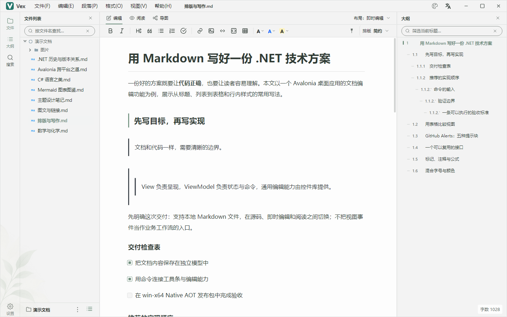
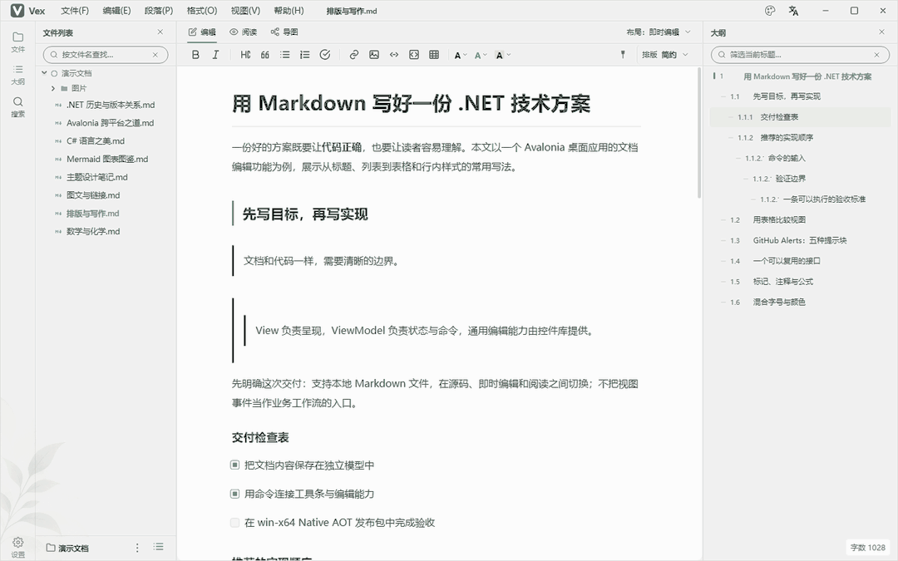
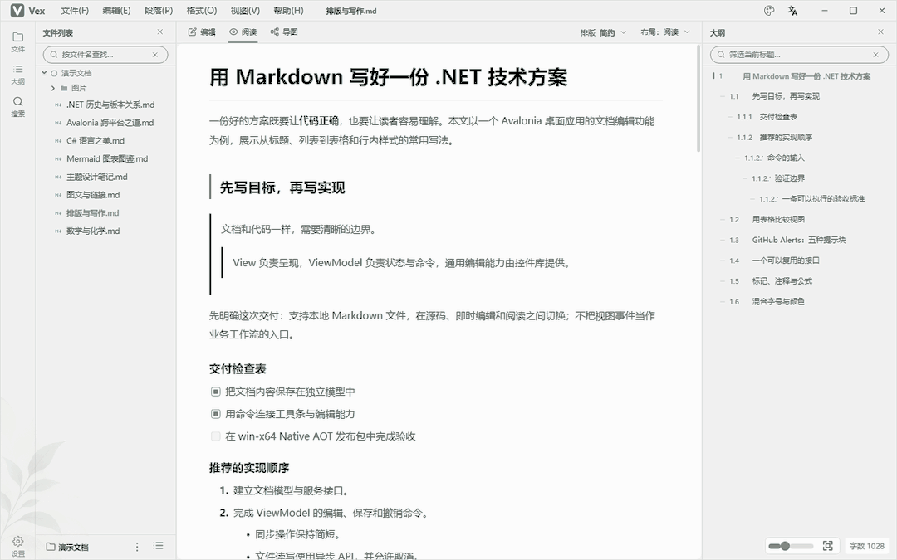
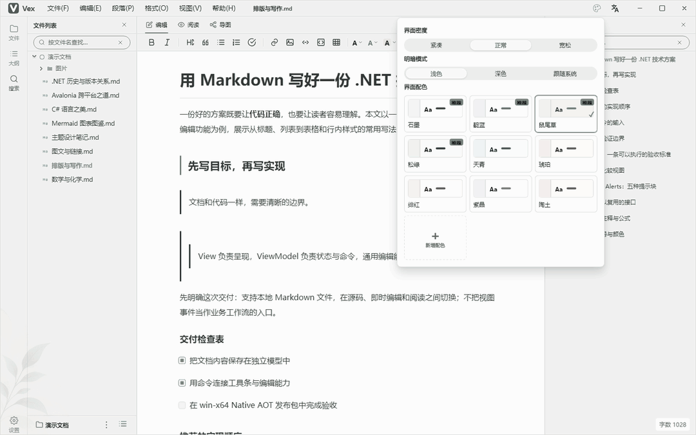

# Vex · 维刻

写下想法，看见脉络。

Vex 是基于 .NET 与 Avalonia 的桌面 Markdown 编辑器，支持 **Windows、Linux、macOS**，围绕本地文件提供即时编辑、源码、阅读、章节导图、导出与本机 MCP 协作。

官网：[vex.codewf.com](https://vex.codewf.com/) · 出品：[码坊 CodeWF](https://codewf.com) · 当前版本：**1.21.1.2**

## 下载

从 [GitHub Releases](https://github.com/dotnet9/Vex/releases/latest) 下载安装包及对应 SHA256：Windows x64 EXE、Linux x64/arm64 DEB、macOS x64/arm64 DMG。

## 功能

- 即时编辑、源码、阅读与章节导图，八种固定布局共享当前文档。
- 本地文件与文件夹、最近记录、大纲、查找替换、自动保存和异常退出草稿恢复。
- Markdown、HTML、PDF、PNG、Word 导出，微信公众号、知乎、稀土掘金复制。
- 九套界面配色、十三套正文排版，支持浅色、深色、跟随系统及四种界面语言。
- 文件夹与大纲折叠、布局、导航和编辑偏好持久化；保存失败、外部变更与恢复草稿有独立保护流程。
- 本机 MCP 服务提供 29 个工具，支持访问范围、修改确认、审计和 stdio 桥接。

源码与即时编辑提供选区字号、前景色和背景色，样式以 Markdown 中的行内标记保存。Mermaid 支持 24 类图表，单击即可在图表上方编辑源码，点击正文后提交并收起。单阅读正文会随窗口扩展，最大可达当前显示器宽度的一半。

应用能力与验证边界见 [快速开始](docs/快速开始.md) 和 [验收记录](docs/验收与已知限制.md)。

## 界面

以下 PNG 与 GIF 采集于 2026-11-08 的本地验收构建（采集时版本元数据 1.21.1.1，CodeWF.Avalonia 12.1.5.2 / Toolkit 1.1.6）。素材来自真实 Avalonia 控件，GIF 是连续交互帧；所示菜单与阅读大纲修复纳入 1.21.1.2，安装包及发布状态以对应 GitHub Release 为准。更多操作见[快速开始](docs/快速开始.md)，采集与验证边界见[截图说明](docs/图片/截图说明.md)。

### 从写作到阅读

即时编辑、源码与阅读对照、单阅读和导图在同一工作区切换：

### 大纲与阅读位置

点击章节定位；继续滚动阅读时，大纲更新当前章节。同一个节点可以重复激活，也支持 Enter / Space。阅读跟随只更新状态，不抢正文焦点；此处演示的是阅读预览视口。

### 外观切换

界面配色与明暗模式即时切换，正文排版可独立选择：

| 源码与阅读对照 | 文档导图 |
| --- | --- |
|  |  |

| 配色与外观 | 正文排版 |
| --- | --- |
|  |  |

## 原型与文档

桌面及三平台安装原型在 [design](design/index.html)，应用已接入 9 套配色、13 套正文排版及对应工作区交互。运行 `node design/scripts/preview.cjs` 后打开 http://127.0.0.1:4317/design/ 。视觉对照和跨平台验证范围见验收文档。

- [仓库学习入口](docs/仓库学习文档.md)
- [需求文档](docs/需求文档.md) · [概要设计](docs/概要设计.md) · [详细设计](docs/详细设计.md)
- [原型与资源](docs/原型与资源.md) · [Markdown 示例](docs/Markdown功能示例.md)
- [开发与验证](docs/开发与验证.md) · [发布流程](docs/安装与发布.md)
- [MCP 使用与接口](docs/MCP接口.md) · [更新日志](docs/更新日志.md) · [鸣谢](docs/鸣谢.md)

## 运行

~~~powershell
# 默认消费正式 NuGet 包；按 global.json 安装对应 .NET 11 RC SDK。
$vexWorkRoot = 'D:/github/temp_files/vex-dev'
dotnet restore Vex.slnx "-p:ArtifactsPath=$vexWorkRoot/artifacts"
dotnet build Vex.slnx --no-restore -v:minimal "-p:ArtifactsPath=$vexWorkRoot/artifacts"
dotnet run --project src/Vex/Vex.csproj -f net11.0 --no-restore "-p:ArtifactsPath=$vexWorkRoot/artifacts"
~~~

应用版本在 Directory.Build.props，框架默认值在 build/ProjectDefaults.props，依赖版本变量在 build/Versions.props，Directory.Packages.props 维护中央包声明，SDK 由 global.json 选择。主分支使用 .NET 11 RC；Win7 历史兼容基线冻结在 win7-archive，不再维护。应用图标以根目录 logo.svg、logo.png、logo.ico 为源；共享库经 NuGet 消费，本地联调和五 RID NativeAOT 发布见开发文档。

## 许可证

项目使用 [MIT](LICENSE)。依赖与维护者见 [鸣谢](docs/鸣谢.md)，浏览器原型本地依赖见 [许可说明](design/Third-Party-Licenses.html)。
