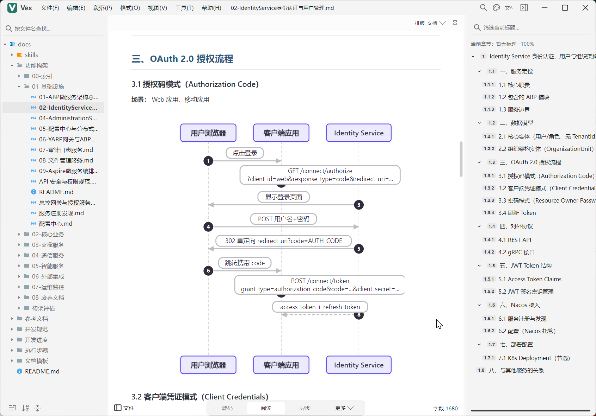

# Vex · 维刻

写下想法，看见脉络。

Vex 是基于 .NET 10 与 Avalonia 12 的桌面 Markdown 编辑器，支持 **Windows、Linux、macOS**，围绕本地文件提供即时编辑、源码、阅读、章节导图、导出与本机 MCP 协作。

官网：[vex.codewf.com](https://vex.codewf.com/) · 作者：沙漠尽头的狼 · 出品：[码坊 CodeWF](https://codewf.com) · 当前版本：**1.7.3**

## 下载

从 [GitHub Releases](https://github.com/dotnet9/Vex/releases/latest) 下载安装包及对应 SHA256：Windows x64 EXE、Linux x64/arm64 DEB、macOS x64/arm64 DMG。

## 功能

- 即时编辑、源码、阅读与章节导图，八种固定布局及独立视图窗口，共享当前文档。
- 本地文件与文件夹、最近记录、大纲、查找替换、自动保存和恢复草稿。
- Markdown、HTML、PDF、PNG、Word 导出，微信公众号、知乎、稀土掘金复制。
- 十六套界面配色、二十七套正文排版，支持浅色、深色、跟随系统及四种界面语言。
- 文件夹与大纲折叠、布局、导航和编辑偏好持久化；保存失败、外部变更与恢复草稿有独立保护流程。
- 本机 MCP 服务提供 29 个工具，支持访问范围、修改确认、审计和 stdio 桥接。

应用能力与验证边界见 [快速开始](docs/快速开始.md) 和 [验收记录](docs/验收与已知限制.md)。

## 原型与文档

桌面及三平台安装原型在 [design](design/index.html)，应用已接入 9 套配色、12 套正文排版及对应工作区交互。运行 `node design/scripts/preview.cjs` 后打开 http://127.0.0.1:4317/design/ 。视觉对照和跨平台验证范围见验收文档。

- [仓库学习入口](docs/README.md)
- [需求文档](docs/需求文档.md) · [概要设计](docs/概要设计.md) · [详细设计](docs/详细设计.md)
- [原型与资源](docs/原型与资源.md) · [Markdown 示例](docs/Markdown功能示例.md)
- [开发与验证](docs/开发与验证.md) · [发布流程](docs/安装与发布.md)
- [MCP 使用与接口](docs/MCP接口.md) · [更新日志](docs/更新日志.md) · [鸣谢](docs/鸣谢.md)

## 运行

在 Windows 根目录运行 `start.bat`，自动还原、构建并启动桌面程序做本地测试；可传入文档路径，例如 `start.bat "docs\快速开始.md"`。跨平台使用 `pwsh ./start.ps1`，Release 模式使用 `-Configuration Release`。中间产物默认位于仓库根目录相对路径 `../../temp_files/vex-start`，避免与其他构建共用输出，也可用 `-ArtifactsPath <目录>` 指定。

~~~powershell
$vexWorkRoot = 'E:/github/temp_files/vex-learning'
dotnet restore Vex.slnx "-p:ArtifactsPath=$vexWorkRoot/artifacts"
dotnet build Vex.slnx --no-restore -v:minimal "-p:ArtifactsPath=$vexWorkRoot/artifacts"
dotnet run --project src/Vex/Vex.csproj -f net10.0 --no-restore "-p:ArtifactsPath=$vexWorkRoot/artifacts"
~~~

版本与编译属性在 Directory.Build.props，NuGet 中央包版本在 Directory.Packages.props，SDK 由 global.json 选择。应用图标以根目录 logo.svg、logo.png、logo.ico 为源；共享库经 NuGet 消费，本地联调和五 RID NativeAOT 发布见开发文档。

发布入口 `publish_all.bat` 默认只列出平台，与 `publish_all.bat list` 相同；传入 `Win`、`Linux`、`osx` 按本机架构发布安装包，也可指定完整 RID。`publish_all.bat all` 依次发布全部五个 RID，并为每个载荷生成 zip 与校验文件。Linux/macOS 使用 `pwsh ./publish.ps1 Linux` 或 `pwsh ./publish.ps1 osx`。NativeAOT 需在匹配的系统和架构上执行，详见 [发布流程](docs/安装与发布.md)。

## 许可证

项目使用 [MIT](LICENSE)。依赖与维护者见 [鸣谢](docs/鸣谢.md)，浏览器原型本地依赖见 [许可说明](design/Third-Party-Licenses.html)。
