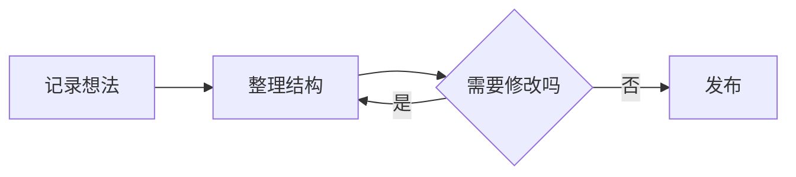
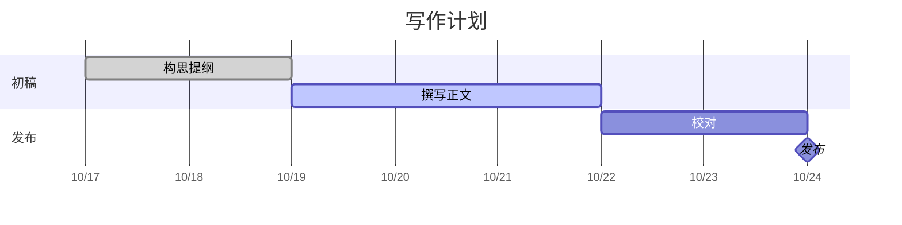
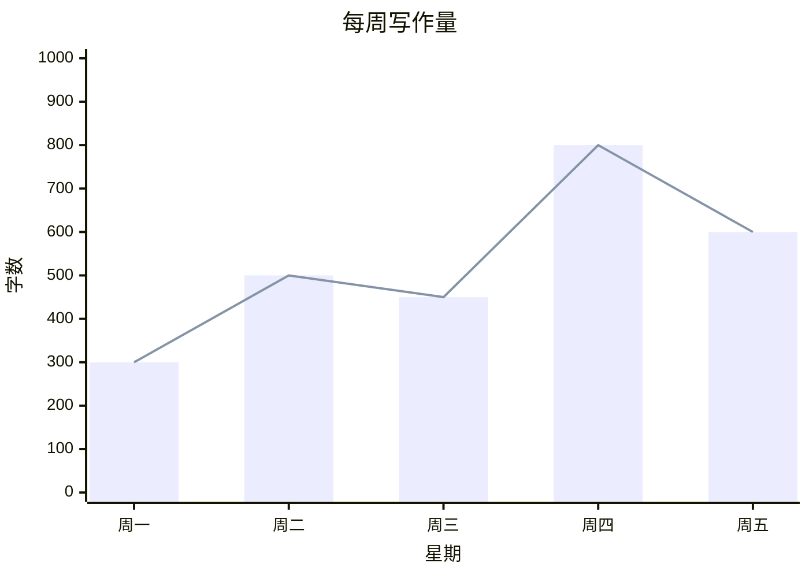

# Markdown 阅读与编辑练习

先另存一份练习稿，尝试源码、即时编辑、阅读、导图与导出。公式、图表和复杂块的能力以实际引擎及导出结果为准；本篇是样例，不是全部兼容性证明。

## 标题、文字与列表

普通正文支持 **粗体**、*斜体*、~~删除线~~、链接与行内代码。引用可补充说明：

> 写下想法，看见脉络。

- 第一层条目
  - 第二层条目
- [x] 创建练习文档
- [ ] 检查不同视图的内容一致

## 内容自适应表格

观察第一列短标签与长说明的宽度分配；不要将三列强制等宽。

| 负责方 | 职责 | 示例 |
| --- | --- | --- |
| 文档核心 | 维护原文、结构和撤销，向各视图提供一致内容 | 修改章节名称后同步源码、大纲与导图 |
| 编辑器 | 接收输入、处理选区和中文候选，生成可撤销的编辑动作 | 即时编辑、源码、查找替换与表格 |
| 应用 | 文件读写、偏好、窗口、导出与本机协作 | 已有文件自动保存；保存失败时保留内容 |

## 数学与化学

行内公式 $E=mc^2$，块公式：

$$
x=\frac{-b\pm\sqrt{b^2-4ac}}{2a}
$$

化学表达示例：$\ce{2H2 + O2 -> 2H2O}$。分别开关数学和化学偏好，检查源文未变化；导出 PDF / Word 后另行查看公式结果。

## 代码与图表

~~~csharp
var thought = "写下想法";
Console.WriteLine(thought);
~~~

~~~mermaid
flowchart LR
  A[写下想法] --> B[整理章节]
  B --> C[阅读与分享]
~~~

## 提示与脚注

> [!INFO]
> 在当前引擎支持时显示为提示框。

正文中的脚注引用[^practice]。

[^practice]: 练习后检查引用和脚注的定位。

## 练习任务

1. 编辑一句正文，撤销再重做。
2. 用大纲或导图定位本节，观察其他视图。
3. 分别选择两套排版和浅深模式，检查表格没有退回等宽。
4. 保存副本，导出 HTML、PDF、PNG、Word 并打开检查。
5. 关闭未保存副本时分别检查保存、放弃、取消。

更多操作见 [快速开始](快速开始.md)，规格与边界见 [需求说明](需求文档.md)。

## Mermaid 图表图鉴

Markdown 的普通语法不定义图表。Vex 原型使用本地 Mermaid 11.12.0，将标记为 `mermaid` 的围栏代码块渲染成图。插入菜单提供下列 22 种模板；左侧“Mermaid 图表图鉴.md”可集中查看、切换源码并修改。

### 选哪种图

| 适合表达什么 | 图表 | 代码起始标记 |
| --- | --- | --- |
| 步骤、条件与分支 | 流程图 | `flowchart` / `graph` |
| 参与者之间的消息 | 时序图 | `sequenceDiagram` |
| 对象状态的转换 | 状态图 | `stateDiagram-v2` |
| 使用步骤与体验评分 | 用户旅程图 | `journey` |
| 任务、工期、依赖、里程碑 | 甘特图 | `gantt` |
| 事件的先后演变 | 时间线 | `timeline` |
| 提交、分支与合并 | Git 分支图 | `gitGraph` |
| 待办与进行中的任务 | 看板 | `kanban` |
| 类型、属性与方法关系 | 类图 | `classDiagram` |
| 数据实体、字段与基数 | 实体关系图 | `erDiagram` |
| 需求与验证、满足关系 | 需求图 | `requirementDiagram` |
| 层次与发散思考 | 思维导图 | `mindmap` |
| 简单模块的排列和连接 | 块图 | `block-beta` |
| 人员、系统、容器与组件 | C4 架构图 | `C4Context` / 其他 C4 层级 |
| 服务、分组与资源连接 | 架构图 | `architecture-beta` |
| 二进制消息字段 | 数据包图 | `packet-beta` |
| 部分占整体的比例 | 饼图 | `pie` |
| 两个维度的优先级 | 象限图 | `quadrantChart` |
| 数值随类别的变化 | XY 坐标图（柱状、折线） | `xychart-beta` |
| 数量从哪里来、流向哪里 | 桑基图 | `sankey-beta` |
| 多维度能力或方案对比 | 雷达图 | `radar-beta` |
| 层级数据的面积占比 | 矩形树图 | `treemap-beta` |

最常用的入口是流程、时序、状态、类、ER、思维导图、甘特、饼图和柱状 / 折线。C4、架构图和带 `-beta` 的语法对引擎版本更敏感。

### 常用写法

````markdown

````

甘特图建议明确日期格式、简短刻度和刻度间隔。短计划按天，长期计划按周或月；任务数量多时增加图高。

````markdown

````

XY 坐标图中带中文、空格的文字使用引号：

````markdown

````

### 显示与兼容范围

- 阅读与即时编辑使用同一字体、主题资源和图表配置。文字测量与最终显示使用同一字体；图表按正文可用宽度等比缩放，完整显示，不出现图表内部滚动条。需要更大文字时，可调整图表源码和布局。
- 甘特图保留足够任务和日期空间；C4 类型标签按自然字宽显示；XY 标题、刻度和轴标题留出独立间距。浅深色及配色切换不重新创建 SVG。
- 模板可渲染表示相应样例通过，不代表全部语法、子类型、复杂布局、外部图标或所有导出格式兼容。原型只使用随仓库提供的本地依赖；不自动加载外部图标包。
- Avalonia 应用使用 CodeWF.Avalonia.Markdown 内的图表能力，其渲染链路与浏览器原型不同。原型菜单是产品设计范围；应用和 PDF、PNG、HTML、Word 输出需分别验收，不能直接据此宣称 22 类完整兼容。
- 语法错误保留原文；即时编辑预览保留上一次成功图形并提示错误位置，修正后重新生成。原型图鉴的全部模板可用于后续应用兼容性验收。

原型与离线资源见 [原型与资源](原型与资源.md)，操作见 [快速开始](快速开始.md)。
