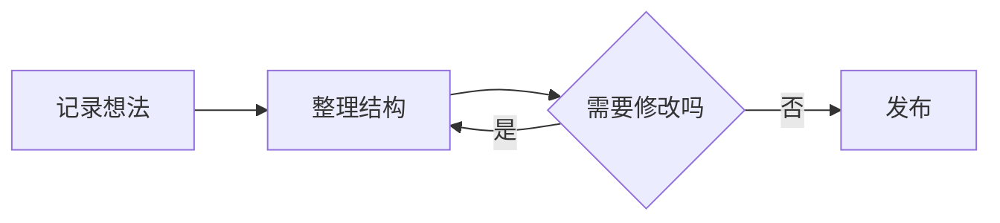
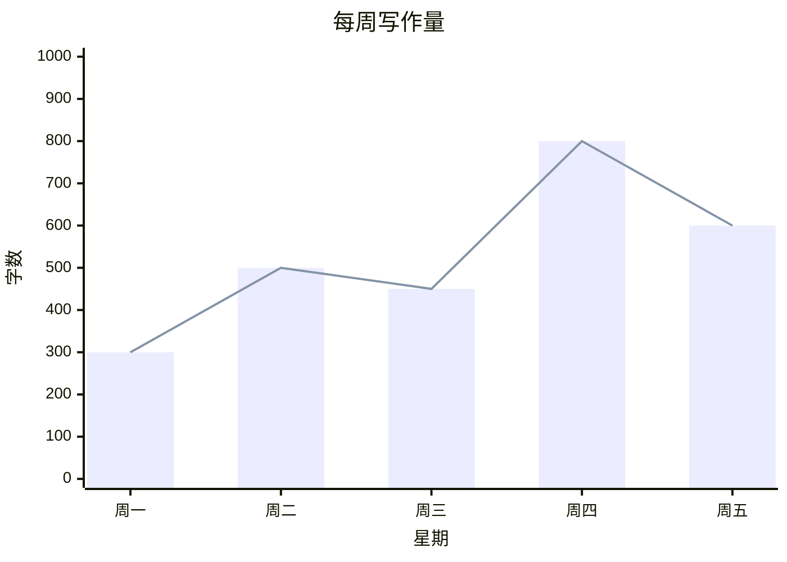
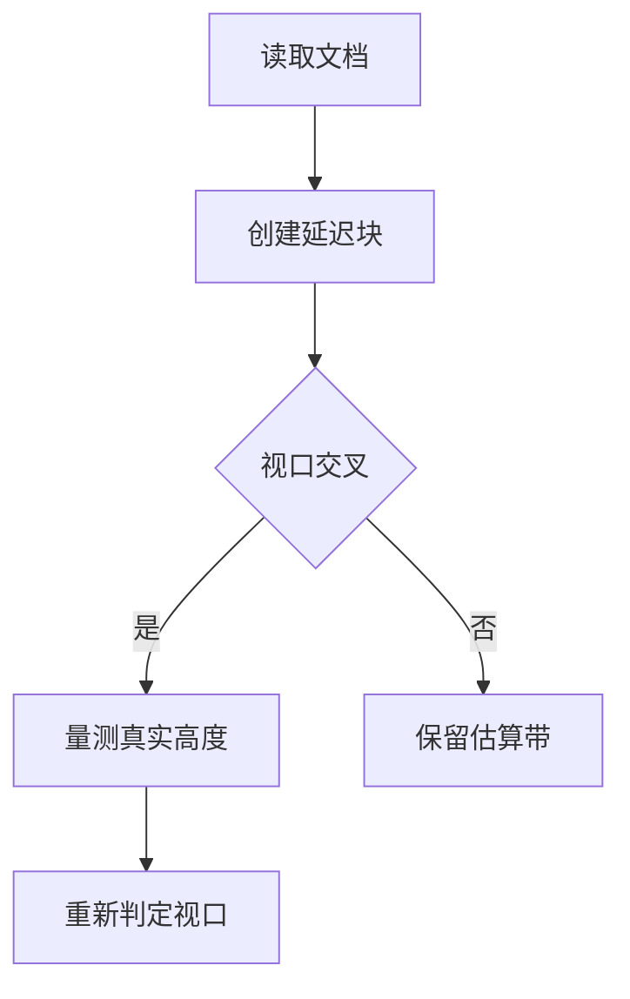

# Markdown 阅读与编辑练习

先另存一份练习稿，尝试源码、即时编辑、阅读、导图与导出。本文同时是阅读布局回归夹具：先检查下列元素矩阵，再从文末“长文压力样本”连续跳滚、缩扩窗口。公式、图表和复杂块的能力以实际引擎及导出结果为准；明确标为“降级”的语法只用于确认不崩溃、不空白，不代表完整视觉支持。

## [TOC] 动态目录导航

使用 '[TOC]' 支持动态目录导航

[TOC]

## 支持元素与布局验收矩阵

| 类别 | 本文覆盖的语法 | 阅读视图 | 需要重点观察的布局行为 |
| --- | --- | --- | --- |
| 文档元数据 | YAML front matter | 专用卡片 | 切换文档后元数据卡片高度变化 |
| 标题 | H1–H6、重复标题 | 完整支持 | 量测后行高变化推动后续条目 |
| 段落与行内 | 粗体、斜体、粗斜体、删除线、高亮、上下标、行内码 | 完整支持 | 混合字号的自然基线与换行 |
| 换行与转义 | 软换行、硬换行、反斜杠、HTML 实体 | 完整支持 | 超宽行内码与换行后的高度收敛 |
| 链接 | 行内、引用式、自动链接、图片链接 | 完整支持 | 长链接换行与本地相对路径 |
| 图片 | 行内图、单图段、多图幻灯片 | 完整支持 | 后台解码导致异步变高 |
| 列表 | 无序、有序、嵌套、任务列表、定义列表 | 常规列表完整；定义列表按引擎兼容口径 | 深层缩进与任务标记宽度 |
| 引用 | 普通引用、嵌套引用、五类 GitHub Alert | 完整支持 | 引用边框、提示块与前后段间距 |
| 代码 | 反引号围栏、波浪号围栏、缩进代码、语言标签 | 完整支持 | 长行滚动、代码工具条与重块缓存 |
| 表格 | Pipe Table、对齐、Grid Table、单元格图片 | Pipe Table 完整；Grid Table 按引擎兼容口径 | 列宽收敛、换行、表头与单元格装饰 |
| 公式 | 行内公式、块公式、矩阵 | 完整支持 | 异步排版与基线变化 |
| 化学 | `\ce`、`\pu`、普通上下标 | 完整支持 | 与数学偏好联动 |
| 扩展行内 | Ruby、脚注引用、任务标记 | 完整支持 | 小字号与基线、脚注定位 |
| 有限 HTML | `span`、`br`、`a`；任意 HTML 仅安全降级 | 白名单样式支持 | 字号/颜色变化与脚本隔离 |
| 特殊块 | `[TOC]`、单图段、多图幻灯片 | 完整支持 | 目录高度、图片异步尺寸 |
| 图表 | Mermaid 围栏块 | 能力包延迟创建 | SVG 异步生成、错误回退与高度变化 |
| 边界语法 | Custom Container、Figure、Citation 等扩展容器 | 解析或降级，不承诺专门视觉 | 确认不产生稳定空白或死循环 |

## 标题、文字与列表

普通正文支持 **粗体**、*斜体*、***粗斜体***、~~删除线~~、==高亮==、H~2~O、n^2^、链接与行内代码。本段故意放入很长的行内代码，检查阅读区按内容换行而不是被固定列宽截断：`inp-chk    british    cmpress    rstplt2    1.5    2`。

#### 四级标题

##### 五级标题

###### 六级标题

软换行会在这里发生，
这一行仍属于同一段落。

硬换行在这里发生。\
下一行从新的视觉行开始。

转义字符应保持原文语义：\*不是强调\*、\|、\\；实体应显示为 &amp; 与 &lt;tag&gt;。

> 普通引用第一层。
>
> > 嵌套引用第二层。
> >
> > > 第三层引用仍应完整显示。

引用可补充说明：

> 写下想法，看见脉络。

---

- 第一层条目
  - 第二层条目
    - 第三层条目
      1. 第四层有序条目
      2. 下一项
  - [x] 已完成任务
  - [ ] 未完成任务
- [x] 创建练习文档
- [ ] 检查不同视图的内容一致

术语
: 定义列表用于解释术语；这里同时检查解析与降级路径。

AXAML
: Avalonia 的声明式界面标记语言。

## 链接、图片与特殊块

阅读 [Microsoft .NET 文档](https://learn.microsoft.com/dotnet/)，或打开引用式链接 [Avalonia 官方文档][avalonia-doc]。自动链接为 <https://dotnet.microsoft.com/>；本地文档使用 URL 转义：[C# 文章](C%23%20语言之美.md)。

行内图片：。点击图片时应能放大，取消后恢复段落布局。


< >

[avalonia-doc]: https://docs.avaloniaui.net/ "Avalonia 官方文档"

## 内容自适应表格

观察第一列短标签与长说明的宽度分配；不要将三列强制等宽。

| 负责方 | 职责 | 示例 |
| --- | --- | --- |
| 文档核心 | 维护原文、结构和撤销，向各视图提供一致内容 | 修改章节名称后同步源码、大纲与导图 |
| 编辑器 | 接收输入、处理选区和中文候选，生成可撤销的编辑动作 | 即时编辑、源码、查找替换与表格 |
| 应用 | 文件读写、偏好、窗口、导出与本机协作 | 已有文件自动保存；保存失败时保留内容 |

| 左对齐 | 居中 | 右对齐 |
| :--- | :---: | ---: |
| 较短标签 | 较长的居中内容用于触发换行 | 123456789 |
| `A \| B` | **粗体单元格** | 98.76 |

+---------+-----------------------+-----------+
| 实体    | 说明                 | 基数      |
+=========+=======================+===========+
| Vex     | 桌面文档工作台       | 1         |
+---------+-----------------------+-----------+
| Avalonia| 跨平台 UI 框架       | N         |
+---------+-----------------------+-----------+

| 图像 | 说明 |
| --- | --- |
|  | 图片与文字处于同一单元格，检查列宽和异步解码。 |

## 数学、化学与扩展行内

行内公式 $E=mc^2$，块公式：

$$
x=\frac{-b\pm\sqrt{b^2-4ac}}{2a}
$$

矩阵公式用于检查块级量测：

$$
\begin{bmatrix}
a & c & t_x \\
b & d & t_y \\
0 & 0 & 1
\end{bmatrix}
\begin{bmatrix}
x \\ y \\ 1
\end{bmatrix}
=
\begin{bmatrix}
x' \\ y' \\ 1
\end{bmatrix}
$$

化学表达示例：$\ce{2H2 + O2 -> 2H2O}$，物质量写法为 $\pu{1.5 mol L-1}$。普通化学标记还可以写 H~2~O 与 2H~2~ + O~2~ → 2H~2~O。

Ruby 扩展：{汉字|hàn zì} 应与普通文字共享基线。脚注引用见本节末尾[^element-matrix]。

## 有限 HTML 与样式

同一行的<span style="font-size:48px">大字</span>和普通文字应共享自然基线，<span style="font-size:12px">小号说明</span>也应完整显示。

<span style="color:#C92A2A">红色警示文字</span>、<span style="background-color:#FFF3BF">浅黄背景</span>与<span style="color:#1F7A2C;background-color:#ECF7EC">绿底深绿文字</span>用于检查选区前后样式恢复。

换行标记：第一行<br>第二行；链接标记：<a href="https://docs.avaloniaui.net/">Avalonia 文档</a>。

<div>
此段用于确认任意 HTML 只走安全降级，不执行脚本，也不让阅读区产生稳定空白。
</div>

## 代码与图表

~~~csharp
var thought = "写下想法";
Console.WriteLine(thought);
~~~

````text
围栏内部的 ``` 与 $x^2$ 只作为代码字符显示，
不应触发公式、图表或二次围栏解析。
````

    缩进代码同样属于代码块。
    第二行保留前导空格与换行。

~~~mermaid
flowchart LR
  A[写下想法] --> B[整理章节]
  B --> C{需要修改吗}
  C -->|是| B
  C -->|否| D[阅读与分享]
~~~

~~~mermaid
sequenceDiagram
  participant U as 用户
  participant V as Vex
  U->>V: 打开长文档
  V-->>U: 创建延迟块
  U->>V: 跳滚并缩窗
  V-->>U: 量测后重新判定视口
~~~

~~~mermaid
stateDiagram-v2
  [*] --> Loading
  Loading --> Ready: 解析完成
  Ready --> Scrolling: 跳滚
  Scrolling --> Ready: 布局收敛
~~~

## 五类提示与脚注

> [!NOTE]
> 备注：蓝色提示用于补充说明。

> [!TIP]
> 提示：绿色提示用于推荐做法。

> [!IMPORTANT]
> 重要：品牌强调色提示用于不可忽略的步骤。

> [!WARNING]
> 警告：橙色提示用于提醒操作风险。

> [!CAUTION]
> 注意：红色提示用于说明不可逆后果。

正文中的脚注引用[^element-matrix]。

[^element-matrix]: 脚注应能回到引用位置，并在跳滚后保持内容可用。

:::note
自定义容器只作为兼容边界样本，确认未知扩展不会形成空白或执行任意 HTML。
:::


普通正文支持 **粗体**、*斜体*、~~删除线~~、链接与行内代码。引用可补充说明：

> 写下想法，看见脉络。

- 第一层条目
  - 第二层条目
- [x] 创建练习文档
- [ ] 检查不同视图的内容一致

## 内容自适应表格

观察第一列短标签与长说明的宽度分配；不要将三列强制等宽。

| 负责方 | 职责 | 示例 |
| --- | --- | --- |
| 文档核心 | 维护原文、结构和撤销，向各视图提供一致内容 | 修改章节名称后同步源码、大纲与导图 |
| 编辑器 | 接收输入、处理选区和中文候选，生成可撤销的编辑动作 | 即时编辑、源码、查找替换与表格 |
| 应用 | 文件读写、偏好、窗口、导出与本机协作 | 已有文件自动保存；保存失败时保留内容 |

## 数学与化学

行内公式 $E=mc^2$，块公式：

$$
x=\frac{-b\pm\sqrt{b^2-4ac}}{2a}
$$

化学表达示例：$\ce{2H2 + O2 -> 2H2O}$。分别开关数学和化学偏好，检查源文未变化；导出 PDF / Word 后另行查看公式结果。

## 代码与图表

~~~csharp
var thought = "写下想法";
Console.WriteLine(thought);
~~~

~~~mermaid
flowchart LR
  A[写下想法] --> B[整理章节]
  B --> C[阅读与分享]
~~~

## 提示与脚注

> [!INFO]
> 在当前引擎支持时显示为提示框。

将以下脚注源码粘贴到 Vex 中，检查引用与脚注之间的定位：

~~~markdown
正文中的脚注引用[^practice]。

[^practice]: 练习后检查引用和脚注的定位。
~~~

## 练习任务

1. 编辑一句正文，撤销再重做。
2. 用大纲或导图定位本节，观察其他视图。
3. 分别选择两套排版和浅深模式，检查表格没有退回等宽。
4. 保存副本，导出 HTML、PDF、PNG、Word 并打开检查。
5. 关闭未保存副本时分别检查保存、放弃、取消。

更多操作见 [快速开始](快速开始.md)，规格与边界见 [需求说明](需求文档.md)。

## Mermaid 图表图鉴

Markdown 的普通语法不定义图表。Vex 原型使用本地 Mermaid 11.12.0，将标记为 `mermaid` 的围栏代码块渲染成图。插入菜单提供下列 22 种模板；左侧“Mermaid 图表图鉴.md”可集中查看、切换源码并修改。

### 选哪种图

| 适合表达什么 | 图表 | 代码起始标记 |
| --- | --- | --- |
| 步骤、条件与分支 | 流程图 | `flowchart` / `graph` |
| 参与者之间的消息 | 时序图 | `sequenceDiagram` |
| 对象状态的转换 | 状态图 | `stateDiagram-v2` |
| 使用步骤与体验评分 | 用户旅程图 | `journey` |
| 任务、工期、依赖、里程碑 | 甘特图 | `gantt` |
| 事件的先后演变 | 时间线 | `timeline` |
| 提交、分支与合并 | Git 分支图 | `gitGraph` |
| 待办与进行中的任务 | 看板 | `kanban` |
| 类型、属性与方法关系 | 类图 | `classDiagram` |
| 数据实体、字段与基数 | 实体关系图 | `erDiagram` |
| 需求与验证、满足关系 | 需求图 | `requirementDiagram` |
| 层次与发散思考 | 思维导图 | `mindmap` |
| 简单模块的排列和连接 | 块图 | `block-beta` |
| 人员、系统、容器与组件 | C4 架构图 | `C4Context` / 其他 C4 层级 |
| 服务、分组与资源连接 | 架构图 | `architecture-beta` |
| 二进制消息字段 | 数据包图 | `packet-beta` |
| 部分占整体的比例 | 饼图 | `pie` |
| 两个维度的优先级 | 象限图 | `quadrantChart` |
| 数值随类别的变化 | XY 坐标图（柱状、折线） | `xychart-beta` |
| 数量从哪里来、流向哪里 | 桑基图 | `sankey-beta` |
| 多维度能力或方案对比 | 雷达图 | `radar-beta` |
| 层级数据的面积占比 | 矩形树图 | `treemap-beta` |

最常用的入口是流程、时序、状态、类、ER、思维导图、甘特、饼图和柱状 / 折线。C4、架构图和带 `-beta` 的语法对引擎版本更敏感。

### 常用写法

````markdown

````

甘特图建议明确日期格式、简短刻度和刻度间隔。短计划按天，长期计划按周或月；任务数量多时增加图高。

````markdown

````

XY 坐标图中带中文、空格的文字使用引号：

````markdown

````

### 显示与兼容范围

- 阅读与即时编辑使用同一字体、主题资源和图表配置。文字测量与最终显示使用同一字体；图表按正文可用宽度等比缩放，完整显示，不出现图表内部滚动条。需要更大文字时，可调整图表源码和布局。
- 甘特图保留足够任务和日期空间；C4 类型标签按自然字宽显示；XY 标题、刻度和轴标题留出独立间距。浅深色及配色切换不重新创建 SVG。
- 模板可渲染表示相应样例通过，不代表全部语法、子类型、复杂布局、外部图标或所有导出格式兼容。原型只使用随仓库提供的本地依赖；不自动加载外部图标包。
- Avalonia 应用使用 CodeWF.Avalonia.Markdown 内的图表能力，其渲染链路与浏览器原型不同。原型菜单是产品设计范围；应用和 PDF、PNG、HTML、Word 输出需分别验收，不能直接据此宣称 22 类完整兼容。
- 语法错误保留原文；即时编辑预览保留上一次成功图形并提示错误位置，修正后重新生成。原型图鉴的全部模板可用于后续应用兼容性验收。

原型与离线资源见 [原型与资源](原型与资源.md)，操作见 [快速开始](快速开始.md)。

## 长文压力样本

以下内容用于阅读布局回归，不建议逐段编辑。连续重块用于覆盖表格、代码、公式、图片和图表的量测后变高；交错章节用于覆盖跳滚、缩扩窗口、延迟创建与离屏回收。

### 连续表格重块带

#### 连续表格 01

| 序号 | 长说明列 | 状态 | 数值 |
| ---: | --- | :---: | ---: |
| 01-01 | 第 1 组第 1 行，包含较长中文说明、`inline-code-1` 与 **强调内容**，用于触发单元格换行和列宽重新分配。 | 完成 | 1001 |
| 01-02 | 第 1 组第 2 行，包含较长中文说明、`inline-code-2` 与 **强调内容**，用于触发单元格换行和列宽重新分配。 | 完成 | 1002 |
| 01-03 | 第 1 组第 3 行，包含较长中文说明、`inline-code-3` 与 **强调内容**，用于触发单元格换行和列宽重新分配。 | 进行中 | 1003 |
| 01-04 | 第 1 组第 4 行，包含较长中文说明、`inline-code-4` 与 **强调内容**，用于触发单元格换行和列宽重新分配。 | 完成 | 1004 |
| 01-05 | 第 1 组第 5 行，包含较长中文说明、`inline-code-5` 与 **强调内容**，用于触发单元格换行和列宽重新分配。 | 完成 | 1005 |
| 01-06 | 第 1 组第 6 行，包含较长中文说明、`inline-code-6` 与 **强调内容**，用于触发单元格换行和列宽重新分配。 | 进行中 | 1006 |
| 01-07 | 第 1 组第 7 行，包含较长中文说明、`inline-code-7` 与 **强调内容**，用于触发单元格换行和列宽重新分配。 | 完成 | 1007 |
| 01-08 | 第 1 组第 8 行，包含较长中文说明、`inline-code-8` 与 **强调内容**，用于触发单元格换行和列宽重新分配。 | 完成 | 1008 |
| 01-09 | 第 1 组第 9 行，包含较长中文说明、`inline-code-9` 与 **强调内容**，用于触发单元格换行和列宽重新分配。 | 进行中 | 1009 |
| 01-10 | 第 1 组第 10 行，包含较长中文说明、`inline-code-10` 与 **强调内容**，用于触发单元格换行和列宽重新分配。 | 完成 | 1010 |
| 01-11 | 第 1 组第 11 行，包含较长中文说明、`inline-code-11` 与 **强调内容**，用于触发单元格换行和列宽重新分配。 | 完成 | 1011 |
| 01-12 | 第 1 组第 12 行，包含较长中文说明、`inline-code-12` 与 **强调内容**，用于触发单元格换行和列宽重新分配。 | 进行中 | 1012 |
| 01-13 | 第 1 组第 13 行，包含较长中文说明、`inline-code-13` 与 **强调内容**，用于触发单元格换行和列宽重新分配。 | 完成 | 1013 |
| 01-14 | 第 1 组第 14 行，包含较长中文说明、`inline-code-14` 与 **强调内容**，用于触发单元格换行和列宽重新分配。 | 完成 | 1014 |
| 01-15 | 第 1 组第 15 行，包含较长中文说明、`inline-code-15` 与 **强调内容**，用于触发单元格换行和列宽重新分配。 | 进行中 | 1015 |
| 01-16 | 第 1 组第 16 行，包含较长中文说明、`inline-code-16` 与 **强调内容**，用于触发单元格换行和列宽重新分配。 | 完成 | 1016 |
| 01-17 | 第 1 组第 17 行，包含较长中文说明、`inline-code-17` 与 **强调内容**，用于触发单元格换行和列宽重新分配。 | 完成 | 1017 |
| 01-18 | 第 1 组第 18 行，包含较长中文说明、`inline-code-18` 与 **强调内容**，用于触发单元格换行和列宽重新分配。 | 进行中 | 1018 |

#### 连续表格 02

| 序号 | 长说明列 | 状态 | 数值 |
| ---: | --- | :---: | ---: |
| 02-01 | 第 2 组第 1 行，包含较长中文说明、`inline-code-1` 与 **强调内容**，用于触发单元格换行和列宽重新分配。 | 完成 | 2001 |
| 02-02 | 第 2 组第 2 行，包含较长中文说明、`inline-code-2` 与 **强调内容**，用于触发单元格换行和列宽重新分配。 | 完成 | 2002 |
| 02-03 | 第 2 组第 3 行，包含较长中文说明、`inline-code-3` 与 **强调内容**，用于触发单元格换行和列宽重新分配。 | 进行中 | 2003 |
| 02-04 | 第 2 组第 4 行，包含较长中文说明、`inline-code-4` 与 **强调内容**，用于触发单元格换行和列宽重新分配。 | 完成 | 2004 |
| 02-05 | 第 2 组第 5 行，包含较长中文说明、`inline-code-5` 与 **强调内容**，用于触发单元格换行和列宽重新分配。 | 完成 | 2005 |
| 02-06 | 第 2 组第 6 行，包含较长中文说明、`inline-code-6` 与 **强调内容**，用于触发单元格换行和列宽重新分配。 | 进行中 | 2006 |
| 02-07 | 第 2 组第 7 行，包含较长中文说明、`inline-code-7` 与 **强调内容**，用于触发单元格换行和列宽重新分配。 | 完成 | 2007 |
| 02-08 | 第 2 组第 8 行，包含较长中文说明、`inline-code-8` 与 **强调内容**，用于触发单元格换行和列宽重新分配。 | 完成 | 2008 |
| 02-09 | 第 2 组第 9 行，包含较长中文说明、`inline-code-9` 与 **强调内容**，用于触发单元格换行和列宽重新分配。 | 进行中 | 2009 |
| 02-10 | 第 2 组第 10 行，包含较长中文说明、`inline-code-10` 与 **强调内容**，用于触发单元格换行和列宽重新分配。 | 完成 | 2010 |
| 02-11 | 第 2 组第 11 行，包含较长中文说明、`inline-code-11` 与 **强调内容**，用于触发单元格换行和列宽重新分配。 | 完成 | 2011 |
| 02-12 | 第 2 组第 12 行，包含较长中文说明、`inline-code-12` 与 **强调内容**，用于触发单元格换行和列宽重新分配。 | 进行中 | 2012 |
| 02-13 | 第 2 组第 13 行，包含较长中文说明、`inline-code-13` 与 **强调内容**，用于触发单元格换行和列宽重新分配。 | 完成 | 2013 |
| 02-14 | 第 2 组第 14 行，包含较长中文说明、`inline-code-14` 与 **强调内容**，用于触发单元格换行和列宽重新分配。 | 完成 | 2014 |
| 02-15 | 第 2 组第 15 行，包含较长中文说明、`inline-code-15` 与 **强调内容**，用于触发单元格换行和列宽重新分配。 | 进行中 | 2015 |
| 02-16 | 第 2 组第 16 行，包含较长中文说明、`inline-code-16` 与 **强调内容**，用于触发单元格换行和列宽重新分配。 | 完成 | 2016 |
| 02-17 | 第 2 组第 17 行，包含较长中文说明、`inline-code-17` 与 **强调内容**，用于触发单元格换行和列宽重新分配。 | 完成 | 2017 |
| 02-18 | 第 2 组第 18 行，包含较长中文说明、`inline-code-18` 与 **强调内容**，用于触发单元格换行和列宽重新分配。 | 进行中 | 2018 |

#### 连续表格 03

| 序号 | 长说明列 | 状态 | 数值 |
| ---: | --- | :---: | ---: |
| 03-01 | 第 3 组第 1 行，包含较长中文说明、`inline-code-1` 与 **强调内容**，用于触发单元格换行和列宽重新分配。 | 完成 | 3001 |
| 03-02 | 第 3 组第 2 行，包含较长中文说明、`inline-code-2` 与 **强调内容**，用于触发单元格换行和列宽重新分配。 | 完成 | 3002 |
| 03-03 | 第 3 组第 3 行，包含较长中文说明、`inline-code-3` 与 **强调内容**，用于触发单元格换行和列宽重新分配。 | 进行中 | 3003 |
| 03-04 | 第 3 组第 4 行，包含较长中文说明、`inline-code-4` 与 **强调内容**，用于触发单元格换行和列宽重新分配。 | 完成 | 3004 |
| 03-05 | 第 3 组第 5 行，包含较长中文说明、`inline-code-5` 与 **强调内容**，用于触发单元格换行和列宽重新分配。 | 完成 | 3005 |
| 03-06 | 第 3 组第 6 行，包含较长中文说明、`inline-code-6` 与 **强调内容**，用于触发单元格换行和列宽重新分配。 | 进行中 | 3006 |
| 03-07 | 第 3 组第 7 行，包含较长中文说明、`inline-code-7` 与 **强调内容**，用于触发单元格换行和列宽重新分配。 | 完成 | 3007 |
| 03-08 | 第 3 组第 8 行，包含较长中文说明、`inline-code-8` 与 **强调内容**，用于触发单元格换行和列宽重新分配。 | 完成 | 3008 |
| 03-09 | 第 3 组第 9 行，包含较长中文说明、`inline-code-9` 与 **强调内容**，用于触发单元格换行和列宽重新分配。 | 进行中 | 3009 |
| 03-10 | 第 3 组第 10 行，包含较长中文说明、`inline-code-10` 与 **强调内容**，用于触发单元格换行和列宽重新分配。 | 完成 | 3010 |
| 03-11 | 第 3 组第 11 行，包含较长中文说明、`inline-code-11` 与 **强调内容**，用于触发单元格换行和列宽重新分配。 | 完成 | 3011 |
| 03-12 | 第 3 组第 12 行，包含较长中文说明、`inline-code-12` 与 **强调内容**，用于触发单元格换行和列宽重新分配。 | 进行中 | 3012 |
| 03-13 | 第 3 组第 13 行，包含较长中文说明、`inline-code-13` 与 **强调内容**，用于触发单元格换行和列宽重新分配。 | 完成 | 3013 |
| 03-14 | 第 3 组第 14 行，包含较长中文说明、`inline-code-14` 与 **强调内容**，用于触发单元格换行和列宽重新分配。 | 完成 | 3014 |
| 03-15 | 第 3 组第 15 行，包含较长中文说明、`inline-code-15` 与 **强调内容**，用于触发单元格换行和列宽重新分配。 | 进行中 | 3015 |
| 03-16 | 第 3 组第 16 行，包含较长中文说明、`inline-code-16` 与 **强调内容**，用于触发单元格换行和列宽重新分配。 | 完成 | 3016 |
| 03-17 | 第 3 组第 17 行，包含较长中文说明、`inline-code-17` 与 **强调内容**，用于触发单元格换行和列宽重新分配。 | 完成 | 3017 |
| 03-18 | 第 3 组第 18 行，包含较长中文说明、`inline-code-18` 与 **强调内容**，用于触发单元格换行和列宽重新分配。 | 进行中 | 3018 |

#### 连续表格 04

| 序号 | 长说明列 | 状态 | 数值 |
| ---: | --- | :---: | ---: |
| 04-01 | 第 4 组第 1 行，包含较长中文说明、`inline-code-1` 与 **强调内容**，用于触发单元格换行和列宽重新分配。 | 完成 | 4001 |
| 04-02 | 第 4 组第 2 行，包含较长中文说明、`inline-code-2` 与 **强调内容**，用于触发单元格换行和列宽重新分配。 | 完成 | 4002 |
| 04-03 | 第 4 组第 3 行，包含较长中文说明、`inline-code-3` 与 **强调内容**，用于触发单元格换行和列宽重新分配。 | 进行中 | 4003 |
| 04-04 | 第 4 组第 4 行，包含较长中文说明、`inline-code-4` 与 **强调内容**，用于触发单元格换行和列宽重新分配。 | 完成 | 4004 |
| 04-05 | 第 4 组第 5 行，包含较长中文说明、`inline-code-5` 与 **强调内容**，用于触发单元格换行和列宽重新分配。 | 完成 | 4005 |
| 04-06 | 第 4 组第 6 行，包含较长中文说明、`inline-code-6` 与 **强调内容**，用于触发单元格换行和列宽重新分配。 | 进行中 | 4006 |
| 04-07 | 第 4 组第 7 行，包含较长中文说明、`inline-code-7` 与 **强调内容**，用于触发单元格换行和列宽重新分配。 | 完成 | 4007 |
| 04-08 | 第 4 组第 8 行，包含较长中文说明、`inline-code-8` 与 **强调内容**，用于触发单元格换行和列宽重新分配。 | 完成 | 4008 |
| 04-09 | 第 4 组第 9 行，包含较长中文说明、`inline-code-9` 与 **强调内容**，用于触发单元格换行和列宽重新分配。 | 进行中 | 4009 |
| 04-10 | 第 4 组第 10 行，包含较长中文说明、`inline-code-10` 与 **强调内容**，用于触发单元格换行和列宽重新分配。 | 完成 | 4010 |
| 04-11 | 第 4 组第 11 行，包含较长中文说明、`inline-code-11` 与 **强调内容**，用于触发单元格换行和列宽重新分配。 | 完成 | 4011 |
| 04-12 | 第 4 组第 12 行，包含较长中文说明、`inline-code-12` 与 **强调内容**，用于触发单元格换行和列宽重新分配。 | 进行中 | 4012 |
| 04-13 | 第 4 组第 13 行，包含较长中文说明、`inline-code-13` 与 **强调内容**，用于触发单元格换行和列宽重新分配。 | 完成 | 4013 |
| 04-14 | 第 4 组第 14 行，包含较长中文说明、`inline-code-14` 与 **强调内容**，用于触发单元格换行和列宽重新分配。 | 完成 | 4014 |
| 04-15 | 第 4 组第 15 行，包含较长中文说明、`inline-code-15` 与 **强调内容**，用于触发单元格换行和列宽重新分配。 | 进行中 | 4015 |
| 04-16 | 第 4 组第 16 行，包含较长中文说明、`inline-code-16` 与 **强调内容**，用于触发单元格换行和列宽重新分配。 | 完成 | 4016 |
| 04-17 | 第 4 组第 17 行，包含较长中文说明、`inline-code-17` 与 **强调内容**，用于触发单元格换行和列宽重新分配。 | 完成 | 4017 |
| 04-18 | 第 4 组第 18 行，包含较长中文说明、`inline-code-18` 与 **强调内容**，用于触发单元格换行和列宽重新分配。 | 进行中 | 4018 |

#### 连续表格 05

| 序号 | 长说明列 | 状态 | 数值 |
| ---: | --- | :---: | ---: |
| 05-01 | 第 5 组第 1 行，包含较长中文说明、`inline-code-1` 与 **强调内容**，用于触发单元格换行和列宽重新分配。 | 完成 | 5001 |
| 05-02 | 第 5 组第 2 行，包含较长中文说明、`inline-code-2` 与 **强调内容**，用于触发单元格换行和列宽重新分配。 | 完成 | 5002 |
| 05-03 | 第 5 组第 3 行，包含较长中文说明、`inline-code-3` 与 **强调内容**，用于触发单元格换行和列宽重新分配。 | 进行中 | 5003 |
| 05-04 | 第 5 组第 4 行，包含较长中文说明、`inline-code-4` 与 **强调内容**，用于触发单元格换行和列宽重新分配。 | 完成 | 5004 |
| 05-05 | 第 5 组第 5 行，包含较长中文说明、`inline-code-5` 与 **强调内容**，用于触发单元格换行和列宽重新分配。 | 完成 | 5005 |
| 05-06 | 第 5 组第 6 行，包含较长中文说明、`inline-code-6` 与 **强调内容**，用于触发单元格换行和列宽重新分配。 | 进行中 | 5006 |
| 05-07 | 第 5 组第 7 行，包含较长中文说明、`inline-code-7` 与 **强调内容**，用于触发单元格换行和列宽重新分配。 | 完成 | 5007 |
| 05-08 | 第 5 组第 8 行，包含较长中文说明、`inline-code-8` 与 **强调内容**，用于触发单元格换行和列宽重新分配。 | 完成 | 5008 |
| 05-09 | 第 5 组第 9 行，包含较长中文说明、`inline-code-9` 与 **强调内容**，用于触发单元格换行和列宽重新分配。 | 进行中 | 5009 |
| 05-10 | 第 5 组第 10 行，包含较长中文说明、`inline-code-10` 与 **强调内容**，用于触发单元格换行和列宽重新分配。 | 完成 | 5010 |
| 05-11 | 第 5 组第 11 行，包含较长中文说明、`inline-code-11` 与 **强调内容**，用于触发单元格换行和列宽重新分配。 | 完成 | 5011 |
| 05-12 | 第 5 组第 12 行，包含较长中文说明、`inline-code-12` 与 **强调内容**，用于触发单元格换行和列宽重新分配。 | 进行中 | 5012 |
| 05-13 | 第 5 组第 13 行，包含较长中文说明、`inline-code-13` 与 **强调内容**，用于触发单元格换行和列宽重新分配。 | 完成 | 5013 |
| 05-14 | 第 5 组第 14 行，包含较长中文说明、`inline-code-14` 与 **强调内容**，用于触发单元格换行和列宽重新分配。 | 完成 | 5014 |
| 05-15 | 第 5 组第 15 行，包含较长中文说明、`inline-code-15` 与 **强调内容**，用于触发单元格换行和列宽重新分配。 | 进行中 | 5015 |
| 05-16 | 第 5 组第 16 行，包含较长中文说明、`inline-code-16` 与 **强调内容**，用于触发单元格换行和列宽重新分配。 | 完成 | 5016 |
| 05-17 | 第 5 组第 17 行，包含较长中文说明、`inline-code-17` 与 **强调内容**，用于触发单元格换行和列宽重新分配。 | 完成 | 5017 |
| 05-18 | 第 5 组第 18 行，包含较长中文说明、`inline-code-18` 与 **强调内容**，用于触发单元格换行和列宽重新分配。 | 进行中 | 5018 |

#### 连续表格 06

| 序号 | 长说明列 | 状态 | 数值 |
| ---: | --- | :---: | ---: |
| 06-01 | 第 6 组第 1 行，包含较长中文说明、`inline-code-1` 与 **强调内容**，用于触发单元格换行和列宽重新分配。 | 完成 | 6001 |
| 06-02 | 第 6 组第 2 行，包含较长中文说明、`inline-code-2` 与 **强调内容**，用于触发单元格换行和列宽重新分配。 | 完成 | 6002 |
| 06-03 | 第 6 组第 3 行，包含较长中文说明、`inline-code-3` 与 **强调内容**，用于触发单元格换行和列宽重新分配。 | 进行中 | 6003 |
| 06-04 | 第 6 组第 4 行，包含较长中文说明、`inline-code-4` 与 **强调内容**，用于触发单元格换行和列宽重新分配。 | 完成 | 6004 |
| 06-05 | 第 6 组第 5 行，包含较长中文说明、`inline-code-5` 与 **强调内容**，用于触发单元格换行和列宽重新分配。 | 完成 | 6005 |
| 06-06 | 第 6 组第 6 行，包含较长中文说明、`inline-code-6` 与 **强调内容**，用于触发单元格换行和列宽重新分配。 | 进行中 | 6006 |
| 06-07 | 第 6 组第 7 行，包含较长中文说明、`inline-code-7` 与 **强调内容**，用于触发单元格换行和列宽重新分配。 | 完成 | 6007 |
| 06-08 | 第 6 组第 8 行，包含较长中文说明、`inline-code-8` 与 **强调内容**，用于触发单元格换行和列宽重新分配。 | 完成 | 6008 |
| 06-09 | 第 6 组第 9 行，包含较长中文说明、`inline-code-9` 与 **强调内容**，用于触发单元格换行和列宽重新分配。 | 进行中 | 6009 |
| 06-10 | 第 6 组第 10 行，包含较长中文说明、`inline-code-10` 与 **强调内容**，用于触发单元格换行和列宽重新分配。 | 完成 | 6010 |
| 06-11 | 第 6 组第 11 行，包含较长中文说明、`inline-code-11` 与 **强调内容**，用于触发单元格换行和列宽重新分配。 | 完成 | 6011 |
| 06-12 | 第 6 组第 12 行，包含较长中文说明、`inline-code-12` 与 **强调内容**，用于触发单元格换行和列宽重新分配。 | 进行中 | 6012 |
| 06-13 | 第 6 组第 13 行，包含较长中文说明、`inline-code-13` 与 **强调内容**，用于触发单元格换行和列宽重新分配。 | 完成 | 6013 |
| 06-14 | 第 6 组第 14 行，包含较长中文说明、`inline-code-14` 与 **强调内容**，用于触发单元格换行和列宽重新分配。 | 完成 | 6014 |
| 06-15 | 第 6 组第 15 行，包含较长中文说明、`inline-code-15` 与 **强调内容**，用于触发单元格换行和列宽重新分配。 | 进行中 | 6015 |
| 06-16 | 第 6 组第 16 行，包含较长中文说明、`inline-code-16` 与 **强调内容**，用于触发单元格换行和列宽重新分配。 | 完成 | 6016 |
| 06-17 | 第 6 组第 17 行，包含较长中文说明、`inline-code-17` 与 **强调内容**，用于触发单元格换行和列宽重新分配。 | 完成 | 6017 |
| 06-18 | 第 6 组第 18 行，包含较长中文说明、`inline-code-18` 与 **强调内容**，用于触发单元格换行和列宽重新分配。 | 进行中 | 6018 |

#### 连续表格 07

| 序号 | 长说明列 | 状态 | 数值 |
| ---: | --- | :---: | ---: |
| 07-01 | 第 7 组第 1 行，包含较长中文说明、`inline-code-1` 与 **强调内容**，用于触发单元格换行和列宽重新分配。 | 完成 | 7001 |
| 07-02 | 第 7 组第 2 行，包含较长中文说明、`inline-code-2` 与 **强调内容**，用于触发单元格换行和列宽重新分配。 | 完成 | 7002 |
| 07-03 | 第 7 组第 3 行，包含较长中文说明、`inline-code-3` 与 **强调内容**，用于触发单元格换行和列宽重新分配。 | 进行中 | 7003 |
| 07-04 | 第 7 组第 4 行，包含较长中文说明、`inline-code-4` 与 **强调内容**，用于触发单元格换行和列宽重新分配。 | 完成 | 7004 |
| 07-05 | 第 7 组第 5 行，包含较长中文说明、`inline-code-5` 与 **强调内容**，用于触发单元格换行和列宽重新分配。 | 完成 | 7005 |
| 07-06 | 第 7 组第 6 行，包含较长中文说明、`inline-code-6` 与 **强调内容**，用于触发单元格换行和列宽重新分配。 | 进行中 | 7006 |
| 07-07 | 第 7 组第 7 行，包含较长中文说明、`inline-code-7` 与 **强调内容**，用于触发单元格换行和列宽重新分配。 | 完成 | 7007 |
| 07-08 | 第 7 组第 8 行，包含较长中文说明、`inline-code-8` 与 **强调内容**，用于触发单元格换行和列宽重新分配。 | 完成 | 7008 |
| 07-09 | 第 7 组第 9 行，包含较长中文说明、`inline-code-9` 与 **强调内容**，用于触发单元格换行和列宽重新分配。 | 进行中 | 7009 |
| 07-10 | 第 7 组第 10 行，包含较长中文说明、`inline-code-10` 与 **强调内容**，用于触发单元格换行和列宽重新分配。 | 完成 | 7010 |
| 07-11 | 第 7 组第 11 行，包含较长中文说明、`inline-code-11` 与 **强调内容**，用于触发单元格换行和列宽重新分配。 | 完成 | 7011 |
| 07-12 | 第 7 组第 12 行，包含较长中文说明、`inline-code-12` 与 **强调内容**，用于触发单元格换行和列宽重新分配。 | 进行中 | 7012 |
| 07-13 | 第 7 组第 13 行，包含较长中文说明、`inline-code-13` 与 **强调内容**，用于触发单元格换行和列宽重新分配。 | 完成 | 7013 |
| 07-14 | 第 7 组第 14 行，包含较长中文说明、`inline-code-14` 与 **强调内容**，用于触发单元格换行和列宽重新分配。 | 完成 | 7014 |
| 07-15 | 第 7 组第 15 行，包含较长中文说明、`inline-code-15` 与 **强调内容**，用于触发单元格换行和列宽重新分配。 | 进行中 | 7015 |
| 07-16 | 第 7 组第 16 行，包含较长中文说明、`inline-code-16` 与 **强调内容**，用于触发单元格换行和列宽重新分配。 | 完成 | 7016 |
| 07-17 | 第 7 组第 17 行，包含较长中文说明、`inline-code-17` 与 **强调内容**，用于触发单元格换行和列宽重新分配。 | 完成 | 7017 |
| 07-18 | 第 7 组第 18 行，包含较长中文说明、`inline-code-18` 与 **强调内容**，用于触发单元格换行和列宽重新分配。 | 进行中 | 7018 |

#### 连续表格 08

| 序号 | 长说明列 | 状态 | 数值 |
| ---: | --- | :---: | ---: |
| 08-01 | 第 8 组第 1 行，包含较长中文说明、`inline-code-1` 与 **强调内容**，用于触发单元格换行和列宽重新分配。 | 完成 | 8001 |
| 08-02 | 第 8 组第 2 行，包含较长中文说明、`inline-code-2` 与 **强调内容**，用于触发单元格换行和列宽重新分配。 | 完成 | 8002 |
| 08-03 | 第 8 组第 3 行，包含较长中文说明、`inline-code-3` 与 **强调内容**，用于触发单元格换行和列宽重新分配。 | 进行中 | 8003 |
| 08-04 | 第 8 组第 4 行，包含较长中文说明、`inline-code-4` 与 **强调内容**，用于触发单元格换行和列宽重新分配。 | 完成 | 8004 |
| 08-05 | 第 8 组第 5 行，包含较长中文说明、`inline-code-5` 与 **强调内容**，用于触发单元格换行和列宽重新分配。 | 完成 | 8005 |
| 08-06 | 第 8 组第 6 行，包含较长中文说明、`inline-code-6` 与 **强调内容**，用于触发单元格换行和列宽重新分配。 | 进行中 | 8006 |
| 08-07 | 第 8 组第 7 行，包含较长中文说明、`inline-code-7` 与 **强调内容**，用于触发单元格换行和列宽重新分配。 | 完成 | 8007 |
| 08-08 | 第 8 组第 8 行，包含较长中文说明、`inline-code-8` 与 **强调内容**，用于触发单元格换行和列宽重新分配。 | 完成 | 8008 |
| 08-09 | 第 8 组第 9 行，包含较长中文说明、`inline-code-9` 与 **强调内容**，用于触发单元格换行和列宽重新分配。 | 进行中 | 8009 |
| 08-10 | 第 8 组第 10 行，包含较长中文说明、`inline-code-10` 与 **强调内容**，用于触发单元格换行和列宽重新分配。 | 完成 | 8010 |
| 08-11 | 第 8 组第 11 行，包含较长中文说明、`inline-code-11` 与 **强调内容**，用于触发单元格换行和列宽重新分配。 | 完成 | 8011 |
| 08-12 | 第 8 组第 12 行，包含较长中文说明、`inline-code-12` 与 **强调内容**，用于触发单元格换行和列宽重新分配。 | 进行中 | 8012 |
| 08-13 | 第 8 组第 13 行，包含较长中文说明、`inline-code-13` 与 **强调内容**，用于触发单元格换行和列宽重新分配。 | 完成 | 8013 |
| 08-14 | 第 8 组第 14 行，包含较长中文说明、`inline-code-14` 与 **强调内容**，用于触发单元格换行和列宽重新分配。 | 完成 | 8014 |
| 08-15 | 第 8 组第 15 行，包含较长中文说明、`inline-code-15` 与 **强调内容**，用于触发单元格换行和列宽重新分配。 | 进行中 | 8015 |
| 08-16 | 第 8 组第 16 行，包含较长中文说明、`inline-code-16` 与 **强调内容**，用于触发单元格换行和列宽重新分配。 | 完成 | 8016 |
| 08-17 | 第 8 组第 17 行，包含较长中文说明、`inline-code-17` 与 **强调内容**，用于触发单元格换行和列宽重新分配。 | 完成 | 8017 |
| 08-18 | 第 8 组第 18 行，包含较长中文说明、`inline-code-18` 与 **强调内容**，用于触发单元格换行和列宽重新分配。 | 进行中 | 8018 |

#### 连续表格 09

| 序号 | 长说明列 | 状态 | 数值 |
| ---: | --- | :---: | ---: |
| 09-01 | 第 9 组第 1 行，包含较长中文说明、`inline-code-1` 与 **强调内容**，用于触发单元格换行和列宽重新分配。 | 完成 | 9001 |
| 09-02 | 第 9 组第 2 行，包含较长中文说明、`inline-code-2` 与 **强调内容**，用于触发单元格换行和列宽重新分配。 | 完成 | 9002 |
| 09-03 | 第 9 组第 3 行，包含较长中文说明、`inline-code-3` 与 **强调内容**，用于触发单元格换行和列宽重新分配。 | 进行中 | 9003 |
| 09-04 | 第 9 组第 4 行，包含较长中文说明、`inline-code-4` 与 **强调内容**，用于触发单元格换行和列宽重新分配。 | 完成 | 9004 |
| 09-05 | 第 9 组第 5 行，包含较长中文说明、`inline-code-5` 与 **强调内容**，用于触发单元格换行和列宽重新分配。 | 完成 | 9005 |
| 09-06 | 第 9 组第 6 行，包含较长中文说明、`inline-code-6` 与 **强调内容**，用于触发单元格换行和列宽重新分配。 | 进行中 | 9006 |
| 09-07 | 第 9 组第 7 行，包含较长中文说明、`inline-code-7` 与 **强调内容**，用于触发单元格换行和列宽重新分配。 | 完成 | 9007 |
| 09-08 | 第 9 组第 8 行，包含较长中文说明、`inline-code-8` 与 **强调内容**，用于触发单元格换行和列宽重新分配。 | 完成 | 9008 |
| 09-09 | 第 9 组第 9 行，包含较长中文说明、`inline-code-9` 与 **强调内容**，用于触发单元格换行和列宽重新分配。 | 进行中 | 9009 |
| 09-10 | 第 9 组第 10 行，包含较长中文说明、`inline-code-10` 与 **强调内容**，用于触发单元格换行和列宽重新分配。 | 完成 | 9010 |
| 09-11 | 第 9 组第 11 行，包含较长中文说明、`inline-code-11` 与 **强调内容**，用于触发单元格换行和列宽重新分配。 | 完成 | 9011 |
| 09-12 | 第 9 组第 12 行，包含较长中文说明、`inline-code-12` 与 **强调内容**，用于触发单元格换行和列宽重新分配。 | 进行中 | 9012 |
| 09-13 | 第 9 组第 13 行，包含较长中文说明、`inline-code-13` 与 **强调内容**，用于触发单元格换行和列宽重新分配。 | 完成 | 9013 |
| 09-14 | 第 9 组第 14 行，包含较长中文说明、`inline-code-14` 与 **强调内容**，用于触发单元格换行和列宽重新分配。 | 完成 | 9014 |
| 09-15 | 第 9 组第 15 行，包含较长中文说明、`inline-code-15` 与 **强调内容**，用于触发单元格换行和列宽重新分配。 | 进行中 | 9015 |
| 09-16 | 第 9 组第 16 行，包含较长中文说明、`inline-code-16` 与 **强调内容**，用于触发单元格换行和列宽重新分配。 | 完成 | 9016 |
| 09-17 | 第 9 组第 17 行，包含较长中文说明、`inline-code-17` 与 **强调内容**，用于触发单元格换行和列宽重新分配。 | 完成 | 9017 |
| 09-18 | 第 9 组第 18 行，包含较长中文说明、`inline-code-18` 与 **强调内容**，用于触发单元格换行和列宽重新分配。 | 进行中 | 9018 |

#### 连续表格 10

| 序号 | 长说明列 | 状态 | 数值 |
| ---: | --- | :---: | ---: |
| 10-01 | 第 10 组第 1 行，包含较长中文说明、`inline-code-1` 与 **强调内容**，用于触发单元格换行和列宽重新分配。 | 完成 | 10001 |
| 10-02 | 第 10 组第 2 行，包含较长中文说明、`inline-code-2` 与 **强调内容**，用于触发单元格换行和列宽重新分配。 | 完成 | 10002 |
| 10-03 | 第 10 组第 3 行，包含较长中文说明、`inline-code-3` 与 **强调内容**，用于触发单元格换行和列宽重新分配。 | 进行中 | 10003 |
| 10-04 | 第 10 组第 4 行，包含较长中文说明、`inline-code-4` 与 **强调内容**，用于触发单元格换行和列宽重新分配。 | 完成 | 10004 |
| 10-05 | 第 10 组第 5 行，包含较长中文说明、`inline-code-5` 与 **强调内容**，用于触发单元格换行和列宽重新分配。 | 完成 | 10005 |
| 10-06 | 第 10 组第 6 行，包含较长中文说明、`inline-code-6` 与 **强调内容**，用于触发单元格换行和列宽重新分配。 | 进行中 | 10006 |
| 10-07 | 第 10 组第 7 行，包含较长中文说明、`inline-code-7` 与 **强调内容**，用于触发单元格换行和列宽重新分配。 | 完成 | 10007 |
| 10-08 | 第 10 组第 8 行，包含较长中文说明、`inline-code-8` 与 **强调内容**，用于触发单元格换行和列宽重新分配。 | 完成 | 10008 |
| 10-09 | 第 10 组第 9 行，包含较长中文说明、`inline-code-9` 与 **强调内容**，用于触发单元格换行和列宽重新分配。 | 进行中 | 10009 |
| 10-10 | 第 10 组第 10 行，包含较长中文说明、`inline-code-10` 与 **强调内容**，用于触发单元格换行和列宽重新分配。 | 完成 | 10010 |
| 10-11 | 第 10 组第 11 行，包含较长中文说明、`inline-code-11` 与 **强调内容**，用于触发单元格换行和列宽重新分配。 | 完成 | 10011 |
| 10-12 | 第 10 组第 12 行，包含较长中文说明、`inline-code-12` 与 **强调内容**，用于触发单元格换行和列宽重新分配。 | 进行中 | 10012 |
| 10-13 | 第 10 组第 13 行，包含较长中文说明、`inline-code-13` 与 **强调内容**，用于触发单元格换行和列宽重新分配。 | 完成 | 10013 |
| 10-14 | 第 10 组第 14 行，包含较长中文说明、`inline-code-14` 与 **强调内容**，用于触发单元格换行和列宽重新分配。 | 完成 | 10014 |
| 10-15 | 第 10 组第 15 行，包含较长中文说明、`inline-code-15` 与 **强调内容**，用于触发单元格换行和列宽重新分配。 | 进行中 | 10015 |
| 10-16 | 第 10 组第 16 行，包含较长中文说明、`inline-code-16` 与 **强调内容**，用于触发单元格换行和列宽重新分配。 | 完成 | 10016 |
| 10-17 | 第 10 组第 17 行，包含较长中文说明、`inline-code-17` 与 **强调内容**，用于触发单元格换行和列宽重新分配。 | 完成 | 10017 |
| 10-18 | 第 10 组第 18 行，包含较长中文说明、`inline-code-18` 与 **强调内容**，用于触发单元格换行和列宽重新分配。 | 进行中 | 10018 |

#### 连续表格 11

| 序号 | 长说明列 | 状态 | 数值 |
| ---: | --- | :---: | ---: |
| 11-01 | 第 11 组第 1 行，包含较长中文说明、`inline-code-1` 与 **强调内容**，用于触发单元格换行和列宽重新分配。 | 完成 | 11001 |
| 11-02 | 第 11 组第 2 行，包含较长中文说明、`inline-code-2` 与 **强调内容**，用于触发单元格换行和列宽重新分配。 | 完成 | 11002 |
| 11-03 | 第 11 组第 3 行，包含较长中文说明、`inline-code-3` 与 **强调内容**，用于触发单元格换行和列宽重新分配。 | 进行中 | 11003 |
| 11-04 | 第 11 组第 4 行，包含较长中文说明、`inline-code-4` 与 **强调内容**，用于触发单元格换行和列宽重新分配。 | 完成 | 11004 |
| 11-05 | 第 11 组第 5 行，包含较长中文说明、`inline-code-5` 与 **强调内容**，用于触发单元格换行和列宽重新分配。 | 完成 | 11005 |
| 11-06 | 第 11 组第 6 行，包含较长中文说明、`inline-code-6` 与 **强调内容**，用于触发单元格换行和列宽重新分配。 | 进行中 | 11006 |
| 11-07 | 第 11 组第 7 行，包含较长中文说明、`inline-code-7` 与 **强调内容**，用于触发单元格换行和列宽重新分配。 | 完成 | 11007 |
| 11-08 | 第 11 组第 8 行，包含较长中文说明、`inline-code-8` 与 **强调内容**，用于触发单元格换行和列宽重新分配。 | 完成 | 11008 |
| 11-09 | 第 11 组第 9 行，包含较长中文说明、`inline-code-9` 与 **强调内容**，用于触发单元格换行和列宽重新分配。 | 进行中 | 11009 |
| 11-10 | 第 11 组第 10 行，包含较长中文说明、`inline-code-10` 与 **强调内容**，用于触发单元格换行和列宽重新分配。 | 完成 | 11010 |
| 11-11 | 第 11 组第 11 行，包含较长中文说明、`inline-code-11` 与 **强调内容**，用于触发单元格换行和列宽重新分配。 | 完成 | 11011 |
| 11-12 | 第 11 组第 12 行，包含较长中文说明、`inline-code-12` 与 **强调内容**，用于触发单元格换行和列宽重新分配。 | 进行中 | 11012 |
| 11-13 | 第 11 组第 13 行，包含较长中文说明、`inline-code-13` 与 **强调内容**，用于触发单元格换行和列宽重新分配。 | 完成 | 11013 |
| 11-14 | 第 11 组第 14 行，包含较长中文说明、`inline-code-14` 与 **强调内容**，用于触发单元格换行和列宽重新分配。 | 完成 | 11014 |
| 11-15 | 第 11 组第 15 行，包含较长中文说明、`inline-code-15` 与 **强调内容**，用于触发单元格换行和列宽重新分配。 | 进行中 | 11015 |
| 11-16 | 第 11 组第 16 行，包含较长中文说明、`inline-code-16` 与 **强调内容**，用于触发单元格换行和列宽重新分配。 | 完成 | 11016 |
| 11-17 | 第 11 组第 17 行，包含较长中文说明、`inline-code-17` 与 **强调内容**，用于触发单元格换行和列宽重新分配。 | 完成 | 11017 |
| 11-18 | 第 11 组第 18 行，包含较长中文说明、`inline-code-18` 与 **强调内容**，用于触发单元格换行和列宽重新分配。 | 进行中 | 11018 |

#### 连续表格 12

| 序号 | 长说明列 | 状态 | 数值 |
| ---: | --- | :---: | ---: |
| 12-01 | 第 12 组第 1 行，包含较长中文说明、`inline-code-1` 与 **强调内容**，用于触发单元格换行和列宽重新分配。 | 完成 | 12001 |
| 12-02 | 第 12 组第 2 行，包含较长中文说明、`inline-code-2` 与 **强调内容**，用于触发单元格换行和列宽重新分配。 | 完成 | 12002 |
| 12-03 | 第 12 组第 3 行，包含较长中文说明、`inline-code-3` 与 **强调内容**，用于触发单元格换行和列宽重新分配。 | 进行中 | 12003 |
| 12-04 | 第 12 组第 4 行，包含较长中文说明、`inline-code-4` 与 **强调内容**，用于触发单元格换行和列宽重新分配。 | 完成 | 12004 |
| 12-05 | 第 12 组第 5 行，包含较长中文说明、`inline-code-5` 与 **强调内容**，用于触发单元格换行和列宽重新分配。 | 完成 | 12005 |
| 12-06 | 第 12 组第 6 行，包含较长中文说明、`inline-code-6` 与 **强调内容**，用于触发单元格换行和列宽重新分配。 | 进行中 | 12006 |
| 12-07 | 第 12 组第 7 行，包含较长中文说明、`inline-code-7` 与 **强调内容**，用于触发单元格换行和列宽重新分配。 | 完成 | 12007 |
| 12-08 | 第 12 组第 8 行，包含较长中文说明、`inline-code-8` 与 **强调内容**，用于触发单元格换行和列宽重新分配。 | 完成 | 12008 |
| 12-09 | 第 12 组第 9 行，包含较长中文说明、`inline-code-9` 与 **强调内容**，用于触发单元格换行和列宽重新分配。 | 进行中 | 12009 |
| 12-10 | 第 12 组第 10 行，包含较长中文说明、`inline-code-10` 与 **强调内容**，用于触发单元格换行和列宽重新分配。 | 完成 | 12010 |
| 12-11 | 第 12 组第 11 行，包含较长中文说明、`inline-code-11` 与 **强调内容**，用于触发单元格换行和列宽重新分配。 | 完成 | 12011 |
| 12-12 | 第 12 组第 12 行，包含较长中文说明、`inline-code-12` 与 **强调内容**，用于触发单元格换行和列宽重新分配。 | 进行中 | 12012 |
| 12-13 | 第 12 组第 13 行，包含较长中文说明、`inline-code-13` 与 **强调内容**，用于触发单元格换行和列宽重新分配。 | 完成 | 12013 |
| 12-14 | 第 12 组第 14 行，包含较长中文说明、`inline-code-14` 与 **强调内容**，用于触发单元格换行和列宽重新分配。 | 完成 | 12014 |
| 12-15 | 第 12 组第 15 行，包含较长中文说明、`inline-code-15` 与 **强调内容**，用于触发单元格换行和列宽重新分配。 | 进行中 | 12015 |
| 12-16 | 第 12 组第 16 行，包含较长中文说明、`inline-code-16` 与 **强调内容**，用于触发单元格换行和列宽重新分配。 | 完成 | 12016 |
| 12-17 | 第 12 组第 17 行，包含较长中文说明、`inline-code-17` 与 **强调内容**，用于触发单元格换行和列宽重新分配。 | 完成 | 12017 |
| 12-18 | 第 12 组第 18 行，包含较长中文说明、`inline-code-18` 与 **强调内容**，用于触发单元格换行和列宽重新分配。 | 进行中 | 12018 |

#### 连续表格 13

| 序号 | 长说明列 | 状态 | 数值 |
| ---: | --- | :---: | ---: |
| 13-01 | 第 13 组第 1 行，包含较长中文说明、`inline-code-1` 与 **强调内容**，用于触发单元格换行和列宽重新分配。 | 完成 | 13001 |
| 13-02 | 第 13 组第 2 行，包含较长中文说明、`inline-code-2` 与 **强调内容**，用于触发单元格换行和列宽重新分配。 | 完成 | 13002 |
| 13-03 | 第 13 组第 3 行，包含较长中文说明、`inline-code-3` 与 **强调内容**，用于触发单元格换行和列宽重新分配。 | 进行中 | 13003 |
| 13-04 | 第 13 组第 4 行，包含较长中文说明、`inline-code-4` 与 **强调内容**，用于触发单元格换行和列宽重新分配。 | 完成 | 13004 |
| 13-05 | 第 13 组第 5 行，包含较长中文说明、`inline-code-5` 与 **强调内容**，用于触发单元格换行和列宽重新分配。 | 完成 | 13005 |
| 13-06 | 第 13 组第 6 行，包含较长中文说明、`inline-code-6` 与 **强调内容**，用于触发单元格换行和列宽重新分配。 | 进行中 | 13006 |
| 13-07 | 第 13 组第 7 行，包含较长中文说明、`inline-code-7` 与 **强调内容**，用于触发单元格换行和列宽重新分配。 | 完成 | 13007 |
| 13-08 | 第 13 组第 8 行，包含较长中文说明、`inline-code-8` 与 **强调内容**，用于触发单元格换行和列宽重新分配。 | 完成 | 13008 |
| 13-09 | 第 13 组第 9 行，包含较长中文说明、`inline-code-9` 与 **强调内容**，用于触发单元格换行和列宽重新分配。 | 进行中 | 13009 |
| 13-10 | 第 13 组第 10 行，包含较长中文说明、`inline-code-10` 与 **强调内容**，用于触发单元格换行和列宽重新分配。 | 完成 | 13010 |
| 13-11 | 第 13 组第 11 行，包含较长中文说明、`inline-code-11` 与 **强调内容**，用于触发单元格换行和列宽重新分配。 | 完成 | 13011 |
| 13-12 | 第 13 组第 12 行，包含较长中文说明、`inline-code-12` 与 **强调内容**，用于触发单元格换行和列宽重新分配。 | 进行中 | 13012 |
| 13-13 | 第 13 组第 13 行，包含较长中文说明、`inline-code-13` 与 **强调内容**，用于触发单元格换行和列宽重新分配。 | 完成 | 13013 |
| 13-14 | 第 13 组第 14 行，包含较长中文说明、`inline-code-14` 与 **强调内容**，用于触发单元格换行和列宽重新分配。 | 完成 | 13014 |
| 13-15 | 第 13 组第 15 行，包含较长中文说明、`inline-code-15` 与 **强调内容**，用于触发单元格换行和列宽重新分配。 | 进行中 | 13015 |
| 13-16 | 第 13 组第 16 行，包含较长中文说明、`inline-code-16` 与 **强调内容**，用于触发单元格换行和列宽重新分配。 | 完成 | 13016 |
| 13-17 | 第 13 组第 17 行，包含较长中文说明、`inline-code-17` 与 **强调内容**，用于触发单元格换行和列宽重新分配。 | 完成 | 13017 |
| 13-18 | 第 13 组第 18 行，包含较长中文说明、`inline-code-18` 与 **强调内容**，用于触发单元格换行和列宽重新分配。 | 进行中 | 13018 |

#### 连续表格 14

| 序号 | 长说明列 | 状态 | 数值 |
| ---: | --- | :---: | ---: |
| 14-01 | 第 14 组第 1 行，包含较长中文说明、`inline-code-1` 与 **强调内容**，用于触发单元格换行和列宽重新分配。 | 完成 | 14001 |
| 14-02 | 第 14 组第 2 行，包含较长中文说明、`inline-code-2` 与 **强调内容**，用于触发单元格换行和列宽重新分配。 | 完成 | 14002 |
| 14-03 | 第 14 组第 3 行，包含较长中文说明、`inline-code-3` 与 **强调内容**，用于触发单元格换行和列宽重新分配。 | 进行中 | 14003 |
| 14-04 | 第 14 组第 4 行，包含较长中文说明、`inline-code-4` 与 **强调内容**，用于触发单元格换行和列宽重新分配。 | 完成 | 14004 |
| 14-05 | 第 14 组第 5 行，包含较长中文说明、`inline-code-5` 与 **强调内容**，用于触发单元格换行和列宽重新分配。 | 完成 | 14005 |
| 14-06 | 第 14 组第 6 行，包含较长中文说明、`inline-code-6` 与 **强调内容**，用于触发单元格换行和列宽重新分配。 | 进行中 | 14006 |
| 14-07 | 第 14 组第 7 行，包含较长中文说明、`inline-code-7` 与 **强调内容**，用于触发单元格换行和列宽重新分配。 | 完成 | 14007 |
| 14-08 | 第 14 组第 8 行，包含较长中文说明、`inline-code-8` 与 **强调内容**，用于触发单元格换行和列宽重新分配。 | 完成 | 14008 |
| 14-09 | 第 14 组第 9 行，包含较长中文说明、`inline-code-9` 与 **强调内容**，用于触发单元格换行和列宽重新分配。 | 进行中 | 14009 |
| 14-10 | 第 14 组第 10 行，包含较长中文说明、`inline-code-10` 与 **强调内容**，用于触发单元格换行和列宽重新分配。 | 完成 | 14010 |
| 14-11 | 第 14 组第 11 行，包含较长中文说明、`inline-code-11` 与 **强调内容**，用于触发单元格换行和列宽重新分配。 | 完成 | 14011 |
| 14-12 | 第 14 组第 12 行，包含较长中文说明、`inline-code-12` 与 **强调内容**，用于触发单元格换行和列宽重新分配。 | 进行中 | 14012 |
| 14-13 | 第 14 组第 13 行，包含较长中文说明、`inline-code-13` 与 **强调内容**，用于触发单元格换行和列宽重新分配。 | 完成 | 14013 |
| 14-14 | 第 14 组第 14 行，包含较长中文说明、`inline-code-14` 与 **强调内容**，用于触发单元格换行和列宽重新分配。 | 完成 | 14014 |
| 14-15 | 第 14 组第 15 行，包含较长中文说明、`inline-code-15` 与 **强调内容**，用于触发单元格换行和列宽重新分配。 | 进行中 | 14015 |
| 14-16 | 第 14 组第 16 行，包含较长中文说明、`inline-code-16` 与 **强调内容**，用于触发单元格换行和列宽重新分配。 | 完成 | 14016 |
| 14-17 | 第 14 组第 17 行，包含较长中文说明、`inline-code-17` 与 **强调内容**，用于触发单元格换行和列宽重新分配。 | 完成 | 14017 |
| 14-18 | 第 14 组第 18 行，包含较长中文说明、`inline-code-18` 与 **强调内容**，用于触发单元格换行和列宽重新分配。 | 进行中 | 14018 |

#### 连续表格 15

| 序号 | 长说明列 | 状态 | 数值 |
| ---: | --- | :---: | ---: |
| 15-01 | 第 15 组第 1 行，包含较长中文说明、`inline-code-1` 与 **强调内容**，用于触发单元格换行和列宽重新分配。 | 完成 | 15001 |
| 15-02 | 第 15 组第 2 行，包含较长中文说明、`inline-code-2` 与 **强调内容**，用于触发单元格换行和列宽重新分配。 | 完成 | 15002 |
| 15-03 | 第 15 组第 3 行，包含较长中文说明、`inline-code-3` 与 **强调内容**，用于触发单元格换行和列宽重新分配。 | 进行中 | 15003 |
| 15-04 | 第 15 组第 4 行，包含较长中文说明、`inline-code-4` 与 **强调内容**，用于触发单元格换行和列宽重新分配。 | 完成 | 15004 |
| 15-05 | 第 15 组第 5 行，包含较长中文说明、`inline-code-5` 与 **强调内容**，用于触发单元格换行和列宽重新分配。 | 完成 | 15005 |
| 15-06 | 第 15 组第 6 行，包含较长中文说明、`inline-code-6` 与 **强调内容**，用于触发单元格换行和列宽重新分配。 | 进行中 | 15006 |
| 15-07 | 第 15 组第 7 行，包含较长中文说明、`inline-code-7` 与 **强调内容**，用于触发单元格换行和列宽重新分配。 | 完成 | 15007 |
| 15-08 | 第 15 组第 8 行，包含较长中文说明、`inline-code-8` 与 **强调内容**，用于触发单元格换行和列宽重新分配。 | 完成 | 15008 |
| 15-09 | 第 15 组第 9 行，包含较长中文说明、`inline-code-9` 与 **强调内容**，用于触发单元格换行和列宽重新分配。 | 进行中 | 15009 |
| 15-10 | 第 15 组第 10 行，包含较长中文说明、`inline-code-10` 与 **强调内容**，用于触发单元格换行和列宽重新分配。 | 完成 | 15010 |
| 15-11 | 第 15 组第 11 行，包含较长中文说明、`inline-code-11` 与 **强调内容**，用于触发单元格换行和列宽重新分配。 | 完成 | 15011 |
| 15-12 | 第 15 组第 12 行，包含较长中文说明、`inline-code-12` 与 **强调内容**，用于触发单元格换行和列宽重新分配。 | 进行中 | 15012 |
| 15-13 | 第 15 组第 13 行，包含较长中文说明、`inline-code-13` 与 **强调内容**，用于触发单元格换行和列宽重新分配。 | 完成 | 15013 |
| 15-14 | 第 15 组第 14 行，包含较长中文说明、`inline-code-14` 与 **强调内容**，用于触发单元格换行和列宽重新分配。 | 完成 | 15014 |
| 15-15 | 第 15 组第 15 行，包含较长中文说明、`inline-code-15` 与 **强调内容**，用于触发单元格换行和列宽重新分配。 | 进行中 | 15015 |
| 15-16 | 第 15 组第 16 行，包含较长中文说明、`inline-code-16` 与 **强调内容**，用于触发单元格换行和列宽重新分配。 | 完成 | 15016 |
| 15-17 | 第 15 组第 17 行，包含较长中文说明、`inline-code-17` 与 **强调内容**，用于触发单元格换行和列宽重新分配。 | 完成 | 15017 |
| 15-18 | 第 15 组第 18 行，包含较长中文说明、`inline-code-18` 与 **强调内容**，用于触发单元格换行和列宽重新分配。 | 进行中 | 15018 |

#### 连续表格 16

| 序号 | 长说明列 | 状态 | 数值 |
| ---: | --- | :---: | ---: |
| 16-01 | 第 16 组第 1 行，包含较长中文说明、`inline-code-1` 与 **强调内容**，用于触发单元格换行和列宽重新分配。 | 完成 | 16001 |
| 16-02 | 第 16 组第 2 行，包含较长中文说明、`inline-code-2` 与 **强调内容**，用于触发单元格换行和列宽重新分配。 | 完成 | 16002 |
| 16-03 | 第 16 组第 3 行，包含较长中文说明、`inline-code-3` 与 **强调内容**，用于触发单元格换行和列宽重新分配。 | 进行中 | 16003 |
| 16-04 | 第 16 组第 4 行，包含较长中文说明、`inline-code-4` 与 **强调内容**，用于触发单元格换行和列宽重新分配。 | 完成 | 16004 |
| 16-05 | 第 16 组第 5 行，包含较长中文说明、`inline-code-5` 与 **强调内容**，用于触发单元格换行和列宽重新分配。 | 完成 | 16005 |
| 16-06 | 第 16 组第 6 行，包含较长中文说明、`inline-code-6` 与 **强调内容**，用于触发单元格换行和列宽重新分配。 | 进行中 | 16006 |
| 16-07 | 第 16 组第 7 行，包含较长中文说明、`inline-code-7` 与 **强调内容**，用于触发单元格换行和列宽重新分配。 | 完成 | 16007 |
| 16-08 | 第 16 组第 8 行，包含较长中文说明、`inline-code-8` 与 **强调内容**，用于触发单元格换行和列宽重新分配。 | 完成 | 16008 |
| 16-09 | 第 16 组第 9 行，包含较长中文说明、`inline-code-9` 与 **强调内容**，用于触发单元格换行和列宽重新分配。 | 进行中 | 16009 |
| 16-10 | 第 16 组第 10 行，包含较长中文说明、`inline-code-10` 与 **强调内容**，用于触发单元格换行和列宽重新分配。 | 完成 | 16010 |
| 16-11 | 第 16 组第 11 行，包含较长中文说明、`inline-code-11` 与 **强调内容**，用于触发单元格换行和列宽重新分配。 | 完成 | 16011 |
| 16-12 | 第 16 组第 12 行，包含较长中文说明、`inline-code-12` 与 **强调内容**，用于触发单元格换行和列宽重新分配。 | 进行中 | 16012 |
| 16-13 | 第 16 组第 13 行，包含较长中文说明、`inline-code-13` 与 **强调内容**，用于触发单元格换行和列宽重新分配。 | 完成 | 16013 |
| 16-14 | 第 16 组第 14 行，包含较长中文说明、`inline-code-14` 与 **强调内容**，用于触发单元格换行和列宽重新分配。 | 完成 | 16014 |
| 16-15 | 第 16 组第 15 行，包含较长中文说明、`inline-code-15` 与 **强调内容**，用于触发单元格换行和列宽重新分配。 | 进行中 | 16015 |
| 16-16 | 第 16 组第 16 行，包含较长中文说明、`inline-code-16` 与 **强调内容**，用于触发单元格换行和列宽重新分配。 | 完成 | 16016 |
| 16-17 | 第 16 组第 17 行，包含较长中文说明、`inline-code-17` 与 **强调内容**，用于触发单元格换行和列宽重新分配。 | 完成 | 16017 |
| 16-18 | 第 16 组第 18 行，包含较长中文说明、`inline-code-18` 与 **强调内容**，用于触发单元格换行和列宽重新分配。 | 进行中 | 16018 |

#### 连续表格 17

| 序号 | 长说明列 | 状态 | 数值 |
| ---: | --- | :---: | ---: |
| 17-01 | 第 17 组第 1 行，包含较长中文说明、`inline-code-1` 与 **强调内容**，用于触发单元格换行和列宽重新分配。 | 完成 | 17001 |
| 17-02 | 第 17 组第 2 行，包含较长中文说明、`inline-code-2` 与 **强调内容**，用于触发单元格换行和列宽重新分配。 | 完成 | 17002 |
| 17-03 | 第 17 组第 3 行，包含较长中文说明、`inline-code-3` 与 **强调内容**，用于触发单元格换行和列宽重新分配。 | 进行中 | 17003 |
| 17-04 | 第 17 组第 4 行，包含较长中文说明、`inline-code-4` 与 **强调内容**，用于触发单元格换行和列宽重新分配。 | 完成 | 17004 |
| 17-05 | 第 17 组第 5 行，包含较长中文说明、`inline-code-5` 与 **强调内容**，用于触发单元格换行和列宽重新分配。 | 完成 | 17005 |
| 17-06 | 第 17 组第 6 行，包含较长中文说明、`inline-code-6` 与 **强调内容**，用于触发单元格换行和列宽重新分配。 | 进行中 | 17006 |
| 17-07 | 第 17 组第 7 行，包含较长中文说明、`inline-code-7` 与 **强调内容**，用于触发单元格换行和列宽重新分配。 | 完成 | 17007 |
| 17-08 | 第 17 组第 8 行，包含较长中文说明、`inline-code-8` 与 **强调内容**，用于触发单元格换行和列宽重新分配。 | 完成 | 17008 |
| 17-09 | 第 17 组第 9 行，包含较长中文说明、`inline-code-9` 与 **强调内容**，用于触发单元格换行和列宽重新分配。 | 进行中 | 17009 |
| 17-10 | 第 17 组第 10 行，包含较长中文说明、`inline-code-10` 与 **强调内容**，用于触发单元格换行和列宽重新分配。 | 完成 | 17010 |
| 17-11 | 第 17 组第 11 行，包含较长中文说明、`inline-code-11` 与 **强调内容**，用于触发单元格换行和列宽重新分配。 | 完成 | 17011 |
| 17-12 | 第 17 组第 12 行，包含较长中文说明、`inline-code-12` 与 **强调内容**，用于触发单元格换行和列宽重新分配。 | 进行中 | 17012 |
| 17-13 | 第 17 组第 13 行，包含较长中文说明、`inline-code-13` 与 **强调内容**，用于触发单元格换行和列宽重新分配。 | 完成 | 17013 |
| 17-14 | 第 17 组第 14 行，包含较长中文说明、`inline-code-14` 与 **强调内容**，用于触发单元格换行和列宽重新分配。 | 完成 | 17014 |
| 17-15 | 第 17 组第 15 行，包含较长中文说明、`inline-code-15` 与 **强调内容**，用于触发单元格换行和列宽重新分配。 | 进行中 | 17015 |
| 17-16 | 第 17 组第 16 行，包含较长中文说明、`inline-code-16` 与 **强调内容**，用于触发单元格换行和列宽重新分配。 | 完成 | 17016 |
| 17-17 | 第 17 组第 17 行，包含较长中文说明、`inline-code-17` 与 **强调内容**，用于触发单元格换行和列宽重新分配。 | 完成 | 17017 |
| 17-18 | 第 17 组第 18 行，包含较长中文说明、`inline-code-18` 与 **强调内容**，用于触发单元格换行和列宽重新分配。 | 进行中 | 17018 |

#### 连续表格 18

| 序号 | 长说明列 | 状态 | 数值 |
| ---: | --- | :---: | ---: |
| 18-01 | 第 18 组第 1 行，包含较长中文说明、`inline-code-1` 与 **强调内容**，用于触发单元格换行和列宽重新分配。 | 完成 | 18001 |
| 18-02 | 第 18 组第 2 行，包含较长中文说明、`inline-code-2` 与 **强调内容**，用于触发单元格换行和列宽重新分配。 | 完成 | 18002 |
| 18-03 | 第 18 组第 3 行，包含较长中文说明、`inline-code-3` 与 **强调内容**，用于触发单元格换行和列宽重新分配。 | 进行中 | 18003 |
| 18-04 | 第 18 组第 4 行，包含较长中文说明、`inline-code-4` 与 **强调内容**，用于触发单元格换行和列宽重新分配。 | 完成 | 18004 |
| 18-05 | 第 18 组第 5 行，包含较长中文说明、`inline-code-5` 与 **强调内容**，用于触发单元格换行和列宽重新分配。 | 完成 | 18005 |
| 18-06 | 第 18 组第 6 行，包含较长中文说明、`inline-code-6` 与 **强调内容**，用于触发单元格换行和列宽重新分配。 | 进行中 | 18006 |
| 18-07 | 第 18 组第 7 行，包含较长中文说明、`inline-code-7` 与 **强调内容**，用于触发单元格换行和列宽重新分配。 | 完成 | 18007 |
| 18-08 | 第 18 组第 8 行，包含较长中文说明、`inline-code-8` 与 **强调内容**，用于触发单元格换行和列宽重新分配。 | 完成 | 18008 |
| 18-09 | 第 18 组第 9 行，包含较长中文说明、`inline-code-9` 与 **强调内容**，用于触发单元格换行和列宽重新分配。 | 进行中 | 18009 |
| 18-10 | 第 18 组第 10 行，包含较长中文说明、`inline-code-10` 与 **强调内容**，用于触发单元格换行和列宽重新分配。 | 完成 | 18010 |
| 18-11 | 第 18 组第 11 行，包含较长中文说明、`inline-code-11` 与 **强调内容**，用于触发单元格换行和列宽重新分配。 | 完成 | 18011 |
| 18-12 | 第 18 组第 12 行，包含较长中文说明、`inline-code-12` 与 **强调内容**，用于触发单元格换行和列宽重新分配。 | 进行中 | 18012 |
| 18-13 | 第 18 组第 13 行，包含较长中文说明、`inline-code-13` 与 **强调内容**，用于触发单元格换行和列宽重新分配。 | 完成 | 18013 |
| 18-14 | 第 18 组第 14 行，包含较长中文说明、`inline-code-14` 与 **强调内容**，用于触发单元格换行和列宽重新分配。 | 完成 | 18014 |
| 18-15 | 第 18 组第 15 行，包含较长中文说明、`inline-code-15` 与 **强调内容**，用于触发单元格换行和列宽重新分配。 | 进行中 | 18015 |
| 18-16 | 第 18 组第 16 行，包含较长中文说明、`inline-code-16` 与 **强调内容**，用于触发单元格换行和列宽重新分配。 | 完成 | 18016 |
| 18-17 | 第 18 组第 17 行，包含较长中文说明、`inline-code-17` 与 **强调内容**，用于触发单元格换行和列宽重新分配。 | 完成 | 18017 |
| 18-18 | 第 18 组第 18 行，包含较长中文说明、`inline-code-18` 与 **强调内容**，用于触发单元格换行和列宽重新分配。 | 进行中 | 18018 |

#### 连续表格 19

| 序号 | 长说明列 | 状态 | 数值 |
| ---: | --- | :---: | ---: |
| 19-01 | 第 19 组第 1 行，包含较长中文说明、`inline-code-1` 与 **强调内容**，用于触发单元格换行和列宽重新分配。 | 完成 | 19001 |
| 19-02 | 第 19 组第 2 行，包含较长中文说明、`inline-code-2` 与 **强调内容**，用于触发单元格换行和列宽重新分配。 | 完成 | 19002 |
| 19-03 | 第 19 组第 3 行，包含较长中文说明、`inline-code-3` 与 **强调内容**，用于触发单元格换行和列宽重新分配。 | 进行中 | 19003 |
| 19-04 | 第 19 组第 4 行，包含较长中文说明、`inline-code-4` 与 **强调内容**，用于触发单元格换行和列宽重新分配。 | 完成 | 19004 |
| 19-05 | 第 19 组第 5 行，包含较长中文说明、`inline-code-5` 与 **强调内容**，用于触发单元格换行和列宽重新分配。 | 完成 | 19005 |
| 19-06 | 第 19 组第 6 行，包含较长中文说明、`inline-code-6` 与 **强调内容**，用于触发单元格换行和列宽重新分配。 | 进行中 | 19006 |
| 19-07 | 第 19 组第 7 行，包含较长中文说明、`inline-code-7` 与 **强调内容**，用于触发单元格换行和列宽重新分配。 | 完成 | 19007 |
| 19-08 | 第 19 组第 8 行，包含较长中文说明、`inline-code-8` 与 **强调内容**，用于触发单元格换行和列宽重新分配。 | 完成 | 19008 |
| 19-09 | 第 19 组第 9 行，包含较长中文说明、`inline-code-9` 与 **强调内容**，用于触发单元格换行和列宽重新分配。 | 进行中 | 19009 |
| 19-10 | 第 19 组第 10 行，包含较长中文说明、`inline-code-10` 与 **强调内容**，用于触发单元格换行和列宽重新分配。 | 完成 | 19010 |
| 19-11 | 第 19 组第 11 行，包含较长中文说明、`inline-code-11` 与 **强调内容**，用于触发单元格换行和列宽重新分配。 | 完成 | 19011 |
| 19-12 | 第 19 组第 12 行，包含较长中文说明、`inline-code-12` 与 **强调内容**，用于触发单元格换行和列宽重新分配。 | 进行中 | 19012 |
| 19-13 | 第 19 组第 13 行，包含较长中文说明、`inline-code-13` 与 **强调内容**，用于触发单元格换行和列宽重新分配。 | 完成 | 19013 |
| 19-14 | 第 19 组第 14 行，包含较长中文说明、`inline-code-14` 与 **强调内容**，用于触发单元格换行和列宽重新分配。 | 完成 | 19014 |
| 19-15 | 第 19 组第 15 行，包含较长中文说明、`inline-code-15` 与 **强调内容**，用于触发单元格换行和列宽重新分配。 | 进行中 | 19015 |
| 19-16 | 第 19 组第 16 行，包含较长中文说明、`inline-code-16` 与 **强调内容**，用于触发单元格换行和列宽重新分配。 | 完成 | 19016 |
| 19-17 | 第 19 组第 17 行，包含较长中文说明、`inline-code-17` 与 **强调内容**，用于触发单元格换行和列宽重新分配。 | 完成 | 19017 |
| 19-18 | 第 19 组第 18 行，包含较长中文说明、`inline-code-18` 与 **强调内容**，用于触发单元格换行和列宽重新分配。 | 进行中 | 19018 |

#### 连续表格 20

| 序号 | 长说明列 | 状态 | 数值 |
| ---: | --- | :---: | ---: |
| 20-01 | 第 20 组第 1 行，包含较长中文说明、`inline-code-1` 与 **强调内容**，用于触发单元格换行和列宽重新分配。 | 完成 | 20001 |
| 20-02 | 第 20 组第 2 行，包含较长中文说明、`inline-code-2` 与 **强调内容**，用于触发单元格换行和列宽重新分配。 | 完成 | 20002 |
| 20-03 | 第 20 组第 3 行，包含较长中文说明、`inline-code-3` 与 **强调内容**，用于触发单元格换行和列宽重新分配。 | 进行中 | 20003 |
| 20-04 | 第 20 组第 4 行，包含较长中文说明、`inline-code-4` 与 **强调内容**，用于触发单元格换行和列宽重新分配。 | 完成 | 20004 |
| 20-05 | 第 20 组第 5 行，包含较长中文说明、`inline-code-5` 与 **强调内容**，用于触发单元格换行和列宽重新分配。 | 完成 | 20005 |
| 20-06 | 第 20 组第 6 行，包含较长中文说明、`inline-code-6` 与 **强调内容**，用于触发单元格换行和列宽重新分配。 | 进行中 | 20006 |
| 20-07 | 第 20 组第 7 行，包含较长中文说明、`inline-code-7` 与 **强调内容**，用于触发单元格换行和列宽重新分配。 | 完成 | 20007 |
| 20-08 | 第 20 组第 8 行，包含较长中文说明、`inline-code-8` 与 **强调内容**，用于触发单元格换行和列宽重新分配。 | 完成 | 20008 |
| 20-09 | 第 20 组第 9 行，包含较长中文说明、`inline-code-9` 与 **强调内容**，用于触发单元格换行和列宽重新分配。 | 进行中 | 20009 |
| 20-10 | 第 20 组第 10 行，包含较长中文说明、`inline-code-10` 与 **强调内容**，用于触发单元格换行和列宽重新分配。 | 完成 | 20010 |
| 20-11 | 第 20 组第 11 行，包含较长中文说明、`inline-code-11` 与 **强调内容**，用于触发单元格换行和列宽重新分配。 | 完成 | 20011 |
| 20-12 | 第 20 组第 12 行，包含较长中文说明、`inline-code-12` 与 **强调内容**，用于触发单元格换行和列宽重新分配。 | 进行中 | 20012 |
| 20-13 | 第 20 组第 13 行，包含较长中文说明、`inline-code-13` 与 **强调内容**，用于触发单元格换行和列宽重新分配。 | 完成 | 20013 |
| 20-14 | 第 20 组第 14 行，包含较长中文说明、`inline-code-14` 与 **强调内容**，用于触发单元格换行和列宽重新分配。 | 完成 | 20014 |
| 20-15 | 第 20 组第 15 行，包含较长中文说明、`inline-code-15` 与 **强调内容**，用于触发单元格换行和列宽重新分配。 | 进行中 | 20015 |
| 20-16 | 第 20 组第 16 行，包含较长中文说明、`inline-code-16` 与 **强调内容**，用于触发单元格换行和列宽重新分配。 | 完成 | 20016 |
| 20-17 | 第 20 组第 17 行，包含较长中文说明、`inline-code-17` 与 **强调内容**，用于触发单元格换行和列宽重新分配。 | 完成 | 20017 |
| 20-18 | 第 20 组第 18 行，包含较长中文说明、`inline-code-18` 与 **强调内容**，用于触发单元格换行和列宽重新分配。 | 进行中 | 20018 |

#### 连续表格 21

| 序号 | 长说明列 | 状态 | 数值 |
| ---: | --- | :---: | ---: |
| 21-01 | 第 21 组第 1 行，包含较长中文说明、`inline-code-1` 与 **强调内容**，用于触发单元格换行和列宽重新分配。 | 完成 | 21001 |
| 21-02 | 第 21 组第 2 行，包含较长中文说明、`inline-code-2` 与 **强调内容**，用于触发单元格换行和列宽重新分配。 | 完成 | 21002 |
| 21-03 | 第 21 组第 3 行，包含较长中文说明、`inline-code-3` 与 **强调内容**，用于触发单元格换行和列宽重新分配。 | 进行中 | 21003 |
| 21-04 | 第 21 组第 4 行，包含较长中文说明、`inline-code-4` 与 **强调内容**，用于触发单元格换行和列宽重新分配。 | 完成 | 21004 |
| 21-05 | 第 21 组第 5 行，包含较长中文说明、`inline-code-5` 与 **强调内容**，用于触发单元格换行和列宽重新分配。 | 完成 | 21005 |
| 21-06 | 第 21 组第 6 行，包含较长中文说明、`inline-code-6` 与 **强调内容**，用于触发单元格换行和列宽重新分配。 | 进行中 | 21006 |
| 21-07 | 第 21 组第 7 行，包含较长中文说明、`inline-code-7` 与 **强调内容**，用于触发单元格换行和列宽重新分配。 | 完成 | 21007 |
| 21-08 | 第 21 组第 8 行，包含较长中文说明、`inline-code-8` 与 **强调内容**，用于触发单元格换行和列宽重新分配。 | 完成 | 21008 |
| 21-09 | 第 21 组第 9 行，包含较长中文说明、`inline-code-9` 与 **强调内容**，用于触发单元格换行和列宽重新分配。 | 进行中 | 21009 |
| 21-10 | 第 21 组第 10 行，包含较长中文说明、`inline-code-10` 与 **强调内容**，用于触发单元格换行和列宽重新分配。 | 完成 | 21010 |
| 21-11 | 第 21 组第 11 行，包含较长中文说明、`inline-code-11` 与 **强调内容**，用于触发单元格换行和列宽重新分配。 | 完成 | 21011 |
| 21-12 | 第 21 组第 12 行，包含较长中文说明、`inline-code-12` 与 **强调内容**，用于触发单元格换行和列宽重新分配。 | 进行中 | 21012 |
| 21-13 | 第 21 组第 13 行，包含较长中文说明、`inline-code-13` 与 **强调内容**，用于触发单元格换行和列宽重新分配。 | 完成 | 21013 |
| 21-14 | 第 21 组第 14 行，包含较长中文说明、`inline-code-14` 与 **强调内容**，用于触发单元格换行和列宽重新分配。 | 完成 | 21014 |
| 21-15 | 第 21 组第 15 行，包含较长中文说明、`inline-code-15` 与 **强调内容**，用于触发单元格换行和列宽重新分配。 | 进行中 | 21015 |
| 21-16 | 第 21 组第 16 行，包含较长中文说明、`inline-code-16` 与 **强调内容**，用于触发单元格换行和列宽重新分配。 | 完成 | 21016 |
| 21-17 | 第 21 组第 17 行，包含较长中文说明、`inline-code-17` 与 **强调内容**，用于触发单元格换行和列宽重新分配。 | 完成 | 21017 |
| 21-18 | 第 21 组第 18 行，包含较长中文说明、`inline-code-18` 与 **强调内容**，用于触发单元格换行和列宽重新分配。 | 进行中 | 21018 |

#### 连续表格 22

| 序号 | 长说明列 | 状态 | 数值 |
| ---: | --- | :---: | ---: |
| 22-01 | 第 22 组第 1 行，包含较长中文说明、`inline-code-1` 与 **强调内容**，用于触发单元格换行和列宽重新分配。 | 完成 | 22001 |
| 22-02 | 第 22 组第 2 行，包含较长中文说明、`inline-code-2` 与 **强调内容**，用于触发单元格换行和列宽重新分配。 | 完成 | 22002 |
| 22-03 | 第 22 组第 3 行，包含较长中文说明、`inline-code-3` 与 **强调内容**，用于触发单元格换行和列宽重新分配。 | 进行中 | 22003 |
| 22-04 | 第 22 组第 4 行，包含较长中文说明、`inline-code-4` 与 **强调内容**，用于触发单元格换行和列宽重新分配。 | 完成 | 22004 |
| 22-05 | 第 22 组第 5 行，包含较长中文说明、`inline-code-5` 与 **强调内容**，用于触发单元格换行和列宽重新分配。 | 完成 | 22005 |
| 22-06 | 第 22 组第 6 行，包含较长中文说明、`inline-code-6` 与 **强调内容**，用于触发单元格换行和列宽重新分配。 | 进行中 | 22006 |
| 22-07 | 第 22 组第 7 行，包含较长中文说明、`inline-code-7` 与 **强调内容**，用于触发单元格换行和列宽重新分配。 | 完成 | 22007 |
| 22-08 | 第 22 组第 8 行，包含较长中文说明、`inline-code-8` 与 **强调内容**，用于触发单元格换行和列宽重新分配。 | 完成 | 22008 |
| 22-09 | 第 22 组第 9 行，包含较长中文说明、`inline-code-9` 与 **强调内容**，用于触发单元格换行和列宽重新分配。 | 进行中 | 22009 |
| 22-10 | 第 22 组第 10 行，包含较长中文说明、`inline-code-10` 与 **强调内容**，用于触发单元格换行和列宽重新分配。 | 完成 | 22010 |
| 22-11 | 第 22 组第 11 行，包含较长中文说明、`inline-code-11` 与 **强调内容**，用于触发单元格换行和列宽重新分配。 | 完成 | 22011 |
| 22-12 | 第 22 组第 12 行，包含较长中文说明、`inline-code-12` 与 **强调内容**，用于触发单元格换行和列宽重新分配。 | 进行中 | 22012 |
| 22-13 | 第 22 组第 13 行，包含较长中文说明、`inline-code-13` 与 **强调内容**，用于触发单元格换行和列宽重新分配。 | 完成 | 22013 |
| 22-14 | 第 22 组第 14 行，包含较长中文说明、`inline-code-14` 与 **强调内容**，用于触发单元格换行和列宽重新分配。 | 完成 | 22014 |
| 22-15 | 第 22 组第 15 行，包含较长中文说明、`inline-code-15` 与 **强调内容**，用于触发单元格换行和列宽重新分配。 | 进行中 | 22015 |
| 22-16 | 第 22 组第 16 行，包含较长中文说明、`inline-code-16` 与 **强调内容**，用于触发单元格换行和列宽重新分配。 | 完成 | 22016 |
| 22-17 | 第 22 组第 17 行，包含较长中文说明、`inline-code-17` 与 **强调内容**，用于触发单元格换行和列宽重新分配。 | 完成 | 22017 |
| 22-18 | 第 22 组第 18 行，包含较长中文说明、`inline-code-18` 与 **强调内容**，用于触发单元格换行和列宽重新分配。 | 进行中 | 22018 |

#### 连续表格 23

| 序号 | 长说明列 | 状态 | 数值 |
| ---: | --- | :---: | ---: |
| 23-01 | 第 23 组第 1 行，包含较长中文说明、`inline-code-1` 与 **强调内容**，用于触发单元格换行和列宽重新分配。 | 完成 | 23001 |
| 23-02 | 第 23 组第 2 行，包含较长中文说明、`inline-code-2` 与 **强调内容**，用于触发单元格换行和列宽重新分配。 | 完成 | 23002 |
| 23-03 | 第 23 组第 3 行，包含较长中文说明、`inline-code-3` 与 **强调内容**，用于触发单元格换行和列宽重新分配。 | 进行中 | 23003 |
| 23-04 | 第 23 组第 4 行，包含较长中文说明、`inline-code-4` 与 **强调内容**，用于触发单元格换行和列宽重新分配。 | 完成 | 23004 |
| 23-05 | 第 23 组第 5 行，包含较长中文说明、`inline-code-5` 与 **强调内容**，用于触发单元格换行和列宽重新分配。 | 完成 | 23005 |
| 23-06 | 第 23 组第 6 行，包含较长中文说明、`inline-code-6` 与 **强调内容**，用于触发单元格换行和列宽重新分配。 | 进行中 | 23006 |
| 23-07 | 第 23 组第 7 行，包含较长中文说明、`inline-code-7` 与 **强调内容**，用于触发单元格换行和列宽重新分配。 | 完成 | 23007 |
| 23-08 | 第 23 组第 8 行，包含较长中文说明、`inline-code-8` 与 **强调内容**，用于触发单元格换行和列宽重新分配。 | 完成 | 23008 |
| 23-09 | 第 23 组第 9 行，包含较长中文说明、`inline-code-9` 与 **强调内容**，用于触发单元格换行和列宽重新分配。 | 进行中 | 23009 |
| 23-10 | 第 23 组第 10 行，包含较长中文说明、`inline-code-10` 与 **强调内容**，用于触发单元格换行和列宽重新分配。 | 完成 | 23010 |
| 23-11 | 第 23 组第 11 行，包含较长中文说明、`inline-code-11` 与 **强调内容**，用于触发单元格换行和列宽重新分配。 | 完成 | 23011 |
| 23-12 | 第 23 组第 12 行，包含较长中文说明、`inline-code-12` 与 **强调内容**，用于触发单元格换行和列宽重新分配。 | 进行中 | 23012 |
| 23-13 | 第 23 组第 13 行，包含较长中文说明、`inline-code-13` 与 **强调内容**，用于触发单元格换行和列宽重新分配。 | 完成 | 23013 |
| 23-14 | 第 23 组第 14 行，包含较长中文说明、`inline-code-14` 与 **强调内容**，用于触发单元格换行和列宽重新分配。 | 完成 | 23014 |
| 23-15 | 第 23 组第 15 行，包含较长中文说明、`inline-code-15` 与 **强调内容**，用于触发单元格换行和列宽重新分配。 | 进行中 | 23015 |
| 23-16 | 第 23 组第 16 行，包含较长中文说明、`inline-code-16` 与 **强调内容**，用于触发单元格换行和列宽重新分配。 | 完成 | 23016 |
| 23-17 | 第 23 组第 17 行，包含较长中文说明、`inline-code-17` 与 **强调内容**，用于触发单元格换行和列宽重新分配。 | 完成 | 23017 |
| 23-18 | 第 23 组第 18 行，包含较长中文说明、`inline-code-18` 与 **强调内容**，用于触发单元格换行和列宽重新分配。 | 进行中 | 23018 |

#### 连续表格 24

| 序号 | 长说明列 | 状态 | 数值 |
| ---: | --- | :---: | ---: |
| 24-01 | 第 24 组第 1 行，包含较长中文说明、`inline-code-1` 与 **强调内容**，用于触发单元格换行和列宽重新分配。 | 完成 | 24001 |
| 24-02 | 第 24 组第 2 行，包含较长中文说明、`inline-code-2` 与 **强调内容**，用于触发单元格换行和列宽重新分配。 | 完成 | 24002 |
| 24-03 | 第 24 组第 3 行，包含较长中文说明、`inline-code-3` 与 **强调内容**，用于触发单元格换行和列宽重新分配。 | 进行中 | 24003 |
| 24-04 | 第 24 组第 4 行，包含较长中文说明、`inline-code-4` 与 **强调内容**，用于触发单元格换行和列宽重新分配。 | 完成 | 24004 |
| 24-05 | 第 24 组第 5 行，包含较长中文说明、`inline-code-5` 与 **强调内容**，用于触发单元格换行和列宽重新分配。 | 完成 | 24005 |
| 24-06 | 第 24 组第 6 行，包含较长中文说明、`inline-code-6` 与 **强调内容**，用于触发单元格换行和列宽重新分配。 | 进行中 | 24006 |
| 24-07 | 第 24 组第 7 行，包含较长中文说明、`inline-code-7` 与 **强调内容**，用于触发单元格换行和列宽重新分配。 | 完成 | 24007 |
| 24-08 | 第 24 组第 8 行，包含较长中文说明、`inline-code-8` 与 **强调内容**，用于触发单元格换行和列宽重新分配。 | 完成 | 24008 |
| 24-09 | 第 24 组第 9 行，包含较长中文说明、`inline-code-9` 与 **强调内容**，用于触发单元格换行和列宽重新分配。 | 进行中 | 24009 |
| 24-10 | 第 24 组第 10 行，包含较长中文说明、`inline-code-10` 与 **强调内容**，用于触发单元格换行和列宽重新分配。 | 完成 | 24010 |
| 24-11 | 第 24 组第 11 行，包含较长中文说明、`inline-code-11` 与 **强调内容**，用于触发单元格换行和列宽重新分配。 | 完成 | 24011 |
| 24-12 | 第 24 组第 12 行，包含较长中文说明、`inline-code-12` 与 **强调内容**，用于触发单元格换行和列宽重新分配。 | 进行中 | 24012 |
| 24-13 | 第 24 组第 13 行，包含较长中文说明、`inline-code-13` 与 **强调内容**，用于触发单元格换行和列宽重新分配。 | 完成 | 24013 |
| 24-14 | 第 24 组第 14 行，包含较长中文说明、`inline-code-14` 与 **强调内容**，用于触发单元格换行和列宽重新分配。 | 完成 | 24014 |
| 24-15 | 第 24 组第 15 行，包含较长中文说明、`inline-code-15` 与 **强调内容**，用于触发单元格换行和列宽重新分配。 | 进行中 | 24015 |
| 24-16 | 第 24 组第 16 行，包含较长中文说明、`inline-code-16` 与 **强调内容**，用于触发单元格换行和列宽重新分配。 | 完成 | 24016 |
| 24-17 | 第 24 组第 17 行，包含较长中文说明、`inline-code-17` 与 **强调内容**，用于触发单元格换行和列宽重新分配。 | 完成 | 24017 |
| 24-18 | 第 24 组第 18 行，包含较长中文说明、`inline-code-18` 与 **强调内容**，用于触发单元格换行和列宽重新分配。 | 进行中 | 24018 |

#### 连续表格 25

| 序号 | 长说明列 | 状态 | 数值 |
| ---: | --- | :---: | ---: |
| 25-01 | 第 25 组第 1 行，包含较长中文说明、`inline-code-1` 与 **强调内容**，用于触发单元格换行和列宽重新分配。 | 完成 | 25001 |
| 25-02 | 第 25 组第 2 行，包含较长中文说明、`inline-code-2` 与 **强调内容**，用于触发单元格换行和列宽重新分配。 | 完成 | 25002 |
| 25-03 | 第 25 组第 3 行，包含较长中文说明、`inline-code-3` 与 **强调内容**，用于触发单元格换行和列宽重新分配。 | 进行中 | 25003 |
| 25-04 | 第 25 组第 4 行，包含较长中文说明、`inline-code-4` 与 **强调内容**，用于触发单元格换行和列宽重新分配。 | 完成 | 25004 |
| 25-05 | 第 25 组第 5 行，包含较长中文说明、`inline-code-5` 与 **强调内容**，用于触发单元格换行和列宽重新分配。 | 完成 | 25005 |
| 25-06 | 第 25 组第 6 行，包含较长中文说明、`inline-code-6` 与 **强调内容**，用于触发单元格换行和列宽重新分配。 | 进行中 | 25006 |
| 25-07 | 第 25 组第 7 行，包含较长中文说明、`inline-code-7` 与 **强调内容**，用于触发单元格换行和列宽重新分配。 | 完成 | 25007 |
| 25-08 | 第 25 组第 8 行，包含较长中文说明、`inline-code-8` 与 **强调内容**，用于触发单元格换行和列宽重新分配。 | 完成 | 25008 |
| 25-09 | 第 25 组第 9 行，包含较长中文说明、`inline-code-9` 与 **强调内容**，用于触发单元格换行和列宽重新分配。 | 进行中 | 25009 |
| 25-10 | 第 25 组第 10 行，包含较长中文说明、`inline-code-10` 与 **强调内容**，用于触发单元格换行和列宽重新分配。 | 完成 | 25010 |
| 25-11 | 第 25 组第 11 行，包含较长中文说明、`inline-code-11` 与 **强调内容**，用于触发单元格换行和列宽重新分配。 | 完成 | 25011 |
| 25-12 | 第 25 组第 12 行，包含较长中文说明、`inline-code-12` 与 **强调内容**，用于触发单元格换行和列宽重新分配。 | 进行中 | 25012 |
| 25-13 | 第 25 组第 13 行，包含较长中文说明、`inline-code-13` 与 **强调内容**，用于触发单元格换行和列宽重新分配。 | 完成 | 25013 |
| 25-14 | 第 25 组第 14 行，包含较长中文说明、`inline-code-14` 与 **强调内容**，用于触发单元格换行和列宽重新分配。 | 完成 | 25014 |
| 25-15 | 第 25 组第 15 行，包含较长中文说明、`inline-code-15` 与 **强调内容**，用于触发单元格换行和列宽重新分配。 | 进行中 | 25015 |
| 25-16 | 第 25 组第 16 行，包含较长中文说明、`inline-code-16` 与 **强调内容**，用于触发单元格换行和列宽重新分配。 | 完成 | 25016 |
| 25-17 | 第 25 组第 17 行，包含较长中文说明、`inline-code-17` 与 **强调内容**，用于触发单元格换行和列宽重新分配。 | 完成 | 25017 |
| 25-18 | 第 25 组第 18 行，包含较长中文说明、`inline-code-18` 与 **强调内容**，用于触发单元格换行和列宽重新分配。 | 进行中 | 25018 |

#### 连续表格 26

| 序号 | 长说明列 | 状态 | 数值 |
| ---: | --- | :---: | ---: |
| 26-01 | 第 26 组第 1 行，包含较长中文说明、`inline-code-1` 与 **强调内容**，用于触发单元格换行和列宽重新分配。 | 完成 | 26001 |
| 26-02 | 第 26 组第 2 行，包含较长中文说明、`inline-code-2` 与 **强调内容**，用于触发单元格换行和列宽重新分配。 | 完成 | 26002 |
| 26-03 | 第 26 组第 3 行，包含较长中文说明、`inline-code-3` 与 **强调内容**，用于触发单元格换行和列宽重新分配。 | 进行中 | 26003 |
| 26-04 | 第 26 组第 4 行，包含较长中文说明、`inline-code-4` 与 **强调内容**，用于触发单元格换行和列宽重新分配。 | 完成 | 26004 |
| 26-05 | 第 26 组第 5 行，包含较长中文说明、`inline-code-5` 与 **强调内容**，用于触发单元格换行和列宽重新分配。 | 完成 | 26005 |
| 26-06 | 第 26 组第 6 行，包含较长中文说明、`inline-code-6` 与 **强调内容**，用于触发单元格换行和列宽重新分配。 | 进行中 | 26006 |
| 26-07 | 第 26 组第 7 行，包含较长中文说明、`inline-code-7` 与 **强调内容**，用于触发单元格换行和列宽重新分配。 | 完成 | 26007 |
| 26-08 | 第 26 组第 8 行，包含较长中文说明、`inline-code-8` 与 **强调内容**，用于触发单元格换行和列宽重新分配。 | 完成 | 26008 |
| 26-09 | 第 26 组第 9 行，包含较长中文说明、`inline-code-9` 与 **强调内容**，用于触发单元格换行和列宽重新分配。 | 进行中 | 26009 |
| 26-10 | 第 26 组第 10 行，包含较长中文说明、`inline-code-10` 与 **强调内容**，用于触发单元格换行和列宽重新分配。 | 完成 | 26010 |
| 26-11 | 第 26 组第 11 行，包含较长中文说明、`inline-code-11` 与 **强调内容**，用于触发单元格换行和列宽重新分配。 | 完成 | 26011 |
| 26-12 | 第 26 组第 12 行，包含较长中文说明、`inline-code-12` 与 **强调内容**，用于触发单元格换行和列宽重新分配。 | 进行中 | 26012 |
| 26-13 | 第 26 组第 13 行，包含较长中文说明、`inline-code-13` 与 **强调内容**，用于触发单元格换行和列宽重新分配。 | 完成 | 26013 |
| 26-14 | 第 26 组第 14 行，包含较长中文说明、`inline-code-14` 与 **强调内容**，用于触发单元格换行和列宽重新分配。 | 完成 | 26014 |
| 26-15 | 第 26 组第 15 行，包含较长中文说明、`inline-code-15` 与 **强调内容**，用于触发单元格换行和列宽重新分配。 | 进行中 | 26015 |
| 26-16 | 第 26 组第 16 行，包含较长中文说明、`inline-code-16` 与 **强调内容**，用于触发单元格换行和列宽重新分配。 | 完成 | 26016 |
| 26-17 | 第 26 组第 17 行，包含较长中文说明、`inline-code-17` 与 **强调内容**，用于触发单元格换行和列宽重新分配。 | 完成 | 26017 |
| 26-18 | 第 26 组第 18 行，包含较长中文说明、`inline-code-18` 与 **强调内容**，用于触发单元格换行和列宽重新分配。 | 进行中 | 26018 |

#### 连续表格 27

| 序号 | 长说明列 | 状态 | 数值 |
| ---: | --- | :---: | ---: |
| 27-01 | 第 27 组第 1 行，包含较长中文说明、`inline-code-1` 与 **强调内容**，用于触发单元格换行和列宽重新分配。 | 完成 | 27001 |
| 27-02 | 第 27 组第 2 行，包含较长中文说明、`inline-code-2` 与 **强调内容**，用于触发单元格换行和列宽重新分配。 | 完成 | 27002 |
| 27-03 | 第 27 组第 3 行，包含较长中文说明、`inline-code-3` 与 **强调内容**，用于触发单元格换行和列宽重新分配。 | 进行中 | 27003 |
| 27-04 | 第 27 组第 4 行，包含较长中文说明、`inline-code-4` 与 **强调内容**，用于触发单元格换行和列宽重新分配。 | 完成 | 27004 |
| 27-05 | 第 27 组第 5 行，包含较长中文说明、`inline-code-5` 与 **强调内容**，用于触发单元格换行和列宽重新分配。 | 完成 | 27005 |
| 27-06 | 第 27 组第 6 行，包含较长中文说明、`inline-code-6` 与 **强调内容**，用于触发单元格换行和列宽重新分配。 | 进行中 | 27006 |
| 27-07 | 第 27 组第 7 行，包含较长中文说明、`inline-code-7` 与 **强调内容**，用于触发单元格换行和列宽重新分配。 | 完成 | 27007 |
| 27-08 | 第 27 组第 8 行，包含较长中文说明、`inline-code-8` 与 **强调内容**，用于触发单元格换行和列宽重新分配。 | 完成 | 27008 |
| 27-09 | 第 27 组第 9 行，包含较长中文说明、`inline-code-9` 与 **强调内容**，用于触发单元格换行和列宽重新分配。 | 进行中 | 27009 |
| 27-10 | 第 27 组第 10 行，包含较长中文说明、`inline-code-10` 与 **强调内容**，用于触发单元格换行和列宽重新分配。 | 完成 | 27010 |
| 27-11 | 第 27 组第 11 行，包含较长中文说明、`inline-code-11` 与 **强调内容**，用于触发单元格换行和列宽重新分配。 | 完成 | 27011 |
| 27-12 | 第 27 组第 12 行，包含较长中文说明、`inline-code-12` 与 **强调内容**，用于触发单元格换行和列宽重新分配。 | 进行中 | 27012 |
| 27-13 | 第 27 组第 13 行，包含较长中文说明、`inline-code-13` 与 **强调内容**，用于触发单元格换行和列宽重新分配。 | 完成 | 27013 |
| 27-14 | 第 27 组第 14 行，包含较长中文说明、`inline-code-14` 与 **强调内容**，用于触发单元格换行和列宽重新分配。 | 完成 | 27014 |
| 27-15 | 第 27 组第 15 行，包含较长中文说明、`inline-code-15` 与 **强调内容**，用于触发单元格换行和列宽重新分配。 | 进行中 | 27015 |
| 27-16 | 第 27 组第 16 行，包含较长中文说明、`inline-code-16` 与 **强调内容**，用于触发单元格换行和列宽重新分配。 | 完成 | 27016 |
| 27-17 | 第 27 组第 17 行，包含较长中文说明、`inline-code-17` 与 **强调内容**，用于触发单元格换行和列宽重新分配。 | 完成 | 27017 |
| 27-18 | 第 27 组第 18 行，包含较长中文说明、`inline-code-18` 与 **强调内容**，用于触发单元格换行和列宽重新分配。 | 进行中 | 27018 |

#### 连续表格 28

| 序号 | 长说明列 | 状态 | 数值 |
| ---: | --- | :---: | ---: |
| 28-01 | 第 28 组第 1 行，包含较长中文说明、`inline-code-1` 与 **强调内容**，用于触发单元格换行和列宽重新分配。 | 完成 | 28001 |
| 28-02 | 第 28 组第 2 行，包含较长中文说明、`inline-code-2` 与 **强调内容**，用于触发单元格换行和列宽重新分配。 | 完成 | 28002 |
| 28-03 | 第 28 组第 3 行，包含较长中文说明、`inline-code-3` 与 **强调内容**，用于触发单元格换行和列宽重新分配。 | 进行中 | 28003 |
| 28-04 | 第 28 组第 4 行，包含较长中文说明、`inline-code-4` 与 **强调内容**，用于触发单元格换行和列宽重新分配。 | 完成 | 28004 |
| 28-05 | 第 28 组第 5 行，包含较长中文说明、`inline-code-5` 与 **强调内容**，用于触发单元格换行和列宽重新分配。 | 完成 | 28005 |
| 28-06 | 第 28 组第 6 行，包含较长中文说明、`inline-code-6` 与 **强调内容**，用于触发单元格换行和列宽重新分配。 | 进行中 | 28006 |
| 28-07 | 第 28 组第 7 行，包含较长中文说明、`inline-code-7` 与 **强调内容**，用于触发单元格换行和列宽重新分配。 | 完成 | 28007 |
| 28-08 | 第 28 组第 8 行，包含较长中文说明、`inline-code-8` 与 **强调内容**，用于触发单元格换行和列宽重新分配。 | 完成 | 28008 |
| 28-09 | 第 28 组第 9 行，包含较长中文说明、`inline-code-9` 与 **强调内容**，用于触发单元格换行和列宽重新分配。 | 进行中 | 28009 |
| 28-10 | 第 28 组第 10 行，包含较长中文说明、`inline-code-10` 与 **强调内容**，用于触发单元格换行和列宽重新分配。 | 完成 | 28010 |
| 28-11 | 第 28 组第 11 行，包含较长中文说明、`inline-code-11` 与 **强调内容**，用于触发单元格换行和列宽重新分配。 | 完成 | 28011 |
| 28-12 | 第 28 组第 12 行，包含较长中文说明、`inline-code-12` 与 **强调内容**，用于触发单元格换行和列宽重新分配。 | 进行中 | 28012 |
| 28-13 | 第 28 组第 13 行，包含较长中文说明、`inline-code-13` 与 **强调内容**，用于触发单元格换行和列宽重新分配。 | 完成 | 28013 |
| 28-14 | 第 28 组第 14 行，包含较长中文说明、`inline-code-14` 与 **强调内容**，用于触发单元格换行和列宽重新分配。 | 完成 | 28014 |
| 28-15 | 第 28 组第 15 行，包含较长中文说明、`inline-code-15` 与 **强调内容**，用于触发单元格换行和列宽重新分配。 | 进行中 | 28015 |
| 28-16 | 第 28 组第 16 行，包含较长中文说明、`inline-code-16` 与 **强调内容**，用于触发单元格换行和列宽重新分配。 | 完成 | 28016 |
| 28-17 | 第 28 组第 17 行，包含较长中文说明、`inline-code-17` 与 **强调内容**，用于触发单元格换行和列宽重新分配。 | 完成 | 28017 |
| 28-18 | 第 28 组第 18 行，包含较长中文说明、`inline-code-18` 与 **强调内容**，用于触发单元格换行和列宽重新分配。 | 进行中 | 28018 |

#### 连续表格 29

| 序号 | 长说明列 | 状态 | 数值 |
| ---: | --- | :---: | ---: |
| 29-01 | 第 29 组第 1 行，包含较长中文说明、`inline-code-1` 与 **强调内容**，用于触发单元格换行和列宽重新分配。 | 完成 | 29001 |
| 29-02 | 第 29 组第 2 行，包含较长中文说明、`inline-code-2` 与 **强调内容**，用于触发单元格换行和列宽重新分配。 | 完成 | 29002 |
| 29-03 | 第 29 组第 3 行，包含较长中文说明、`inline-code-3` 与 **强调内容**，用于触发单元格换行和列宽重新分配。 | 进行中 | 29003 |
| 29-04 | 第 29 组第 4 行，包含较长中文说明、`inline-code-4` 与 **强调内容**，用于触发单元格换行和列宽重新分配。 | 完成 | 29004 |
| 29-05 | 第 29 组第 5 行，包含较长中文说明、`inline-code-5` 与 **强调内容**，用于触发单元格换行和列宽重新分配。 | 完成 | 29005 |
| 29-06 | 第 29 组第 6 行，包含较长中文说明、`inline-code-6` 与 **强调内容**，用于触发单元格换行和列宽重新分配。 | 进行中 | 29006 |
| 29-07 | 第 29 组第 7 行，包含较长中文说明、`inline-code-7` 与 **强调内容**，用于触发单元格换行和列宽重新分配。 | 完成 | 29007 |
| 29-08 | 第 29 组第 8 行，包含较长中文说明、`inline-code-8` 与 **强调内容**，用于触发单元格换行和列宽重新分配。 | 完成 | 29008 |
| 29-09 | 第 29 组第 9 行，包含较长中文说明、`inline-code-9` 与 **强调内容**，用于触发单元格换行和列宽重新分配。 | 进行中 | 29009 |
| 29-10 | 第 29 组第 10 行，包含较长中文说明、`inline-code-10` 与 **强调内容**，用于触发单元格换行和列宽重新分配。 | 完成 | 29010 |
| 29-11 | 第 29 组第 11 行，包含较长中文说明、`inline-code-11` 与 **强调内容**，用于触发单元格换行和列宽重新分配。 | 完成 | 29011 |
| 29-12 | 第 29 组第 12 行，包含较长中文说明、`inline-code-12` 与 **强调内容**，用于触发单元格换行和列宽重新分配。 | 进行中 | 29012 |
| 29-13 | 第 29 组第 13 行，包含较长中文说明、`inline-code-13` 与 **强调内容**，用于触发单元格换行和列宽重新分配。 | 完成 | 29013 |
| 29-14 | 第 29 组第 14 行，包含较长中文说明、`inline-code-14` 与 **强调内容**，用于触发单元格换行和列宽重新分配。 | 完成 | 29014 |
| 29-15 | 第 29 组第 15 行，包含较长中文说明、`inline-code-15` 与 **强调内容**，用于触发单元格换行和列宽重新分配。 | 进行中 | 29015 |
| 29-16 | 第 29 组第 16 行，包含较长中文说明、`inline-code-16` 与 **强调内容**，用于触发单元格换行和列宽重新分配。 | 完成 | 29016 |
| 29-17 | 第 29 组第 17 行，包含较长中文说明、`inline-code-17` 与 **强调内容**，用于触发单元格换行和列宽重新分配。 | 完成 | 29017 |
| 29-18 | 第 29 组第 18 行，包含较长中文说明、`inline-code-18` 与 **强调内容**，用于触发单元格换行和列宽重新分配。 | 进行中 | 29018 |

#### 连续表格 30

| 序号 | 长说明列 | 状态 | 数值 |
| ---: | --- | :---: | ---: |
| 30-01 | 第 30 组第 1 行，包含较长中文说明、`inline-code-1` 与 **强调内容**，用于触发单元格换行和列宽重新分配。 | 完成 | 30001 |
| 30-02 | 第 30 组第 2 行，包含较长中文说明、`inline-code-2` 与 **强调内容**，用于触发单元格换行和列宽重新分配。 | 完成 | 30002 |
| 30-03 | 第 30 组第 3 行，包含较长中文说明、`inline-code-3` 与 **强调内容**，用于触发单元格换行和列宽重新分配。 | 进行中 | 30003 |
| 30-04 | 第 30 组第 4 行，包含较长中文说明、`inline-code-4` 与 **强调内容**，用于触发单元格换行和列宽重新分配。 | 完成 | 30004 |
| 30-05 | 第 30 组第 5 行，包含较长中文说明、`inline-code-5` 与 **强调内容**，用于触发单元格换行和列宽重新分配。 | 完成 | 30005 |
| 30-06 | 第 30 组第 6 行，包含较长中文说明、`inline-code-6` 与 **强调内容**，用于触发单元格换行和列宽重新分配。 | 进行中 | 30006 |
| 30-07 | 第 30 组第 7 行，包含较长中文说明、`inline-code-7` 与 **强调内容**，用于触发单元格换行和列宽重新分配。 | 完成 | 30007 |
| 30-08 | 第 30 组第 8 行，包含较长中文说明、`inline-code-8` 与 **强调内容**，用于触发单元格换行和列宽重新分配。 | 完成 | 30008 |
| 30-09 | 第 30 组第 9 行，包含较长中文说明、`inline-code-9` 与 **强调内容**，用于触发单元格换行和列宽重新分配。 | 进行中 | 30009 |
| 30-10 | 第 30 组第 10 行，包含较长中文说明、`inline-code-10` 与 **强调内容**，用于触发单元格换行和列宽重新分配。 | 完成 | 30010 |
| 30-11 | 第 30 组第 11 行，包含较长中文说明、`inline-code-11` 与 **强调内容**，用于触发单元格换行和列宽重新分配。 | 完成 | 30011 |
| 30-12 | 第 30 组第 12 行，包含较长中文说明、`inline-code-12` 与 **强调内容**，用于触发单元格换行和列宽重新分配。 | 进行中 | 30012 |
| 30-13 | 第 30 组第 13 行，包含较长中文说明、`inline-code-13` 与 **强调内容**，用于触发单元格换行和列宽重新分配。 | 完成 | 30013 |
| 30-14 | 第 30 组第 14 行，包含较长中文说明、`inline-code-14` 与 **强调内容**，用于触发单元格换行和列宽重新分配。 | 完成 | 30014 |
| 30-15 | 第 30 组第 15 行，包含较长中文说明、`inline-code-15` 与 **强调内容**，用于触发单元格换行和列宽重新分配。 | 进行中 | 30015 |
| 30-16 | 第 30 组第 16 行，包含较长中文说明、`inline-code-16` 与 **强调内容**，用于触发单元格换行和列宽重新分配。 | 完成 | 30016 |
| 30-17 | 第 30 组第 17 行，包含较长中文说明、`inline-code-17` 与 **强调内容**，用于触发单元格换行和列宽重新分配。 | 完成 | 30017 |
| 30-18 | 第 30 组第 18 行，包含较长中文说明、`inline-code-18` 与 **强调内容**，用于触发单元格换行和列宽重新分配。 | 进行中 | 30018 |

#### 连续表格 31

| 序号 | 长说明列 | 状态 | 数值 |
| ---: | --- | :---: | ---: |
| 31-01 | 第 31 组第 1 行，包含较长中文说明、`inline-code-1` 与 **强调内容**，用于触发单元格换行和列宽重新分配。 | 完成 | 31001 |
| 31-02 | 第 31 组第 2 行，包含较长中文说明、`inline-code-2` 与 **强调内容**，用于触发单元格换行和列宽重新分配。 | 完成 | 31002 |
| 31-03 | 第 31 组第 3 行，包含较长中文说明、`inline-code-3` 与 **强调内容**，用于触发单元格换行和列宽重新分配。 | 进行中 | 31003 |
| 31-04 | 第 31 组第 4 行，包含较长中文说明、`inline-code-4` 与 **强调内容**，用于触发单元格换行和列宽重新分配。 | 完成 | 31004 |
| 31-05 | 第 31 组第 5 行，包含较长中文说明、`inline-code-5` 与 **强调内容**，用于触发单元格换行和列宽重新分配。 | 完成 | 31005 |
| 31-06 | 第 31 组第 6 行，包含较长中文说明、`inline-code-6` 与 **强调内容**，用于触发单元格换行和列宽重新分配。 | 进行中 | 31006 |
| 31-07 | 第 31 组第 7 行，包含较长中文说明、`inline-code-7` 与 **强调内容**，用于触发单元格换行和列宽重新分配。 | 完成 | 31007 |
| 31-08 | 第 31 组第 8 行，包含较长中文说明、`inline-code-8` 与 **强调内容**，用于触发单元格换行和列宽重新分配。 | 完成 | 31008 |
| 31-09 | 第 31 组第 9 行，包含较长中文说明、`inline-code-9` 与 **强调内容**，用于触发单元格换行和列宽重新分配。 | 进行中 | 31009 |
| 31-10 | 第 31 组第 10 行，包含较长中文说明、`inline-code-10` 与 **强调内容**，用于触发单元格换行和列宽重新分配。 | 完成 | 31010 |
| 31-11 | 第 31 组第 11 行，包含较长中文说明、`inline-code-11` 与 **强调内容**，用于触发单元格换行和列宽重新分配。 | 完成 | 31011 |
| 31-12 | 第 31 组第 12 行，包含较长中文说明、`inline-code-12` 与 **强调内容**，用于触发单元格换行和列宽重新分配。 | 进行中 | 31012 |
| 31-13 | 第 31 组第 13 行，包含较长中文说明、`inline-code-13` 与 **强调内容**，用于触发单元格换行和列宽重新分配。 | 完成 | 31013 |
| 31-14 | 第 31 组第 14 行，包含较长中文说明、`inline-code-14` 与 **强调内容**，用于触发单元格换行和列宽重新分配。 | 完成 | 31014 |
| 31-15 | 第 31 组第 15 行，包含较长中文说明、`inline-code-15` 与 **强调内容**，用于触发单元格换行和列宽重新分配。 | 进行中 | 31015 |
| 31-16 | 第 31 组第 16 行，包含较长中文说明、`inline-code-16` 与 **强调内容**，用于触发单元格换行和列宽重新分配。 | 完成 | 31016 |
| 31-17 | 第 31 组第 17 行，包含较长中文说明、`inline-code-17` 与 **强调内容**，用于触发单元格换行和列宽重新分配。 | 完成 | 31017 |
| 31-18 | 第 31 组第 18 行，包含较长中文说明、`inline-code-18` 与 **强调内容**，用于触发单元格换行和列宽重新分配。 | 进行中 | 31018 |

#### 连续表格 32

| 序号 | 长说明列 | 状态 | 数值 |
| ---: | --- | :---: | ---: |
| 32-01 | 第 32 组第 1 行，包含较长中文说明、`inline-code-1` 与 **强调内容**，用于触发单元格换行和列宽重新分配。 | 完成 | 32001 |
| 32-02 | 第 32 组第 2 行，包含较长中文说明、`inline-code-2` 与 **强调内容**，用于触发单元格换行和列宽重新分配。 | 完成 | 32002 |
| 32-03 | 第 32 组第 3 行，包含较长中文说明、`inline-code-3` 与 **强调内容**，用于触发单元格换行和列宽重新分配。 | 进行中 | 32003 |
| 32-04 | 第 32 组第 4 行，包含较长中文说明、`inline-code-4` 与 **强调内容**，用于触发单元格换行和列宽重新分配。 | 完成 | 32004 |
| 32-05 | 第 32 组第 5 行，包含较长中文说明、`inline-code-5` 与 **强调内容**，用于触发单元格换行和列宽重新分配。 | 完成 | 32005 |
| 32-06 | 第 32 组第 6 行，包含较长中文说明、`inline-code-6` 与 **强调内容**，用于触发单元格换行和列宽重新分配。 | 进行中 | 32006 |
| 32-07 | 第 32 组第 7 行，包含较长中文说明、`inline-code-7` 与 **强调内容**，用于触发单元格换行和列宽重新分配。 | 完成 | 32007 |
| 32-08 | 第 32 组第 8 行，包含较长中文说明、`inline-code-8` 与 **强调内容**，用于触发单元格换行和列宽重新分配。 | 完成 | 32008 |
| 32-09 | 第 32 组第 9 行，包含较长中文说明、`inline-code-9` 与 **强调内容**，用于触发单元格换行和列宽重新分配。 | 进行中 | 32009 |
| 32-10 | 第 32 组第 10 行，包含较长中文说明、`inline-code-10` 与 **强调内容**，用于触发单元格换行和列宽重新分配。 | 完成 | 32010 |
| 32-11 | 第 32 组第 11 行，包含较长中文说明、`inline-code-11` 与 **强调内容**，用于触发单元格换行和列宽重新分配。 | 完成 | 32011 |
| 32-12 | 第 32 组第 12 行，包含较长中文说明、`inline-code-12` 与 **强调内容**，用于触发单元格换行和列宽重新分配。 | 进行中 | 32012 |
| 32-13 | 第 32 组第 13 行，包含较长中文说明、`inline-code-13` 与 **强调内容**，用于触发单元格换行和列宽重新分配。 | 完成 | 32013 |
| 32-14 | 第 32 组第 14 行，包含较长中文说明、`inline-code-14` 与 **强调内容**，用于触发单元格换行和列宽重新分配。 | 完成 | 32014 |
| 32-15 | 第 32 组第 15 行，包含较长中文说明、`inline-code-15` 与 **强调内容**，用于触发单元格换行和列宽重新分配。 | 进行中 | 32015 |
| 32-16 | 第 32 组第 16 行，包含较长中文说明、`inline-code-16` 与 **强调内容**，用于触发单元格换行和列宽重新分配。 | 完成 | 32016 |
| 32-17 | 第 32 组第 17 行，包含较长中文说明、`inline-code-17` 与 **强调内容**，用于触发单元格换行和列宽重新分配。 | 完成 | 32017 |
| 32-18 | 第 32 组第 18 行，包含较长中文说明、`inline-code-18` 与 **强调内容**，用于触发单元格换行和列宽重新分配。 | 进行中 | 32018 |

#### 连续表格 33

| 序号 | 长说明列 | 状态 | 数值 |
| ---: | --- | :---: | ---: |
| 33-01 | 第 33 组第 1 行，包含较长中文说明、`inline-code-1` 与 **强调内容**，用于触发单元格换行和列宽重新分配。 | 完成 | 33001 |
| 33-02 | 第 33 组第 2 行，包含较长中文说明、`inline-code-2` 与 **强调内容**，用于触发单元格换行和列宽重新分配。 | 完成 | 33002 |
| 33-03 | 第 33 组第 3 行，包含较长中文说明、`inline-code-3` 与 **强调内容**，用于触发单元格换行和列宽重新分配。 | 进行中 | 33003 |
| 33-04 | 第 33 组第 4 行，包含较长中文说明、`inline-code-4` 与 **强调内容**，用于触发单元格换行和列宽重新分配。 | 完成 | 33004 |
| 33-05 | 第 33 组第 5 行，包含较长中文说明、`inline-code-5` 与 **强调内容**，用于触发单元格换行和列宽重新分配。 | 完成 | 33005 |
| 33-06 | 第 33 组第 6 行，包含较长中文说明、`inline-code-6` 与 **强调内容**，用于触发单元格换行和列宽重新分配。 | 进行中 | 33006 |
| 33-07 | 第 33 组第 7 行，包含较长中文说明、`inline-code-7` 与 **强调内容**，用于触发单元格换行和列宽重新分配。 | 完成 | 33007 |
| 33-08 | 第 33 组第 8 行，包含较长中文说明、`inline-code-8` 与 **强调内容**，用于触发单元格换行和列宽重新分配。 | 完成 | 33008 |
| 33-09 | 第 33 组第 9 行，包含较长中文说明、`inline-code-9` 与 **强调内容**，用于触发单元格换行和列宽重新分配。 | 进行中 | 33009 |
| 33-10 | 第 33 组第 10 行，包含较长中文说明、`inline-code-10` 与 **强调内容**，用于触发单元格换行和列宽重新分配。 | 完成 | 33010 |
| 33-11 | 第 33 组第 11 行，包含较长中文说明、`inline-code-11` 与 **强调内容**，用于触发单元格换行和列宽重新分配。 | 完成 | 33011 |
| 33-12 | 第 33 组第 12 行，包含较长中文说明、`inline-code-12` 与 **强调内容**，用于触发单元格换行和列宽重新分配。 | 进行中 | 33012 |
| 33-13 | 第 33 组第 13 行，包含较长中文说明、`inline-code-13` 与 **强调内容**，用于触发单元格换行和列宽重新分配。 | 完成 | 33013 |
| 33-14 | 第 33 组第 14 行，包含较长中文说明、`inline-code-14` 与 **强调内容**，用于触发单元格换行和列宽重新分配。 | 完成 | 33014 |
| 33-15 | 第 33 组第 15 行，包含较长中文说明、`inline-code-15` 与 **强调内容**，用于触发单元格换行和列宽重新分配。 | 进行中 | 33015 |
| 33-16 | 第 33 组第 16 行，包含较长中文说明、`inline-code-16` 与 **强调内容**，用于触发单元格换行和列宽重新分配。 | 完成 | 33016 |
| 33-17 | 第 33 组第 17 行，包含较长中文说明、`inline-code-17` 与 **强调内容**，用于触发单元格换行和列宽重新分配。 | 完成 | 33017 |
| 33-18 | 第 33 组第 18 行，包含较长中文说明、`inline-code-18` 与 **强调内容**，用于触发单元格换行和列宽重新分配。 | 进行中 | 33018 |

#### 连续表格 34

| 序号 | 长说明列 | 状态 | 数值 |
| ---: | --- | :---: | ---: |
| 34-01 | 第 34 组第 1 行，包含较长中文说明、`inline-code-1` 与 **强调内容**，用于触发单元格换行和列宽重新分配。 | 完成 | 34001 |
| 34-02 | 第 34 组第 2 行，包含较长中文说明、`inline-code-2` 与 **强调内容**，用于触发单元格换行和列宽重新分配。 | 完成 | 34002 |
| 34-03 | 第 34 组第 3 行，包含较长中文说明、`inline-code-3` 与 **强调内容**，用于触发单元格换行和列宽重新分配。 | 进行中 | 34003 |
| 34-04 | 第 34 组第 4 行，包含较长中文说明、`inline-code-4` 与 **强调内容**，用于触发单元格换行和列宽重新分配。 | 完成 | 34004 |
| 34-05 | 第 34 组第 5 行，包含较长中文说明、`inline-code-5` 与 **强调内容**，用于触发单元格换行和列宽重新分配。 | 完成 | 34005 |
| 34-06 | 第 34 组第 6 行，包含较长中文说明、`inline-code-6` 与 **强调内容**，用于触发单元格换行和列宽重新分配。 | 进行中 | 34006 |
| 34-07 | 第 34 组第 7 行，包含较长中文说明、`inline-code-7` 与 **强调内容**，用于触发单元格换行和列宽重新分配。 | 完成 | 34007 |
| 34-08 | 第 34 组第 8 行，包含较长中文说明、`inline-code-8` 与 **强调内容**，用于触发单元格换行和列宽重新分配。 | 完成 | 34008 |
| 34-09 | 第 34 组第 9 行，包含较长中文说明、`inline-code-9` 与 **强调内容**，用于触发单元格换行和列宽重新分配。 | 进行中 | 34009 |
| 34-10 | 第 34 组第 10 行，包含较长中文说明、`inline-code-10` 与 **强调内容**，用于触发单元格换行和列宽重新分配。 | 完成 | 34010 |
| 34-11 | 第 34 组第 11 行，包含较长中文说明、`inline-code-11` 与 **强调内容**，用于触发单元格换行和列宽重新分配。 | 完成 | 34011 |
| 34-12 | 第 34 组第 12 行，包含较长中文说明、`inline-code-12` 与 **强调内容**，用于触发单元格换行和列宽重新分配。 | 进行中 | 34012 |
| 34-13 | 第 34 组第 13 行，包含较长中文说明、`inline-code-13` 与 **强调内容**，用于触发单元格换行和列宽重新分配。 | 完成 | 34013 |
| 34-14 | 第 34 组第 14 行，包含较长中文说明、`inline-code-14` 与 **强调内容**，用于触发单元格换行和列宽重新分配。 | 完成 | 34014 |
| 34-15 | 第 34 组第 15 行，包含较长中文说明、`inline-code-15` 与 **强调内容**，用于触发单元格换行和列宽重新分配。 | 进行中 | 34015 |
| 34-16 | 第 34 组第 16 行，包含较长中文说明、`inline-code-16` 与 **强调内容**，用于触发单元格换行和列宽重新分配。 | 完成 | 34016 |
| 34-17 | 第 34 组第 17 行，包含较长中文说明、`inline-code-17` 与 **强调内容**，用于触发单元格换行和列宽重新分配。 | 完成 | 34017 |
| 34-18 | 第 34 组第 18 行，包含较长中文说明、`inline-code-18` 与 **强调内容**，用于触发单元格换行和列宽重新分配。 | 进行中 | 34018 |

#### 连续表格 35

| 序号 | 长说明列 | 状态 | 数值 |
| ---: | --- | :---: | ---: |
| 35-01 | 第 35 组第 1 行，包含较长中文说明、`inline-code-1` 与 **强调内容**，用于触发单元格换行和列宽重新分配。 | 完成 | 35001 |
| 35-02 | 第 35 组第 2 行，包含较长中文说明、`inline-code-2` 与 **强调内容**，用于触发单元格换行和列宽重新分配。 | 完成 | 35002 |
| 35-03 | 第 35 组第 3 行，包含较长中文说明、`inline-code-3` 与 **强调内容**，用于触发单元格换行和列宽重新分配。 | 进行中 | 35003 |
| 35-04 | 第 35 组第 4 行，包含较长中文说明、`inline-code-4` 与 **强调内容**，用于触发单元格换行和列宽重新分配。 | 完成 | 35004 |
| 35-05 | 第 35 组第 5 行，包含较长中文说明、`inline-code-5` 与 **强调内容**，用于触发单元格换行和列宽重新分配。 | 完成 | 35005 |
| 35-06 | 第 35 组第 6 行，包含较长中文说明、`inline-code-6` 与 **强调内容**，用于触发单元格换行和列宽重新分配。 | 进行中 | 35006 |
| 35-07 | 第 35 组第 7 行，包含较长中文说明、`inline-code-7` 与 **强调内容**，用于触发单元格换行和列宽重新分配。 | 完成 | 35007 |
| 35-08 | 第 35 组第 8 行，包含较长中文说明、`inline-code-8` 与 **强调内容**，用于触发单元格换行和列宽重新分配。 | 完成 | 35008 |
| 35-09 | 第 35 组第 9 行，包含较长中文说明、`inline-code-9` 与 **强调内容**，用于触发单元格换行和列宽重新分配。 | 进行中 | 35009 |
| 35-10 | 第 35 组第 10 行，包含较长中文说明、`inline-code-10` 与 **强调内容**，用于触发单元格换行和列宽重新分配。 | 完成 | 35010 |
| 35-11 | 第 35 组第 11 行，包含较长中文说明、`inline-code-11` 与 **强调内容**，用于触发单元格换行和列宽重新分配。 | 完成 | 35011 |
| 35-12 | 第 35 组第 12 行，包含较长中文说明、`inline-code-12` 与 **强调内容**，用于触发单元格换行和列宽重新分配。 | 进行中 | 35012 |
| 35-13 | 第 35 组第 13 行，包含较长中文说明、`inline-code-13` 与 **强调内容**，用于触发单元格换行和列宽重新分配。 | 完成 | 35013 |
| 35-14 | 第 35 组第 14 行，包含较长中文说明、`inline-code-14` 与 **强调内容**，用于触发单元格换行和列宽重新分配。 | 完成 | 35014 |
| 35-15 | 第 35 组第 15 行，包含较长中文说明、`inline-code-15` 与 **强调内容**，用于触发单元格换行和列宽重新分配。 | 进行中 | 35015 |
| 35-16 | 第 35 组第 16 行，包含较长中文说明、`inline-code-16` 与 **强调内容**，用于触发单元格换行和列宽重新分配。 | 完成 | 35016 |
| 35-17 | 第 35 组第 17 行，包含较长中文说明、`inline-code-17` 与 **强调内容**，用于触发单元格换行和列宽重新分配。 | 完成 | 35017 |
| 35-18 | 第 35 组第 18 行，包含较长中文说明、`inline-code-18` 与 **强调内容**，用于触发单元格换行和列宽重新分配。 | 进行中 | 35018 |

#### 连续表格 36

| 序号 | 长说明列 | 状态 | 数值 |
| ---: | --- | :---: | ---: |
| 36-01 | 第 36 组第 1 行，包含较长中文说明、`inline-code-1` 与 **强调内容**，用于触发单元格换行和列宽重新分配。 | 完成 | 36001 |
| 36-02 | 第 36 组第 2 行，包含较长中文说明、`inline-code-2` 与 **强调内容**，用于触发单元格换行和列宽重新分配。 | 完成 | 36002 |
| 36-03 | 第 36 组第 3 行，包含较长中文说明、`inline-code-3` 与 **强调内容**，用于触发单元格换行和列宽重新分配。 | 进行中 | 36003 |
| 36-04 | 第 36 组第 4 行，包含较长中文说明、`inline-code-4` 与 **强调内容**，用于触发单元格换行和列宽重新分配。 | 完成 | 36004 |
| 36-05 | 第 36 组第 5 行，包含较长中文说明、`inline-code-5` 与 **强调内容**，用于触发单元格换行和列宽重新分配。 | 完成 | 36005 |
| 36-06 | 第 36 组第 6 行，包含较长中文说明、`inline-code-6` 与 **强调内容**，用于触发单元格换行和列宽重新分配。 | 进行中 | 36006 |
| 36-07 | 第 36 组第 7 行，包含较长中文说明、`inline-code-7` 与 **强调内容**，用于触发单元格换行和列宽重新分配。 | 完成 | 36007 |
| 36-08 | 第 36 组第 8 行，包含较长中文说明、`inline-code-8` 与 **强调内容**，用于触发单元格换行和列宽重新分配。 | 完成 | 36008 |
| 36-09 | 第 36 组第 9 行，包含较长中文说明、`inline-code-9` 与 **强调内容**，用于触发单元格换行和列宽重新分配。 | 进行中 | 36009 |
| 36-10 | 第 36 组第 10 行，包含较长中文说明、`inline-code-10` 与 **强调内容**，用于触发单元格换行和列宽重新分配。 | 完成 | 36010 |
| 36-11 | 第 36 组第 11 行，包含较长中文说明、`inline-code-11` 与 **强调内容**，用于触发单元格换行和列宽重新分配。 | 完成 | 36011 |
| 36-12 | 第 36 组第 12 行，包含较长中文说明、`inline-code-12` 与 **强调内容**，用于触发单元格换行和列宽重新分配。 | 进行中 | 36012 |
| 36-13 | 第 36 组第 13 行，包含较长中文说明、`inline-code-13` 与 **强调内容**，用于触发单元格换行和列宽重新分配。 | 完成 | 36013 |
| 36-14 | 第 36 组第 14 行，包含较长中文说明、`inline-code-14` 与 **强调内容**，用于触发单元格换行和列宽重新分配。 | 完成 | 36014 |
| 36-15 | 第 36 组第 15 行，包含较长中文说明、`inline-code-15` 与 **强调内容**，用于触发单元格换行和列宽重新分配。 | 进行中 | 36015 |
| 36-16 | 第 36 组第 16 行，包含较长中文说明、`inline-code-16` 与 **强调内容**，用于触发单元格换行和列宽重新分配。 | 完成 | 36016 |
| 36-17 | 第 36 组第 17 行，包含较长中文说明、`inline-code-17` 与 **强调内容**，用于触发单元格换行和列宽重新分配。 | 完成 | 36017 |
| 36-18 | 第 36 组第 18 行，包含较长中文说明、`inline-code-18` 与 **强调内容**，用于触发单元格换行和列宽重新分配。 | 进行中 | 36018 |

#### 连续表格 37

| 序号 | 长说明列 | 状态 | 数值 |
| ---: | --- | :---: | ---: |
| 37-01 | 第 37 组第 1 行，包含较长中文说明、`inline-code-1` 与 **强调内容**，用于触发单元格换行和列宽重新分配。 | 完成 | 37001 |
| 37-02 | 第 37 组第 2 行，包含较长中文说明、`inline-code-2` 与 **强调内容**，用于触发单元格换行和列宽重新分配。 | 完成 | 37002 |
| 37-03 | 第 37 组第 3 行，包含较长中文说明、`inline-code-3` 与 **强调内容**，用于触发单元格换行和列宽重新分配。 | 进行中 | 37003 |
| 37-04 | 第 37 组第 4 行，包含较长中文说明、`inline-code-4` 与 **强调内容**，用于触发单元格换行和列宽重新分配。 | 完成 | 37004 |
| 37-05 | 第 37 组第 5 行，包含较长中文说明、`inline-code-5` 与 **强调内容**，用于触发单元格换行和列宽重新分配。 | 完成 | 37005 |
| 37-06 | 第 37 组第 6 行，包含较长中文说明、`inline-code-6` 与 **强调内容**，用于触发单元格换行和列宽重新分配。 | 进行中 | 37006 |
| 37-07 | 第 37 组第 7 行，包含较长中文说明、`inline-code-7` 与 **强调内容**，用于触发单元格换行和列宽重新分配。 | 完成 | 37007 |
| 37-08 | 第 37 组第 8 行，包含较长中文说明、`inline-code-8` 与 **强调内容**，用于触发单元格换行和列宽重新分配。 | 完成 | 37008 |
| 37-09 | 第 37 组第 9 行，包含较长中文说明、`inline-code-9` 与 **强调内容**，用于触发单元格换行和列宽重新分配。 | 进行中 | 37009 |
| 37-10 | 第 37 组第 10 行，包含较长中文说明、`inline-code-10` 与 **强调内容**，用于触发单元格换行和列宽重新分配。 | 完成 | 37010 |
| 37-11 | 第 37 组第 11 行，包含较长中文说明、`inline-code-11` 与 **强调内容**，用于触发单元格换行和列宽重新分配。 | 完成 | 37011 |
| 37-12 | 第 37 组第 12 行，包含较长中文说明、`inline-code-12` 与 **强调内容**，用于触发单元格换行和列宽重新分配。 | 进行中 | 37012 |
| 37-13 | 第 37 组第 13 行，包含较长中文说明、`inline-code-13` 与 **强调内容**，用于触发单元格换行和列宽重新分配。 | 完成 | 37013 |
| 37-14 | 第 37 组第 14 行，包含较长中文说明、`inline-code-14` 与 **强调内容**，用于触发单元格换行和列宽重新分配。 | 完成 | 37014 |
| 37-15 | 第 37 组第 15 行，包含较长中文说明、`inline-code-15` 与 **强调内容**，用于触发单元格换行和列宽重新分配。 | 进行中 | 37015 |
| 37-16 | 第 37 组第 16 行，包含较长中文说明、`inline-code-16` 与 **强调内容**，用于触发单元格换行和列宽重新分配。 | 完成 | 37016 |
| 37-17 | 第 37 组第 17 行，包含较长中文说明、`inline-code-17` 与 **强调内容**，用于触发单元格换行和列宽重新分配。 | 完成 | 37017 |
| 37-18 | 第 37 组第 18 行，包含较长中文说明、`inline-code-18` 与 **强调内容**，用于触发单元格换行和列宽重新分配。 | 进行中 | 37018 |

#### 连续表格 38

| 序号 | 长说明列 | 状态 | 数值 |
| ---: | --- | :---: | ---: |
| 38-01 | 第 38 组第 1 行，包含较长中文说明、`inline-code-1` 与 **强调内容**，用于触发单元格换行和列宽重新分配。 | 完成 | 38001 |
| 38-02 | 第 38 组第 2 行，包含较长中文说明、`inline-code-2` 与 **强调内容**，用于触发单元格换行和列宽重新分配。 | 完成 | 38002 |
| 38-03 | 第 38 组第 3 行，包含较长中文说明、`inline-code-3` 与 **强调内容**，用于触发单元格换行和列宽重新分配。 | 进行中 | 38003 |
| 38-04 | 第 38 组第 4 行，包含较长中文说明、`inline-code-4` 与 **强调内容**，用于触发单元格换行和列宽重新分配。 | 完成 | 38004 |
| 38-05 | 第 38 组第 5 行，包含较长中文说明、`inline-code-5` 与 **强调内容**，用于触发单元格换行和列宽重新分配。 | 完成 | 38005 |
| 38-06 | 第 38 组第 6 行，包含较长中文说明、`inline-code-6` 与 **强调内容**，用于触发单元格换行和列宽重新分配。 | 进行中 | 38006 |
| 38-07 | 第 38 组第 7 行，包含较长中文说明、`inline-code-7` 与 **强调内容**，用于触发单元格换行和列宽重新分配。 | 完成 | 38007 |
| 38-08 | 第 38 组第 8 行，包含较长中文说明、`inline-code-8` 与 **强调内容**，用于触发单元格换行和列宽重新分配。 | 完成 | 38008 |
| 38-09 | 第 38 组第 9 行，包含较长中文说明、`inline-code-9` 与 **强调内容**，用于触发单元格换行和列宽重新分配。 | 进行中 | 38009 |
| 38-10 | 第 38 组第 10 行，包含较长中文说明、`inline-code-10` 与 **强调内容**，用于触发单元格换行和列宽重新分配。 | 完成 | 38010 |
| 38-11 | 第 38 组第 11 行，包含较长中文说明、`inline-code-11` 与 **强调内容**，用于触发单元格换行和列宽重新分配。 | 完成 | 38011 |
| 38-12 | 第 38 组第 12 行，包含较长中文说明、`inline-code-12` 与 **强调内容**，用于触发单元格换行和列宽重新分配。 | 进行中 | 38012 |
| 38-13 | 第 38 组第 13 行，包含较长中文说明、`inline-code-13` 与 **强调内容**，用于触发单元格换行和列宽重新分配。 | 完成 | 38013 |
| 38-14 | 第 38 组第 14 行，包含较长中文说明、`inline-code-14` 与 **强调内容**，用于触发单元格换行和列宽重新分配。 | 完成 | 38014 |
| 38-15 | 第 38 组第 15 行，包含较长中文说明、`inline-code-15` 与 **强调内容**，用于触发单元格换行和列宽重新分配。 | 进行中 | 38015 |
| 38-16 | 第 38 组第 16 行，包含较长中文说明、`inline-code-16` 与 **强调内容**，用于触发单元格换行和列宽重新分配。 | 完成 | 38016 |
| 38-17 | 第 38 组第 17 行，包含较长中文说明、`inline-code-17` 与 **强调内容**，用于触发单元格换行和列宽重新分配。 | 完成 | 38017 |
| 38-18 | 第 38 组第 18 行，包含较长中文说明、`inline-code-18` 与 **强调内容**，用于触发单元格换行和列宽重新分配。 | 进行中 | 38018 |

#### 连续表格 39

| 序号 | 长说明列 | 状态 | 数值 |
| ---: | --- | :---: | ---: |
| 39-01 | 第 39 组第 1 行，包含较长中文说明、`inline-code-1` 与 **强调内容**，用于触发单元格换行和列宽重新分配。 | 完成 | 39001 |
| 39-02 | 第 39 组第 2 行，包含较长中文说明、`inline-code-2` 与 **强调内容**，用于触发单元格换行和列宽重新分配。 | 完成 | 39002 |
| 39-03 | 第 39 组第 3 行，包含较长中文说明、`inline-code-3` 与 **强调内容**，用于触发单元格换行和列宽重新分配。 | 进行中 | 39003 |
| 39-04 | 第 39 组第 4 行，包含较长中文说明、`inline-code-4` 与 **强调内容**，用于触发单元格换行和列宽重新分配。 | 完成 | 39004 |
| 39-05 | 第 39 组第 5 行，包含较长中文说明、`inline-code-5` 与 **强调内容**，用于触发单元格换行和列宽重新分配。 | 完成 | 39005 |
| 39-06 | 第 39 组第 6 行，包含较长中文说明、`inline-code-6` 与 **强调内容**，用于触发单元格换行和列宽重新分配。 | 进行中 | 39006 |
| 39-07 | 第 39 组第 7 行，包含较长中文说明、`inline-code-7` 与 **强调内容**，用于触发单元格换行和列宽重新分配。 | 完成 | 39007 |
| 39-08 | 第 39 组第 8 行，包含较长中文说明、`inline-code-8` 与 **强调内容**，用于触发单元格换行和列宽重新分配。 | 完成 | 39008 |
| 39-09 | 第 39 组第 9 行，包含较长中文说明、`inline-code-9` 与 **强调内容**，用于触发单元格换行和列宽重新分配。 | 进行中 | 39009 |
| 39-10 | 第 39 组第 10 行，包含较长中文说明、`inline-code-10` 与 **强调内容**，用于触发单元格换行和列宽重新分配。 | 完成 | 39010 |
| 39-11 | 第 39 组第 11 行，包含较长中文说明、`inline-code-11` 与 **强调内容**，用于触发单元格换行和列宽重新分配。 | 完成 | 39011 |
| 39-12 | 第 39 组第 12 行，包含较长中文说明、`inline-code-12` 与 **强调内容**，用于触发单元格换行和列宽重新分配。 | 进行中 | 39012 |
| 39-13 | 第 39 组第 13 行，包含较长中文说明、`inline-code-13` 与 **强调内容**，用于触发单元格换行和列宽重新分配。 | 完成 | 39013 |
| 39-14 | 第 39 组第 14 行，包含较长中文说明、`inline-code-14` 与 **强调内容**，用于触发单元格换行和列宽重新分配。 | 完成 | 39014 |
| 39-15 | 第 39 组第 15 行，包含较长中文说明、`inline-code-15` 与 **强调内容**，用于触发单元格换行和列宽重新分配。 | 进行中 | 39015 |
| 39-16 | 第 39 组第 16 行，包含较长中文说明、`inline-code-16` 与 **强调内容**，用于触发单元格换行和列宽重新分配。 | 完成 | 39016 |
| 39-17 | 第 39 组第 17 行，包含较长中文说明、`inline-code-17` 与 **强调内容**，用于触发单元格换行和列宽重新分配。 | 完成 | 39017 |
| 39-18 | 第 39 组第 18 行，包含较长中文说明、`inline-code-18` 与 **强调内容**，用于触发单元格换行和列宽重新分配。 | 进行中 | 39018 |

#### 连续表格 40

| 序号 | 长说明列 | 状态 | 数值 |
| ---: | --- | :---: | ---: |
| 40-01 | 第 40 组第 1 行，包含较长中文说明、`inline-code-1` 与 **强调内容**，用于触发单元格换行和列宽重新分配。 | 完成 | 40001 |
| 40-02 | 第 40 组第 2 行，包含较长中文说明、`inline-code-2` 与 **强调内容**，用于触发单元格换行和列宽重新分配。 | 完成 | 40002 |
| 40-03 | 第 40 组第 3 行，包含较长中文说明、`inline-code-3` 与 **强调内容**，用于触发单元格换行和列宽重新分配。 | 进行中 | 40003 |
| 40-04 | 第 40 组第 4 行，包含较长中文说明、`inline-code-4` 与 **强调内容**，用于触发单元格换行和列宽重新分配。 | 完成 | 40004 |
| 40-05 | 第 40 组第 5 行，包含较长中文说明、`inline-code-5` 与 **强调内容**，用于触发单元格换行和列宽重新分配。 | 完成 | 40005 |
| 40-06 | 第 40 组第 6 行，包含较长中文说明、`inline-code-6` 与 **强调内容**，用于触发单元格换行和列宽重新分配。 | 进行中 | 40006 |
| 40-07 | 第 40 组第 7 行，包含较长中文说明、`inline-code-7` 与 **强调内容**，用于触发单元格换行和列宽重新分配。 | 完成 | 40007 |
| 40-08 | 第 40 组第 8 行，包含较长中文说明、`inline-code-8` 与 **强调内容**，用于触发单元格换行和列宽重新分配。 | 完成 | 40008 |
| 40-09 | 第 40 组第 9 行，包含较长中文说明、`inline-code-9` 与 **强调内容**，用于触发单元格换行和列宽重新分配。 | 进行中 | 40009 |
| 40-10 | 第 40 组第 10 行，包含较长中文说明、`inline-code-10` 与 **强调内容**，用于触发单元格换行和列宽重新分配。 | 完成 | 40010 |
| 40-11 | 第 40 组第 11 行，包含较长中文说明、`inline-code-11` 与 **强调内容**，用于触发单元格换行和列宽重新分配。 | 完成 | 40011 |
| 40-12 | 第 40 组第 12 行，包含较长中文说明、`inline-code-12` 与 **强调内容**，用于触发单元格换行和列宽重新分配。 | 进行中 | 40012 |
| 40-13 | 第 40 组第 13 行，包含较长中文说明、`inline-code-13` 与 **强调内容**，用于触发单元格换行和列宽重新分配。 | 完成 | 40013 |
| 40-14 | 第 40 组第 14 行，包含较长中文说明、`inline-code-14` 与 **强调内容**，用于触发单元格换行和列宽重新分配。 | 完成 | 40014 |
| 40-15 | 第 40 组第 15 行，包含较长中文说明、`inline-code-15` 与 **强调内容**，用于触发单元格换行和列宽重新分配。 | 进行中 | 40015 |
| 40-16 | 第 40 组第 16 行，包含较长中文说明、`inline-code-16` 与 **强调内容**，用于触发单元格换行和列宽重新分配。 | 完成 | 40016 |
| 40-17 | 第 40 组第 17 行，包含较长中文说明、`inline-code-17` 与 **强调内容**，用于触发单元格换行和列宽重新分配。 | 完成 | 40017 |
| 40-18 | 第 40 组第 18 行，包含较长中文说明、`inline-code-18` 与 **强调内容**，用于触发单元格换行和列宽重新分配。 | 进行中 | 40018 |

#### 连续表格 41

| 序号 | 长说明列 | 状态 | 数值 |
| ---: | --- | :---: | ---: |
| 41-01 | 第 41 组第 1 行，包含较长中文说明、`inline-code-1` 与 **强调内容**，用于触发单元格换行和列宽重新分配。 | 完成 | 41001 |
| 41-02 | 第 41 组第 2 行，包含较长中文说明、`inline-code-2` 与 **强调内容**，用于触发单元格换行和列宽重新分配。 | 完成 | 41002 |
| 41-03 | 第 41 组第 3 行，包含较长中文说明、`inline-code-3` 与 **强调内容**，用于触发单元格换行和列宽重新分配。 | 进行中 | 41003 |
| 41-04 | 第 41 组第 4 行，包含较长中文说明、`inline-code-4` 与 **强调内容**，用于触发单元格换行和列宽重新分配。 | 完成 | 41004 |
| 41-05 | 第 41 组第 5 行，包含较长中文说明、`inline-code-5` 与 **强调内容**，用于触发单元格换行和列宽重新分配。 | 完成 | 41005 |
| 41-06 | 第 41 组第 6 行，包含较长中文说明、`inline-code-6` 与 **强调内容**，用于触发单元格换行和列宽重新分配。 | 进行中 | 41006 |
| 41-07 | 第 41 组第 7 行，包含较长中文说明、`inline-code-7` 与 **强调内容**，用于触发单元格换行和列宽重新分配。 | 完成 | 41007 |
| 41-08 | 第 41 组第 8 行，包含较长中文说明、`inline-code-8` 与 **强调内容**，用于触发单元格换行和列宽重新分配。 | 完成 | 41008 |
| 41-09 | 第 41 组第 9 行，包含较长中文说明、`inline-code-9` 与 **强调内容**，用于触发单元格换行和列宽重新分配。 | 进行中 | 41009 |
| 41-10 | 第 41 组第 10 行，包含较长中文说明、`inline-code-10` 与 **强调内容**，用于触发单元格换行和列宽重新分配。 | 完成 | 41010 |
| 41-11 | 第 41 组第 11 行，包含较长中文说明、`inline-code-11` 与 **强调内容**，用于触发单元格换行和列宽重新分配。 | 完成 | 41011 |
| 41-12 | 第 41 组第 12 行，包含较长中文说明、`inline-code-12` 与 **强调内容**，用于触发单元格换行和列宽重新分配。 | 进行中 | 41012 |
| 41-13 | 第 41 组第 13 行，包含较长中文说明、`inline-code-13` 与 **强调内容**，用于触发单元格换行和列宽重新分配。 | 完成 | 41013 |
| 41-14 | 第 41 组第 14 行，包含较长中文说明、`inline-code-14` 与 **强调内容**，用于触发单元格换行和列宽重新分配。 | 完成 | 41014 |
| 41-15 | 第 41 组第 15 行，包含较长中文说明、`inline-code-15` 与 **强调内容**，用于触发单元格换行和列宽重新分配。 | 进行中 | 41015 |
| 41-16 | 第 41 组第 16 行，包含较长中文说明、`inline-code-16` 与 **强调内容**，用于触发单元格换行和列宽重新分配。 | 完成 | 41016 |
| 41-17 | 第 41 组第 17 行，包含较长中文说明、`inline-code-17` 与 **强调内容**，用于触发单元格换行和列宽重新分配。 | 完成 | 41017 |
| 41-18 | 第 41 组第 18 行，包含较长中文说明、`inline-code-18` 与 **强调内容**，用于触发单元格换行和列宽重新分配。 | 进行中 | 41018 |

#### 连续表格 42

| 序号 | 长说明列 | 状态 | 数值 |
| ---: | --- | :---: | ---: |
| 42-01 | 第 42 组第 1 行，包含较长中文说明、`inline-code-1` 与 **强调内容**，用于触发单元格换行和列宽重新分配。 | 完成 | 42001 |
| 42-02 | 第 42 组第 2 行，包含较长中文说明、`inline-code-2` 与 **强调内容**，用于触发单元格换行和列宽重新分配。 | 完成 | 42002 |
| 42-03 | 第 42 组第 3 行，包含较长中文说明、`inline-code-3` 与 **强调内容**，用于触发单元格换行和列宽重新分配。 | 进行中 | 42003 |
| 42-04 | 第 42 组第 4 行，包含较长中文说明、`inline-code-4` 与 **强调内容**，用于触发单元格换行和列宽重新分配。 | 完成 | 42004 |
| 42-05 | 第 42 组第 5 行，包含较长中文说明、`inline-code-5` 与 **强调内容**，用于触发单元格换行和列宽重新分配。 | 完成 | 42005 |
| 42-06 | 第 42 组第 6 行，包含较长中文说明、`inline-code-6` 与 **强调内容**，用于触发单元格换行和列宽重新分配。 | 进行中 | 42006 |
| 42-07 | 第 42 组第 7 行，包含较长中文说明、`inline-code-7` 与 **强调内容**，用于触发单元格换行和列宽重新分配。 | 完成 | 42007 |
| 42-08 | 第 42 组第 8 行，包含较长中文说明、`inline-code-8` 与 **强调内容**，用于触发单元格换行和列宽重新分配。 | 完成 | 42008 |
| 42-09 | 第 42 组第 9 行，包含较长中文说明、`inline-code-9` 与 **强调内容**，用于触发单元格换行和列宽重新分配。 | 进行中 | 42009 |
| 42-10 | 第 42 组第 10 行，包含较长中文说明、`inline-code-10` 与 **强调内容**，用于触发单元格换行和列宽重新分配。 | 完成 | 42010 |
| 42-11 | 第 42 组第 11 行，包含较长中文说明、`inline-code-11` 与 **强调内容**，用于触发单元格换行和列宽重新分配。 | 完成 | 42011 |
| 42-12 | 第 42 组第 12 行，包含较长中文说明、`inline-code-12` 与 **强调内容**，用于触发单元格换行和列宽重新分配。 | 进行中 | 42012 |
| 42-13 | 第 42 组第 13 行，包含较长中文说明、`inline-code-13` 与 **强调内容**，用于触发单元格换行和列宽重新分配。 | 完成 | 42013 |
| 42-14 | 第 42 组第 14 行，包含较长中文说明、`inline-code-14` 与 **强调内容**，用于触发单元格换行和列宽重新分配。 | 完成 | 42014 |
| 42-15 | 第 42 组第 15 行，包含较长中文说明、`inline-code-15` 与 **强调内容**，用于触发单元格换行和列宽重新分配。 | 进行中 | 42015 |
| 42-16 | 第 42 组第 16 行，包含较长中文说明、`inline-code-16` 与 **强调内容**，用于触发单元格换行和列宽重新分配。 | 完成 | 42016 |
| 42-17 | 第 42 组第 17 行，包含较长中文说明、`inline-code-17` 与 **强调内容**，用于触发单元格换行和列宽重新分配。 | 完成 | 42017 |
| 42-18 | 第 42 组第 18 行，包含较长中文说明、`inline-code-18` 与 **强调内容**，用于触发单元格换行和列宽重新分配。 | 进行中 | 42018 |

#### 连续表格 43

| 序号 | 长说明列 | 状态 | 数值 |
| ---: | --- | :---: | ---: |
| 43-01 | 第 43 组第 1 行，包含较长中文说明、`inline-code-1` 与 **强调内容**，用于触发单元格换行和列宽重新分配。 | 完成 | 43001 |
| 43-02 | 第 43 组第 2 行，包含较长中文说明、`inline-code-2` 与 **强调内容**，用于触发单元格换行和列宽重新分配。 | 完成 | 43002 |
| 43-03 | 第 43 组第 3 行，包含较长中文说明、`inline-code-3` 与 **强调内容**，用于触发单元格换行和列宽重新分配。 | 进行中 | 43003 |
| 43-04 | 第 43 组第 4 行，包含较长中文说明、`inline-code-4` 与 **强调内容**，用于触发单元格换行和列宽重新分配。 | 完成 | 43004 |
| 43-05 | 第 43 组第 5 行，包含较长中文说明、`inline-code-5` 与 **强调内容**，用于触发单元格换行和列宽重新分配。 | 完成 | 43005 |
| 43-06 | 第 43 组第 6 行，包含较长中文说明、`inline-code-6` 与 **强调内容**，用于触发单元格换行和列宽重新分配。 | 进行中 | 43006 |
| 43-07 | 第 43 组第 7 行，包含较长中文说明、`inline-code-7` 与 **强调内容**，用于触发单元格换行和列宽重新分配。 | 完成 | 43007 |
| 43-08 | 第 43 组第 8 行，包含较长中文说明、`inline-code-8` 与 **强调内容**，用于触发单元格换行和列宽重新分配。 | 完成 | 43008 |
| 43-09 | 第 43 组第 9 行，包含较长中文说明、`inline-code-9` 与 **强调内容**，用于触发单元格换行和列宽重新分配。 | 进行中 | 43009 |
| 43-10 | 第 43 组第 10 行，包含较长中文说明、`inline-code-10` 与 **强调内容**，用于触发单元格换行和列宽重新分配。 | 完成 | 43010 |
| 43-11 | 第 43 组第 11 行，包含较长中文说明、`inline-code-11` 与 **强调内容**，用于触发单元格换行和列宽重新分配。 | 完成 | 43011 |
| 43-12 | 第 43 组第 12 行，包含较长中文说明、`inline-code-12` 与 **强调内容**，用于触发单元格换行和列宽重新分配。 | 进行中 | 43012 |
| 43-13 | 第 43 组第 13 行，包含较长中文说明、`inline-code-13` 与 **强调内容**，用于触发单元格换行和列宽重新分配。 | 完成 | 43013 |
| 43-14 | 第 43 组第 14 行，包含较长中文说明、`inline-code-14` 与 **强调内容**，用于触发单元格换行和列宽重新分配。 | 完成 | 43014 |
| 43-15 | 第 43 组第 15 行，包含较长中文说明、`inline-code-15` 与 **强调内容**，用于触发单元格换行和列宽重新分配。 | 进行中 | 43015 |
| 43-16 | 第 43 组第 16 行，包含较长中文说明、`inline-code-16` 与 **强调内容**，用于触发单元格换行和列宽重新分配。 | 完成 | 43016 |
| 43-17 | 第 43 组第 17 行，包含较长中文说明、`inline-code-17` 与 **强调内容**，用于触发单元格换行和列宽重新分配。 | 完成 | 43017 |
| 43-18 | 第 43 组第 18 行，包含较长中文说明、`inline-code-18` 与 **强调内容**，用于触发单元格换行和列宽重新分配。 | 进行中 | 43018 |

#### 连续表格 44

| 序号 | 长说明列 | 状态 | 数值 |
| ---: | --- | :---: | ---: |
| 44-01 | 第 44 组第 1 行，包含较长中文说明、`inline-code-1` 与 **强调内容**，用于触发单元格换行和列宽重新分配。 | 完成 | 44001 |
| 44-02 | 第 44 组第 2 行，包含较长中文说明、`inline-code-2` 与 **强调内容**，用于触发单元格换行和列宽重新分配。 | 完成 | 44002 |
| 44-03 | 第 44 组第 3 行，包含较长中文说明、`inline-code-3` 与 **强调内容**，用于触发单元格换行和列宽重新分配。 | 进行中 | 44003 |
| 44-04 | 第 44 组第 4 行，包含较长中文说明、`inline-code-4` 与 **强调内容**，用于触发单元格换行和列宽重新分配。 | 完成 | 44004 |
| 44-05 | 第 44 组第 5 行，包含较长中文说明、`inline-code-5` 与 **强调内容**，用于触发单元格换行和列宽重新分配。 | 完成 | 44005 |
| 44-06 | 第 44 组第 6 行，包含较长中文说明、`inline-code-6` 与 **强调内容**，用于触发单元格换行和列宽重新分配。 | 进行中 | 44006 |
| 44-07 | 第 44 组第 7 行，包含较长中文说明、`inline-code-7` 与 **强调内容**，用于触发单元格换行和列宽重新分配。 | 完成 | 44007 |
| 44-08 | 第 44 组第 8 行，包含较长中文说明、`inline-code-8` 与 **强调内容**，用于触发单元格换行和列宽重新分配。 | 完成 | 44008 |
| 44-09 | 第 44 组第 9 行，包含较长中文说明、`inline-code-9` 与 **强调内容**，用于触发单元格换行和列宽重新分配。 | 进行中 | 44009 |
| 44-10 | 第 44 组第 10 行，包含较长中文说明、`inline-code-10` 与 **强调内容**，用于触发单元格换行和列宽重新分配。 | 完成 | 44010 |
| 44-11 | 第 44 组第 11 行，包含较长中文说明、`inline-code-11` 与 **强调内容**，用于触发单元格换行和列宽重新分配。 | 完成 | 44011 |
| 44-12 | 第 44 组第 12 行，包含较长中文说明、`inline-code-12` 与 **强调内容**，用于触发单元格换行和列宽重新分配。 | 进行中 | 44012 |
| 44-13 | 第 44 组第 13 行，包含较长中文说明、`inline-code-13` 与 **强调内容**，用于触发单元格换行和列宽重新分配。 | 完成 | 44013 |
| 44-14 | 第 44 组第 14 行，包含较长中文说明、`inline-code-14` 与 **强调内容**，用于触发单元格换行和列宽重新分配。 | 完成 | 44014 |
| 44-15 | 第 44 组第 15 行，包含较长中文说明、`inline-code-15` 与 **强调内容**，用于触发单元格换行和列宽重新分配。 | 进行中 | 44015 |
| 44-16 | 第 44 组第 16 行，包含较长中文说明、`inline-code-16` 与 **强调内容**，用于触发单元格换行和列宽重新分配。 | 完成 | 44016 |
| 44-17 | 第 44 组第 17 行，包含较长中文说明、`inline-code-17` 与 **强调内容**，用于触发单元格换行和列宽重新分配。 | 完成 | 44017 |
| 44-18 | 第 44 组第 18 行，包含较长中文说明、`inline-code-18` 与 **强调内容**，用于触发单元格换行和列宽重新分配。 | 进行中 | 44018 |

#### 连续表格 45

| 序号 | 长说明列 | 状态 | 数值 |
| ---: | --- | :---: | ---: |
| 45-01 | 第 45 组第 1 行，包含较长中文说明、`inline-code-1` 与 **强调内容**，用于触发单元格换行和列宽重新分配。 | 完成 | 45001 |
| 45-02 | 第 45 组第 2 行，包含较长中文说明、`inline-code-2` 与 **强调内容**，用于触发单元格换行和列宽重新分配。 | 完成 | 45002 |
| 45-03 | 第 45 组第 3 行，包含较长中文说明、`inline-code-3` 与 **强调内容**，用于触发单元格换行和列宽重新分配。 | 进行中 | 45003 |
| 45-04 | 第 45 组第 4 行，包含较长中文说明、`inline-code-4` 与 **强调内容**，用于触发单元格换行和列宽重新分配。 | 完成 | 45004 |
| 45-05 | 第 45 组第 5 行，包含较长中文说明、`inline-code-5` 与 **强调内容**，用于触发单元格换行和列宽重新分配。 | 完成 | 45005 |
| 45-06 | 第 45 组第 6 行，包含较长中文说明、`inline-code-6` 与 **强调内容**，用于触发单元格换行和列宽重新分配。 | 进行中 | 45006 |
| 45-07 | 第 45 组第 7 行，包含较长中文说明、`inline-code-7` 与 **强调内容**，用于触发单元格换行和列宽重新分配。 | 完成 | 45007 |
| 45-08 | 第 45 组第 8 行，包含较长中文说明、`inline-code-8` 与 **强调内容**，用于触发单元格换行和列宽重新分配。 | 完成 | 45008 |
| 45-09 | 第 45 组第 9 行，包含较长中文说明、`inline-code-9` 与 **强调内容**，用于触发单元格换行和列宽重新分配。 | 进行中 | 45009 |
| 45-10 | 第 45 组第 10 行，包含较长中文说明、`inline-code-10` 与 **强调内容**，用于触发单元格换行和列宽重新分配。 | 完成 | 45010 |
| 45-11 | 第 45 组第 11 行，包含较长中文说明、`inline-code-11` 与 **强调内容**，用于触发单元格换行和列宽重新分配。 | 完成 | 45011 |
| 45-12 | 第 45 组第 12 行，包含较长中文说明、`inline-code-12` 与 **强调内容**，用于触发单元格换行和列宽重新分配。 | 进行中 | 45012 |
| 45-13 | 第 45 组第 13 行，包含较长中文说明、`inline-code-13` 与 **强调内容**，用于触发单元格换行和列宽重新分配。 | 完成 | 45013 |
| 45-14 | 第 45 组第 14 行，包含较长中文说明、`inline-code-14` 与 **强调内容**，用于触发单元格换行和列宽重新分配。 | 完成 | 45014 |
| 45-15 | 第 45 组第 15 行，包含较长中文说明、`inline-code-15` 与 **强调内容**，用于触发单元格换行和列宽重新分配。 | 进行中 | 45015 |
| 45-16 | 第 45 组第 16 行，包含较长中文说明、`inline-code-16` 与 **强调内容**，用于触发单元格换行和列宽重新分配。 | 完成 | 45016 |
| 45-17 | 第 45 组第 17 行，包含较长中文说明、`inline-code-17` 与 **强调内容**，用于触发单元格换行和列宽重新分配。 | 完成 | 45017 |
| 45-18 | 第 45 组第 18 行，包含较长中文说明、`inline-code-18` 与 **强调内容**，用于触发单元格换行和列宽重新分配。 | 进行中 | 45018 |

#### 连续表格 46

| 序号 | 长说明列 | 状态 | 数值 |
| ---: | --- | :---: | ---: |
| 46-01 | 第 46 组第 1 行，包含较长中文说明、`inline-code-1` 与 **强调内容**，用于触发单元格换行和列宽重新分配。 | 完成 | 46001 |
| 46-02 | 第 46 组第 2 行，包含较长中文说明、`inline-code-2` 与 **强调内容**，用于触发单元格换行和列宽重新分配。 | 完成 | 46002 |
| 46-03 | 第 46 组第 3 行，包含较长中文说明、`inline-code-3` 与 **强调内容**，用于触发单元格换行和列宽重新分配。 | 进行中 | 46003 |
| 46-04 | 第 46 组第 4 行，包含较长中文说明、`inline-code-4` 与 **强调内容**，用于触发单元格换行和列宽重新分配。 | 完成 | 46004 |
| 46-05 | 第 46 组第 5 行，包含较长中文说明、`inline-code-5` 与 **强调内容**，用于触发单元格换行和列宽重新分配。 | 完成 | 46005 |
| 46-06 | 第 46 组第 6 行，包含较长中文说明、`inline-code-6` 与 **强调内容**，用于触发单元格换行和列宽重新分配。 | 进行中 | 46006 |
| 46-07 | 第 46 组第 7 行，包含较长中文说明、`inline-code-7` 与 **强调内容**，用于触发单元格换行和列宽重新分配。 | 完成 | 46007 |
| 46-08 | 第 46 组第 8 行，包含较长中文说明、`inline-code-8` 与 **强调内容**，用于触发单元格换行和列宽重新分配。 | 完成 | 46008 |
| 46-09 | 第 46 组第 9 行，包含较长中文说明、`inline-code-9` 与 **强调内容**，用于触发单元格换行和列宽重新分配。 | 进行中 | 46009 |
| 46-10 | 第 46 组第 10 行，包含较长中文说明、`inline-code-10` 与 **强调内容**，用于触发单元格换行和列宽重新分配。 | 完成 | 46010 |
| 46-11 | 第 46 组第 11 行，包含较长中文说明、`inline-code-11` 与 **强调内容**，用于触发单元格换行和列宽重新分配。 | 完成 | 46011 |
| 46-12 | 第 46 组第 12 行，包含较长中文说明、`inline-code-12` 与 **强调内容**，用于触发单元格换行和列宽重新分配。 | 进行中 | 46012 |
| 46-13 | 第 46 组第 13 行，包含较长中文说明、`inline-code-13` 与 **强调内容**，用于触发单元格换行和列宽重新分配。 | 完成 | 46013 |
| 46-14 | 第 46 组第 14 行，包含较长中文说明、`inline-code-14` 与 **强调内容**，用于触发单元格换行和列宽重新分配。 | 完成 | 46014 |
| 46-15 | 第 46 组第 15 行，包含较长中文说明、`inline-code-15` 与 **强调内容**，用于触发单元格换行和列宽重新分配。 | 进行中 | 46015 |
| 46-16 | 第 46 组第 16 行，包含较长中文说明、`inline-code-16` 与 **强调内容**，用于触发单元格换行和列宽重新分配。 | 完成 | 46016 |
| 46-17 | 第 46 组第 17 行，包含较长中文说明、`inline-code-17` 与 **强调内容**，用于触发单元格换行和列宽重新分配。 | 完成 | 46017 |
| 46-18 | 第 46 组第 18 行，包含较长中文说明、`inline-code-18` 与 **强调内容**，用于触发单元格换行和列宽重新分配。 | 进行中 | 46018 |

#### 连续表格 47

| 序号 | 长说明列 | 状态 | 数值 |
| ---: | --- | :---: | ---: |
| 47-01 | 第 47 组第 1 行，包含较长中文说明、`inline-code-1` 与 **强调内容**，用于触发单元格换行和列宽重新分配。 | 完成 | 47001 |
| 47-02 | 第 47 组第 2 行，包含较长中文说明、`inline-code-2` 与 **强调内容**，用于触发单元格换行和列宽重新分配。 | 完成 | 47002 |
| 47-03 | 第 47 组第 3 行，包含较长中文说明、`inline-code-3` 与 **强调内容**，用于触发单元格换行和列宽重新分配。 | 进行中 | 47003 |
| 47-04 | 第 47 组第 4 行，包含较长中文说明、`inline-code-4` 与 **强调内容**，用于触发单元格换行和列宽重新分配。 | 完成 | 47004 |
| 47-05 | 第 47 组第 5 行，包含较长中文说明、`inline-code-5` 与 **强调内容**，用于触发单元格换行和列宽重新分配。 | 完成 | 47005 |
| 47-06 | 第 47 组第 6 行，包含较长中文说明、`inline-code-6` 与 **强调内容**，用于触发单元格换行和列宽重新分配。 | 进行中 | 47006 |
| 47-07 | 第 47 组第 7 行，包含较长中文说明、`inline-code-7` 与 **强调内容**，用于触发单元格换行和列宽重新分配。 | 完成 | 47007 |
| 47-08 | 第 47 组第 8 行，包含较长中文说明、`inline-code-8` 与 **强调内容**，用于触发单元格换行和列宽重新分配。 | 完成 | 47008 |
| 47-09 | 第 47 组第 9 行，包含较长中文说明、`inline-code-9` 与 **强调内容**，用于触发单元格换行和列宽重新分配。 | 进行中 | 47009 |
| 47-10 | 第 47 组第 10 行，包含较长中文说明、`inline-code-10` 与 **强调内容**，用于触发单元格换行和列宽重新分配。 | 完成 | 47010 |
| 47-11 | 第 47 组第 11 行，包含较长中文说明、`inline-code-11` 与 **强调内容**，用于触发单元格换行和列宽重新分配。 | 完成 | 47011 |
| 47-12 | 第 47 组第 12 行，包含较长中文说明、`inline-code-12` 与 **强调内容**，用于触发单元格换行和列宽重新分配。 | 进行中 | 47012 |
| 47-13 | 第 47 组第 13 行，包含较长中文说明、`inline-code-13` 与 **强调内容**，用于触发单元格换行和列宽重新分配。 | 完成 | 47013 |
| 47-14 | 第 47 组第 14 行，包含较长中文说明、`inline-code-14` 与 **强调内容**，用于触发单元格换行和列宽重新分配。 | 完成 | 47014 |
| 47-15 | 第 47 组第 15 行，包含较长中文说明、`inline-code-15` 与 **强调内容**，用于触发单元格换行和列宽重新分配。 | 进行中 | 47015 |
| 47-16 | 第 47 组第 16 行，包含较长中文说明、`inline-code-16` 与 **强调内容**，用于触发单元格换行和列宽重新分配。 | 完成 | 47016 |
| 47-17 | 第 47 组第 17 行，包含较长中文说明、`inline-code-17` 与 **强调内容**，用于触发单元格换行和列宽重新分配。 | 完成 | 47017 |
| 47-18 | 第 47 组第 18 行，包含较长中文说明、`inline-code-18` 与 **强调内容**，用于触发单元格换行和列宽重新分配。 | 进行中 | 47018 |

#### 连续表格 48

| 序号 | 长说明列 | 状态 | 数值 |
| ---: | --- | :---: | ---: |
| 48-01 | 第 48 组第 1 行，包含较长中文说明、`inline-code-1` 与 **强调内容**，用于触发单元格换行和列宽重新分配。 | 完成 | 48001 |
| 48-02 | 第 48 组第 2 行，包含较长中文说明、`inline-code-2` 与 **强调内容**，用于触发单元格换行和列宽重新分配。 | 完成 | 48002 |
| 48-03 | 第 48 组第 3 行，包含较长中文说明、`inline-code-3` 与 **强调内容**，用于触发单元格换行和列宽重新分配。 | 进行中 | 48003 |
| 48-04 | 第 48 组第 4 行，包含较长中文说明、`inline-code-4` 与 **强调内容**，用于触发单元格换行和列宽重新分配。 | 完成 | 48004 |
| 48-05 | 第 48 组第 5 行，包含较长中文说明、`inline-code-5` 与 **强调内容**，用于触发单元格换行和列宽重新分配。 | 完成 | 48005 |
| 48-06 | 第 48 组第 6 行，包含较长中文说明、`inline-code-6` 与 **强调内容**，用于触发单元格换行和列宽重新分配。 | 进行中 | 48006 |
| 48-07 | 第 48 组第 7 行，包含较长中文说明、`inline-code-7` 与 **强调内容**，用于触发单元格换行和列宽重新分配。 | 完成 | 48007 |
| 48-08 | 第 48 组第 8 行，包含较长中文说明、`inline-code-8` 与 **强调内容**，用于触发单元格换行和列宽重新分配。 | 完成 | 48008 |
| 48-09 | 第 48 组第 9 行，包含较长中文说明、`inline-code-9` 与 **强调内容**，用于触发单元格换行和列宽重新分配。 | 进行中 | 48009 |
| 48-10 | 第 48 组第 10 行，包含较长中文说明、`inline-code-10` 与 **强调内容**，用于触发单元格换行和列宽重新分配。 | 完成 | 48010 |
| 48-11 | 第 48 组第 11 行，包含较长中文说明、`inline-code-11` 与 **强调内容**，用于触发单元格换行和列宽重新分配。 | 完成 | 48011 |
| 48-12 | 第 48 组第 12 行，包含较长中文说明、`inline-code-12` 与 **强调内容**，用于触发单元格换行和列宽重新分配。 | 进行中 | 48012 |
| 48-13 | 第 48 组第 13 行，包含较长中文说明、`inline-code-13` 与 **强调内容**，用于触发单元格换行和列宽重新分配。 | 完成 | 48013 |
| 48-14 | 第 48 组第 14 行，包含较长中文说明、`inline-code-14` 与 **强调内容**，用于触发单元格换行和列宽重新分配。 | 完成 | 48014 |
| 48-15 | 第 48 组第 15 行，包含较长中文说明、`inline-code-15` 与 **强调内容**，用于触发单元格换行和列宽重新分配。 | 进行中 | 48015 |
| 48-16 | 第 48 组第 16 行，包含较长中文说明、`inline-code-16` 与 **强调内容**，用于触发单元格换行和列宽重新分配。 | 完成 | 48016 |
| 48-17 | 第 48 组第 17 行，包含较长中文说明、`inline-code-17` 与 **强调内容**，用于触发单元格换行和列宽重新分配。 | 完成 | 48017 |
| 48-18 | 第 48 组第 18 行，包含较长中文说明、`inline-code-18` 与 **强调内容**，用于触发单元格换行和列宽重新分配。 | 进行中 | 48018 |

### 连续代码重块带

#### 连续代码 01

```csharp
public sealed record Probe01Line01(int Index, string Description);
public sealed record Probe01Line02(int Index, string Description);
public sealed record Probe01Line03(int Index, string Description);
public sealed record Probe01Line04(int Index, string Description);
public sealed record Probe01Line05(int Index, string Description);
public sealed record Probe01Line06(int Index, string Description);
public sealed record Probe01Line07(int Index, string Description);
public sealed record Probe01Line08(int Index, string Description);
public sealed record Probe01Line09(int Index, string Description);
public sealed record Probe01Line10(int Index, string Description);
public sealed record Probe01Line11(int Index, string Description);
public sealed record Probe01Line12(int Index, string Description);
public sealed record Probe01Line13(int Index, string Description);
public sealed record Probe01Line14(int Index, string Description);
public sealed record Probe01Line15(int Index, string Description);
public sealed record Probe01Line16(int Index, string Description);
public sealed record Probe01Line17(int Index, string Description);
public sealed record Probe01Line18(int Index, string Description);
public sealed record Probe01Line19(int Index, string Description);
public sealed record Probe01Line20(int Index, string Description);
public sealed record Probe01Line21(int Index, string Description);
public sealed record Probe01Line22(int Index, string Description);
public sealed record Probe01Line23(int Index, string Description);
public sealed record Probe01Line24(int Index, string Description);
public sealed record Probe01Line25(int Index, string Description);
public sealed record Probe01Line26(int Index, string Description);
public sealed record Probe01Line27(int Index, string Description);
public sealed record Probe01Line28(int Index, string Description);
public sealed record Probe01Line29(int Index, string Description);
public sealed record Probe01Line30(int Index, string Description);
public sealed record Probe01Line31(int Index, string Description);
public sealed record Probe01Line32(int Index, string Description);
public sealed record Probe01Line33(int Index, string Description);
public sealed record Probe01Line34(int Index, string Description);
public sealed record Probe01Line35(int Index, string Description);
public sealed record Probe01Line36(int Index, string Description);
public sealed record Probe01Line37(int Index, string Description);
public sealed record Probe01Line38(int Index, string Description);
public sealed record Probe01Line39(int Index, string Description);
public sealed record Probe01Line40(int Index, string Description);
public sealed record Probe01Line41(int Index, string Description);
public sealed record Probe01Line42(int Index, string Description);
public sealed record Probe01Line43(int Index, string Description);
public sealed record Probe01Line44(int Index, string Description);
public sealed record Probe01Line45(int Index, string Description);
public sealed record Probe01Line46(int Index, string Description);
public sealed record Probe01Line47(int Index, string Description);
public sealed record Probe01Line48(int Index, string Description);
```

#### 连续代码 02

```xml
<Setter Property="Probe02Line01" Value="1" />
<Setter Property="Probe02Line02" Value="2" />
<Setter Property="Probe02Line03" Value="3" />
<Setter Property="Probe02Line04" Value="4" />
<Setter Property="Probe02Line05" Value="5" />
<Setter Property="Probe02Line06" Value="6" />
<Setter Property="Probe02Line07" Value="7" />
<Setter Property="Probe02Line08" Value="8" />
<Setter Property="Probe02Line09" Value="9" />
<Setter Property="Probe02Line10" Value="10" />
<Setter Property="Probe02Line11" Value="11" />
<Setter Property="Probe02Line12" Value="12" />
<Setter Property="Probe02Line13" Value="13" />
<Setter Property="Probe02Line14" Value="14" />
<Setter Property="Probe02Line15" Value="15" />
<Setter Property="Probe02Line16" Value="16" />
<Setter Property="Probe02Line17" Value="17" />
<Setter Property="Probe02Line18" Value="18" />
<Setter Property="Probe02Line19" Value="19" />
<Setter Property="Probe02Line20" Value="20" />
<Setter Property="Probe02Line21" Value="21" />
<Setter Property="Probe02Line22" Value="22" />
<Setter Property="Probe02Line23" Value="23" />
<Setter Property="Probe02Line24" Value="24" />
<Setter Property="Probe02Line25" Value="25" />
<Setter Property="Probe02Line26" Value="26" />
<Setter Property="Probe02Line27" Value="27" />
<Setter Property="Probe02Line28" Value="28" />
<Setter Property="Probe02Line29" Value="29" />
<Setter Property="Probe02Line30" Value="30" />
<Setter Property="Probe02Line31" Value="31" />
<Setter Property="Probe02Line32" Value="32" />
<Setter Property="Probe02Line33" Value="33" />
<Setter Property="Probe02Line34" Value="34" />
<Setter Property="Probe02Line35" Value="35" />
<Setter Property="Probe02Line36" Value="36" />
<Setter Property="Probe02Line37" Value="37" />
<Setter Property="Probe02Line38" Value="38" />
<Setter Property="Probe02Line39" Value="39" />
<Setter Property="Probe02Line40" Value="40" />
<Setter Property="Probe02Line41" Value="41" />
<Setter Property="Probe02Line42" Value="42" />
<Setter Property="Probe02Line43" Value="43" />
<Setter Property="Probe02Line44" Value="44" />
<Setter Property="Probe02Line45" Value="45" />
<Setter Property="Probe02Line46" Value="46" />
<Setter Property="Probe02Line47" Value="47" />
<Setter Property="Probe02Line48" Value="48" />
```

#### 连续代码 03

```csharp
public sealed record Probe03Line01(int Index, string Description);
public sealed record Probe03Line02(int Index, string Description);
public sealed record Probe03Line03(int Index, string Description);
public sealed record Probe03Line04(int Index, string Description);
public sealed record Probe03Line05(int Index, string Description);
public sealed record Probe03Line06(int Index, string Description);
public sealed record Probe03Line07(int Index, string Description);
public sealed record Probe03Line08(int Index, string Description);
public sealed record Probe03Line09(int Index, string Description);
public sealed record Probe03Line10(int Index, string Description);
public sealed record Probe03Line11(int Index, string Description);
public sealed record Probe03Line12(int Index, string Description);
public sealed record Probe03Line13(int Index, string Description);
public sealed record Probe03Line14(int Index, string Description);
public sealed record Probe03Line15(int Index, string Description);
public sealed record Probe03Line16(int Index, string Description);
public sealed record Probe03Line17(int Index, string Description);
public sealed record Probe03Line18(int Index, string Description);
public sealed record Probe03Line19(int Index, string Description);
public sealed record Probe03Line20(int Index, string Description);
public sealed record Probe03Line21(int Index, string Description);
public sealed record Probe03Line22(int Index, string Description);
public sealed record Probe03Line23(int Index, string Description);
public sealed record Probe03Line24(int Index, string Description);
public sealed record Probe03Line25(int Index, string Description);
public sealed record Probe03Line26(int Index, string Description);
public sealed record Probe03Line27(int Index, string Description);
public sealed record Probe03Line28(int Index, string Description);
public sealed record Probe03Line29(int Index, string Description);
public sealed record Probe03Line30(int Index, string Description);
public sealed record Probe03Line31(int Index, string Description);
public sealed record Probe03Line32(int Index, string Description);
public sealed record Probe03Line33(int Index, string Description);
public sealed record Probe03Line34(int Index, string Description);
public sealed record Probe03Line35(int Index, string Description);
public sealed record Probe03Line36(int Index, string Description);
public sealed record Probe03Line37(int Index, string Description);
public sealed record Probe03Line38(int Index, string Description);
public sealed record Probe03Line39(int Index, string Description);
public sealed record Probe03Line40(int Index, string Description);
public sealed record Probe03Line41(int Index, string Description);
public sealed record Probe03Line42(int Index, string Description);
public sealed record Probe03Line43(int Index, string Description);
public sealed record Probe03Line44(int Index, string Description);
public sealed record Probe03Line45(int Index, string Description);
public sealed record Probe03Line46(int Index, string Description);
public sealed record Probe03Line47(int Index, string Description);
public sealed record Probe03Line48(int Index, string Description);
```

#### 连续代码 04

```xml
<Setter Property="Probe04Line01" Value="1" />
<Setter Property="Probe04Line02" Value="2" />
<Setter Property="Probe04Line03" Value="3" />
<Setter Property="Probe04Line04" Value="4" />
<Setter Property="Probe04Line05" Value="5" />
<Setter Property="Probe04Line06" Value="6" />
<Setter Property="Probe04Line07" Value="7" />
<Setter Property="Probe04Line08" Value="8" />
<Setter Property="Probe04Line09" Value="9" />
<Setter Property="Probe04Line10" Value="10" />
<Setter Property="Probe04Line11" Value="11" />
<Setter Property="Probe04Line12" Value="12" />
<Setter Property="Probe04Line13" Value="13" />
<Setter Property="Probe04Line14" Value="14" />
<Setter Property="Probe04Line15" Value="15" />
<Setter Property="Probe04Line16" Value="16" />
<Setter Property="Probe04Line17" Value="17" />
<Setter Property="Probe04Line18" Value="18" />
<Setter Property="Probe04Line19" Value="19" />
<Setter Property="Probe04Line20" Value="20" />
<Setter Property="Probe04Line21" Value="21" />
<Setter Property="Probe04Line22" Value="22" />
<Setter Property="Probe04Line23" Value="23" />
<Setter Property="Probe04Line24" Value="24" />
<Setter Property="Probe04Line25" Value="25" />
<Setter Property="Probe04Line26" Value="26" />
<Setter Property="Probe04Line27" Value="27" />
<Setter Property="Probe04Line28" Value="28" />
<Setter Property="Probe04Line29" Value="29" />
<Setter Property="Probe04Line30" Value="30" />
<Setter Property="Probe04Line31" Value="31" />
<Setter Property="Probe04Line32" Value="32" />
<Setter Property="Probe04Line33" Value="33" />
<Setter Property="Probe04Line34" Value="34" />
<Setter Property="Probe04Line35" Value="35" />
<Setter Property="Probe04Line36" Value="36" />
<Setter Property="Probe04Line37" Value="37" />
<Setter Property="Probe04Line38" Value="38" />
<Setter Property="Probe04Line39" Value="39" />
<Setter Property="Probe04Line40" Value="40" />
<Setter Property="Probe04Line41" Value="41" />
<Setter Property="Probe04Line42" Value="42" />
<Setter Property="Probe04Line43" Value="43" />
<Setter Property="Probe04Line44" Value="44" />
<Setter Property="Probe04Line45" Value="45" />
<Setter Property="Probe04Line46" Value="46" />
<Setter Property="Probe04Line47" Value="47" />
<Setter Property="Probe04Line48" Value="48" />
```

#### 连续代码 05

```csharp
public sealed record Probe05Line01(int Index, string Description);
public sealed record Probe05Line02(int Index, string Description);
public sealed record Probe05Line03(int Index, string Description);
public sealed record Probe05Line04(int Index, string Description);
public sealed record Probe05Line05(int Index, string Description);
public sealed record Probe05Line06(int Index, string Description);
public sealed record Probe05Line07(int Index, string Description);
public sealed record Probe05Line08(int Index, string Description);
public sealed record Probe05Line09(int Index, string Description);
public sealed record Probe05Line10(int Index, string Description);
public sealed record Probe05Line11(int Index, string Description);
public sealed record Probe05Line12(int Index, string Description);
public sealed record Probe05Line13(int Index, string Description);
public sealed record Probe05Line14(int Index, string Description);
public sealed record Probe05Line15(int Index, string Description);
public sealed record Probe05Line16(int Index, string Description);
public sealed record Probe05Line17(int Index, string Description);
public sealed record Probe05Line18(int Index, string Description);
public sealed record Probe05Line19(int Index, string Description);
public sealed record Probe05Line20(int Index, string Description);
public sealed record Probe05Line21(int Index, string Description);
public sealed record Probe05Line22(int Index, string Description);
public sealed record Probe05Line23(int Index, string Description);
public sealed record Probe05Line24(int Index, string Description);
public sealed record Probe05Line25(int Index, string Description);
public sealed record Probe05Line26(int Index, string Description);
public sealed record Probe05Line27(int Index, string Description);
public sealed record Probe05Line28(int Index, string Description);
public sealed record Probe05Line29(int Index, string Description);
public sealed record Probe05Line30(int Index, string Description);
public sealed record Probe05Line31(int Index, string Description);
public sealed record Probe05Line32(int Index, string Description);
public sealed record Probe05Line33(int Index, string Description);
public sealed record Probe05Line34(int Index, string Description);
public sealed record Probe05Line35(int Index, string Description);
public sealed record Probe05Line36(int Index, string Description);
public sealed record Probe05Line37(int Index, string Description);
public sealed record Probe05Line38(int Index, string Description);
public sealed record Probe05Line39(int Index, string Description);
public sealed record Probe05Line40(int Index, string Description);
public sealed record Probe05Line41(int Index, string Description);
public sealed record Probe05Line42(int Index, string Description);
public sealed record Probe05Line43(int Index, string Description);
public sealed record Probe05Line44(int Index, string Description);
public sealed record Probe05Line45(int Index, string Description);
public sealed record Probe05Line46(int Index, string Description);
public sealed record Probe05Line47(int Index, string Description);
public sealed record Probe05Line48(int Index, string Description);
```

#### 连续代码 06

```xml
<Setter Property="Probe06Line01" Value="1" />
<Setter Property="Probe06Line02" Value="2" />
<Setter Property="Probe06Line03" Value="3" />
<Setter Property="Probe06Line04" Value="4" />
<Setter Property="Probe06Line05" Value="5" />
<Setter Property="Probe06Line06" Value="6" />
<Setter Property="Probe06Line07" Value="7" />
<Setter Property="Probe06Line08" Value="8" />
<Setter Property="Probe06Line09" Value="9" />
<Setter Property="Probe06Line10" Value="10" />
<Setter Property="Probe06Line11" Value="11" />
<Setter Property="Probe06Line12" Value="12" />
<Setter Property="Probe06Line13" Value="13" />
<Setter Property="Probe06Line14" Value="14" />
<Setter Property="Probe06Line15" Value="15" />
<Setter Property="Probe06Line16" Value="16" />
<Setter Property="Probe06Line17" Value="17" />
<Setter Property="Probe06Line18" Value="18" />
<Setter Property="Probe06Line19" Value="19" />
<Setter Property="Probe06Line20" Value="20" />
<Setter Property="Probe06Line21" Value="21" />
<Setter Property="Probe06Line22" Value="22" />
<Setter Property="Probe06Line23" Value="23" />
<Setter Property="Probe06Line24" Value="24" />
<Setter Property="Probe06Line25" Value="25" />
<Setter Property="Probe06Line26" Value="26" />
<Setter Property="Probe06Line27" Value="27" />
<Setter Property="Probe06Line28" Value="28" />
<Setter Property="Probe06Line29" Value="29" />
<Setter Property="Probe06Line30" Value="30" />
<Setter Property="Probe06Line31" Value="31" />
<Setter Property="Probe06Line32" Value="32" />
<Setter Property="Probe06Line33" Value="33" />
<Setter Property="Probe06Line34" Value="34" />
<Setter Property="Probe06Line35" Value="35" />
<Setter Property="Probe06Line36" Value="36" />
<Setter Property="Probe06Line37" Value="37" />
<Setter Property="Probe06Line38" Value="38" />
<Setter Property="Probe06Line39" Value="39" />
<Setter Property="Probe06Line40" Value="40" />
<Setter Property="Probe06Line41" Value="41" />
<Setter Property="Probe06Line42" Value="42" />
<Setter Property="Probe06Line43" Value="43" />
<Setter Property="Probe06Line44" Value="44" />
<Setter Property="Probe06Line45" Value="45" />
<Setter Property="Probe06Line46" Value="46" />
<Setter Property="Probe06Line47" Value="47" />
<Setter Property="Probe06Line48" Value="48" />
```

#### 连续代码 07

```csharp
public sealed record Probe07Line01(int Index, string Description);
public sealed record Probe07Line02(int Index, string Description);
public sealed record Probe07Line03(int Index, string Description);
public sealed record Probe07Line04(int Index, string Description);
public sealed record Probe07Line05(int Index, string Description);
public sealed record Probe07Line06(int Index, string Description);
public sealed record Probe07Line07(int Index, string Description);
public sealed record Probe07Line08(int Index, string Description);
public sealed record Probe07Line09(int Index, string Description);
public sealed record Probe07Line10(int Index, string Description);
public sealed record Probe07Line11(int Index, string Description);
public sealed record Probe07Line12(int Index, string Description);
public sealed record Probe07Line13(int Index, string Description);
public sealed record Probe07Line14(int Index, string Description);
public sealed record Probe07Line15(int Index, string Description);
public sealed record Probe07Line16(int Index, string Description);
public sealed record Probe07Line17(int Index, string Description);
public sealed record Probe07Line18(int Index, string Description);
public sealed record Probe07Line19(int Index, string Description);
public sealed record Probe07Line20(int Index, string Description);
public sealed record Probe07Line21(int Index, string Description);
public sealed record Probe07Line22(int Index, string Description);
public sealed record Probe07Line23(int Index, string Description);
public sealed record Probe07Line24(int Index, string Description);
public sealed record Probe07Line25(int Index, string Description);
public sealed record Probe07Line26(int Index, string Description);
public sealed record Probe07Line27(int Index, string Description);
public sealed record Probe07Line28(int Index, string Description);
public sealed record Probe07Line29(int Index, string Description);
public sealed record Probe07Line30(int Index, string Description);
public sealed record Probe07Line31(int Index, string Description);
public sealed record Probe07Line32(int Index, string Description);
public sealed record Probe07Line33(int Index, string Description);
public sealed record Probe07Line34(int Index, string Description);
public sealed record Probe07Line35(int Index, string Description);
public sealed record Probe07Line36(int Index, string Description);
public sealed record Probe07Line37(int Index, string Description);
public sealed record Probe07Line38(int Index, string Description);
public sealed record Probe07Line39(int Index, string Description);
public sealed record Probe07Line40(int Index, string Description);
public sealed record Probe07Line41(int Index, string Description);
public sealed record Probe07Line42(int Index, string Description);
public sealed record Probe07Line43(int Index, string Description);
public sealed record Probe07Line44(int Index, string Description);
public sealed record Probe07Line45(int Index, string Description);
public sealed record Probe07Line46(int Index, string Description);
public sealed record Probe07Line47(int Index, string Description);
public sealed record Probe07Line48(int Index, string Description);
```

#### 连续代码 08

```xml
<Setter Property="Probe08Line01" Value="1" />
<Setter Property="Probe08Line02" Value="2" />
<Setter Property="Probe08Line03" Value="3" />
<Setter Property="Probe08Line04" Value="4" />
<Setter Property="Probe08Line05" Value="5" />
<Setter Property="Probe08Line06" Value="6" />
<Setter Property="Probe08Line07" Value="7" />
<Setter Property="Probe08Line08" Value="8" />
<Setter Property="Probe08Line09" Value="9" />
<Setter Property="Probe08Line10" Value="10" />
<Setter Property="Probe08Line11" Value="11" />
<Setter Property="Probe08Line12" Value="12" />
<Setter Property="Probe08Line13" Value="13" />
<Setter Property="Probe08Line14" Value="14" />
<Setter Property="Probe08Line15" Value="15" />
<Setter Property="Probe08Line16" Value="16" />
<Setter Property="Probe08Line17" Value="17" />
<Setter Property="Probe08Line18" Value="18" />
<Setter Property="Probe08Line19" Value="19" />
<Setter Property="Probe08Line20" Value="20" />
<Setter Property="Probe08Line21" Value="21" />
<Setter Property="Probe08Line22" Value="22" />
<Setter Property="Probe08Line23" Value="23" />
<Setter Property="Probe08Line24" Value="24" />
<Setter Property="Probe08Line25" Value="25" />
<Setter Property="Probe08Line26" Value="26" />
<Setter Property="Probe08Line27" Value="27" />
<Setter Property="Probe08Line28" Value="28" />
<Setter Property="Probe08Line29" Value="29" />
<Setter Property="Probe08Line30" Value="30" />
<Setter Property="Probe08Line31" Value="31" />
<Setter Property="Probe08Line32" Value="32" />
<Setter Property="Probe08Line33" Value="33" />
<Setter Property="Probe08Line34" Value="34" />
<Setter Property="Probe08Line35" Value="35" />
<Setter Property="Probe08Line36" Value="36" />
<Setter Property="Probe08Line37" Value="37" />
<Setter Property="Probe08Line38" Value="38" />
<Setter Property="Probe08Line39" Value="39" />
<Setter Property="Probe08Line40" Value="40" />
<Setter Property="Probe08Line41" Value="41" />
<Setter Property="Probe08Line42" Value="42" />
<Setter Property="Probe08Line43" Value="43" />
<Setter Property="Probe08Line44" Value="44" />
<Setter Property="Probe08Line45" Value="45" />
<Setter Property="Probe08Line46" Value="46" />
<Setter Property="Probe08Line47" Value="47" />
<Setter Property="Probe08Line48" Value="48" />
```

#### 连续代码 09

```csharp
public sealed record Probe09Line01(int Index, string Description);
public sealed record Probe09Line02(int Index, string Description);
public sealed record Probe09Line03(int Index, string Description);
public sealed record Probe09Line04(int Index, string Description);
public sealed record Probe09Line05(int Index, string Description);
public sealed record Probe09Line06(int Index, string Description);
public sealed record Probe09Line07(int Index, string Description);
public sealed record Probe09Line08(int Index, string Description);
public sealed record Probe09Line09(int Index, string Description);
public sealed record Probe09Line10(int Index, string Description);
public sealed record Probe09Line11(int Index, string Description);
public sealed record Probe09Line12(int Index, string Description);
public sealed record Probe09Line13(int Index, string Description);
public sealed record Probe09Line14(int Index, string Description);
public sealed record Probe09Line15(int Index, string Description);
public sealed record Probe09Line16(int Index, string Description);
public sealed record Probe09Line17(int Index, string Description);
public sealed record Probe09Line18(int Index, string Description);
public sealed record Probe09Line19(int Index, string Description);
public sealed record Probe09Line20(int Index, string Description);
public sealed record Probe09Line21(int Index, string Description);
public sealed record Probe09Line22(int Index, string Description);
public sealed record Probe09Line23(int Index, string Description);
public sealed record Probe09Line24(int Index, string Description);
public sealed record Probe09Line25(int Index, string Description);
public sealed record Probe09Line26(int Index, string Description);
public sealed record Probe09Line27(int Index, string Description);
public sealed record Probe09Line28(int Index, string Description);
public sealed record Probe09Line29(int Index, string Description);
public sealed record Probe09Line30(int Index, string Description);
public sealed record Probe09Line31(int Index, string Description);
public sealed record Probe09Line32(int Index, string Description);
public sealed record Probe09Line33(int Index, string Description);
public sealed record Probe09Line34(int Index, string Description);
public sealed record Probe09Line35(int Index, string Description);
public sealed record Probe09Line36(int Index, string Description);
public sealed record Probe09Line37(int Index, string Description);
public sealed record Probe09Line38(int Index, string Description);
public sealed record Probe09Line39(int Index, string Description);
public sealed record Probe09Line40(int Index, string Description);
public sealed record Probe09Line41(int Index, string Description);
public sealed record Probe09Line42(int Index, string Description);
public sealed record Probe09Line43(int Index, string Description);
public sealed record Probe09Line44(int Index, string Description);
public sealed record Probe09Line45(int Index, string Description);
public sealed record Probe09Line46(int Index, string Description);
public sealed record Probe09Line47(int Index, string Description);
public sealed record Probe09Line48(int Index, string Description);
```

#### 连续代码 10

```xml
<Setter Property="Probe10Line01" Value="1" />
<Setter Property="Probe10Line02" Value="2" />
<Setter Property="Probe10Line03" Value="3" />
<Setter Property="Probe10Line04" Value="4" />
<Setter Property="Probe10Line05" Value="5" />
<Setter Property="Probe10Line06" Value="6" />
<Setter Property="Probe10Line07" Value="7" />
<Setter Property="Probe10Line08" Value="8" />
<Setter Property="Probe10Line09" Value="9" />
<Setter Property="Probe10Line10" Value="10" />
<Setter Property="Probe10Line11" Value="11" />
<Setter Property="Probe10Line12" Value="12" />
<Setter Property="Probe10Line13" Value="13" />
<Setter Property="Probe10Line14" Value="14" />
<Setter Property="Probe10Line15" Value="15" />
<Setter Property="Probe10Line16" Value="16" />
<Setter Property="Probe10Line17" Value="17" />
<Setter Property="Probe10Line18" Value="18" />
<Setter Property="Probe10Line19" Value="19" />
<Setter Property="Probe10Line20" Value="20" />
<Setter Property="Probe10Line21" Value="21" />
<Setter Property="Probe10Line22" Value="22" />
<Setter Property="Probe10Line23" Value="23" />
<Setter Property="Probe10Line24" Value="24" />
<Setter Property="Probe10Line25" Value="25" />
<Setter Property="Probe10Line26" Value="26" />
<Setter Property="Probe10Line27" Value="27" />
<Setter Property="Probe10Line28" Value="28" />
<Setter Property="Probe10Line29" Value="29" />
<Setter Property="Probe10Line30" Value="30" />
<Setter Property="Probe10Line31" Value="31" />
<Setter Property="Probe10Line32" Value="32" />
<Setter Property="Probe10Line33" Value="33" />
<Setter Property="Probe10Line34" Value="34" />
<Setter Property="Probe10Line35" Value="35" />
<Setter Property="Probe10Line36" Value="36" />
<Setter Property="Probe10Line37" Value="37" />
<Setter Property="Probe10Line38" Value="38" />
<Setter Property="Probe10Line39" Value="39" />
<Setter Property="Probe10Line40" Value="40" />
<Setter Property="Probe10Line41" Value="41" />
<Setter Property="Probe10Line42" Value="42" />
<Setter Property="Probe10Line43" Value="43" />
<Setter Property="Probe10Line44" Value="44" />
<Setter Property="Probe10Line45" Value="45" />
<Setter Property="Probe10Line46" Value="46" />
<Setter Property="Probe10Line47" Value="47" />
<Setter Property="Probe10Line48" Value="48" />
```

#### 连续代码 11

```csharp
public sealed record Probe11Line01(int Index, string Description);
public sealed record Probe11Line02(int Index, string Description);
public sealed record Probe11Line03(int Index, string Description);
public sealed record Probe11Line04(int Index, string Description);
public sealed record Probe11Line05(int Index, string Description);
public sealed record Probe11Line06(int Index, string Description);
public sealed record Probe11Line07(int Index, string Description);
public sealed record Probe11Line08(int Index, string Description);
public sealed record Probe11Line09(int Index, string Description);
public sealed record Probe11Line10(int Index, string Description);
public sealed record Probe11Line11(int Index, string Description);
public sealed record Probe11Line12(int Index, string Description);
public sealed record Probe11Line13(int Index, string Description);
public sealed record Probe11Line14(int Index, string Description);
public sealed record Probe11Line15(int Index, string Description);
public sealed record Probe11Line16(int Index, string Description);
public sealed record Probe11Line17(int Index, string Description);
public sealed record Probe11Line18(int Index, string Description);
public sealed record Probe11Line19(int Index, string Description);
public sealed record Probe11Line20(int Index, string Description);
public sealed record Probe11Line21(int Index, string Description);
public sealed record Probe11Line22(int Index, string Description);
public sealed record Probe11Line23(int Index, string Description);
public sealed record Probe11Line24(int Index, string Description);
public sealed record Probe11Line25(int Index, string Description);
public sealed record Probe11Line26(int Index, string Description);
public sealed record Probe11Line27(int Index, string Description);
public sealed record Probe11Line28(int Index, string Description);
public sealed record Probe11Line29(int Index, string Description);
public sealed record Probe11Line30(int Index, string Description);
public sealed record Probe11Line31(int Index, string Description);
public sealed record Probe11Line32(int Index, string Description);
public sealed record Probe11Line33(int Index, string Description);
public sealed record Probe11Line34(int Index, string Description);
public sealed record Probe11Line35(int Index, string Description);
public sealed record Probe11Line36(int Index, string Description);
public sealed record Probe11Line37(int Index, string Description);
public sealed record Probe11Line38(int Index, string Description);
public sealed record Probe11Line39(int Index, string Description);
public sealed record Probe11Line40(int Index, string Description);
public sealed record Probe11Line41(int Index, string Description);
public sealed record Probe11Line42(int Index, string Description);
public sealed record Probe11Line43(int Index, string Description);
public sealed record Probe11Line44(int Index, string Description);
public sealed record Probe11Line45(int Index, string Description);
public sealed record Probe11Line46(int Index, string Description);
public sealed record Probe11Line47(int Index, string Description);
public sealed record Probe11Line48(int Index, string Description);
```

#### 连续代码 12

```xml
<Setter Property="Probe12Line01" Value="1" />
<Setter Property="Probe12Line02" Value="2" />
<Setter Property="Probe12Line03" Value="3" />
<Setter Property="Probe12Line04" Value="4" />
<Setter Property="Probe12Line05" Value="5" />
<Setter Property="Probe12Line06" Value="6" />
<Setter Property="Probe12Line07" Value="7" />
<Setter Property="Probe12Line08" Value="8" />
<Setter Property="Probe12Line09" Value="9" />
<Setter Property="Probe12Line10" Value="10" />
<Setter Property="Probe12Line11" Value="11" />
<Setter Property="Probe12Line12" Value="12" />
<Setter Property="Probe12Line13" Value="13" />
<Setter Property="Probe12Line14" Value="14" />
<Setter Property="Probe12Line15" Value="15" />
<Setter Property="Probe12Line16" Value="16" />
<Setter Property="Probe12Line17" Value="17" />
<Setter Property="Probe12Line18" Value="18" />
<Setter Property="Probe12Line19" Value="19" />
<Setter Property="Probe12Line20" Value="20" />
<Setter Property="Probe12Line21" Value="21" />
<Setter Property="Probe12Line22" Value="22" />
<Setter Property="Probe12Line23" Value="23" />
<Setter Property="Probe12Line24" Value="24" />
<Setter Property="Probe12Line25" Value="25" />
<Setter Property="Probe12Line26" Value="26" />
<Setter Property="Probe12Line27" Value="27" />
<Setter Property="Probe12Line28" Value="28" />
<Setter Property="Probe12Line29" Value="29" />
<Setter Property="Probe12Line30" Value="30" />
<Setter Property="Probe12Line31" Value="31" />
<Setter Property="Probe12Line32" Value="32" />
<Setter Property="Probe12Line33" Value="33" />
<Setter Property="Probe12Line34" Value="34" />
<Setter Property="Probe12Line35" Value="35" />
<Setter Property="Probe12Line36" Value="36" />
<Setter Property="Probe12Line37" Value="37" />
<Setter Property="Probe12Line38" Value="38" />
<Setter Property="Probe12Line39" Value="39" />
<Setter Property="Probe12Line40" Value="40" />
<Setter Property="Probe12Line41" Value="41" />
<Setter Property="Probe12Line42" Value="42" />
<Setter Property="Probe12Line43" Value="43" />
<Setter Property="Probe12Line44" Value="44" />
<Setter Property="Probe12Line45" Value="45" />
<Setter Property="Probe12Line46" Value="46" />
<Setter Property="Probe12Line47" Value="47" />
<Setter Property="Probe12Line48" Value="48" />
```

#### 连续代码 13

```csharp
public sealed record Probe13Line01(int Index, string Description);
public sealed record Probe13Line02(int Index, string Description);
public sealed record Probe13Line03(int Index, string Description);
public sealed record Probe13Line04(int Index, string Description);
public sealed record Probe13Line05(int Index, string Description);
public sealed record Probe13Line06(int Index, string Description);
public sealed record Probe13Line07(int Index, string Description);
public sealed record Probe13Line08(int Index, string Description);
public sealed record Probe13Line09(int Index, string Description);
public sealed record Probe13Line10(int Index, string Description);
public sealed record Probe13Line11(int Index, string Description);
public sealed record Probe13Line12(int Index, string Description);
public sealed record Probe13Line13(int Index, string Description);
public sealed record Probe13Line14(int Index, string Description);
public sealed record Probe13Line15(int Index, string Description);
public sealed record Probe13Line16(int Index, string Description);
public sealed record Probe13Line17(int Index, string Description);
public sealed record Probe13Line18(int Index, string Description);
public sealed record Probe13Line19(int Index, string Description);
public sealed record Probe13Line20(int Index, string Description);
public sealed record Probe13Line21(int Index, string Description);
public sealed record Probe13Line22(int Index, string Description);
public sealed record Probe13Line23(int Index, string Description);
public sealed record Probe13Line24(int Index, string Description);
public sealed record Probe13Line25(int Index, string Description);
public sealed record Probe13Line26(int Index, string Description);
public sealed record Probe13Line27(int Index, string Description);
public sealed record Probe13Line28(int Index, string Description);
public sealed record Probe13Line29(int Index, string Description);
public sealed record Probe13Line30(int Index, string Description);
public sealed record Probe13Line31(int Index, string Description);
public sealed record Probe13Line32(int Index, string Description);
public sealed record Probe13Line33(int Index, string Description);
public sealed record Probe13Line34(int Index, string Description);
public sealed record Probe13Line35(int Index, string Description);
public sealed record Probe13Line36(int Index, string Description);
public sealed record Probe13Line37(int Index, string Description);
public sealed record Probe13Line38(int Index, string Description);
public sealed record Probe13Line39(int Index, string Description);
public sealed record Probe13Line40(int Index, string Description);
public sealed record Probe13Line41(int Index, string Description);
public sealed record Probe13Line42(int Index, string Description);
public sealed record Probe13Line43(int Index, string Description);
public sealed record Probe13Line44(int Index, string Description);
public sealed record Probe13Line45(int Index, string Description);
public sealed record Probe13Line46(int Index, string Description);
public sealed record Probe13Line47(int Index, string Description);
public sealed record Probe13Line48(int Index, string Description);
```

#### 连续代码 14

```xml
<Setter Property="Probe14Line01" Value="1" />
<Setter Property="Probe14Line02" Value="2" />
<Setter Property="Probe14Line03" Value="3" />
<Setter Property="Probe14Line04" Value="4" />
<Setter Property="Probe14Line05" Value="5" />
<Setter Property="Probe14Line06" Value="6" />
<Setter Property="Probe14Line07" Value="7" />
<Setter Property="Probe14Line08" Value="8" />
<Setter Property="Probe14Line09" Value="9" />
<Setter Property="Probe14Line10" Value="10" />
<Setter Property="Probe14Line11" Value="11" />
<Setter Property="Probe14Line12" Value="12" />
<Setter Property="Probe14Line13" Value="13" />
<Setter Property="Probe14Line14" Value="14" />
<Setter Property="Probe14Line15" Value="15" />
<Setter Property="Probe14Line16" Value="16" />
<Setter Property="Probe14Line17" Value="17" />
<Setter Property="Probe14Line18" Value="18" />
<Setter Property="Probe14Line19" Value="19" />
<Setter Property="Probe14Line20" Value="20" />
<Setter Property="Probe14Line21" Value="21" />
<Setter Property="Probe14Line22" Value="22" />
<Setter Property="Probe14Line23" Value="23" />
<Setter Property="Probe14Line24" Value="24" />
<Setter Property="Probe14Line25" Value="25" />
<Setter Property="Probe14Line26" Value="26" />
<Setter Property="Probe14Line27" Value="27" />
<Setter Property="Probe14Line28" Value="28" />
<Setter Property="Probe14Line29" Value="29" />
<Setter Property="Probe14Line30" Value="30" />
<Setter Property="Probe14Line31" Value="31" />
<Setter Property="Probe14Line32" Value="32" />
<Setter Property="Probe14Line33" Value="33" />
<Setter Property="Probe14Line34" Value="34" />
<Setter Property="Probe14Line35" Value="35" />
<Setter Property="Probe14Line36" Value="36" />
<Setter Property="Probe14Line37" Value="37" />
<Setter Property="Probe14Line38" Value="38" />
<Setter Property="Probe14Line39" Value="39" />
<Setter Property="Probe14Line40" Value="40" />
<Setter Property="Probe14Line41" Value="41" />
<Setter Property="Probe14Line42" Value="42" />
<Setter Property="Probe14Line43" Value="43" />
<Setter Property="Probe14Line44" Value="44" />
<Setter Property="Probe14Line45" Value="45" />
<Setter Property="Probe14Line46" Value="46" />
<Setter Property="Probe14Line47" Value="47" />
<Setter Property="Probe14Line48" Value="48" />
```

#### 连续代码 15

```csharp
public sealed record Probe15Line01(int Index, string Description);
public sealed record Probe15Line02(int Index, string Description);
public sealed record Probe15Line03(int Index, string Description);
public sealed record Probe15Line04(int Index, string Description);
public sealed record Probe15Line05(int Index, string Description);
public sealed record Probe15Line06(int Index, string Description);
public sealed record Probe15Line07(int Index, string Description);
public sealed record Probe15Line08(int Index, string Description);
public sealed record Probe15Line09(int Index, string Description);
public sealed record Probe15Line10(int Index, string Description);
public sealed record Probe15Line11(int Index, string Description);
public sealed record Probe15Line12(int Index, string Description);
public sealed record Probe15Line13(int Index, string Description);
public sealed record Probe15Line14(int Index, string Description);
public sealed record Probe15Line15(int Index, string Description);
public sealed record Probe15Line16(int Index, string Description);
public sealed record Probe15Line17(int Index, string Description);
public sealed record Probe15Line18(int Index, string Description);
public sealed record Probe15Line19(int Index, string Description);
public sealed record Probe15Line20(int Index, string Description);
public sealed record Probe15Line21(int Index, string Description);
public sealed record Probe15Line22(int Index, string Description);
public sealed record Probe15Line23(int Index, string Description);
public sealed record Probe15Line24(int Index, string Description);
public sealed record Probe15Line25(int Index, string Description);
public sealed record Probe15Line26(int Index, string Description);
public sealed record Probe15Line27(int Index, string Description);
public sealed record Probe15Line28(int Index, string Description);
public sealed record Probe15Line29(int Index, string Description);
public sealed record Probe15Line30(int Index, string Description);
public sealed record Probe15Line31(int Index, string Description);
public sealed record Probe15Line32(int Index, string Description);
public sealed record Probe15Line33(int Index, string Description);
public sealed record Probe15Line34(int Index, string Description);
public sealed record Probe15Line35(int Index, string Description);
public sealed record Probe15Line36(int Index, string Description);
public sealed record Probe15Line37(int Index, string Description);
public sealed record Probe15Line38(int Index, string Description);
public sealed record Probe15Line39(int Index, string Description);
public sealed record Probe15Line40(int Index, string Description);
public sealed record Probe15Line41(int Index, string Description);
public sealed record Probe15Line42(int Index, string Description);
public sealed record Probe15Line43(int Index, string Description);
public sealed record Probe15Line44(int Index, string Description);
public sealed record Probe15Line45(int Index, string Description);
public sealed record Probe15Line46(int Index, string Description);
public sealed record Probe15Line47(int Index, string Description);
public sealed record Probe15Line48(int Index, string Description);
```

#### 连续代码 16

```xml
<Setter Property="Probe16Line01" Value="1" />
<Setter Property="Probe16Line02" Value="2" />
<Setter Property="Probe16Line03" Value="3" />
<Setter Property="Probe16Line04" Value="4" />
<Setter Property="Probe16Line05" Value="5" />
<Setter Property="Probe16Line06" Value="6" />
<Setter Property="Probe16Line07" Value="7" />
<Setter Property="Probe16Line08" Value="8" />
<Setter Property="Probe16Line09" Value="9" />
<Setter Property="Probe16Line10" Value="10" />
<Setter Property="Probe16Line11" Value="11" />
<Setter Property="Probe16Line12" Value="12" />
<Setter Property="Probe16Line13" Value="13" />
<Setter Property="Probe16Line14" Value="14" />
<Setter Property="Probe16Line15" Value="15" />
<Setter Property="Probe16Line16" Value="16" />
<Setter Property="Probe16Line17" Value="17" />
<Setter Property="Probe16Line18" Value="18" />
<Setter Property="Probe16Line19" Value="19" />
<Setter Property="Probe16Line20" Value="20" />
<Setter Property="Probe16Line21" Value="21" />
<Setter Property="Probe16Line22" Value="22" />
<Setter Property="Probe16Line23" Value="23" />
<Setter Property="Probe16Line24" Value="24" />
<Setter Property="Probe16Line25" Value="25" />
<Setter Property="Probe16Line26" Value="26" />
<Setter Property="Probe16Line27" Value="27" />
<Setter Property="Probe16Line28" Value="28" />
<Setter Property="Probe16Line29" Value="29" />
<Setter Property="Probe16Line30" Value="30" />
<Setter Property="Probe16Line31" Value="31" />
<Setter Property="Probe16Line32" Value="32" />
<Setter Property="Probe16Line33" Value="33" />
<Setter Property="Probe16Line34" Value="34" />
<Setter Property="Probe16Line35" Value="35" />
<Setter Property="Probe16Line36" Value="36" />
<Setter Property="Probe16Line37" Value="37" />
<Setter Property="Probe16Line38" Value="38" />
<Setter Property="Probe16Line39" Value="39" />
<Setter Property="Probe16Line40" Value="40" />
<Setter Property="Probe16Line41" Value="41" />
<Setter Property="Probe16Line42" Value="42" />
<Setter Property="Probe16Line43" Value="43" />
<Setter Property="Probe16Line44" Value="44" />
<Setter Property="Probe16Line45" Value="45" />
<Setter Property="Probe16Line46" Value="46" />
<Setter Property="Probe16Line47" Value="47" />
<Setter Property="Probe16Line48" Value="48" />
```

#### 连续代码 17

```csharp
public sealed record Probe17Line01(int Index, string Description);
public sealed record Probe17Line02(int Index, string Description);
public sealed record Probe17Line03(int Index, string Description);
public sealed record Probe17Line04(int Index, string Description);
public sealed record Probe17Line05(int Index, string Description);
public sealed record Probe17Line06(int Index, string Description);
public sealed record Probe17Line07(int Index, string Description);
public sealed record Probe17Line08(int Index, string Description);
public sealed record Probe17Line09(int Index, string Description);
public sealed record Probe17Line10(int Index, string Description);
public sealed record Probe17Line11(int Index, string Description);
public sealed record Probe17Line12(int Index, string Description);
public sealed record Probe17Line13(int Index, string Description);
public sealed record Probe17Line14(int Index, string Description);
public sealed record Probe17Line15(int Index, string Description);
public sealed record Probe17Line16(int Index, string Description);
public sealed record Probe17Line17(int Index, string Description);
public sealed record Probe17Line18(int Index, string Description);
public sealed record Probe17Line19(int Index, string Description);
public sealed record Probe17Line20(int Index, string Description);
public sealed record Probe17Line21(int Index, string Description);
public sealed record Probe17Line22(int Index, string Description);
public sealed record Probe17Line23(int Index, string Description);
public sealed record Probe17Line24(int Index, string Description);
public sealed record Probe17Line25(int Index, string Description);
public sealed record Probe17Line26(int Index, string Description);
public sealed record Probe17Line27(int Index, string Description);
public sealed record Probe17Line28(int Index, string Description);
public sealed record Probe17Line29(int Index, string Description);
public sealed record Probe17Line30(int Index, string Description);
public sealed record Probe17Line31(int Index, string Description);
public sealed record Probe17Line32(int Index, string Description);
public sealed record Probe17Line33(int Index, string Description);
public sealed record Probe17Line34(int Index, string Description);
public sealed record Probe17Line35(int Index, string Description);
public sealed record Probe17Line36(int Index, string Description);
public sealed record Probe17Line37(int Index, string Description);
public sealed record Probe17Line38(int Index, string Description);
public sealed record Probe17Line39(int Index, string Description);
public sealed record Probe17Line40(int Index, string Description);
public sealed record Probe17Line41(int Index, string Description);
public sealed record Probe17Line42(int Index, string Description);
public sealed record Probe17Line43(int Index, string Description);
public sealed record Probe17Line44(int Index, string Description);
public sealed record Probe17Line45(int Index, string Description);
public sealed record Probe17Line46(int Index, string Description);
public sealed record Probe17Line47(int Index, string Description);
public sealed record Probe17Line48(int Index, string Description);
```

#### 连续代码 18

```xml
<Setter Property="Probe18Line01" Value="1" />
<Setter Property="Probe18Line02" Value="2" />
<Setter Property="Probe18Line03" Value="3" />
<Setter Property="Probe18Line04" Value="4" />
<Setter Property="Probe18Line05" Value="5" />
<Setter Property="Probe18Line06" Value="6" />
<Setter Property="Probe18Line07" Value="7" />
<Setter Property="Probe18Line08" Value="8" />
<Setter Property="Probe18Line09" Value="9" />
<Setter Property="Probe18Line10" Value="10" />
<Setter Property="Probe18Line11" Value="11" />
<Setter Property="Probe18Line12" Value="12" />
<Setter Property="Probe18Line13" Value="13" />
<Setter Property="Probe18Line14" Value="14" />
<Setter Property="Probe18Line15" Value="15" />
<Setter Property="Probe18Line16" Value="16" />
<Setter Property="Probe18Line17" Value="17" />
<Setter Property="Probe18Line18" Value="18" />
<Setter Property="Probe18Line19" Value="19" />
<Setter Property="Probe18Line20" Value="20" />
<Setter Property="Probe18Line21" Value="21" />
<Setter Property="Probe18Line22" Value="22" />
<Setter Property="Probe18Line23" Value="23" />
<Setter Property="Probe18Line24" Value="24" />
<Setter Property="Probe18Line25" Value="25" />
<Setter Property="Probe18Line26" Value="26" />
<Setter Property="Probe18Line27" Value="27" />
<Setter Property="Probe18Line28" Value="28" />
<Setter Property="Probe18Line29" Value="29" />
<Setter Property="Probe18Line30" Value="30" />
<Setter Property="Probe18Line31" Value="31" />
<Setter Property="Probe18Line32" Value="32" />
<Setter Property="Probe18Line33" Value="33" />
<Setter Property="Probe18Line34" Value="34" />
<Setter Property="Probe18Line35" Value="35" />
<Setter Property="Probe18Line36" Value="36" />
<Setter Property="Probe18Line37" Value="37" />
<Setter Property="Probe18Line38" Value="38" />
<Setter Property="Probe18Line39" Value="39" />
<Setter Property="Probe18Line40" Value="40" />
<Setter Property="Probe18Line41" Value="41" />
<Setter Property="Probe18Line42" Value="42" />
<Setter Property="Probe18Line43" Value="43" />
<Setter Property="Probe18Line44" Value="44" />
<Setter Property="Probe18Line45" Value="45" />
<Setter Property="Probe18Line46" Value="46" />
<Setter Property="Probe18Line47" Value="47" />
<Setter Property="Probe18Line48" Value="48" />
```

#### 连续代码 19

```csharp
public sealed record Probe19Line01(int Index, string Description);
public sealed record Probe19Line02(int Index, string Description);
public sealed record Probe19Line03(int Index, string Description);
public sealed record Probe19Line04(int Index, string Description);
public sealed record Probe19Line05(int Index, string Description);
public sealed record Probe19Line06(int Index, string Description);
public sealed record Probe19Line07(int Index, string Description);
public sealed record Probe19Line08(int Index, string Description);
public sealed record Probe19Line09(int Index, string Description);
public sealed record Probe19Line10(int Index, string Description);
public sealed record Probe19Line11(int Index, string Description);
public sealed record Probe19Line12(int Index, string Description);
public sealed record Probe19Line13(int Index, string Description);
public sealed record Probe19Line14(int Index, string Description);
public sealed record Probe19Line15(int Index, string Description);
public sealed record Probe19Line16(int Index, string Description);
public sealed record Probe19Line17(int Index, string Description);
public sealed record Probe19Line18(int Index, string Description);
public sealed record Probe19Line19(int Index, string Description);
public sealed record Probe19Line20(int Index, string Description);
public sealed record Probe19Line21(int Index, string Description);
public sealed record Probe19Line22(int Index, string Description);
public sealed record Probe19Line23(int Index, string Description);
public sealed record Probe19Line24(int Index, string Description);
public sealed record Probe19Line25(int Index, string Description);
public sealed record Probe19Line26(int Index, string Description);
public sealed record Probe19Line27(int Index, string Description);
public sealed record Probe19Line28(int Index, string Description);
public sealed record Probe19Line29(int Index, string Description);
public sealed record Probe19Line30(int Index, string Description);
public sealed record Probe19Line31(int Index, string Description);
public sealed record Probe19Line32(int Index, string Description);
public sealed record Probe19Line33(int Index, string Description);
public sealed record Probe19Line34(int Index, string Description);
public sealed record Probe19Line35(int Index, string Description);
public sealed record Probe19Line36(int Index, string Description);
public sealed record Probe19Line37(int Index, string Description);
public sealed record Probe19Line38(int Index, string Description);
public sealed record Probe19Line39(int Index, string Description);
public sealed record Probe19Line40(int Index, string Description);
public sealed record Probe19Line41(int Index, string Description);
public sealed record Probe19Line42(int Index, string Description);
public sealed record Probe19Line43(int Index, string Description);
public sealed record Probe19Line44(int Index, string Description);
public sealed record Probe19Line45(int Index, string Description);
public sealed record Probe19Line46(int Index, string Description);
public sealed record Probe19Line47(int Index, string Description);
public sealed record Probe19Line48(int Index, string Description);
```

#### 连续代码 20

```xml
<Setter Property="Probe20Line01" Value="1" />
<Setter Property="Probe20Line02" Value="2" />
<Setter Property="Probe20Line03" Value="3" />
<Setter Property="Probe20Line04" Value="4" />
<Setter Property="Probe20Line05" Value="5" />
<Setter Property="Probe20Line06" Value="6" />
<Setter Property="Probe20Line07" Value="7" />
<Setter Property="Probe20Line08" Value="8" />
<Setter Property="Probe20Line09" Value="9" />
<Setter Property="Probe20Line10" Value="10" />
<Setter Property="Probe20Line11" Value="11" />
<Setter Property="Probe20Line12" Value="12" />
<Setter Property="Probe20Line13" Value="13" />
<Setter Property="Probe20Line14" Value="14" />
<Setter Property="Probe20Line15" Value="15" />
<Setter Property="Probe20Line16" Value="16" />
<Setter Property="Probe20Line17" Value="17" />
<Setter Property="Probe20Line18" Value="18" />
<Setter Property="Probe20Line19" Value="19" />
<Setter Property="Probe20Line20" Value="20" />
<Setter Property="Probe20Line21" Value="21" />
<Setter Property="Probe20Line22" Value="22" />
<Setter Property="Probe20Line23" Value="23" />
<Setter Property="Probe20Line24" Value="24" />
<Setter Property="Probe20Line25" Value="25" />
<Setter Property="Probe20Line26" Value="26" />
<Setter Property="Probe20Line27" Value="27" />
<Setter Property="Probe20Line28" Value="28" />
<Setter Property="Probe20Line29" Value="29" />
<Setter Property="Probe20Line30" Value="30" />
<Setter Property="Probe20Line31" Value="31" />
<Setter Property="Probe20Line32" Value="32" />
<Setter Property="Probe20Line33" Value="33" />
<Setter Property="Probe20Line34" Value="34" />
<Setter Property="Probe20Line35" Value="35" />
<Setter Property="Probe20Line36" Value="36" />
<Setter Property="Probe20Line37" Value="37" />
<Setter Property="Probe20Line38" Value="38" />
<Setter Property="Probe20Line39" Value="39" />
<Setter Property="Probe20Line40" Value="40" />
<Setter Property="Probe20Line41" Value="41" />
<Setter Property="Probe20Line42" Value="42" />
<Setter Property="Probe20Line43" Value="43" />
<Setter Property="Probe20Line44" Value="44" />
<Setter Property="Probe20Line45" Value="45" />
<Setter Property="Probe20Line46" Value="46" />
<Setter Property="Probe20Line47" Value="47" />
<Setter Property="Probe20Line48" Value="48" />
```

#### 连续代码 21

```csharp
public sealed record Probe21Line01(int Index, string Description);
public sealed record Probe21Line02(int Index, string Description);
public sealed record Probe21Line03(int Index, string Description);
public sealed record Probe21Line04(int Index, string Description);
public sealed record Probe21Line05(int Index, string Description);
public sealed record Probe21Line06(int Index, string Description);
public sealed record Probe21Line07(int Index, string Description);
public sealed record Probe21Line08(int Index, string Description);
public sealed record Probe21Line09(int Index, string Description);
public sealed record Probe21Line10(int Index, string Description);
public sealed record Probe21Line11(int Index, string Description);
public sealed record Probe21Line12(int Index, string Description);
public sealed record Probe21Line13(int Index, string Description);
public sealed record Probe21Line14(int Index, string Description);
public sealed record Probe21Line15(int Index, string Description);
public sealed record Probe21Line16(int Index, string Description);
public sealed record Probe21Line17(int Index, string Description);
public sealed record Probe21Line18(int Index, string Description);
public sealed record Probe21Line19(int Index, string Description);
public sealed record Probe21Line20(int Index, string Description);
public sealed record Probe21Line21(int Index, string Description);
public sealed record Probe21Line22(int Index, string Description);
public sealed record Probe21Line23(int Index, string Description);
public sealed record Probe21Line24(int Index, string Description);
public sealed record Probe21Line25(int Index, string Description);
public sealed record Probe21Line26(int Index, string Description);
public sealed record Probe21Line27(int Index, string Description);
public sealed record Probe21Line28(int Index, string Description);
public sealed record Probe21Line29(int Index, string Description);
public sealed record Probe21Line30(int Index, string Description);
public sealed record Probe21Line31(int Index, string Description);
public sealed record Probe21Line32(int Index, string Description);
public sealed record Probe21Line33(int Index, string Description);
public sealed record Probe21Line34(int Index, string Description);
public sealed record Probe21Line35(int Index, string Description);
public sealed record Probe21Line36(int Index, string Description);
public sealed record Probe21Line37(int Index, string Description);
public sealed record Probe21Line38(int Index, string Description);
public sealed record Probe21Line39(int Index, string Description);
public sealed record Probe21Line40(int Index, string Description);
public sealed record Probe21Line41(int Index, string Description);
public sealed record Probe21Line42(int Index, string Description);
public sealed record Probe21Line43(int Index, string Description);
public sealed record Probe21Line44(int Index, string Description);
public sealed record Probe21Line45(int Index, string Description);
public sealed record Probe21Line46(int Index, string Description);
public sealed record Probe21Line47(int Index, string Description);
public sealed record Probe21Line48(int Index, string Description);
```

#### 连续代码 22

```xml
<Setter Property="Probe22Line01" Value="1" />
<Setter Property="Probe22Line02" Value="2" />
<Setter Property="Probe22Line03" Value="3" />
<Setter Property="Probe22Line04" Value="4" />
<Setter Property="Probe22Line05" Value="5" />
<Setter Property="Probe22Line06" Value="6" />
<Setter Property="Probe22Line07" Value="7" />
<Setter Property="Probe22Line08" Value="8" />
<Setter Property="Probe22Line09" Value="9" />
<Setter Property="Probe22Line10" Value="10" />
<Setter Property="Probe22Line11" Value="11" />
<Setter Property="Probe22Line12" Value="12" />
<Setter Property="Probe22Line13" Value="13" />
<Setter Property="Probe22Line14" Value="14" />
<Setter Property="Probe22Line15" Value="15" />
<Setter Property="Probe22Line16" Value="16" />
<Setter Property="Probe22Line17" Value="17" />
<Setter Property="Probe22Line18" Value="18" />
<Setter Property="Probe22Line19" Value="19" />
<Setter Property="Probe22Line20" Value="20" />
<Setter Property="Probe22Line21" Value="21" />
<Setter Property="Probe22Line22" Value="22" />
<Setter Property="Probe22Line23" Value="23" />
<Setter Property="Probe22Line24" Value="24" />
<Setter Property="Probe22Line25" Value="25" />
<Setter Property="Probe22Line26" Value="26" />
<Setter Property="Probe22Line27" Value="27" />
<Setter Property="Probe22Line28" Value="28" />
<Setter Property="Probe22Line29" Value="29" />
<Setter Property="Probe22Line30" Value="30" />
<Setter Property="Probe22Line31" Value="31" />
<Setter Property="Probe22Line32" Value="32" />
<Setter Property="Probe22Line33" Value="33" />
<Setter Property="Probe22Line34" Value="34" />
<Setter Property="Probe22Line35" Value="35" />
<Setter Property="Probe22Line36" Value="36" />
<Setter Property="Probe22Line37" Value="37" />
<Setter Property="Probe22Line38" Value="38" />
<Setter Property="Probe22Line39" Value="39" />
<Setter Property="Probe22Line40" Value="40" />
<Setter Property="Probe22Line41" Value="41" />
<Setter Property="Probe22Line42" Value="42" />
<Setter Property="Probe22Line43" Value="43" />
<Setter Property="Probe22Line44" Value="44" />
<Setter Property="Probe22Line45" Value="45" />
<Setter Property="Probe22Line46" Value="46" />
<Setter Property="Probe22Line47" Value="47" />
<Setter Property="Probe22Line48" Value="48" />
```

#### 连续代码 23

```csharp
public sealed record Probe23Line01(int Index, string Description);
public sealed record Probe23Line02(int Index, string Description);
public sealed record Probe23Line03(int Index, string Description);
public sealed record Probe23Line04(int Index, string Description);
public sealed record Probe23Line05(int Index, string Description);
public sealed record Probe23Line06(int Index, string Description);
public sealed record Probe23Line07(int Index, string Description);
public sealed record Probe23Line08(int Index, string Description);
public sealed record Probe23Line09(int Index, string Description);
public sealed record Probe23Line10(int Index, string Description);
public sealed record Probe23Line11(int Index, string Description);
public sealed record Probe23Line12(int Index, string Description);
public sealed record Probe23Line13(int Index, string Description);
public sealed record Probe23Line14(int Index, string Description);
public sealed record Probe23Line15(int Index, string Description);
public sealed record Probe23Line16(int Index, string Description);
public sealed record Probe23Line17(int Index, string Description);
public sealed record Probe23Line18(int Index, string Description);
public sealed record Probe23Line19(int Index, string Description);
public sealed record Probe23Line20(int Index, string Description);
public sealed record Probe23Line21(int Index, string Description);
public sealed record Probe23Line22(int Index, string Description);
public sealed record Probe23Line23(int Index, string Description);
public sealed record Probe23Line24(int Index, string Description);
public sealed record Probe23Line25(int Index, string Description);
public sealed record Probe23Line26(int Index, string Description);
public sealed record Probe23Line27(int Index, string Description);
public sealed record Probe23Line28(int Index, string Description);
public sealed record Probe23Line29(int Index, string Description);
public sealed record Probe23Line30(int Index, string Description);
public sealed record Probe23Line31(int Index, string Description);
public sealed record Probe23Line32(int Index, string Description);
public sealed record Probe23Line33(int Index, string Description);
public sealed record Probe23Line34(int Index, string Description);
public sealed record Probe23Line35(int Index, string Description);
public sealed record Probe23Line36(int Index, string Description);
public sealed record Probe23Line37(int Index, string Description);
public sealed record Probe23Line38(int Index, string Description);
public sealed record Probe23Line39(int Index, string Description);
public sealed record Probe23Line40(int Index, string Description);
public sealed record Probe23Line41(int Index, string Description);
public sealed record Probe23Line42(int Index, string Description);
public sealed record Probe23Line43(int Index, string Description);
public sealed record Probe23Line44(int Index, string Description);
public sealed record Probe23Line45(int Index, string Description);
public sealed record Probe23Line46(int Index, string Description);
public sealed record Probe23Line47(int Index, string Description);
public sealed record Probe23Line48(int Index, string Description);
```

#### 连续代码 24

```xml
<Setter Property="Probe24Line01" Value="1" />
<Setter Property="Probe24Line02" Value="2" />
<Setter Property="Probe24Line03" Value="3" />
<Setter Property="Probe24Line04" Value="4" />
<Setter Property="Probe24Line05" Value="5" />
<Setter Property="Probe24Line06" Value="6" />
<Setter Property="Probe24Line07" Value="7" />
<Setter Property="Probe24Line08" Value="8" />
<Setter Property="Probe24Line09" Value="9" />
<Setter Property="Probe24Line10" Value="10" />
<Setter Property="Probe24Line11" Value="11" />
<Setter Property="Probe24Line12" Value="12" />
<Setter Property="Probe24Line13" Value="13" />
<Setter Property="Probe24Line14" Value="14" />
<Setter Property="Probe24Line15" Value="15" />
<Setter Property="Probe24Line16" Value="16" />
<Setter Property="Probe24Line17" Value="17" />
<Setter Property="Probe24Line18" Value="18" />
<Setter Property="Probe24Line19" Value="19" />
<Setter Property="Probe24Line20" Value="20" />
<Setter Property="Probe24Line21" Value="21" />
<Setter Property="Probe24Line22" Value="22" />
<Setter Property="Probe24Line23" Value="23" />
<Setter Property="Probe24Line24" Value="24" />
<Setter Property="Probe24Line25" Value="25" />
<Setter Property="Probe24Line26" Value="26" />
<Setter Property="Probe24Line27" Value="27" />
<Setter Property="Probe24Line28" Value="28" />
<Setter Property="Probe24Line29" Value="29" />
<Setter Property="Probe24Line30" Value="30" />
<Setter Property="Probe24Line31" Value="31" />
<Setter Property="Probe24Line32" Value="32" />
<Setter Property="Probe24Line33" Value="33" />
<Setter Property="Probe24Line34" Value="34" />
<Setter Property="Probe24Line35" Value="35" />
<Setter Property="Probe24Line36" Value="36" />
<Setter Property="Probe24Line37" Value="37" />
<Setter Property="Probe24Line38" Value="38" />
<Setter Property="Probe24Line39" Value="39" />
<Setter Property="Probe24Line40" Value="40" />
<Setter Property="Probe24Line41" Value="41" />
<Setter Property="Probe24Line42" Value="42" />
<Setter Property="Probe24Line43" Value="43" />
<Setter Property="Probe24Line44" Value="44" />
<Setter Property="Probe24Line45" Value="45" />
<Setter Property="Probe24Line46" Value="46" />
<Setter Property="Probe24Line47" Value="47" />
<Setter Property="Probe24Line48" Value="48" />
```

### 连续公式重块带

#### 连续公式 01

$$
f_{1}(x)=\frac{x^{2}+1x+1}{\sqrt{x^2+1}}\quad(x\in\mathbb{R})
$$

#### 连续公式 02

$$
f_{2}(x)=\frac{x^{2}+2x+1}{\sqrt{x^2+1}}\quad(x\in\mathbb{R})
$$

#### 连续公式 03

$$
f_{3}(x)=\frac{x^{2}+3x+1}{\sqrt{x^2+1}}\quad(x\in\mathbb{R})
$$

#### 连续公式 04

$$
f_{4}(x)=\frac{x^{2}+4x+1}{\sqrt{x^2+1}}\quad(x\in\mathbb{R})
$$

#### 连续公式 05

$$
f_{5}(x)=\frac{x^{2}+5x+1}{\sqrt{x^2+1}}\quad(x\in\mathbb{R})
$$

#### 连续公式 06

$$
f_{6}(x)=\frac{x^{2}+6x+1}{\sqrt{x^2+1}}\quad(x\in\mathbb{R})
$$

#### 连续公式 07

$$
f_{7}(x)=\frac{x^{2}+7x+1}{\sqrt{x^2+1}}\quad(x\in\mathbb{R})
$$

#### 连续公式 08

$$
f_{8}(x)=\frac{x^{2}+8x+1}{\sqrt{x^2+1}}\quad(x\in\mathbb{R})
$$

#### 连续公式 09

$$
f_{9}(x)=\frac{x^{2}+9x+1}{\sqrt{x^2+1}}\quad(x\in\mathbb{R})
$$

#### 连续公式 10

$$
f_{10}(x)=\frac{x^{2}+10x+1}{\sqrt{x^2+1}}\quad(x\in\mathbb{R})
$$

#### 连续公式 11

$$
f_{11}(x)=\frac{x^{2}+11x+1}{\sqrt{x^2+1}}\quad(x\in\mathbb{R})
$$

#### 连续公式 12

$$
f_{12}(x)=\frac{x^{2}+12x+1}{\sqrt{x^2+1}}\quad(x\in\mathbb{R})
$$

#### 连续公式 13

$$
f_{13}(x)=\frac{x^{2}+13x+1}{\sqrt{x^2+1}}\quad(x\in\mathbb{R})
$$

#### 连续公式 14

$$
f_{14}(x)=\frac{x^{2}+14x+1}{\sqrt{x^2+1}}\quad(x\in\mathbb{R})
$$

#### 连续公式 15

$$
f_{15}(x)=\frac{x^{2}+15x+1}{\sqrt{x^2+1}}\quad(x\in\mathbb{R})
$$

#### 连续公式 16

$$
f_{16}(x)=\frac{x^{2}+16x+1}{\sqrt{x^2+1}}\quad(x\in\mathbb{R})
$$

### 连续图片异步带

#### 连续图片 01


#### 连续图片 02


#### 连续图片 03


#### 连续图片 04


#### 连续图片 05


#### 连续图片 06


#### 连续图片 07


#### 连续图片 08


#### 连续图片 09


#### 连续图片 10


#### 连续图片 11


#### 连续图片 12


### 连续 Mermaid 异步带

#### 连续图表 01



#### 连续图表 02


#### 连续图表 03


#### 连续图表 04


#### 连续图表 05


#### 连续图表 06


## 压力章节 001：交错元素

本章混合标题、引用、列表、表格与公式，检查第 1 组内容在跳滚后不会留下未物化带。段落中的超宽行内码为 `inp-chk    british    cmpress    rstplt2    1.5    2`，并包含 [本地链接](测试文档.md) 与脚注[^stress]。

### 001.1 小节与嵌套引用

> [!TIP]
> 第 1 章的提示块与前后段落共同参与量测；切换主题时不得改变源文。

- 第一层任务
  - [x] 第二层已完成
  - [ ] 第二层待办
    - 第三层说明
  1. 第 1 个有序嵌套项
  2. 下一项使用 `Task SaveAsync()` 作为行内码

#### 001.2 围栏代码

```csharp
var probe001_01 = new ProbeRecord(Id: 101, Label: "压力样本");
var probe001_02 = new ProbeRecord(Id: 102, Label: "压力样本");
var probe001_03 = new ProbeRecord(Id: 103, Label: "压力样本");
var probe001_04 = new ProbeRecord(Id: 104, Label: "压力样本");
var probe001_05 = new ProbeRecord(Id: 105, Label: "压力样本");
var probe001_06 = new ProbeRecord(Id: 106, Label: "压力样本");
var probe001_07 = new ProbeRecord(Id: 107, Label: "压力样本");
var probe001_08 = new ProbeRecord(Id: 108, Label: "压力样本");
var probe001_09 = new ProbeRecord(Id: 109, Label: "压力样本");
var probe001_10 = new ProbeRecord(Id: 110, Label: "压力样本");
var probe001_11 = new ProbeRecord(Id: 111, Label: "压力样本");
var probe001_12 = new ProbeRecord(Id: 112, Label: "压力样本");
```

**实际**：第 1 章内容应在任意稳定滚动位置完整可见，不留动态空白。

## 压力章节 002：交错元素

本章混合标题、引用、列表、表格与公式，检查第 2 组内容在跳滚后不会留下未物化带。段落中的超宽行内码为 `inp-chk    british    cmpress    rstplt2    1.5    2`，并包含 [本地链接](测试文档.md) 与脚注[^stress]。

### 002.1 小节与嵌套引用

> [!WARNING]
> 第 2 章的提示块与前后段落共同参与量测；切换主题时不得改变源文。

- 第一层任务
  - [x] 第二层已完成
  - [ ] 第二层待办
    - 第三层说明
  1. 第 2 个有序嵌套项
  2. 下一项使用 `Task SaveAsync()` 作为行内码

#### 002.2 自适应表格

| 项目 | 说明 | 结果 |
| --- | --- | ---: |
| 2-1 | 第 1 行包含中文长说明与 `value-1`，用于反复触发列宽收敛。 | 21 |
| 2-2 | 第 2 行包含中文长说明与 `value-2`，用于反复触发列宽收敛。 | 22 |
| 2-3 | 第 3 行包含中文长说明与 `value-3`，用于反复触发列宽收敛。 | 23 |
| 2-4 | 第 4 行包含中文长说明与 `value-4`，用于反复触发列宽收敛。 | 24 |
| 2-5 | 第 5 行包含中文长说明与 `value-5`，用于反复触发列宽收敛。 | 25 |
| 2-6 | 第 6 行包含中文长说明与 `value-6`，用于反复触发列宽收敛。 | 26 |
| 2-7 | 第 7 行包含中文长说明与 `value-7`，用于反复触发列宽收敛。 | 27 |
| 2-8 | 第 8 行包含中文长说明与 `value-8`，用于反复触发列宽收敛。 | 28 |
| 2-9 | 第 9 行包含中文长说明与 `value-9`，用于反复触发列宽收敛。 | 29 |
| 2-10 | 第 10 行包含中文长说明与 `value-10`，用于反复触发列宽收敛。 | 30 |

**实际**：第 2 章内容应在任意稳定滚动位置完整可见，不留动态空白。

## 压力章节 003：交错元素

本章混合标题、引用、列表、表格与公式，检查第 3 组内容在跳滚后不会留下未物化带。段落中的超宽行内码为 `inp-chk    british    cmpress    rstplt2    1.5    2`，并包含 [本地链接](测试文档.md) 与脚注[^stress]。

### 003.1 小节与嵌套引用

> [!NOTE]
> 第 3 章的提示块与前后段落共同参与量测；切换主题时不得改变源文。

- 第一层任务
  - [x] 第二层已完成
  - [ ] 第二层待办
    - 第三层说明
  1. 第 3 个有序嵌套项
  2. 下一项使用 `Task SaveAsync()` 作为行内码

#### 003.2 围栏代码

```csharp
var probe003_01 = new ProbeRecord(Id: 301, Label: "压力样本");
var probe003_02 = new ProbeRecord(Id: 302, Label: "压力样本");
var probe003_03 = new ProbeRecord(Id: 303, Label: "压力样本");
var probe003_04 = new ProbeRecord(Id: 304, Label: "压力样本");
var probe003_05 = new ProbeRecord(Id: 305, Label: "压力样本");
var probe003_06 = new ProbeRecord(Id: 306, Label: "压力样本");
var probe003_07 = new ProbeRecord(Id: 307, Label: "压力样本");
var probe003_08 = new ProbeRecord(Id: 308, Label: "压力样本");
var probe003_09 = new ProbeRecord(Id: 309, Label: "压力样本");
var probe003_10 = new ProbeRecord(Id: 310, Label: "压力样本");
var probe003_11 = new ProbeRecord(Id: 311, Label: "压力样本");
var probe003_12 = new ProbeRecord(Id: 312, Label: "压力样本");
```

行内公式 $T(3)=O(n)$ 与化学式 $\ce{H2O}$ 应与段落基线对齐。

$$
\Delta_{3}=\left|m_{3}-r_{3}\right|,\qquad\varepsilon_{3}=\frac{\Delta_{3}}{\max(1,|r_{3}|)}
$$

**实际**：第 3 章内容应在任意稳定滚动位置完整可见，不留动态空白。

## 压力章节 004：交错元素

本章混合标题、引用、列表、表格与公式，检查第 4 组内容在跳滚后不会留下未物化带。段落中的超宽行内码为 `inp-chk    british    cmpress    rstplt2    1.5    2`，并包含 [本地链接](测试文档.md) 与脚注[^stress]。

### 004.1 小节与嵌套引用

> [!TIP]
> 第 4 章的提示块与前后段落共同参与量测；切换主题时不得改变源文。

- 第一层任务
  - [x] 第二层已完成
  - [ ] 第二层待办
    - 第三层说明
  1. 第 4 个有序嵌套项
  2. 下一项使用 `Task SaveAsync()` 作为行内码

#### 004.2 自适应表格

| 项目 | 说明 | 结果 |
| --- | --- | ---: |
| 4-1 | 第 1 行包含中文长说明与 `value-1`，用于反复触发列宽收敛。 | 41 |
| 4-2 | 第 2 行包含中文长说明与 `value-2`，用于反复触发列宽收敛。 | 42 |
| 4-3 | 第 3 行包含中文长说明与 `value-3`，用于反复触发列宽收敛。 | 43 |
| 4-4 | 第 4 行包含中文长说明与 `value-4`，用于反复触发列宽收敛。 | 44 |
| 4-5 | 第 5 行包含中文长说明与 `value-5`，用于反复触发列宽收敛。 | 45 |
| 4-6 | 第 6 行包含中文长说明与 `value-6`，用于反复触发列宽收敛。 | 46 |
| 4-7 | 第 7 行包含中文长说明与 `value-7`，用于反复触发列宽收敛。 | 47 |
| 4-8 | 第 8 行包含中文长说明与 `value-8`，用于反复触发列宽收敛。 | 48 |
| 4-9 | 第 9 行包含中文长说明与 `value-9`，用于反复触发列宽收敛。 | 49 |
| 4-10 | 第 10 行包含中文长说明与 `value-10`，用于反复触发列宽收敛。 | 50 |

**实际**：第 4 章内容应在任意稳定滚动位置完整可见，不留动态空白。

## 压力章节 005：交错元素

本章混合标题、引用、列表、表格与公式，检查第 5 组内容在跳滚后不会留下未物化带。段落中的超宽行内码为 `inp-chk    british    cmpress    rstplt2    1.5    2`，并包含 [本地链接](测试文档.md) 与脚注[^stress]。

### 005.1 小节与嵌套引用

> [!WARNING]
> 第 5 章的提示块与前后段落共同参与量测；切换主题时不得改变源文。

- 第一层任务
  - [x] 第二层已完成
  - [ ] 第二层待办
    - 第三层说明
  1. 第 5 个有序嵌套项
  2. 下一项使用 `Task SaveAsync()` 作为行内码

#### 005.2 围栏代码

```csharp
var probe005_01 = new ProbeRecord(Id: 501, Label: "压力样本");
var probe005_02 = new ProbeRecord(Id: 502, Label: "压力样本");
var probe005_03 = new ProbeRecord(Id: 503, Label: "压力样本");
var probe005_04 = new ProbeRecord(Id: 504, Label: "压力样本");
var probe005_05 = new ProbeRecord(Id: 505, Label: "压力样本");
var probe005_06 = new ProbeRecord(Id: 506, Label: "压力样本");
var probe005_07 = new ProbeRecord(Id: 507, Label: "压力样本");
var probe005_08 = new ProbeRecord(Id: 508, Label: "压力样本");
var probe005_09 = new ProbeRecord(Id: 509, Label: "压力样本");
var probe005_10 = new ProbeRecord(Id: 510, Label: "压力样本");
var probe005_11 = new ProbeRecord(Id: 511, Label: "压力样本");
var probe005_12 = new ProbeRecord(Id: 512, Label: "压力样本");
```

#### 005.3 图片段


**实际**：第 5 章内容应在任意稳定滚动位置完整可见，不留动态空白。

## 压力章节 006：交错元素

本章混合标题、引用、列表、表格与公式，检查第 6 组内容在跳滚后不会留下未物化带。段落中的超宽行内码为 `inp-chk    british    cmpress    rstplt2    1.5    2`，并包含 [本地链接](测试文档.md) 与脚注[^stress]。

### 006.1 小节与嵌套引用

> [!NOTE]
> 第 6 章的提示块与前后段落共同参与量测；切换主题时不得改变源文。

- 第一层任务
  - [x] 第二层已完成
  - [ ] 第二层待办
    - 第三层说明
  1. 第 6 个有序嵌套项
  2. 下一项使用 `Task SaveAsync()` 作为行内码

#### 006.2 自适应表格

| 项目 | 说明 | 结果 |
| --- | --- | ---: |
| 6-1 | 第 1 行包含中文长说明与 `value-1`，用于反复触发列宽收敛。 | 61 |
| 6-2 | 第 2 行包含中文长说明与 `value-2`，用于反复触发列宽收敛。 | 62 |
| 6-3 | 第 3 行包含中文长说明与 `value-3`，用于反复触发列宽收敛。 | 63 |
| 6-4 | 第 4 行包含中文长说明与 `value-4`，用于反复触发列宽收敛。 | 64 |
| 6-5 | 第 5 行包含中文长说明与 `value-5`，用于反复触发列宽收敛。 | 65 |
| 6-6 | 第 6 行包含中文长说明与 `value-6`，用于反复触发列宽收敛。 | 66 |
| 6-7 | 第 7 行包含中文长说明与 `value-7`，用于反复触发列宽收敛。 | 67 |
| 6-8 | 第 8 行包含中文长说明与 `value-8`，用于反复触发列宽收敛。 | 68 |
| 6-9 | 第 9 行包含中文长说明与 `value-9`，用于反复触发列宽收敛。 | 69 |
| 6-10 | 第 10 行包含中文长说明与 `value-10`，用于反复触发列宽收敛。 | 70 |

行内公式 $T(6)=O(n)$ 与化学式 $\ce{H2O}$ 应与段落基线对齐。

$$
\Delta_{6}=\left|m_{6}-r_{6}\right|,\qquad\varepsilon_{6}=\frac{\Delta_{6}}{\max(1,|r_{6}|)}
$$

**实际**：第 6 章内容应在任意稳定滚动位置完整可见，不留动态空白。

## 压力章节 007：交错元素

本章混合标题、引用、列表、表格与公式，检查第 7 组内容在跳滚后不会留下未物化带。段落中的超宽行内码为 `inp-chk    british    cmpress    rstplt2    1.5    2`，并包含 [本地链接](测试文档.md) 与脚注[^stress]。

### 007.1 小节与嵌套引用

> [!TIP]
> 第 7 章的提示块与前后段落共同参与量测；切换主题时不得改变源文。

- 第一层任务
  - [x] 第二层已完成
  - [ ] 第二层待办
    - 第三层说明
  1. 第 7 个有序嵌套项
  2. 下一项使用 `Task SaveAsync()` 作为行内码

#### 007.2 围栏代码

```csharp
var probe007_01 = new ProbeRecord(Id: 701, Label: "压力样本");
var probe007_02 = new ProbeRecord(Id: 702, Label: "压力样本");
var probe007_03 = new ProbeRecord(Id: 703, Label: "压力样本");
var probe007_04 = new ProbeRecord(Id: 704, Label: "压力样本");
var probe007_05 = new ProbeRecord(Id: 705, Label: "压力样本");
var probe007_06 = new ProbeRecord(Id: 706, Label: "压力样本");
var probe007_07 = new ProbeRecord(Id: 707, Label: "压力样本");
var probe007_08 = new ProbeRecord(Id: 708, Label: "压力样本");
var probe007_09 = new ProbeRecord(Id: 709, Label: "压力样本");
var probe007_10 = new ProbeRecord(Id: 710, Label: "压力样本");
var probe007_11 = new ProbeRecord(Id: 711, Label: "压力样本");
var probe007_12 = new ProbeRecord(Id: 712, Label: "压力样本");
```


**实际**：第 7 章内容应在任意稳定滚动位置完整可见，不留动态空白。

## 压力章节 008：交错元素

本章混合标题、引用、列表、表格与公式，检查第 8 组内容在跳滚后不会留下未物化带。段落中的超宽行内码为 `inp-chk    british    cmpress    rstplt2    1.5    2`，并包含 [本地链接](测试文档.md) 与脚注[^stress]。

### 008.1 小节与嵌套引用

> [!WARNING]
> 第 8 章的提示块与前后段落共同参与量测；切换主题时不得改变源文。

- 第一层任务
  - [x] 第二层已完成
  - [ ] 第二层待办
    - 第三层说明
  1. 第 8 个有序嵌套项
  2. 下一项使用 `Task SaveAsync()` 作为行内码

#### 008.2 自适应表格

| 项目 | 说明 | 结果 |
| --- | --- | ---: |
| 8-1 | 第 1 行包含中文长说明与 `value-1`，用于反复触发列宽收敛。 | 81 |
| 8-2 | 第 2 行包含中文长说明与 `value-2`，用于反复触发列宽收敛。 | 82 |
| 8-3 | 第 3 行包含中文长说明与 `value-3`，用于反复触发列宽收敛。 | 83 |
| 8-4 | 第 4 行包含中文长说明与 `value-4`，用于反复触发列宽收敛。 | 84 |
| 8-5 | 第 5 行包含中文长说明与 `value-5`，用于反复触发列宽收敛。 | 85 |
| 8-6 | 第 6 行包含中文长说明与 `value-6`，用于反复触发列宽收敛。 | 86 |
| 8-7 | 第 7 行包含中文长说明与 `value-7`，用于反复触发列宽收敛。 | 87 |
| 8-8 | 第 8 行包含中文长说明与 `value-8`，用于反复触发列宽收敛。 | 88 |
| 8-9 | 第 9 行包含中文长说明与 `value-9`，用于反复触发列宽收敛。 | 89 |
| 8-10 | 第 10 行包含中文长说明与 `value-10`，用于反复触发列宽收敛。 | 90 |

**实际**：第 8 章内容应在任意稳定滚动位置完整可见，不留动态空白。

## 压力章节 009：交错元素

本章混合标题、引用、列表、表格与公式，检查第 9 组内容在跳滚后不会留下未物化带。段落中的超宽行内码为 `inp-chk    british    cmpress    rstplt2    1.5    2`，并包含 [本地链接](测试文档.md) 与脚注[^stress]。

### 009.1 小节与嵌套引用

> [!NOTE]
> 第 9 章的提示块与前后段落共同参与量测；切换主题时不得改变源文。

- 第一层任务
  - [x] 第二层已完成
  - [ ] 第二层待办
    - 第三层说明
  1. 第 9 个有序嵌套项
  2. 下一项使用 `Task SaveAsync()` 作为行内码

#### 009.2 围栏代码

```csharp
var probe009_01 = new ProbeRecord(Id: 901, Label: "压力样本");
var probe009_02 = new ProbeRecord(Id: 902, Label: "压力样本");
var probe009_03 = new ProbeRecord(Id: 903, Label: "压力样本");
var probe009_04 = new ProbeRecord(Id: 904, Label: "压力样本");
var probe009_05 = new ProbeRecord(Id: 905, Label: "压力样本");
var probe009_06 = new ProbeRecord(Id: 906, Label: "压力样本");
var probe009_07 = new ProbeRecord(Id: 907, Label: "压力样本");
var probe009_08 = new ProbeRecord(Id: 908, Label: "压力样本");
var probe009_09 = new ProbeRecord(Id: 909, Label: "压力样本");
var probe009_10 = new ProbeRecord(Id: 910, Label: "压力样本");
var probe009_11 = new ProbeRecord(Id: 911, Label: "压力样本");
var probe009_12 = new ProbeRecord(Id: 912, Label: "压力样本");
```

行内公式 $T(9)=O(n)$ 与化学式 $\ce{H2O}$ 应与段落基线对齐。

$$
\Delta_{9}=\left|m_{9}-r_{9}\right|,\qquad\varepsilon_{9}=\frac{\Delta_{9}}{\max(1,|r_{9}|)}
$$

**实际**：第 9 章内容应在任意稳定滚动位置完整可见，不留动态空白。

## 压力章节 010：交错元素

本章混合标题、引用、列表、表格与公式，检查第 10 组内容在跳滚后不会留下未物化带。段落中的超宽行内码为 `inp-chk    british    cmpress    rstplt2    1.5    2`，并包含 [本地链接](测试文档.md) 与脚注[^stress]。

### 010.1 小节与嵌套引用

> [!TIP]
> 第 10 章的提示块与前后段落共同参与量测；切换主题时不得改变源文。

- 第一层任务
  - [x] 第二层已完成
  - [ ] 第二层待办
    - 第三层说明
  1. 第 10 个有序嵌套项
  2. 下一项使用 `Task SaveAsync()` 作为行内码

#### 010.2 自适应表格

| 项目 | 说明 | 结果 |
| --- | --- | ---: |
| 10-1 | 第 1 行包含中文长说明与 `value-1`，用于反复触发列宽收敛。 | 101 |
| 10-2 | 第 2 行包含中文长说明与 `value-2`，用于反复触发列宽收敛。 | 102 |
| 10-3 | 第 3 行包含中文长说明与 `value-3`，用于反复触发列宽收敛。 | 103 |
| 10-4 | 第 4 行包含中文长说明与 `value-4`，用于反复触发列宽收敛。 | 104 |
| 10-5 | 第 5 行包含中文长说明与 `value-5`，用于反复触发列宽收敛。 | 105 |
| 10-6 | 第 6 行包含中文长说明与 `value-6`，用于反复触发列宽收敛。 | 106 |
| 10-7 | 第 7 行包含中文长说明与 `value-7`，用于反复触发列宽收敛。 | 107 |
| 10-8 | 第 8 行包含中文长说明与 `value-8`，用于反复触发列宽收敛。 | 108 |
| 10-9 | 第 9 行包含中文长说明与 `value-9`，用于反复触发列宽收敛。 | 109 |
| 10-10 | 第 10 行包含中文长说明与 `value-10`，用于反复触发列宽收敛。 | 110 |

#### 010.3 图片段


**实际**：第 10 章内容应在任意稳定滚动位置完整可见，不留动态空白。

## 压力章节 011：交错元素

本章混合标题、引用、列表、表格与公式，检查第 11 组内容在跳滚后不会留下未物化带。段落中的超宽行内码为 `inp-chk    british    cmpress    rstplt2    1.5    2`，并包含 [本地链接](测试文档.md) 与脚注[^stress]。

### 011.1 小节与嵌套引用

> [!WARNING]
> 第 11 章的提示块与前后段落共同参与量测；切换主题时不得改变源文。

- 第一层任务
  - [x] 第二层已完成
  - [ ] 第二层待办
    - 第三层说明
  1. 第 11 个有序嵌套项
  2. 下一项使用 `Task SaveAsync()` 作为行内码

#### 011.2 围栏代码

```csharp
var probe011_01 = new ProbeRecord(Id: 1101, Label: "压力样本");
var probe011_02 = new ProbeRecord(Id: 1102, Label: "压力样本");
var probe011_03 = new ProbeRecord(Id: 1103, Label: "压力样本");
var probe011_04 = new ProbeRecord(Id: 1104, Label: "压力样本");
var probe011_05 = new ProbeRecord(Id: 1105, Label: "压力样本");
var probe011_06 = new ProbeRecord(Id: 1106, Label: "压力样本");
var probe011_07 = new ProbeRecord(Id: 1107, Label: "压力样本");
var probe011_08 = new ProbeRecord(Id: 1108, Label: "压力样本");
var probe011_09 = new ProbeRecord(Id: 1109, Label: "压力样本");
var probe011_10 = new ProbeRecord(Id: 1110, Label: "压力样本");
var probe011_11 = new ProbeRecord(Id: 1111, Label: "压力样本");
var probe011_12 = new ProbeRecord(Id: 1112, Label: "压力样本");
```

**实际**：第 11 章内容应在任意稳定滚动位置完整可见，不留动态空白。

## 压力章节 012：交错元素

本章混合标题、引用、列表、表格与公式，检查第 12 组内容在跳滚后不会留下未物化带。段落中的超宽行内码为 `inp-chk    british    cmpress    rstplt2    1.5    2`，并包含 [本地链接](测试文档.md) 与脚注[^stress]。

### 012.1 小节与嵌套引用

> [!NOTE]
> 第 12 章的提示块与前后段落共同参与量测；切换主题时不得改变源文。

- 第一层任务
  - [x] 第二层已完成
  - [ ] 第二层待办
    - 第三层说明
  1. 第 12 个有序嵌套项
  2. 下一项使用 `Task SaveAsync()` 作为行内码

#### 012.2 自适应表格

| 项目 | 说明 | 结果 |
| --- | --- | ---: |
| 12-1 | 第 1 行包含中文长说明与 `value-1`，用于反复触发列宽收敛。 | 121 |
| 12-2 | 第 2 行包含中文长说明与 `value-2`，用于反复触发列宽收敛。 | 122 |
| 12-3 | 第 3 行包含中文长说明与 `value-3`，用于反复触发列宽收敛。 | 123 |
| 12-4 | 第 4 行包含中文长说明与 `value-4`，用于反复触发列宽收敛。 | 124 |
| 12-5 | 第 5 行包含中文长说明与 `value-5`，用于反复触发列宽收敛。 | 125 |
| 12-6 | 第 6 行包含中文长说明与 `value-6`，用于反复触发列宽收敛。 | 126 |
| 12-7 | 第 7 行包含中文长说明与 `value-7`，用于反复触发列宽收敛。 | 127 |
| 12-8 | 第 8 行包含中文长说明与 `value-8`，用于反复触发列宽收敛。 | 128 |
| 12-9 | 第 9 行包含中文长说明与 `value-9`，用于反复触发列宽收敛。 | 129 |
| 12-10 | 第 10 行包含中文长说明与 `value-10`，用于反复触发列宽收敛。 | 130 |

行内公式 $T(12)=O(n)$ 与化学式 $\ce{H2O}$ 应与段落基线对齐。

$$
\Delta_{12}=\left|m_{12}-r_{12}\right|,\qquad\varepsilon_{12}=\frac{\Delta_{12}}{\max(1,|r_{12}|)}
$$

**实际**：第 12 章内容应在任意稳定滚动位置完整可见，不留动态空白。

## 压力章节 013：交错元素

本章混合标题、引用、列表、表格与公式，检查第 13 组内容在跳滚后不会留下未物化带。段落中的超宽行内码为 `inp-chk    british    cmpress    rstplt2    1.5    2`，并包含 [本地链接](测试文档.md) 与脚注[^stress]。

### 013.1 小节与嵌套引用

> [!TIP]
> 第 13 章的提示块与前后段落共同参与量测；切换主题时不得改变源文。

- 第一层任务
  - [x] 第二层已完成
  - [ ] 第二层待办
    - 第三层说明
  1. 第 13 个有序嵌套项
  2. 下一项使用 `Task SaveAsync()` 作为行内码

#### 013.2 围栏代码

```csharp
var probe013_01 = new ProbeRecord(Id: 1301, Label: "压力样本");
var probe013_02 = new ProbeRecord(Id: 1302, Label: "压力样本");
var probe013_03 = new ProbeRecord(Id: 1303, Label: "压力样本");
var probe013_04 = new ProbeRecord(Id: 1304, Label: "压力样本");
var probe013_05 = new ProbeRecord(Id: 1305, Label: "压力样本");
var probe013_06 = new ProbeRecord(Id: 1306, Label: "压力样本");
var probe013_07 = new ProbeRecord(Id: 1307, Label: "压力样本");
var probe013_08 = new ProbeRecord(Id: 1308, Label: "压力样本");
var probe013_09 = new ProbeRecord(Id: 1309, Label: "压力样本");
var probe013_10 = new ProbeRecord(Id: 1310, Label: "压力样本");
var probe013_11 = new ProbeRecord(Id: 1311, Label: "压力样本");
var probe013_12 = new ProbeRecord(Id: 1312, Label: "压力样本");
```

**实际**：第 13 章内容应在任意稳定滚动位置完整可见，不留动态空白。

## 压力章节 014：交错元素

本章混合标题、引用、列表、表格与公式，检查第 14 组内容在跳滚后不会留下未物化带。段落中的超宽行内码为 `inp-chk    british    cmpress    rstplt2    1.5    2`，并包含 [本地链接](测试文档.md) 与脚注[^stress]。

### 014.1 小节与嵌套引用

> [!WARNING]
> 第 14 章的提示块与前后段落共同参与量测；切换主题时不得改变源文。

- 第一层任务
  - [x] 第二层已完成
  - [ ] 第二层待办
    - 第三层说明
  1. 第 14 个有序嵌套项
  2. 下一项使用 `Task SaveAsync()` 作为行内码

#### 014.2 自适应表格

| 项目 | 说明 | 结果 |
| --- | --- | ---: |
| 14-1 | 第 1 行包含中文长说明与 `value-1`，用于反复触发列宽收敛。 | 141 |
| 14-2 | 第 2 行包含中文长说明与 `value-2`，用于反复触发列宽收敛。 | 142 |
| 14-3 | 第 3 行包含中文长说明与 `value-3`，用于反复触发列宽收敛。 | 143 |
| 14-4 | 第 4 行包含中文长说明与 `value-4`，用于反复触发列宽收敛。 | 144 |
| 14-5 | 第 5 行包含中文长说明与 `value-5`，用于反复触发列宽收敛。 | 145 |
| 14-6 | 第 6 行包含中文长说明与 `value-6`，用于反复触发列宽收敛。 | 146 |
| 14-7 | 第 7 行包含中文长说明与 `value-7`，用于反复触发列宽收敛。 | 147 |
| 14-8 | 第 8 行包含中文长说明与 `value-8`，用于反复触发列宽收敛。 | 148 |
| 14-9 | 第 9 行包含中文长说明与 `value-9`，用于反复触发列宽收敛。 | 149 |
| 14-10 | 第 10 行包含中文长说明与 `value-10`，用于反复触发列宽收敛。 | 150 |


**实际**：第 14 章内容应在任意稳定滚动位置完整可见，不留动态空白。

## 压力章节 015：交错元素

本章混合标题、引用、列表、表格与公式，检查第 15 组内容在跳滚后不会留下未物化带。段落中的超宽行内码为 `inp-chk    british    cmpress    rstplt2    1.5    2`，并包含 [本地链接](测试文档.md) 与脚注[^stress]。

### 015.1 小节与嵌套引用

> [!NOTE]
> 第 15 章的提示块与前后段落共同参与量测；切换主题时不得改变源文。

- 第一层任务
  - [x] 第二层已完成
  - [ ] 第二层待办
    - 第三层说明
  1. 第 15 个有序嵌套项
  2. 下一项使用 `Task SaveAsync()` 作为行内码

#### 015.2 围栏代码

```csharp
var probe015_01 = new ProbeRecord(Id: 1501, Label: "压力样本");
var probe015_02 = new ProbeRecord(Id: 1502, Label: "压力样本");
var probe015_03 = new ProbeRecord(Id: 1503, Label: "压力样本");
var probe015_04 = new ProbeRecord(Id: 1504, Label: "压力样本");
var probe015_05 = new ProbeRecord(Id: 1505, Label: "压力样本");
var probe015_06 = new ProbeRecord(Id: 1506, Label: "压力样本");
var probe015_07 = new ProbeRecord(Id: 1507, Label: "压力样本");
var probe015_08 = new ProbeRecord(Id: 1508, Label: "压力样本");
var probe015_09 = new ProbeRecord(Id: 1509, Label: "压力样本");
var probe015_10 = new ProbeRecord(Id: 1510, Label: "压力样本");
var probe015_11 = new ProbeRecord(Id: 1511, Label: "压力样本");
var probe015_12 = new ProbeRecord(Id: 1512, Label: "压力样本");
```

行内公式 $T(15)=O(n)$ 与化学式 $\ce{H2O}$ 应与段落基线对齐。

$$
\Delta_{15}=\left|m_{15}-r_{15}\right|,\qquad\varepsilon_{15}=\frac{\Delta_{15}}{\max(1,|r_{15}|)}
$$

#### 015.3 图片段


**实际**：第 15 章内容应在任意稳定滚动位置完整可见，不留动态空白。

## 压力章节 016：交错元素

本章混合标题、引用、列表、表格与公式，检查第 16 组内容在跳滚后不会留下未物化带。段落中的超宽行内码为 `inp-chk    british    cmpress    rstplt2    1.5    2`，并包含 [本地链接](测试文档.md) 与脚注[^stress]。

### 016.1 小节与嵌套引用

> [!TIP]
> 第 16 章的提示块与前后段落共同参与量测；切换主题时不得改变源文。

- 第一层任务
  - [x] 第二层已完成
  - [ ] 第二层待办
    - 第三层说明
  1. 第 16 个有序嵌套项
  2. 下一项使用 `Task SaveAsync()` 作为行内码

#### 016.2 自适应表格

| 项目 | 说明 | 结果 |
| --- | --- | ---: |
| 16-1 | 第 1 行包含中文长说明与 `value-1`，用于反复触发列宽收敛。 | 161 |
| 16-2 | 第 2 行包含中文长说明与 `value-2`，用于反复触发列宽收敛。 | 162 |
| 16-3 | 第 3 行包含中文长说明与 `value-3`，用于反复触发列宽收敛。 | 163 |
| 16-4 | 第 4 行包含中文长说明与 `value-4`，用于反复触发列宽收敛。 | 164 |
| 16-5 | 第 5 行包含中文长说明与 `value-5`，用于反复触发列宽收敛。 | 165 |
| 16-6 | 第 6 行包含中文长说明与 `value-6`，用于反复触发列宽收敛。 | 166 |
| 16-7 | 第 7 行包含中文长说明与 `value-7`，用于反复触发列宽收敛。 | 167 |
| 16-8 | 第 8 行包含中文长说明与 `value-8`，用于反复触发列宽收敛。 | 168 |
| 16-9 | 第 9 行包含中文长说明与 `value-9`，用于反复触发列宽收敛。 | 169 |
| 16-10 | 第 10 行包含中文长说明与 `value-10`，用于反复触发列宽收敛。 | 170 |

**实际**：第 16 章内容应在任意稳定滚动位置完整可见，不留动态空白。

## 压力章节 017：交错元素

本章混合标题、引用、列表、表格与公式，检查第 17 组内容在跳滚后不会留下未物化带。段落中的超宽行内码为 `inp-chk    british    cmpress    rstplt2    1.5    2`，并包含 [本地链接](测试文档.md) 与脚注[^stress]。

### 017.1 小节与嵌套引用

> [!WARNING]
> 第 17 章的提示块与前后段落共同参与量测；切换主题时不得改变源文。

- 第一层任务
  - [x] 第二层已完成
  - [ ] 第二层待办
    - 第三层说明
  1. 第 17 个有序嵌套项
  2. 下一项使用 `Task SaveAsync()` 作为行内码

#### 017.2 围栏代码

```csharp
var probe017_01 = new ProbeRecord(Id: 1701, Label: "压力样本");
var probe017_02 = new ProbeRecord(Id: 1702, Label: "压力样本");
var probe017_03 = new ProbeRecord(Id: 1703, Label: "压力样本");
var probe017_04 = new ProbeRecord(Id: 1704, Label: "压力样本");
var probe017_05 = new ProbeRecord(Id: 1705, Label: "压力样本");
var probe017_06 = new ProbeRecord(Id: 1706, Label: "压力样本");
var probe017_07 = new ProbeRecord(Id: 1707, Label: "压力样本");
var probe017_08 = new ProbeRecord(Id: 1708, Label: "压力样本");
var probe017_09 = new ProbeRecord(Id: 1709, Label: "压力样本");
var probe017_10 = new ProbeRecord(Id: 1710, Label: "压力样本");
var probe017_11 = new ProbeRecord(Id: 1711, Label: "压力样本");
var probe017_12 = new ProbeRecord(Id: 1712, Label: "压力样本");
```

**实际**：第 17 章内容应在任意稳定滚动位置完整可见，不留动态空白。

## 压力章节 018：交错元素

本章混合标题、引用、列表、表格与公式，检查第 18 组内容在跳滚后不会留下未物化带。段落中的超宽行内码为 `inp-chk    british    cmpress    rstplt2    1.5    2`，并包含 [本地链接](测试文档.md) 与脚注[^stress]。

### 018.1 小节与嵌套引用

> [!NOTE]
> 第 18 章的提示块与前后段落共同参与量测；切换主题时不得改变源文。

- 第一层任务
  - [x] 第二层已完成
  - [ ] 第二层待办
    - 第三层说明
  1. 第 18 个有序嵌套项
  2. 下一项使用 `Task SaveAsync()` 作为行内码

#### 018.2 自适应表格

| 项目 | 说明 | 结果 |
| --- | --- | ---: |
| 18-1 | 第 1 行包含中文长说明与 `value-1`，用于反复触发列宽收敛。 | 181 |
| 18-2 | 第 2 行包含中文长说明与 `value-2`，用于反复触发列宽收敛。 | 182 |
| 18-3 | 第 3 行包含中文长说明与 `value-3`，用于反复触发列宽收敛。 | 183 |
| 18-4 | 第 4 行包含中文长说明与 `value-4`，用于反复触发列宽收敛。 | 184 |
| 18-5 | 第 5 行包含中文长说明与 `value-5`，用于反复触发列宽收敛。 | 185 |
| 18-6 | 第 6 行包含中文长说明与 `value-6`，用于反复触发列宽收敛。 | 186 |
| 18-7 | 第 7 行包含中文长说明与 `value-7`，用于反复触发列宽收敛。 | 187 |
| 18-8 | 第 8 行包含中文长说明与 `value-8`，用于反复触发列宽收敛。 | 188 |
| 18-9 | 第 9 行包含中文长说明与 `value-9`，用于反复触发列宽收敛。 | 189 |
| 18-10 | 第 10 行包含中文长说明与 `value-10`，用于反复触发列宽收敛。 | 190 |

行内公式 $T(18)=O(n)$ 与化学式 $\ce{H2O}$ 应与段落基线对齐。

$$
\Delta_{18}=\left|m_{18}-r_{18}\right|,\qquad\varepsilon_{18}=\frac{\Delta_{18}}{\max(1,|r_{18}|)}
$$

**实际**：第 18 章内容应在任意稳定滚动位置完整可见，不留动态空白。

## 压力章节 019：交错元素

本章混合标题、引用、列表、表格与公式，检查第 19 组内容在跳滚后不会留下未物化带。段落中的超宽行内码为 `inp-chk    british    cmpress    rstplt2    1.5    2`，并包含 [本地链接](测试文档.md) 与脚注[^stress]。

### 019.1 小节与嵌套引用

> [!TIP]
> 第 19 章的提示块与前后段落共同参与量测；切换主题时不得改变源文。

- 第一层任务
  - [x] 第二层已完成
  - [ ] 第二层待办
    - 第三层说明
  1. 第 19 个有序嵌套项
  2. 下一项使用 `Task SaveAsync()` 作为行内码

#### 019.2 围栏代码

```csharp
var probe019_01 = new ProbeRecord(Id: 1901, Label: "压力样本");
var probe019_02 = new ProbeRecord(Id: 1902, Label: "压力样本");
var probe019_03 = new ProbeRecord(Id: 1903, Label: "压力样本");
var probe019_04 = new ProbeRecord(Id: 1904, Label: "压力样本");
var probe019_05 = new ProbeRecord(Id: 1905, Label: "压力样本");
var probe019_06 = new ProbeRecord(Id: 1906, Label: "压力样本");
var probe019_07 = new ProbeRecord(Id: 1907, Label: "压力样本");
var probe019_08 = new ProbeRecord(Id: 1908, Label: "压力样本");
var probe019_09 = new ProbeRecord(Id: 1909, Label: "压力样本");
var probe019_10 = new ProbeRecord(Id: 1910, Label: "压力样本");
var probe019_11 = new ProbeRecord(Id: 1911, Label: "压力样本");
var probe019_12 = new ProbeRecord(Id: 1912, Label: "压力样本");
```

**实际**：第 19 章内容应在任意稳定滚动位置完整可见，不留动态空白。

## 压力章节 020：交错元素

本章混合标题、引用、列表、表格与公式，检查第 20 组内容在跳滚后不会留下未物化带。段落中的超宽行内码为 `inp-chk    british    cmpress    rstplt2    1.5    2`，并包含 [本地链接](测试文档.md) 与脚注[^stress]。

### 020.1 小节与嵌套引用

> [!WARNING]
> 第 20 章的提示块与前后段落共同参与量测；切换主题时不得改变源文。

- 第一层任务
  - [x] 第二层已完成
  - [ ] 第二层待办
    - 第三层说明
  1. 第 20 个有序嵌套项
  2. 下一项使用 `Task SaveAsync()` 作为行内码

#### 020.2 自适应表格

| 项目 | 说明 | 结果 |
| --- | --- | ---: |
| 20-1 | 第 1 行包含中文长说明与 `value-1`，用于反复触发列宽收敛。 | 201 |
| 20-2 | 第 2 行包含中文长说明与 `value-2`，用于反复触发列宽收敛。 | 202 |
| 20-3 | 第 3 行包含中文长说明与 `value-3`，用于反复触发列宽收敛。 | 203 |
| 20-4 | 第 4 行包含中文长说明与 `value-4`，用于反复触发列宽收敛。 | 204 |
| 20-5 | 第 5 行包含中文长说明与 `value-5`，用于反复触发列宽收敛。 | 205 |
| 20-6 | 第 6 行包含中文长说明与 `value-6`，用于反复触发列宽收敛。 | 206 |
| 20-7 | 第 7 行包含中文长说明与 `value-7`，用于反复触发列宽收敛。 | 207 |
| 20-8 | 第 8 行包含中文长说明与 `value-8`，用于反复触发列宽收敛。 | 208 |
| 20-9 | 第 9 行包含中文长说明与 `value-9`，用于反复触发列宽收敛。 | 209 |
| 20-10 | 第 10 行包含中文长说明与 `value-10`，用于反复触发列宽收敛。 | 210 |

#### 020.3 图片段


**实际**：第 20 章内容应在任意稳定滚动位置完整可见，不留动态空白。

## 压力章节 021：交错元素

本章混合标题、引用、列表、表格与公式，检查第 21 组内容在跳滚后不会留下未物化带。段落中的超宽行内码为 `inp-chk    british    cmpress    rstplt2    1.5    2`，并包含 [本地链接](测试文档.md) 与脚注[^stress]。

### 021.1 小节与嵌套引用

> [!NOTE]
> 第 21 章的提示块与前后段落共同参与量测；切换主题时不得改变源文。

- 第一层任务
  - [x] 第二层已完成
  - [ ] 第二层待办
    - 第三层说明
  1. 第 21 个有序嵌套项
  2. 下一项使用 `Task SaveAsync()` 作为行内码

#### 021.2 围栏代码

```csharp
var probe021_01 = new ProbeRecord(Id: 2101, Label: "压力样本");
var probe021_02 = new ProbeRecord(Id: 2102, Label: "压力样本");
var probe021_03 = new ProbeRecord(Id: 2103, Label: "压力样本");
var probe021_04 = new ProbeRecord(Id: 2104, Label: "压力样本");
var probe021_05 = new ProbeRecord(Id: 2105, Label: "压力样本");
var probe021_06 = new ProbeRecord(Id: 2106, Label: "压力样本");
var probe021_07 = new ProbeRecord(Id: 2107, Label: "压力样本");
var probe021_08 = new ProbeRecord(Id: 2108, Label: "压力样本");
var probe021_09 = new ProbeRecord(Id: 2109, Label: "压力样本");
var probe021_10 = new ProbeRecord(Id: 2110, Label: "压力样本");
var probe021_11 = new ProbeRecord(Id: 2111, Label: "压力样本");
var probe021_12 = new ProbeRecord(Id: 2112, Label: "压力样本");
```

行内公式 $T(21)=O(n)$ 与化学式 $\ce{H2O}$ 应与段落基线对齐。

$$
\Delta_{21}=\left|m_{21}-r_{21}\right|,\qquad\varepsilon_{21}=\frac{\Delta_{21}}{\max(1,|r_{21}|)}
$$


**实际**：第 21 章内容应在任意稳定滚动位置完整可见，不留动态空白。

## 压力章节 022：交错元素

本章混合标题、引用、列表、表格与公式，检查第 22 组内容在跳滚后不会留下未物化带。段落中的超宽行内码为 `inp-chk    british    cmpress    rstplt2    1.5    2`，并包含 [本地链接](测试文档.md) 与脚注[^stress]。

### 022.1 小节与嵌套引用

> [!TIP]
> 第 22 章的提示块与前后段落共同参与量测；切换主题时不得改变源文。

- 第一层任务
  - [x] 第二层已完成
  - [ ] 第二层待办
    - 第三层说明
  1. 第 22 个有序嵌套项
  2. 下一项使用 `Task SaveAsync()` 作为行内码

#### 022.2 自适应表格

| 项目 | 说明 | 结果 |
| --- | --- | ---: |
| 22-1 | 第 1 行包含中文长说明与 `value-1`，用于反复触发列宽收敛。 | 221 |
| 22-2 | 第 2 行包含中文长说明与 `value-2`，用于反复触发列宽收敛。 | 222 |
| 22-3 | 第 3 行包含中文长说明与 `value-3`，用于反复触发列宽收敛。 | 223 |
| 22-4 | 第 4 行包含中文长说明与 `value-4`，用于反复触发列宽收敛。 | 224 |
| 22-5 | 第 5 行包含中文长说明与 `value-5`，用于反复触发列宽收敛。 | 225 |
| 22-6 | 第 6 行包含中文长说明与 `value-6`，用于反复触发列宽收敛。 | 226 |
| 22-7 | 第 7 行包含中文长说明与 `value-7`，用于反复触发列宽收敛。 | 227 |
| 22-8 | 第 8 行包含中文长说明与 `value-8`，用于反复触发列宽收敛。 | 228 |
| 22-9 | 第 9 行包含中文长说明与 `value-9`，用于反复触发列宽收敛。 | 229 |
| 22-10 | 第 10 行包含中文长说明与 `value-10`，用于反复触发列宽收敛。 | 230 |

**实际**：第 22 章内容应在任意稳定滚动位置完整可见，不留动态空白。

## 压力章节 023：交错元素

本章混合标题、引用、列表、表格与公式，检查第 23 组内容在跳滚后不会留下未物化带。段落中的超宽行内码为 `inp-chk    british    cmpress    rstplt2    1.5    2`，并包含 [本地链接](测试文档.md) 与脚注[^stress]。

### 023.1 小节与嵌套引用

> [!WARNING]
> 第 23 章的提示块与前后段落共同参与量测；切换主题时不得改变源文。

- 第一层任务
  - [x] 第二层已完成
  - [ ] 第二层待办
    - 第三层说明
  1. 第 23 个有序嵌套项
  2. 下一项使用 `Task SaveAsync()` 作为行内码

#### 023.2 围栏代码

```csharp
var probe023_01 = new ProbeRecord(Id: 2301, Label: "压力样本");
var probe023_02 = new ProbeRecord(Id: 2302, Label: "压力样本");
var probe023_03 = new ProbeRecord(Id: 2303, Label: "压力样本");
var probe023_04 = new ProbeRecord(Id: 2304, Label: "压力样本");
var probe023_05 = new ProbeRecord(Id: 2305, Label: "压力样本");
var probe023_06 = new ProbeRecord(Id: 2306, Label: "压力样本");
var probe023_07 = new ProbeRecord(Id: 2307, Label: "压力样本");
var probe023_08 = new ProbeRecord(Id: 2308, Label: "压力样本");
var probe023_09 = new ProbeRecord(Id: 2309, Label: "压力样本");
var probe023_10 = new ProbeRecord(Id: 2310, Label: "压力样本");
var probe023_11 = new ProbeRecord(Id: 2311, Label: "压力样本");
var probe023_12 = new ProbeRecord(Id: 2312, Label: "压力样本");
```

**实际**：第 23 章内容应在任意稳定滚动位置完整可见，不留动态空白。

## 压力章节 024：交错元素

本章混合标题、引用、列表、表格与公式，检查第 24 组内容在跳滚后不会留下未物化带。段落中的超宽行内码为 `inp-chk    british    cmpress    rstplt2    1.5    2`，并包含 [本地链接](测试文档.md) 与脚注[^stress]。

### 024.1 小节与嵌套引用

> [!NOTE]
> 第 24 章的提示块与前后段落共同参与量测；切换主题时不得改变源文。

- 第一层任务
  - [x] 第二层已完成
  - [ ] 第二层待办
    - 第三层说明
  1. 第 24 个有序嵌套项
  2. 下一项使用 `Task SaveAsync()` 作为行内码

#### 024.2 自适应表格

| 项目 | 说明 | 结果 |
| --- | --- | ---: |
| 24-1 | 第 1 行包含中文长说明与 `value-1`，用于反复触发列宽收敛。 | 241 |
| 24-2 | 第 2 行包含中文长说明与 `value-2`，用于反复触发列宽收敛。 | 242 |
| 24-3 | 第 3 行包含中文长说明与 `value-3`，用于反复触发列宽收敛。 | 243 |
| 24-4 | 第 4 行包含中文长说明与 `value-4`，用于反复触发列宽收敛。 | 244 |
| 24-5 | 第 5 行包含中文长说明与 `value-5`，用于反复触发列宽收敛。 | 245 |
| 24-6 | 第 6 行包含中文长说明与 `value-6`，用于反复触发列宽收敛。 | 246 |
| 24-7 | 第 7 行包含中文长说明与 `value-7`，用于反复触发列宽收敛。 | 247 |
| 24-8 | 第 8 行包含中文长说明与 `value-8`，用于反复触发列宽收敛。 | 248 |
| 24-9 | 第 9 行包含中文长说明与 `value-9`，用于反复触发列宽收敛。 | 249 |
| 24-10 | 第 10 行包含中文长说明与 `value-10`，用于反复触发列宽收敛。 | 250 |

行内公式 $T(24)=O(n)$ 与化学式 $\ce{H2O}$ 应与段落基线对齐。

$$
\Delta_{24}=\left|m_{24}-r_{24}\right|,\qquad\varepsilon_{24}=\frac{\Delta_{24}}{\max(1,|r_{24}|)}
$$

**实际**：第 24 章内容应在任意稳定滚动位置完整可见，不留动态空白。

## 压力章节 025：交错元素

本章混合标题、引用、列表、表格与公式，检查第 25 组内容在跳滚后不会留下未物化带。段落中的超宽行内码为 `inp-chk    british    cmpress    rstplt2    1.5    2`，并包含 [本地链接](测试文档.md) 与脚注[^stress]。

### 025.1 小节与嵌套引用

> [!TIP]
> 第 25 章的提示块与前后段落共同参与量测；切换主题时不得改变源文。

- 第一层任务
  - [x] 第二层已完成
  - [ ] 第二层待办
    - 第三层说明
  1. 第 25 个有序嵌套项
  2. 下一项使用 `Task SaveAsync()` 作为行内码

#### 025.2 围栏代码

```csharp
var probe025_01 = new ProbeRecord(Id: 2501, Label: "压力样本");
var probe025_02 = new ProbeRecord(Id: 2502, Label: "压力样本");
var probe025_03 = new ProbeRecord(Id: 2503, Label: "压力样本");
var probe025_04 = new ProbeRecord(Id: 2504, Label: "压力样本");
var probe025_05 = new ProbeRecord(Id: 2505, Label: "压力样本");
var probe025_06 = new ProbeRecord(Id: 2506, Label: "压力样本");
var probe025_07 = new ProbeRecord(Id: 2507, Label: "压力样本");
var probe025_08 = new ProbeRecord(Id: 2508, Label: "压力样本");
var probe025_09 = new ProbeRecord(Id: 2509, Label: "压力样本");
var probe025_10 = new ProbeRecord(Id: 2510, Label: "压力样本");
var probe025_11 = new ProbeRecord(Id: 2511, Label: "压力样本");
var probe025_12 = new ProbeRecord(Id: 2512, Label: "压力样本");
```

#### 025.3 图片段


**实际**：第 25 章内容应在任意稳定滚动位置完整可见，不留动态空白。

## 压力章节 026：交错元素

本章混合标题、引用、列表、表格与公式，检查第 26 组内容在跳滚后不会留下未物化带。段落中的超宽行内码为 `inp-chk    british    cmpress    rstplt2    1.5    2`，并包含 [本地链接](测试文档.md) 与脚注[^stress]。

### 026.1 小节与嵌套引用

> [!WARNING]
> 第 26 章的提示块与前后段落共同参与量测；切换主题时不得改变源文。

- 第一层任务
  - [x] 第二层已完成
  - [ ] 第二层待办
    - 第三层说明
  1. 第 26 个有序嵌套项
  2. 下一项使用 `Task SaveAsync()` 作为行内码

#### 026.2 自适应表格

| 项目 | 说明 | 结果 |
| --- | --- | ---: |
| 26-1 | 第 1 行包含中文长说明与 `value-1`，用于反复触发列宽收敛。 | 261 |
| 26-2 | 第 2 行包含中文长说明与 `value-2`，用于反复触发列宽收敛。 | 262 |
| 26-3 | 第 3 行包含中文长说明与 `value-3`，用于反复触发列宽收敛。 | 263 |
| 26-4 | 第 4 行包含中文长说明与 `value-4`，用于反复触发列宽收敛。 | 264 |
| 26-5 | 第 5 行包含中文长说明与 `value-5`，用于反复触发列宽收敛。 | 265 |
| 26-6 | 第 6 行包含中文长说明与 `value-6`，用于反复触发列宽收敛。 | 266 |
| 26-7 | 第 7 行包含中文长说明与 `value-7`，用于反复触发列宽收敛。 | 267 |
| 26-8 | 第 8 行包含中文长说明与 `value-8`，用于反复触发列宽收敛。 | 268 |
| 26-9 | 第 9 行包含中文长说明与 `value-9`，用于反复触发列宽收敛。 | 269 |
| 26-10 | 第 10 行包含中文长说明与 `value-10`，用于反复触发列宽收敛。 | 270 |

**实际**：第 26 章内容应在任意稳定滚动位置完整可见，不留动态空白。

## 压力章节 027：交错元素

本章混合标题、引用、列表、表格与公式，检查第 27 组内容在跳滚后不会留下未物化带。段落中的超宽行内码为 `inp-chk    british    cmpress    rstplt2    1.5    2`，并包含 [本地链接](测试文档.md) 与脚注[^stress]。

### 027.1 小节与嵌套引用

> [!NOTE]
> 第 27 章的提示块与前后段落共同参与量测；切换主题时不得改变源文。

- 第一层任务
  - [x] 第二层已完成
  - [ ] 第二层待办
    - 第三层说明
  1. 第 27 个有序嵌套项
  2. 下一项使用 `Task SaveAsync()` 作为行内码

#### 027.2 围栏代码

```csharp
var probe027_01 = new ProbeRecord(Id: 2701, Label: "压力样本");
var probe027_02 = new ProbeRecord(Id: 2702, Label: "压力样本");
var probe027_03 = new ProbeRecord(Id: 2703, Label: "压力样本");
var probe027_04 = new ProbeRecord(Id: 2704, Label: "压力样本");
var probe027_05 = new ProbeRecord(Id: 2705, Label: "压力样本");
var probe027_06 = new ProbeRecord(Id: 2706, Label: "压力样本");
var probe027_07 = new ProbeRecord(Id: 2707, Label: "压力样本");
var probe027_08 = new ProbeRecord(Id: 2708, Label: "压力样本");
var probe027_09 = new ProbeRecord(Id: 2709, Label: "压力样本");
var probe027_10 = new ProbeRecord(Id: 2710, Label: "压力样本");
var probe027_11 = new ProbeRecord(Id: 2711, Label: "压力样本");
var probe027_12 = new ProbeRecord(Id: 2712, Label: "压力样本");
```

行内公式 $T(27)=O(n)$ 与化学式 $\ce{H2O}$ 应与段落基线对齐。

$$
\Delta_{27}=\left|m_{27}-r_{27}\right|,\qquad\varepsilon_{27}=\frac{\Delta_{27}}{\max(1,|r_{27}|)}
$$

**实际**：第 27 章内容应在任意稳定滚动位置完整可见，不留动态空白。

## 压力章节 028：交错元素

本章混合标题、引用、列表、表格与公式，检查第 28 组内容在跳滚后不会留下未物化带。段落中的超宽行内码为 `inp-chk    british    cmpress    rstplt2    1.5    2`，并包含 [本地链接](测试文档.md) 与脚注[^stress]。

### 028.1 小节与嵌套引用

> [!TIP]
> 第 28 章的提示块与前后段落共同参与量测；切换主题时不得改变源文。

- 第一层任务
  - [x] 第二层已完成
  - [ ] 第二层待办
    - 第三层说明
  1. 第 28 个有序嵌套项
  2. 下一项使用 `Task SaveAsync()` 作为行内码

#### 028.2 自适应表格

| 项目 | 说明 | 结果 |
| --- | --- | ---: |
| 28-1 | 第 1 行包含中文长说明与 `value-1`，用于反复触发列宽收敛。 | 281 |
| 28-2 | 第 2 行包含中文长说明与 `value-2`，用于反复触发列宽收敛。 | 282 |
| 28-3 | 第 3 行包含中文长说明与 `value-3`，用于反复触发列宽收敛。 | 283 |
| 28-4 | 第 4 行包含中文长说明与 `value-4`，用于反复触发列宽收敛。 | 284 |
| 28-5 | 第 5 行包含中文长说明与 `value-5`，用于反复触发列宽收敛。 | 285 |
| 28-6 | 第 6 行包含中文长说明与 `value-6`，用于反复触发列宽收敛。 | 286 |
| 28-7 | 第 7 行包含中文长说明与 `value-7`，用于反复触发列宽收敛。 | 287 |
| 28-8 | 第 8 行包含中文长说明与 `value-8`，用于反复触发列宽收敛。 | 288 |
| 28-9 | 第 9 行包含中文长说明与 `value-9`，用于反复触发列宽收敛。 | 289 |
| 28-10 | 第 10 行包含中文长说明与 `value-10`，用于反复触发列宽收敛。 | 290 |


**实际**：第 28 章内容应在任意稳定滚动位置完整可见，不留动态空白。

## 压力章节 029：交错元素

本章混合标题、引用、列表、表格与公式，检查第 29 组内容在跳滚后不会留下未物化带。段落中的超宽行内码为 `inp-chk    british    cmpress    rstplt2    1.5    2`，并包含 [本地链接](测试文档.md) 与脚注[^stress]。

### 029.1 小节与嵌套引用

> [!WARNING]
> 第 29 章的提示块与前后段落共同参与量测；切换主题时不得改变源文。

- 第一层任务
  - [x] 第二层已完成
  - [ ] 第二层待办
    - 第三层说明
  1. 第 29 个有序嵌套项
  2. 下一项使用 `Task SaveAsync()` 作为行内码

#### 029.2 围栏代码

```csharp
var probe029_01 = new ProbeRecord(Id: 2901, Label: "压力样本");
var probe029_02 = new ProbeRecord(Id: 2902, Label: "压力样本");
var probe029_03 = new ProbeRecord(Id: 2903, Label: "压力样本");
var probe029_04 = new ProbeRecord(Id: 2904, Label: "压力样本");
var probe029_05 = new ProbeRecord(Id: 2905, Label: "压力样本");
var probe029_06 = new ProbeRecord(Id: 2906, Label: "压力样本");
var probe029_07 = new ProbeRecord(Id: 2907, Label: "压力样本");
var probe029_08 = new ProbeRecord(Id: 2908, Label: "压力样本");
var probe029_09 = new ProbeRecord(Id: 2909, Label: "压力样本");
var probe029_10 = new ProbeRecord(Id: 2910, Label: "压力样本");
var probe029_11 = new ProbeRecord(Id: 2911, Label: "压力样本");
var probe029_12 = new ProbeRecord(Id: 2912, Label: "压力样本");
```

**实际**：第 29 章内容应在任意稳定滚动位置完整可见，不留动态空白。

## 压力章节 030：交错元素

本章混合标题、引用、列表、表格与公式，检查第 30 组内容在跳滚后不会留下未物化带。段落中的超宽行内码为 `inp-chk    british    cmpress    rstplt2    1.5    2`，并包含 [本地链接](测试文档.md) 与脚注[^stress]。

### 030.1 小节与嵌套引用

> [!NOTE]
> 第 30 章的提示块与前后段落共同参与量测；切换主题时不得改变源文。

- 第一层任务
  - [x] 第二层已完成
  - [ ] 第二层待办
    - 第三层说明
  1. 第 30 个有序嵌套项
  2. 下一项使用 `Task SaveAsync()` 作为行内码

#### 030.2 自适应表格

| 项目 | 说明 | 结果 |
| --- | --- | ---: |
| 30-1 | 第 1 行包含中文长说明与 `value-1`，用于反复触发列宽收敛。 | 301 |
| 30-2 | 第 2 行包含中文长说明与 `value-2`，用于反复触发列宽收敛。 | 302 |
| 30-3 | 第 3 行包含中文长说明与 `value-3`，用于反复触发列宽收敛。 | 303 |
| 30-4 | 第 4 行包含中文长说明与 `value-4`，用于反复触发列宽收敛。 | 304 |
| 30-5 | 第 5 行包含中文长说明与 `value-5`，用于反复触发列宽收敛。 | 305 |
| 30-6 | 第 6 行包含中文长说明与 `value-6`，用于反复触发列宽收敛。 | 306 |
| 30-7 | 第 7 行包含中文长说明与 `value-7`，用于反复触发列宽收敛。 | 307 |
| 30-8 | 第 8 行包含中文长说明与 `value-8`，用于反复触发列宽收敛。 | 308 |
| 30-9 | 第 9 行包含中文长说明与 `value-9`，用于反复触发列宽收敛。 | 309 |
| 30-10 | 第 10 行包含中文长说明与 `value-10`，用于反复触发列宽收敛。 | 310 |

行内公式 $T(30)=O(n)$ 与化学式 $\ce{H2O}$ 应与段落基线对齐。

$$
\Delta_{30}=\left|m_{30}-r_{30}\right|,\qquad\varepsilon_{30}=\frac{\Delta_{30}}{\max(1,|r_{30}|)}
$$

#### 030.3 图片段


**实际**：第 30 章内容应在任意稳定滚动位置完整可见，不留动态空白。

## 压力章节 031：交错元素

本章混合标题、引用、列表、表格与公式，检查第 31 组内容在跳滚后不会留下未物化带。段落中的超宽行内码为 `inp-chk    british    cmpress    rstplt2    1.5    2`，并包含 [本地链接](测试文档.md) 与脚注[^stress]。

### 031.1 小节与嵌套引用

> [!TIP]
> 第 31 章的提示块与前后段落共同参与量测；切换主题时不得改变源文。

- 第一层任务
  - [x] 第二层已完成
  - [ ] 第二层待办
    - 第三层说明
  1. 第 31 个有序嵌套项
  2. 下一项使用 `Task SaveAsync()` 作为行内码

#### 031.2 围栏代码

```csharp
var probe031_01 = new ProbeRecord(Id: 3101, Label: "压力样本");
var probe031_02 = new ProbeRecord(Id: 3102, Label: "压力样本");
var probe031_03 = new ProbeRecord(Id: 3103, Label: "压力样本");
var probe031_04 = new ProbeRecord(Id: 3104, Label: "压力样本");
var probe031_05 = new ProbeRecord(Id: 3105, Label: "压力样本");
var probe031_06 = new ProbeRecord(Id: 3106, Label: "压力样本");
var probe031_07 = new ProbeRecord(Id: 3107, Label: "压力样本");
var probe031_08 = new ProbeRecord(Id: 3108, Label: "压力样本");
var probe031_09 = new ProbeRecord(Id: 3109, Label: "压力样本");
var probe031_10 = new ProbeRecord(Id: 3110, Label: "压力样本");
var probe031_11 = new ProbeRecord(Id: 3111, Label: "压力样本");
var probe031_12 = new ProbeRecord(Id: 3112, Label: "压力样本");
```

**实际**：第 31 章内容应在任意稳定滚动位置完整可见，不留动态空白。

## 压力章节 032：交错元素

本章混合标题、引用、列表、表格与公式，检查第 32 组内容在跳滚后不会留下未物化带。段落中的超宽行内码为 `inp-chk    british    cmpress    rstplt2    1.5    2`，并包含 [本地链接](测试文档.md) 与脚注[^stress]。

### 032.1 小节与嵌套引用

> [!WARNING]
> 第 32 章的提示块与前后段落共同参与量测；切换主题时不得改变源文。

- 第一层任务
  - [x] 第二层已完成
  - [ ] 第二层待办
    - 第三层说明
  1. 第 32 个有序嵌套项
  2. 下一项使用 `Task SaveAsync()` 作为行内码

#### 032.2 自适应表格

| 项目 | 说明 | 结果 |
| --- | --- | ---: |
| 32-1 | 第 1 行包含中文长说明与 `value-1`，用于反复触发列宽收敛。 | 321 |
| 32-2 | 第 2 行包含中文长说明与 `value-2`，用于反复触发列宽收敛。 | 322 |
| 32-3 | 第 3 行包含中文长说明与 `value-3`，用于反复触发列宽收敛。 | 323 |
| 32-4 | 第 4 行包含中文长说明与 `value-4`，用于反复触发列宽收敛。 | 324 |
| 32-5 | 第 5 行包含中文长说明与 `value-5`，用于反复触发列宽收敛。 | 325 |
| 32-6 | 第 6 行包含中文长说明与 `value-6`，用于反复触发列宽收敛。 | 326 |
| 32-7 | 第 7 行包含中文长说明与 `value-7`，用于反复触发列宽收敛。 | 327 |
| 32-8 | 第 8 行包含中文长说明与 `value-8`，用于反复触发列宽收敛。 | 328 |
| 32-9 | 第 9 行包含中文长说明与 `value-9`，用于反复触发列宽收敛。 | 329 |
| 32-10 | 第 10 行包含中文长说明与 `value-10`，用于反复触发列宽收敛。 | 330 |

**实际**：第 32 章内容应在任意稳定滚动位置完整可见，不留动态空白。

## 压力章节 033：交错元素

本章混合标题、引用、列表、表格与公式，检查第 33 组内容在跳滚后不会留下未物化带。段落中的超宽行内码为 `inp-chk    british    cmpress    rstplt2    1.5    2`，并包含 [本地链接](测试文档.md) 与脚注[^stress]。

### 033.1 小节与嵌套引用

> [!NOTE]
> 第 33 章的提示块与前后段落共同参与量测；切换主题时不得改变源文。

- 第一层任务
  - [x] 第二层已完成
  - [ ] 第二层待办
    - 第三层说明
  1. 第 33 个有序嵌套项
  2. 下一项使用 `Task SaveAsync()` 作为行内码

#### 033.2 围栏代码

```csharp
var probe033_01 = new ProbeRecord(Id: 3301, Label: "压力样本");
var probe033_02 = new ProbeRecord(Id: 3302, Label: "压力样本");
var probe033_03 = new ProbeRecord(Id: 3303, Label: "压力样本");
var probe033_04 = new ProbeRecord(Id: 3304, Label: "压力样本");
var probe033_05 = new ProbeRecord(Id: 3305, Label: "压力样本");
var probe033_06 = new ProbeRecord(Id: 3306, Label: "压力样本");
var probe033_07 = new ProbeRecord(Id: 3307, Label: "压力样本");
var probe033_08 = new ProbeRecord(Id: 3308, Label: "压力样本");
var probe033_09 = new ProbeRecord(Id: 3309, Label: "压力样本");
var probe033_10 = new ProbeRecord(Id: 3310, Label: "压力样本");
var probe033_11 = new ProbeRecord(Id: 3311, Label: "压力样本");
var probe033_12 = new ProbeRecord(Id: 3312, Label: "压力样本");
```

行内公式 $T(33)=O(n)$ 与化学式 $\ce{H2O}$ 应与段落基线对齐。

$$
\Delta_{33}=\left|m_{33}-r_{33}\right|,\qquad\varepsilon_{33}=\frac{\Delta_{33}}{\max(1,|r_{33}|)}
$$

**实际**：第 33 章内容应在任意稳定滚动位置完整可见，不留动态空白。

## 压力章节 034：交错元素

本章混合标题、引用、列表、表格与公式，检查第 34 组内容在跳滚后不会留下未物化带。段落中的超宽行内码为 `inp-chk    british    cmpress    rstplt2    1.5    2`，并包含 [本地链接](测试文档.md) 与脚注[^stress]。

### 034.1 小节与嵌套引用

> [!TIP]
> 第 34 章的提示块与前后段落共同参与量测；切换主题时不得改变源文。

- 第一层任务
  - [x] 第二层已完成
  - [ ] 第二层待办
    - 第三层说明
  1. 第 34 个有序嵌套项
  2. 下一项使用 `Task SaveAsync()` 作为行内码

#### 034.2 自适应表格

| 项目 | 说明 | 结果 |
| --- | --- | ---: |
| 34-1 | 第 1 行包含中文长说明与 `value-1`，用于反复触发列宽收敛。 | 341 |
| 34-2 | 第 2 行包含中文长说明与 `value-2`，用于反复触发列宽收敛。 | 342 |
| 34-3 | 第 3 行包含中文长说明与 `value-3`，用于反复触发列宽收敛。 | 343 |
| 34-4 | 第 4 行包含中文长说明与 `value-4`，用于反复触发列宽收敛。 | 344 |
| 34-5 | 第 5 行包含中文长说明与 `value-5`，用于反复触发列宽收敛。 | 345 |
| 34-6 | 第 6 行包含中文长说明与 `value-6`，用于反复触发列宽收敛。 | 346 |
| 34-7 | 第 7 行包含中文长说明与 `value-7`，用于反复触发列宽收敛。 | 347 |
| 34-8 | 第 8 行包含中文长说明与 `value-8`，用于反复触发列宽收敛。 | 348 |
| 34-9 | 第 9 行包含中文长说明与 `value-9`，用于反复触发列宽收敛。 | 349 |
| 34-10 | 第 10 行包含中文长说明与 `value-10`，用于反复触发列宽收敛。 | 350 |

**实际**：第 34 章内容应在任意稳定滚动位置完整可见，不留动态空白。

## 压力章节 035：交错元素

本章混合标题、引用、列表、表格与公式，检查第 35 组内容在跳滚后不会留下未物化带。段落中的超宽行内码为 `inp-chk    british    cmpress    rstplt2    1.5    2`，并包含 [本地链接](测试文档.md) 与脚注[^stress]。

### 035.1 小节与嵌套引用

> [!WARNING]
> 第 35 章的提示块与前后段落共同参与量测；切换主题时不得改变源文。

- 第一层任务
  - [x] 第二层已完成
  - [ ] 第二层待办
    - 第三层说明
  1. 第 35 个有序嵌套项
  2. 下一项使用 `Task SaveAsync()` 作为行内码

#### 035.2 围栏代码

```csharp
var probe035_01 = new ProbeRecord(Id: 3501, Label: "压力样本");
var probe035_02 = new ProbeRecord(Id: 3502, Label: "压力样本");
var probe035_03 = new ProbeRecord(Id: 3503, Label: "压力样本");
var probe035_04 = new ProbeRecord(Id: 3504, Label: "压力样本");
var probe035_05 = new ProbeRecord(Id: 3505, Label: "压力样本");
var probe035_06 = new ProbeRecord(Id: 3506, Label: "压力样本");
var probe035_07 = new ProbeRecord(Id: 3507, Label: "压力样本");
var probe035_08 = new ProbeRecord(Id: 3508, Label: "压力样本");
var probe035_09 = new ProbeRecord(Id: 3509, Label: "压力样本");
var probe035_10 = new ProbeRecord(Id: 3510, Label: "压力样本");
var probe035_11 = new ProbeRecord(Id: 3511, Label: "压力样本");
var probe035_12 = new ProbeRecord(Id: 3512, Label: "压力样本");
```

#### 035.3 图片段


**实际**：第 35 章内容应在任意稳定滚动位置完整可见，不留动态空白。

## 压力章节 036：交错元素

本章混合标题、引用、列表、表格与公式，检查第 36 组内容在跳滚后不会留下未物化带。段落中的超宽行内码为 `inp-chk    british    cmpress    rstplt2    1.5    2`，并包含 [本地链接](测试文档.md) 与脚注[^stress]。

### 036.1 小节与嵌套引用

> [!NOTE]
> 第 36 章的提示块与前后段落共同参与量测；切换主题时不得改变源文。

- 第一层任务
  - [x] 第二层已完成
  - [ ] 第二层待办
    - 第三层说明
  1. 第 36 个有序嵌套项
  2. 下一项使用 `Task SaveAsync()` 作为行内码

#### 036.2 自适应表格

| 项目 | 说明 | 结果 |
| --- | --- | ---: |
| 36-1 | 第 1 行包含中文长说明与 `value-1`，用于反复触发列宽收敛。 | 361 |
| 36-2 | 第 2 行包含中文长说明与 `value-2`，用于反复触发列宽收敛。 | 362 |
| 36-3 | 第 3 行包含中文长说明与 `value-3`，用于反复触发列宽收敛。 | 363 |
| 36-4 | 第 4 行包含中文长说明与 `value-4`，用于反复触发列宽收敛。 | 364 |
| 36-5 | 第 5 行包含中文长说明与 `value-5`，用于反复触发列宽收敛。 | 365 |
| 36-6 | 第 6 行包含中文长说明与 `value-6`，用于反复触发列宽收敛。 | 366 |
| 36-7 | 第 7 行包含中文长说明与 `value-7`，用于反复触发列宽收敛。 | 367 |
| 36-8 | 第 8 行包含中文长说明与 `value-8`，用于反复触发列宽收敛。 | 368 |
| 36-9 | 第 9 行包含中文长说明与 `value-9`，用于反复触发列宽收敛。 | 369 |
| 36-10 | 第 10 行包含中文长说明与 `value-10`，用于反复触发列宽收敛。 | 370 |

行内公式 $T(36)=O(n)$ 与化学式 $\ce{H2O}$ 应与段落基线对齐。

$$
\Delta_{36}=\left|m_{36}-r_{36}\right|,\qquad\varepsilon_{36}=\frac{\Delta_{36}}{\max(1,|r_{36}|)}
$$

**实际**：第 36 章内容应在任意稳定滚动位置完整可见，不留动态空白。

## 压力章节 037：交错元素

本章混合标题、引用、列表、表格与公式，检查第 37 组内容在跳滚后不会留下未物化带。段落中的超宽行内码为 `inp-chk    british    cmpress    rstplt2    1.5    2`，并包含 [本地链接](测试文档.md) 与脚注[^stress]。

### 037.1 小节与嵌套引用

> [!TIP]
> 第 37 章的提示块与前后段落共同参与量测；切换主题时不得改变源文。

- 第一层任务
  - [x] 第二层已完成
  - [ ] 第二层待办
    - 第三层说明
  1. 第 37 个有序嵌套项
  2. 下一项使用 `Task SaveAsync()` 作为行内码

#### 037.2 围栏代码

```csharp
var probe037_01 = new ProbeRecord(Id: 3701, Label: "压力样本");
var probe037_02 = new ProbeRecord(Id: 3702, Label: "压力样本");
var probe037_03 = new ProbeRecord(Id: 3703, Label: "压力样本");
var probe037_04 = new ProbeRecord(Id: 3704, Label: "压力样本");
var probe037_05 = new ProbeRecord(Id: 3705, Label: "压力样本");
var probe037_06 = new ProbeRecord(Id: 3706, Label: "压力样本");
var probe037_07 = new ProbeRecord(Id: 3707, Label: "压力样本");
var probe037_08 = new ProbeRecord(Id: 3708, Label: "压力样本");
var probe037_09 = new ProbeRecord(Id: 3709, Label: "压力样本");
var probe037_10 = new ProbeRecord(Id: 3710, Label: "压力样本");
var probe037_11 = new ProbeRecord(Id: 3711, Label: "压力样本");
var probe037_12 = new ProbeRecord(Id: 3712, Label: "压力样本");
```

**实际**：第 37 章内容应在任意稳定滚动位置完整可见，不留动态空白。

## 压力章节 038：交错元素

本章混合标题、引用、列表、表格与公式，检查第 38 组内容在跳滚后不会留下未物化带。段落中的超宽行内码为 `inp-chk    british    cmpress    rstplt2    1.5    2`，并包含 [本地链接](测试文档.md) 与脚注[^stress]。

### 038.1 小节与嵌套引用

> [!WARNING]
> 第 38 章的提示块与前后段落共同参与量测；切换主题时不得改变源文。

- 第一层任务
  - [x] 第二层已完成
  - [ ] 第二层待办
    - 第三层说明
  1. 第 38 个有序嵌套项
  2. 下一项使用 `Task SaveAsync()` 作为行内码

#### 038.2 自适应表格

| 项目 | 说明 | 结果 |
| --- | --- | ---: |
| 38-1 | 第 1 行包含中文长说明与 `value-1`，用于反复触发列宽收敛。 | 381 |
| 38-2 | 第 2 行包含中文长说明与 `value-2`，用于反复触发列宽收敛。 | 382 |
| 38-3 | 第 3 行包含中文长说明与 `value-3`，用于反复触发列宽收敛。 | 383 |
| 38-4 | 第 4 行包含中文长说明与 `value-4`，用于反复触发列宽收敛。 | 384 |
| 38-5 | 第 5 行包含中文长说明与 `value-5`，用于反复触发列宽收敛。 | 385 |
| 38-6 | 第 6 行包含中文长说明与 `value-6`，用于反复触发列宽收敛。 | 386 |
| 38-7 | 第 7 行包含中文长说明与 `value-7`，用于反复触发列宽收敛。 | 387 |
| 38-8 | 第 8 行包含中文长说明与 `value-8`，用于反复触发列宽收敛。 | 388 |
| 38-9 | 第 9 行包含中文长说明与 `value-9`，用于反复触发列宽收敛。 | 389 |
| 38-10 | 第 10 行包含中文长说明与 `value-10`，用于反复触发列宽收敛。 | 390 |

**实际**：第 38 章内容应在任意稳定滚动位置完整可见，不留动态空白。

## 压力章节 039：交错元素

本章混合标题、引用、列表、表格与公式，检查第 39 组内容在跳滚后不会留下未物化带。段落中的超宽行内码为 `inp-chk    british    cmpress    rstplt2    1.5    2`，并包含 [本地链接](测试文档.md) 与脚注[^stress]。

### 039.1 小节与嵌套引用

> [!NOTE]
> 第 39 章的提示块与前后段落共同参与量测；切换主题时不得改变源文。

- 第一层任务
  - [x] 第二层已完成
  - [ ] 第二层待办
    - 第三层说明
  1. 第 39 个有序嵌套项
  2. 下一项使用 `Task SaveAsync()` 作为行内码

#### 039.2 围栏代码

```csharp
var probe039_01 = new ProbeRecord(Id: 3901, Label: "压力样本");
var probe039_02 = new ProbeRecord(Id: 3902, Label: "压力样本");
var probe039_03 = new ProbeRecord(Id: 3903, Label: "压力样本");
var probe039_04 = new ProbeRecord(Id: 3904, Label: "压力样本");
var probe039_05 = new ProbeRecord(Id: 3905, Label: "压力样本");
var probe039_06 = new ProbeRecord(Id: 3906, Label: "压力样本");
var probe039_07 = new ProbeRecord(Id: 3907, Label: "压力样本");
var probe039_08 = new ProbeRecord(Id: 3908, Label: "压力样本");
var probe039_09 = new ProbeRecord(Id: 3909, Label: "压力样本");
var probe039_10 = new ProbeRecord(Id: 3910, Label: "压力样本");
var probe039_11 = new ProbeRecord(Id: 3911, Label: "压力样本");
var probe039_12 = new ProbeRecord(Id: 3912, Label: "压力样本");
```

行内公式 $T(39)=O(n)$ 与化学式 $\ce{H2O}$ 应与段落基线对齐。

$$
\Delta_{39}=\left|m_{39}-r_{39}\right|,\qquad\varepsilon_{39}=\frac{\Delta_{39}}{\max(1,|r_{39}|)}
$$

**实际**：第 39 章内容应在任意稳定滚动位置完整可见，不留动态空白。

## 压力章节 040：交错元素

本章混合标题、引用、列表、表格与公式，检查第 40 组内容在跳滚后不会留下未物化带。段落中的超宽行内码为 `inp-chk    british    cmpress    rstplt2    1.5    2`，并包含 [本地链接](测试文档.md) 与脚注[^stress]。

### 040.1 小节与嵌套引用

> [!TIP]
> 第 40 章的提示块与前后段落共同参与量测；切换主题时不得改变源文。

- 第一层任务
  - [x] 第二层已完成
  - [ ] 第二层待办
    - 第三层说明
  1. 第 40 个有序嵌套项
  2. 下一项使用 `Task SaveAsync()` 作为行内码

#### 040.2 自适应表格

| 项目 | 说明 | 结果 |
| --- | --- | ---: |
| 40-1 | 第 1 行包含中文长说明与 `value-1`，用于反复触发列宽收敛。 | 401 |
| 40-2 | 第 2 行包含中文长说明与 `value-2`，用于反复触发列宽收敛。 | 402 |
| 40-3 | 第 3 行包含中文长说明与 `value-3`，用于反复触发列宽收敛。 | 403 |
| 40-4 | 第 4 行包含中文长说明与 `value-4`，用于反复触发列宽收敛。 | 404 |
| 40-5 | 第 5 行包含中文长说明与 `value-5`，用于反复触发列宽收敛。 | 405 |
| 40-6 | 第 6 行包含中文长说明与 `value-6`，用于反复触发列宽收敛。 | 406 |
| 40-7 | 第 7 行包含中文长说明与 `value-7`，用于反复触发列宽收敛。 | 407 |
| 40-8 | 第 8 行包含中文长说明与 `value-8`，用于反复触发列宽收敛。 | 408 |
| 40-9 | 第 9 行包含中文长说明与 `value-9`，用于反复触发列宽收敛。 | 409 |
| 40-10 | 第 10 行包含中文长说明与 `value-10`，用于反复触发列宽收敛。 | 410 |

#### 040.3 图片段


**实际**：第 40 章内容应在任意稳定滚动位置完整可见，不留动态空白。

## 压力章节 041：交错元素

本章混合标题、引用、列表、表格与公式，检查第 41 组内容在跳滚后不会留下未物化带。段落中的超宽行内码为 `inp-chk    british    cmpress    rstplt2    1.5    2`，并包含 [本地链接](测试文档.md) 与脚注[^stress]。

### 041.1 小节与嵌套引用

> [!WARNING]
> 第 41 章的提示块与前后段落共同参与量测；切换主题时不得改变源文。

- 第一层任务
  - [x] 第二层已完成
  - [ ] 第二层待办
    - 第三层说明
  1. 第 41 个有序嵌套项
  2. 下一项使用 `Task SaveAsync()` 作为行内码

#### 041.2 围栏代码

```csharp
var probe041_01 = new ProbeRecord(Id: 4101, Label: "压力样本");
var probe041_02 = new ProbeRecord(Id: 4102, Label: "压力样本");
var probe041_03 = new ProbeRecord(Id: 4103, Label: "压力样本");
var probe041_04 = new ProbeRecord(Id: 4104, Label: "压力样本");
var probe041_05 = new ProbeRecord(Id: 4105, Label: "压力样本");
var probe041_06 = new ProbeRecord(Id: 4106, Label: "压力样本");
var probe041_07 = new ProbeRecord(Id: 4107, Label: "压力样本");
var probe041_08 = new ProbeRecord(Id: 4108, Label: "压力样本");
var probe041_09 = new ProbeRecord(Id: 4109, Label: "压力样本");
var probe041_10 = new ProbeRecord(Id: 4110, Label: "压力样本");
var probe041_11 = new ProbeRecord(Id: 4111, Label: "压力样本");
var probe041_12 = new ProbeRecord(Id: 4112, Label: "压力样本");
```

**实际**：第 41 章内容应在任意稳定滚动位置完整可见，不留动态空白。

## 压力章节 042：交错元素

本章混合标题、引用、列表、表格与公式，检查第 42 组内容在跳滚后不会留下未物化带。段落中的超宽行内码为 `inp-chk    british    cmpress    rstplt2    1.5    2`，并包含 [本地链接](测试文档.md) 与脚注[^stress]。

### 042.1 小节与嵌套引用

> [!NOTE]
> 第 42 章的提示块与前后段落共同参与量测；切换主题时不得改变源文。

- 第一层任务
  - [x] 第二层已完成
  - [ ] 第二层待办
    - 第三层说明
  1. 第 42 个有序嵌套项
  2. 下一项使用 `Task SaveAsync()` 作为行内码

#### 042.2 自适应表格

| 项目 | 说明 | 结果 |
| --- | --- | ---: |
| 42-1 | 第 1 行包含中文长说明与 `value-1`，用于反复触发列宽收敛。 | 421 |
| 42-2 | 第 2 行包含中文长说明与 `value-2`，用于反复触发列宽收敛。 | 422 |
| 42-3 | 第 3 行包含中文长说明与 `value-3`，用于反复触发列宽收敛。 | 423 |
| 42-4 | 第 4 行包含中文长说明与 `value-4`，用于反复触发列宽收敛。 | 424 |
| 42-5 | 第 5 行包含中文长说明与 `value-5`，用于反复触发列宽收敛。 | 425 |
| 42-6 | 第 6 行包含中文长说明与 `value-6`，用于反复触发列宽收敛。 | 426 |
| 42-7 | 第 7 行包含中文长说明与 `value-7`，用于反复触发列宽收敛。 | 427 |
| 42-8 | 第 8 行包含中文长说明与 `value-8`，用于反复触发列宽收敛。 | 428 |
| 42-9 | 第 9 行包含中文长说明与 `value-9`，用于反复触发列宽收敛。 | 429 |
| 42-10 | 第 10 行包含中文长说明与 `value-10`，用于反复触发列宽收敛。 | 430 |

行内公式 $T(42)=O(n)$ 与化学式 $\ce{H2O}$ 应与段落基线对齐。

$$
\Delta_{42}=\left|m_{42}-r_{42}\right|,\qquad\varepsilon_{42}=\frac{\Delta_{42}}{\max(1,|r_{42}|)}
$$


**实际**：第 42 章内容应在任意稳定滚动位置完整可见，不留动态空白。

## 压力章节 043：交错元素

本章混合标题、引用、列表、表格与公式，检查第 43 组内容在跳滚后不会留下未物化带。段落中的超宽行内码为 `inp-chk    british    cmpress    rstplt2    1.5    2`，并包含 [本地链接](测试文档.md) 与脚注[^stress]。

### 043.1 小节与嵌套引用

> [!TIP]
> 第 43 章的提示块与前后段落共同参与量测；切换主题时不得改变源文。

- 第一层任务
  - [x] 第二层已完成
  - [ ] 第二层待办
    - 第三层说明
  1. 第 43 个有序嵌套项
  2. 下一项使用 `Task SaveAsync()` 作为行内码

#### 043.2 围栏代码

```csharp
var probe043_01 = new ProbeRecord(Id: 4301, Label: "压力样本");
var probe043_02 = new ProbeRecord(Id: 4302, Label: "压力样本");
var probe043_03 = new ProbeRecord(Id: 4303, Label: "压力样本");
var probe043_04 = new ProbeRecord(Id: 4304, Label: "压力样本");
var probe043_05 = new ProbeRecord(Id: 4305, Label: "压力样本");
var probe043_06 = new ProbeRecord(Id: 4306, Label: "压力样本");
var probe043_07 = new ProbeRecord(Id: 4307, Label: "压力样本");
var probe043_08 = new ProbeRecord(Id: 4308, Label: "压力样本");
var probe043_09 = new ProbeRecord(Id: 4309, Label: "压力样本");
var probe043_10 = new ProbeRecord(Id: 4310, Label: "压力样本");
var probe043_11 = new ProbeRecord(Id: 4311, Label: "压力样本");
var probe043_12 = new ProbeRecord(Id: 4312, Label: "压力样本");
```

**实际**：第 43 章内容应在任意稳定滚动位置完整可见，不留动态空白。

## 压力章节 044：交错元素

本章混合标题、引用、列表、表格与公式，检查第 44 组内容在跳滚后不会留下未物化带。段落中的超宽行内码为 `inp-chk    british    cmpress    rstplt2    1.5    2`，并包含 [本地链接](测试文档.md) 与脚注[^stress]。

### 044.1 小节与嵌套引用

> [!WARNING]
> 第 44 章的提示块与前后段落共同参与量测；切换主题时不得改变源文。

- 第一层任务
  - [x] 第二层已完成
  - [ ] 第二层待办
    - 第三层说明
  1. 第 44 个有序嵌套项
  2. 下一项使用 `Task SaveAsync()` 作为行内码

#### 044.2 自适应表格

| 项目 | 说明 | 结果 |
| --- | --- | ---: |
| 44-1 | 第 1 行包含中文长说明与 `value-1`，用于反复触发列宽收敛。 | 441 |
| 44-2 | 第 2 行包含中文长说明与 `value-2`，用于反复触发列宽收敛。 | 442 |
| 44-3 | 第 3 行包含中文长说明与 `value-3`，用于反复触发列宽收敛。 | 443 |
| 44-4 | 第 4 行包含中文长说明与 `value-4`，用于反复触发列宽收敛。 | 444 |
| 44-5 | 第 5 行包含中文长说明与 `value-5`，用于反复触发列宽收敛。 | 445 |
| 44-6 | 第 6 行包含中文长说明与 `value-6`，用于反复触发列宽收敛。 | 446 |
| 44-7 | 第 7 行包含中文长说明与 `value-7`，用于反复触发列宽收敛。 | 447 |
| 44-8 | 第 8 行包含中文长说明与 `value-8`，用于反复触发列宽收敛。 | 448 |
| 44-9 | 第 9 行包含中文长说明与 `value-9`，用于反复触发列宽收敛。 | 449 |
| 44-10 | 第 10 行包含中文长说明与 `value-10`，用于反复触发列宽收敛。 | 450 |

**实际**：第 44 章内容应在任意稳定滚动位置完整可见，不留动态空白。

## 压力章节 045：交错元素

本章混合标题、引用、列表、表格与公式，检查第 45 组内容在跳滚后不会留下未物化带。段落中的超宽行内码为 `inp-chk    british    cmpress    rstplt2    1.5    2`，并包含 [本地链接](测试文档.md) 与脚注[^stress]。

### 045.1 小节与嵌套引用

> [!NOTE]
> 第 45 章的提示块与前后段落共同参与量测；切换主题时不得改变源文。

- 第一层任务
  - [x] 第二层已完成
  - [ ] 第二层待办
    - 第三层说明
  1. 第 45 个有序嵌套项
  2. 下一项使用 `Task SaveAsync()` 作为行内码

#### 045.2 围栏代码

```csharp
var probe045_01 = new ProbeRecord(Id: 4501, Label: "压力样本");
var probe045_02 = new ProbeRecord(Id: 4502, Label: "压力样本");
var probe045_03 = new ProbeRecord(Id: 4503, Label: "压力样本");
var probe045_04 = new ProbeRecord(Id: 4504, Label: "压力样本");
var probe045_05 = new ProbeRecord(Id: 4505, Label: "压力样本");
var probe045_06 = new ProbeRecord(Id: 4506, Label: "压力样本");
var probe045_07 = new ProbeRecord(Id: 4507, Label: "压力样本");
var probe045_08 = new ProbeRecord(Id: 4508, Label: "压力样本");
var probe045_09 = new ProbeRecord(Id: 4509, Label: "压力样本");
var probe045_10 = new ProbeRecord(Id: 4510, Label: "压力样本");
var probe045_11 = new ProbeRecord(Id: 4511, Label: "压力样本");
var probe045_12 = new ProbeRecord(Id: 4512, Label: "压力样本");
```

行内公式 $T(45)=O(n)$ 与化学式 $\ce{H2O}$ 应与段落基线对齐。

$$
\Delta_{45}=\left|m_{45}-r_{45}\right|,\qquad\varepsilon_{45}=\frac{\Delta_{45}}{\max(1,|r_{45}|)}
$$

#### 045.3 图片段


**实际**：第 45 章内容应在任意稳定滚动位置完整可见，不留动态空白。

## 压力章节 046：交错元素

本章混合标题、引用、列表、表格与公式，检查第 46 组内容在跳滚后不会留下未物化带。段落中的超宽行内码为 `inp-chk    british    cmpress    rstplt2    1.5    2`，并包含 [本地链接](测试文档.md) 与脚注[^stress]。

### 046.1 小节与嵌套引用

> [!TIP]
> 第 46 章的提示块与前后段落共同参与量测；切换主题时不得改变源文。

- 第一层任务
  - [x] 第二层已完成
  - [ ] 第二层待办
    - 第三层说明
  1. 第 46 个有序嵌套项
  2. 下一项使用 `Task SaveAsync()` 作为行内码

#### 046.2 自适应表格

| 项目 | 说明 | 结果 |
| --- | --- | ---: |
| 46-1 | 第 1 行包含中文长说明与 `value-1`，用于反复触发列宽收敛。 | 461 |
| 46-2 | 第 2 行包含中文长说明与 `value-2`，用于反复触发列宽收敛。 | 462 |
| 46-3 | 第 3 行包含中文长说明与 `value-3`，用于反复触发列宽收敛。 | 463 |
| 46-4 | 第 4 行包含中文长说明与 `value-4`，用于反复触发列宽收敛。 | 464 |
| 46-5 | 第 5 行包含中文长说明与 `value-5`，用于反复触发列宽收敛。 | 465 |
| 46-6 | 第 6 行包含中文长说明与 `value-6`，用于反复触发列宽收敛。 | 466 |
| 46-7 | 第 7 行包含中文长说明与 `value-7`，用于反复触发列宽收敛。 | 467 |
| 46-8 | 第 8 行包含中文长说明与 `value-8`，用于反复触发列宽收敛。 | 468 |
| 46-9 | 第 9 行包含中文长说明与 `value-9`，用于反复触发列宽收敛。 | 469 |
| 46-10 | 第 10 行包含中文长说明与 `value-10`，用于反复触发列宽收敛。 | 470 |

**实际**：第 46 章内容应在任意稳定滚动位置完整可见，不留动态空白。

## 压力章节 047：交错元素

本章混合标题、引用、列表、表格与公式，检查第 47 组内容在跳滚后不会留下未物化带。段落中的超宽行内码为 `inp-chk    british    cmpress    rstplt2    1.5    2`，并包含 [本地链接](测试文档.md) 与脚注[^stress]。

### 047.1 小节与嵌套引用

> [!WARNING]
> 第 47 章的提示块与前后段落共同参与量测；切换主题时不得改变源文。

- 第一层任务
  - [x] 第二层已完成
  - [ ] 第二层待办
    - 第三层说明
  1. 第 47 个有序嵌套项
  2. 下一项使用 `Task SaveAsync()` 作为行内码

#### 047.2 围栏代码

```csharp
var probe047_01 = new ProbeRecord(Id: 4701, Label: "压力样本");
var probe047_02 = new ProbeRecord(Id: 4702, Label: "压力样本");
var probe047_03 = new ProbeRecord(Id: 4703, Label: "压力样本");
var probe047_04 = new ProbeRecord(Id: 4704, Label: "压力样本");
var probe047_05 = new ProbeRecord(Id: 4705, Label: "压力样本");
var probe047_06 = new ProbeRecord(Id: 4706, Label: "压力样本");
var probe047_07 = new ProbeRecord(Id: 4707, Label: "压力样本");
var probe047_08 = new ProbeRecord(Id: 4708, Label: "压力样本");
var probe047_09 = new ProbeRecord(Id: 4709, Label: "压力样本");
var probe047_10 = new ProbeRecord(Id: 4710, Label: "压力样本");
var probe047_11 = new ProbeRecord(Id: 4711, Label: "压力样本");
var probe047_12 = new ProbeRecord(Id: 4712, Label: "压力样本");
```

**实际**：第 47 章内容应在任意稳定滚动位置完整可见，不留动态空白。

## 压力章节 048：交错元素

本章混合标题、引用、列表、表格与公式，检查第 48 组内容在跳滚后不会留下未物化带。段落中的超宽行内码为 `inp-chk    british    cmpress    rstplt2    1.5    2`，并包含 [本地链接](测试文档.md) 与脚注[^stress]。

### 048.1 小节与嵌套引用

> [!NOTE]
> 第 48 章的提示块与前后段落共同参与量测；切换主题时不得改变源文。

- 第一层任务
  - [x] 第二层已完成
  - [ ] 第二层待办
    - 第三层说明
  1. 第 48 个有序嵌套项
  2. 下一项使用 `Task SaveAsync()` 作为行内码

#### 048.2 自适应表格

| 项目 | 说明 | 结果 |
| --- | --- | ---: |
| 48-1 | 第 1 行包含中文长说明与 `value-1`，用于反复触发列宽收敛。 | 481 |
| 48-2 | 第 2 行包含中文长说明与 `value-2`，用于反复触发列宽收敛。 | 482 |
| 48-3 | 第 3 行包含中文长说明与 `value-3`，用于反复触发列宽收敛。 | 483 |
| 48-4 | 第 4 行包含中文长说明与 `value-4`，用于反复触发列宽收敛。 | 484 |
| 48-5 | 第 5 行包含中文长说明与 `value-5`，用于反复触发列宽收敛。 | 485 |
| 48-6 | 第 6 行包含中文长说明与 `value-6`，用于反复触发列宽收敛。 | 486 |
| 48-7 | 第 7 行包含中文长说明与 `value-7`，用于反复触发列宽收敛。 | 487 |
| 48-8 | 第 8 行包含中文长说明与 `value-8`，用于反复触发列宽收敛。 | 488 |
| 48-9 | 第 9 行包含中文长说明与 `value-9`，用于反复触发列宽收敛。 | 489 |
| 48-10 | 第 10 行包含中文长说明与 `value-10`，用于反复触发列宽收敛。 | 490 |

行内公式 $T(48)=O(n)$ 与化学式 $\ce{H2O}$ 应与段落基线对齐。

$$
\Delta_{48}=\left|m_{48}-r_{48}\right|,\qquad\varepsilon_{48}=\frac{\Delta_{48}}{\max(1,|r_{48}|)}
$$

**实际**：第 48 章内容应在任意稳定滚动位置完整可见，不留动态空白。

## 压力章节 049：交错元素

本章混合标题、引用、列表、表格与公式，检查第 49 组内容在跳滚后不会留下未物化带。段落中的超宽行内码为 `inp-chk    british    cmpress    rstplt2    1.5    2`，并包含 [本地链接](测试文档.md) 与脚注[^stress]。

### 049.1 小节与嵌套引用

> [!TIP]
> 第 49 章的提示块与前后段落共同参与量测；切换主题时不得改变源文。

- 第一层任务
  - [x] 第二层已完成
  - [ ] 第二层待办
    - 第三层说明
  1. 第 49 个有序嵌套项
  2. 下一项使用 `Task SaveAsync()` 作为行内码

#### 049.2 围栏代码

```csharp
var probe049_01 = new ProbeRecord(Id: 4901, Label: "压力样本");
var probe049_02 = new ProbeRecord(Id: 4902, Label: "压力样本");
var probe049_03 = new ProbeRecord(Id: 4903, Label: "压力样本");
var probe049_04 = new ProbeRecord(Id: 4904, Label: "压力样本");
var probe049_05 = new ProbeRecord(Id: 4905, Label: "压力样本");
var probe049_06 = new ProbeRecord(Id: 4906, Label: "压力样本");
var probe049_07 = new ProbeRecord(Id: 4907, Label: "压力样本");
var probe049_08 = new ProbeRecord(Id: 4908, Label: "压力样本");
var probe049_09 = new ProbeRecord(Id: 4909, Label: "压力样本");
var probe049_10 = new ProbeRecord(Id: 4910, Label: "压力样本");
var probe049_11 = new ProbeRecord(Id: 4911, Label: "压力样本");
var probe049_12 = new ProbeRecord(Id: 4912, Label: "压力样本");
```


**实际**：第 49 章内容应在任意稳定滚动位置完整可见，不留动态空白。

## 压力章节 050：交错元素

本章混合标题、引用、列表、表格与公式，检查第 50 组内容在跳滚后不会留下未物化带。段落中的超宽行内码为 `inp-chk    british    cmpress    rstplt2    1.5    2`，并包含 [本地链接](测试文档.md) 与脚注[^stress]。

### 050.1 小节与嵌套引用

> [!WARNING]
> 第 50 章的提示块与前后段落共同参与量测；切换主题时不得改变源文。

- 第一层任务
  - [x] 第二层已完成
  - [ ] 第二层待办
    - 第三层说明
  1. 第 50 个有序嵌套项
  2. 下一项使用 `Task SaveAsync()` 作为行内码

#### 050.2 自适应表格

| 项目 | 说明 | 结果 |
| --- | --- | ---: |
| 50-1 | 第 1 行包含中文长说明与 `value-1`，用于反复触发列宽收敛。 | 501 |
| 50-2 | 第 2 行包含中文长说明与 `value-2`，用于反复触发列宽收敛。 | 502 |
| 50-3 | 第 3 行包含中文长说明与 `value-3`，用于反复触发列宽收敛。 | 503 |
| 50-4 | 第 4 行包含中文长说明与 `value-4`，用于反复触发列宽收敛。 | 504 |
| 50-5 | 第 5 行包含中文长说明与 `value-5`，用于反复触发列宽收敛。 | 505 |
| 50-6 | 第 6 行包含中文长说明与 `value-6`，用于反复触发列宽收敛。 | 506 |
| 50-7 | 第 7 行包含中文长说明与 `value-7`，用于反复触发列宽收敛。 | 507 |
| 50-8 | 第 8 行包含中文长说明与 `value-8`，用于反复触发列宽收敛。 | 508 |
| 50-9 | 第 9 行包含中文长说明与 `value-9`，用于反复触发列宽收敛。 | 509 |
| 50-10 | 第 10 行包含中文长说明与 `value-10`，用于反复触发列宽收敛。 | 510 |

#### 050.3 图片段


**实际**：第 50 章内容应在任意稳定滚动位置完整可见，不留动态空白。

## 压力章节 051：交错元素

本章混合标题、引用、列表、表格与公式，检查第 51 组内容在跳滚后不会留下未物化带。段落中的超宽行内码为 `inp-chk    british    cmpress    rstplt2    1.5    2`，并包含 [本地链接](测试文档.md) 与脚注[^stress]。

### 051.1 小节与嵌套引用

> [!NOTE]
> 第 51 章的提示块与前后段落共同参与量测；切换主题时不得改变源文。

- 第一层任务
  - [x] 第二层已完成
  - [ ] 第二层待办
    - 第三层说明
  1. 第 51 个有序嵌套项
  2. 下一项使用 `Task SaveAsync()` 作为行内码

#### 051.2 围栏代码

```csharp
var probe051_01 = new ProbeRecord(Id: 5101, Label: "压力样本");
var probe051_02 = new ProbeRecord(Id: 5102, Label: "压力样本");
var probe051_03 = new ProbeRecord(Id: 5103, Label: "压力样本");
var probe051_04 = new ProbeRecord(Id: 5104, Label: "压力样本");
var probe051_05 = new ProbeRecord(Id: 5105, Label: "压力样本");
var probe051_06 = new ProbeRecord(Id: 5106, Label: "压力样本");
var probe051_07 = new ProbeRecord(Id: 5107, Label: "压力样本");
var probe051_08 = new ProbeRecord(Id: 5108, Label: "压力样本");
var probe051_09 = new ProbeRecord(Id: 5109, Label: "压力样本");
var probe051_10 = new ProbeRecord(Id: 5110, Label: "压力样本");
var probe051_11 = new ProbeRecord(Id: 5111, Label: "压力样本");
var probe051_12 = new ProbeRecord(Id: 5112, Label: "压力样本");
```

行内公式 $T(51)=O(n)$ 与化学式 $\ce{H2O}$ 应与段落基线对齐。

$$
\Delta_{51}=\left|m_{51}-r_{51}\right|,\qquad\varepsilon_{51}=\frac{\Delta_{51}}{\max(1,|r_{51}|)}
$$

**实际**：第 51 章内容应在任意稳定滚动位置完整可见，不留动态空白。

## 压力章节 052：交错元素

本章混合标题、引用、列表、表格与公式，检查第 52 组内容在跳滚后不会留下未物化带。段落中的超宽行内码为 `inp-chk    british    cmpress    rstplt2    1.5    2`，并包含 [本地链接](测试文档.md) 与脚注[^stress]。

### 052.1 小节与嵌套引用

> [!TIP]
> 第 52 章的提示块与前后段落共同参与量测；切换主题时不得改变源文。

- 第一层任务
  - [x] 第二层已完成
  - [ ] 第二层待办
    - 第三层说明
  1. 第 52 个有序嵌套项
  2. 下一项使用 `Task SaveAsync()` 作为行内码

#### 052.2 自适应表格

| 项目 | 说明 | 结果 |
| --- | --- | ---: |
| 52-1 | 第 1 行包含中文长说明与 `value-1`，用于反复触发列宽收敛。 | 521 |
| 52-2 | 第 2 行包含中文长说明与 `value-2`，用于反复触发列宽收敛。 | 522 |
| 52-3 | 第 3 行包含中文长说明与 `value-3`，用于反复触发列宽收敛。 | 523 |
| 52-4 | 第 4 行包含中文长说明与 `value-4`，用于反复触发列宽收敛。 | 524 |
| 52-5 | 第 5 行包含中文长说明与 `value-5`，用于反复触发列宽收敛。 | 525 |
| 52-6 | 第 6 行包含中文长说明与 `value-6`，用于反复触发列宽收敛。 | 526 |
| 52-7 | 第 7 行包含中文长说明与 `value-7`，用于反复触发列宽收敛。 | 527 |
| 52-8 | 第 8 行包含中文长说明与 `value-8`，用于反复触发列宽收敛。 | 528 |
| 52-9 | 第 9 行包含中文长说明与 `value-9`，用于反复触发列宽收敛。 | 529 |
| 52-10 | 第 10 行包含中文长说明与 `value-10`，用于反复触发列宽收敛。 | 530 |

**实际**：第 52 章内容应在任意稳定滚动位置完整可见，不留动态空白。

## 压力章节 053：交错元素

本章混合标题、引用、列表、表格与公式，检查第 53 组内容在跳滚后不会留下未物化带。段落中的超宽行内码为 `inp-chk    british    cmpress    rstplt2    1.5    2`，并包含 [本地链接](测试文档.md) 与脚注[^stress]。

### 053.1 小节与嵌套引用

> [!WARNING]
> 第 53 章的提示块与前后段落共同参与量测；切换主题时不得改变源文。

- 第一层任务
  - [x] 第二层已完成
  - [ ] 第二层待办
    - 第三层说明
  1. 第 53 个有序嵌套项
  2. 下一项使用 `Task SaveAsync()` 作为行内码

#### 053.2 围栏代码

```csharp
var probe053_01 = new ProbeRecord(Id: 5301, Label: "压力样本");
var probe053_02 = new ProbeRecord(Id: 5302, Label: "压力样本");
var probe053_03 = new ProbeRecord(Id: 5303, Label: "压力样本");
var probe053_04 = new ProbeRecord(Id: 5304, Label: "压力样本");
var probe053_05 = new ProbeRecord(Id: 5305, Label: "压力样本");
var probe053_06 = new ProbeRecord(Id: 5306, Label: "压力样本");
var probe053_07 = new ProbeRecord(Id: 5307, Label: "压力样本");
var probe053_08 = new ProbeRecord(Id: 5308, Label: "压力样本");
var probe053_09 = new ProbeRecord(Id: 5309, Label: "压力样本");
var probe053_10 = new ProbeRecord(Id: 5310, Label: "压力样本");
var probe053_11 = new ProbeRecord(Id: 5311, Label: "压力样本");
var probe053_12 = new ProbeRecord(Id: 5312, Label: "压力样本");
```

**实际**：第 53 章内容应在任意稳定滚动位置完整可见，不留动态空白。

## 压力章节 054：交错元素

本章混合标题、引用、列表、表格与公式，检查第 54 组内容在跳滚后不会留下未物化带。段落中的超宽行内码为 `inp-chk    british    cmpress    rstplt2    1.5    2`，并包含 [本地链接](测试文档.md) 与脚注[^stress]。

### 054.1 小节与嵌套引用

> [!NOTE]
> 第 54 章的提示块与前后段落共同参与量测；切换主题时不得改变源文。

- 第一层任务
  - [x] 第二层已完成
  - [ ] 第二层待办
    - 第三层说明
  1. 第 54 个有序嵌套项
  2. 下一项使用 `Task SaveAsync()` 作为行内码

#### 054.2 自适应表格

| 项目 | 说明 | 结果 |
| --- | --- | ---: |
| 54-1 | 第 1 行包含中文长说明与 `value-1`，用于反复触发列宽收敛。 | 541 |
| 54-2 | 第 2 行包含中文长说明与 `value-2`，用于反复触发列宽收敛。 | 542 |
| 54-3 | 第 3 行包含中文长说明与 `value-3`，用于反复触发列宽收敛。 | 543 |
| 54-4 | 第 4 行包含中文长说明与 `value-4`，用于反复触发列宽收敛。 | 544 |
| 54-5 | 第 5 行包含中文长说明与 `value-5`，用于反复触发列宽收敛。 | 545 |
| 54-6 | 第 6 行包含中文长说明与 `value-6`，用于反复触发列宽收敛。 | 546 |
| 54-7 | 第 7 行包含中文长说明与 `value-7`，用于反复触发列宽收敛。 | 547 |
| 54-8 | 第 8 行包含中文长说明与 `value-8`，用于反复触发列宽收敛。 | 548 |
| 54-9 | 第 9 行包含中文长说明与 `value-9`，用于反复触发列宽收敛。 | 549 |
| 54-10 | 第 10 行包含中文长说明与 `value-10`，用于反复触发列宽收敛。 | 550 |

行内公式 $T(54)=O(n)$ 与化学式 $\ce{H2O}$ 应与段落基线对齐。

$$
\Delta_{54}=\left|m_{54}-r_{54}\right|,\qquad\varepsilon_{54}=\frac{\Delta_{54}}{\max(1,|r_{54}|)}
$$

**实际**：第 54 章内容应在任意稳定滚动位置完整可见，不留动态空白。

## 压力章节 055：交错元素

本章混合标题、引用、列表、表格与公式，检查第 55 组内容在跳滚后不会留下未物化带。段落中的超宽行内码为 `inp-chk    british    cmpress    rstplt2    1.5    2`，并包含 [本地链接](测试文档.md) 与脚注[^stress]。

### 055.1 小节与嵌套引用

> [!TIP]
> 第 55 章的提示块与前后段落共同参与量测；切换主题时不得改变源文。

- 第一层任务
  - [x] 第二层已完成
  - [ ] 第二层待办
    - 第三层说明
  1. 第 55 个有序嵌套项
  2. 下一项使用 `Task SaveAsync()` 作为行内码

#### 055.2 围栏代码

```csharp
var probe055_01 = new ProbeRecord(Id: 5501, Label: "压力样本");
var probe055_02 = new ProbeRecord(Id: 5502, Label: "压力样本");
var probe055_03 = new ProbeRecord(Id: 5503, Label: "压力样本");
var probe055_04 = new ProbeRecord(Id: 5504, Label: "压力样本");
var probe055_05 = new ProbeRecord(Id: 5505, Label: "压力样本");
var probe055_06 = new ProbeRecord(Id: 5506, Label: "压力样本");
var probe055_07 = new ProbeRecord(Id: 5507, Label: "压力样本");
var probe055_08 = new ProbeRecord(Id: 5508, Label: "压力样本");
var probe055_09 = new ProbeRecord(Id: 5509, Label: "压力样本");
var probe055_10 = new ProbeRecord(Id: 5510, Label: "压力样本");
var probe055_11 = new ProbeRecord(Id: 5511, Label: "压力样本");
var probe055_12 = new ProbeRecord(Id: 5512, Label: "压力样本");
```

#### 055.3 图片段


**实际**：第 55 章内容应在任意稳定滚动位置完整可见，不留动态空白。

## 压力章节 056：交错元素

本章混合标题、引用、列表、表格与公式，检查第 56 组内容在跳滚后不会留下未物化带。段落中的超宽行内码为 `inp-chk    british    cmpress    rstplt2    1.5    2`，并包含 [本地链接](测试文档.md) 与脚注[^stress]。

### 056.1 小节与嵌套引用

> [!WARNING]
> 第 56 章的提示块与前后段落共同参与量测；切换主题时不得改变源文。

- 第一层任务
  - [x] 第二层已完成
  - [ ] 第二层待办
    - 第三层说明
  1. 第 56 个有序嵌套项
  2. 下一项使用 `Task SaveAsync()` 作为行内码

#### 056.2 自适应表格

| 项目 | 说明 | 结果 |
| --- | --- | ---: |
| 56-1 | 第 1 行包含中文长说明与 `value-1`，用于反复触发列宽收敛。 | 561 |
| 56-2 | 第 2 行包含中文长说明与 `value-2`，用于反复触发列宽收敛。 | 562 |
| 56-3 | 第 3 行包含中文长说明与 `value-3`，用于反复触发列宽收敛。 | 563 |
| 56-4 | 第 4 行包含中文长说明与 `value-4`，用于反复触发列宽收敛。 | 564 |
| 56-5 | 第 5 行包含中文长说明与 `value-5`，用于反复触发列宽收敛。 | 565 |
| 56-6 | 第 6 行包含中文长说明与 `value-6`，用于反复触发列宽收敛。 | 566 |
| 56-7 | 第 7 行包含中文长说明与 `value-7`，用于反复触发列宽收敛。 | 567 |
| 56-8 | 第 8 行包含中文长说明与 `value-8`，用于反复触发列宽收敛。 | 568 |
| 56-9 | 第 9 行包含中文长说明与 `value-9`，用于反复触发列宽收敛。 | 569 |
| 56-10 | 第 10 行包含中文长说明与 `value-10`，用于反复触发列宽收敛。 | 570 |


**实际**：第 56 章内容应在任意稳定滚动位置完整可见，不留动态空白。

## 压力章节 057：交错元素

本章混合标题、引用、列表、表格与公式，检查第 57 组内容在跳滚后不会留下未物化带。段落中的超宽行内码为 `inp-chk    british    cmpress    rstplt2    1.5    2`，并包含 [本地链接](测试文档.md) 与脚注[^stress]。

### 057.1 小节与嵌套引用

> [!NOTE]
> 第 57 章的提示块与前后段落共同参与量测；切换主题时不得改变源文。

- 第一层任务
  - [x] 第二层已完成
  - [ ] 第二层待办
    - 第三层说明
  1. 第 57 个有序嵌套项
  2. 下一项使用 `Task SaveAsync()` 作为行内码

#### 057.2 围栏代码

```csharp
var probe057_01 = new ProbeRecord(Id: 5701, Label: "压力样本");
var probe057_02 = new ProbeRecord(Id: 5702, Label: "压力样本");
var probe057_03 = new ProbeRecord(Id: 5703, Label: "压力样本");
var probe057_04 = new ProbeRecord(Id: 5704, Label: "压力样本");
var probe057_05 = new ProbeRecord(Id: 5705, Label: "压力样本");
var probe057_06 = new ProbeRecord(Id: 5706, Label: "压力样本");
var probe057_07 = new ProbeRecord(Id: 5707, Label: "压力样本");
var probe057_08 = new ProbeRecord(Id: 5708, Label: "压力样本");
var probe057_09 = new ProbeRecord(Id: 5709, Label: "压力样本");
var probe057_10 = new ProbeRecord(Id: 5710, Label: "压力样本");
var probe057_11 = new ProbeRecord(Id: 5711, Label: "压力样本");
var probe057_12 = new ProbeRecord(Id: 5712, Label: "压力样本");
```

行内公式 $T(57)=O(n)$ 与化学式 $\ce{H2O}$ 应与段落基线对齐。

$$
\Delta_{57}=\left|m_{57}-r_{57}\right|,\qquad\varepsilon_{57}=\frac{\Delta_{57}}{\max(1,|r_{57}|)}
$$

**实际**：第 57 章内容应在任意稳定滚动位置完整可见，不留动态空白。

## 压力章节 058：交错元素

本章混合标题、引用、列表、表格与公式，检查第 58 组内容在跳滚后不会留下未物化带。段落中的超宽行内码为 `inp-chk    british    cmpress    rstplt2    1.5    2`，并包含 [本地链接](测试文档.md) 与脚注[^stress]。

### 058.1 小节与嵌套引用

> [!TIP]
> 第 58 章的提示块与前后段落共同参与量测；切换主题时不得改变源文。

- 第一层任务
  - [x] 第二层已完成
  - [ ] 第二层待办
    - 第三层说明
  1. 第 58 个有序嵌套项
  2. 下一项使用 `Task SaveAsync()` 作为行内码

#### 058.2 自适应表格

| 项目 | 说明 | 结果 |
| --- | --- | ---: |
| 58-1 | 第 1 行包含中文长说明与 `value-1`，用于反复触发列宽收敛。 | 581 |
| 58-2 | 第 2 行包含中文长说明与 `value-2`，用于反复触发列宽收敛。 | 582 |
| 58-3 | 第 3 行包含中文长说明与 `value-3`，用于反复触发列宽收敛。 | 583 |
| 58-4 | 第 4 行包含中文长说明与 `value-4`，用于反复触发列宽收敛。 | 584 |
| 58-5 | 第 5 行包含中文长说明与 `value-5`，用于反复触发列宽收敛。 | 585 |
| 58-6 | 第 6 行包含中文长说明与 `value-6`，用于反复触发列宽收敛。 | 586 |
| 58-7 | 第 7 行包含中文长说明与 `value-7`，用于反复触发列宽收敛。 | 587 |
| 58-8 | 第 8 行包含中文长说明与 `value-8`，用于反复触发列宽收敛。 | 588 |
| 58-9 | 第 9 行包含中文长说明与 `value-9`，用于反复触发列宽收敛。 | 589 |
| 58-10 | 第 10 行包含中文长说明与 `value-10`，用于反复触发列宽收敛。 | 590 |

**实际**：第 58 章内容应在任意稳定滚动位置完整可见，不留动态空白。

## 压力章节 059：交错元素

本章混合标题、引用、列表、表格与公式，检查第 59 组内容在跳滚后不会留下未物化带。段落中的超宽行内码为 `inp-chk    british    cmpress    rstplt2    1.5    2`，并包含 [本地链接](测试文档.md) 与脚注[^stress]。

### 059.1 小节与嵌套引用

> [!WARNING]
> 第 59 章的提示块与前后段落共同参与量测；切换主题时不得改变源文。

- 第一层任务
  - [x] 第二层已完成
  - [ ] 第二层待办
    - 第三层说明
  1. 第 59 个有序嵌套项
  2. 下一项使用 `Task SaveAsync()` 作为行内码

#### 059.2 围栏代码

```csharp
var probe059_01 = new ProbeRecord(Id: 5901, Label: "压力样本");
var probe059_02 = new ProbeRecord(Id: 5902, Label: "压力样本");
var probe059_03 = new ProbeRecord(Id: 5903, Label: "压力样本");
var probe059_04 = new ProbeRecord(Id: 5904, Label: "压力样本");
var probe059_05 = new ProbeRecord(Id: 5905, Label: "压力样本");
var probe059_06 = new ProbeRecord(Id: 5906, Label: "压力样本");
var probe059_07 = new ProbeRecord(Id: 5907, Label: "压力样本");
var probe059_08 = new ProbeRecord(Id: 5908, Label: "压力样本");
var probe059_09 = new ProbeRecord(Id: 5909, Label: "压力样本");
var probe059_10 = new ProbeRecord(Id: 5910, Label: "压力样本");
var probe059_11 = new ProbeRecord(Id: 5911, Label: "压力样本");
var probe059_12 = new ProbeRecord(Id: 5912, Label: "压力样本");
```

**实际**：第 59 章内容应在任意稳定滚动位置完整可见，不留动态空白。

## 压力章节 060：交错元素

本章混合标题、引用、列表、表格与公式，检查第 60 组内容在跳滚后不会留下未物化带。段落中的超宽行内码为 `inp-chk    british    cmpress    rstplt2    1.5    2`，并包含 [本地链接](测试文档.md) 与脚注[^stress]。

### 060.1 小节与嵌套引用

> [!NOTE]
> 第 60 章的提示块与前后段落共同参与量测；切换主题时不得改变源文。

- 第一层任务
  - [x] 第二层已完成
  - [ ] 第二层待办
    - 第三层说明
  1. 第 60 个有序嵌套项
  2. 下一项使用 `Task SaveAsync()` 作为行内码

#### 060.2 自适应表格

| 项目 | 说明 | 结果 |
| --- | --- | ---: |
| 60-1 | 第 1 行包含中文长说明与 `value-1`，用于反复触发列宽收敛。 | 601 |
| 60-2 | 第 2 行包含中文长说明与 `value-2`，用于反复触发列宽收敛。 | 602 |
| 60-3 | 第 3 行包含中文长说明与 `value-3`，用于反复触发列宽收敛。 | 603 |
| 60-4 | 第 4 行包含中文长说明与 `value-4`，用于反复触发列宽收敛。 | 604 |
| 60-5 | 第 5 行包含中文长说明与 `value-5`，用于反复触发列宽收敛。 | 605 |
| 60-6 | 第 6 行包含中文长说明与 `value-6`，用于反复触发列宽收敛。 | 606 |
| 60-7 | 第 7 行包含中文长说明与 `value-7`，用于反复触发列宽收敛。 | 607 |
| 60-8 | 第 8 行包含中文长说明与 `value-8`，用于反复触发列宽收敛。 | 608 |
| 60-9 | 第 9 行包含中文长说明与 `value-9`，用于反复触发列宽收敛。 | 609 |
| 60-10 | 第 10 行包含中文长说明与 `value-10`，用于反复触发列宽收敛。 | 610 |

行内公式 $T(60)=O(n)$ 与化学式 $\ce{H2O}$ 应与段落基线对齐。

$$
\Delta_{60}=\left|m_{60}-r_{60}\right|,\qquad\varepsilon_{60}=\frac{\Delta_{60}}{\max(1,|r_{60}|)}
$$

#### 060.3 图片段


**实际**：第 60 章内容应在任意稳定滚动位置完整可见，不留动态空白。

## 压力章节 061：交错元素

本章混合标题、引用、列表、表格与公式，检查第 61 组内容在跳滚后不会留下未物化带。段落中的超宽行内码为 `inp-chk    british    cmpress    rstplt2    1.5    2`，并包含 [本地链接](测试文档.md) 与脚注[^stress]。

### 061.1 小节与嵌套引用

> [!TIP]
> 第 61 章的提示块与前后段落共同参与量测；切换主题时不得改变源文。

- 第一层任务
  - [x] 第二层已完成
  - [ ] 第二层待办
    - 第三层说明
  1. 第 61 个有序嵌套项
  2. 下一项使用 `Task SaveAsync()` 作为行内码

#### 061.2 围栏代码

```csharp
var probe061_01 = new ProbeRecord(Id: 6101, Label: "压力样本");
var probe061_02 = new ProbeRecord(Id: 6102, Label: "压力样本");
var probe061_03 = new ProbeRecord(Id: 6103, Label: "压力样本");
var probe061_04 = new ProbeRecord(Id: 6104, Label: "压力样本");
var probe061_05 = new ProbeRecord(Id: 6105, Label: "压力样本");
var probe061_06 = new ProbeRecord(Id: 6106, Label: "压力样本");
var probe061_07 = new ProbeRecord(Id: 6107, Label: "压力样本");
var probe061_08 = new ProbeRecord(Id: 6108, Label: "压力样本");
var probe061_09 = new ProbeRecord(Id: 6109, Label: "压力样本");
var probe061_10 = new ProbeRecord(Id: 6110, Label: "压力样本");
var probe061_11 = new ProbeRecord(Id: 6111, Label: "压力样本");
var probe061_12 = new ProbeRecord(Id: 6112, Label: "压力样本");
```

**实际**：第 61 章内容应在任意稳定滚动位置完整可见，不留动态空白。

## 压力章节 062：交错元素

本章混合标题、引用、列表、表格与公式，检查第 62 组内容在跳滚后不会留下未物化带。段落中的超宽行内码为 `inp-chk    british    cmpress    rstplt2    1.5    2`，并包含 [本地链接](测试文档.md) 与脚注[^stress]。

### 062.1 小节与嵌套引用

> [!WARNING]
> 第 62 章的提示块与前后段落共同参与量测；切换主题时不得改变源文。

- 第一层任务
  - [x] 第二层已完成
  - [ ] 第二层待办
    - 第三层说明
  1. 第 62 个有序嵌套项
  2. 下一项使用 `Task SaveAsync()` 作为行内码

#### 062.2 自适应表格

| 项目 | 说明 | 结果 |
| --- | --- | ---: |
| 62-1 | 第 1 行包含中文长说明与 `value-1`，用于反复触发列宽收敛。 | 621 |
| 62-2 | 第 2 行包含中文长说明与 `value-2`，用于反复触发列宽收敛。 | 622 |
| 62-3 | 第 3 行包含中文长说明与 `value-3`，用于反复触发列宽收敛。 | 623 |
| 62-4 | 第 4 行包含中文长说明与 `value-4`，用于反复触发列宽收敛。 | 624 |
| 62-5 | 第 5 行包含中文长说明与 `value-5`，用于反复触发列宽收敛。 | 625 |
| 62-6 | 第 6 行包含中文长说明与 `value-6`，用于反复触发列宽收敛。 | 626 |
| 62-7 | 第 7 行包含中文长说明与 `value-7`，用于反复触发列宽收敛。 | 627 |
| 62-8 | 第 8 行包含中文长说明与 `value-8`，用于反复触发列宽收敛。 | 628 |
| 62-9 | 第 9 行包含中文长说明与 `value-9`，用于反复触发列宽收敛。 | 629 |
| 62-10 | 第 10 行包含中文长说明与 `value-10`，用于反复触发列宽收敛。 | 630 |

**实际**：第 62 章内容应在任意稳定滚动位置完整可见，不留动态空白。

## 压力章节 063：交错元素

本章混合标题、引用、列表、表格与公式，检查第 63 组内容在跳滚后不会留下未物化带。段落中的超宽行内码为 `inp-chk    british    cmpress    rstplt2    1.5    2`，并包含 [本地链接](测试文档.md) 与脚注[^stress]。

### 063.1 小节与嵌套引用

> [!NOTE]
> 第 63 章的提示块与前后段落共同参与量测；切换主题时不得改变源文。

- 第一层任务
  - [x] 第二层已完成
  - [ ] 第二层待办
    - 第三层说明
  1. 第 63 个有序嵌套项
  2. 下一项使用 `Task SaveAsync()` 作为行内码

#### 063.2 围栏代码

```csharp
var probe063_01 = new ProbeRecord(Id: 6301, Label: "压力样本");
var probe063_02 = new ProbeRecord(Id: 6302, Label: "压力样本");
var probe063_03 = new ProbeRecord(Id: 6303, Label: "压力样本");
var probe063_04 = new ProbeRecord(Id: 6304, Label: "压力样本");
var probe063_05 = new ProbeRecord(Id: 6305, Label: "压力样本");
var probe063_06 = new ProbeRecord(Id: 6306, Label: "压力样本");
var probe063_07 = new ProbeRecord(Id: 6307, Label: "压力样本");
var probe063_08 = new ProbeRecord(Id: 6308, Label: "压力样本");
var probe063_09 = new ProbeRecord(Id: 6309, Label: "压力样本");
var probe063_10 = new ProbeRecord(Id: 6310, Label: "压力样本");
var probe063_11 = new ProbeRecord(Id: 6311, Label: "压力样本");
var probe063_12 = new ProbeRecord(Id: 6312, Label: "压力样本");
```

行内公式 $T(63)=O(n)$ 与化学式 $\ce{H2O}$ 应与段落基线对齐。

$$
\Delta_{63}=\left|m_{63}-r_{63}\right|,\qquad\varepsilon_{63}=\frac{\Delta_{63}}{\max(1,|r_{63}|)}
$$


**实际**：第 63 章内容应在任意稳定滚动位置完整可见，不留动态空白。

## 压力章节 064：交错元素

本章混合标题、引用、列表、表格与公式，检查第 64 组内容在跳滚后不会留下未物化带。段落中的超宽行内码为 `inp-chk    british    cmpress    rstplt2    1.5    2`，并包含 [本地链接](测试文档.md) 与脚注[^stress]。

### 064.1 小节与嵌套引用

> [!TIP]
> 第 64 章的提示块与前后段落共同参与量测；切换主题时不得改变源文。

- 第一层任务
  - [x] 第二层已完成
  - [ ] 第二层待办
    - 第三层说明
  1. 第 64 个有序嵌套项
  2. 下一项使用 `Task SaveAsync()` 作为行内码

#### 064.2 自适应表格

| 项目 | 说明 | 结果 |
| --- | --- | ---: |
| 64-1 | 第 1 行包含中文长说明与 `value-1`，用于反复触发列宽收敛。 | 641 |
| 64-2 | 第 2 行包含中文长说明与 `value-2`，用于反复触发列宽收敛。 | 642 |
| 64-3 | 第 3 行包含中文长说明与 `value-3`，用于反复触发列宽收敛。 | 643 |
| 64-4 | 第 4 行包含中文长说明与 `value-4`，用于反复触发列宽收敛。 | 644 |
| 64-5 | 第 5 行包含中文长说明与 `value-5`，用于反复触发列宽收敛。 | 645 |
| 64-6 | 第 6 行包含中文长说明与 `value-6`，用于反复触发列宽收敛。 | 646 |
| 64-7 | 第 7 行包含中文长说明与 `value-7`，用于反复触发列宽收敛。 | 647 |
| 64-8 | 第 8 行包含中文长说明与 `value-8`，用于反复触发列宽收敛。 | 648 |
| 64-9 | 第 9 行包含中文长说明与 `value-9`，用于反复触发列宽收敛。 | 649 |
| 64-10 | 第 10 行包含中文长说明与 `value-10`，用于反复触发列宽收敛。 | 650 |

**实际**：第 64 章内容应在任意稳定滚动位置完整可见，不留动态空白。

## 压力章节 065：交错元素

本章混合标题、引用、列表、表格与公式，检查第 65 组内容在跳滚后不会留下未物化带。段落中的超宽行内码为 `inp-chk    british    cmpress    rstplt2    1.5    2`，并包含 [本地链接](测试文档.md) 与脚注[^stress]。

### 065.1 小节与嵌套引用

> [!WARNING]
> 第 65 章的提示块与前后段落共同参与量测；切换主题时不得改变源文。

- 第一层任务
  - [x] 第二层已完成
  - [ ] 第二层待办
    - 第三层说明
  1. 第 65 个有序嵌套项
  2. 下一项使用 `Task SaveAsync()` 作为行内码

#### 065.2 围栏代码

```csharp
var probe065_01 = new ProbeRecord(Id: 6501, Label: "压力样本");
var probe065_02 = new ProbeRecord(Id: 6502, Label: "压力样本");
var probe065_03 = new ProbeRecord(Id: 6503, Label: "压力样本");
var probe065_04 = new ProbeRecord(Id: 6504, Label: "压力样本");
var probe065_05 = new ProbeRecord(Id: 6505, Label: "压力样本");
var probe065_06 = new ProbeRecord(Id: 6506, Label: "压力样本");
var probe065_07 = new ProbeRecord(Id: 6507, Label: "压力样本");
var probe065_08 = new ProbeRecord(Id: 6508, Label: "压力样本");
var probe065_09 = new ProbeRecord(Id: 6509, Label: "压力样本");
var probe065_10 = new ProbeRecord(Id: 6510, Label: "压力样本");
var probe065_11 = new ProbeRecord(Id: 6511, Label: "压力样本");
var probe065_12 = new ProbeRecord(Id: 6512, Label: "压力样本");
```

#### 065.3 图片段


**实际**：第 65 章内容应在任意稳定滚动位置完整可见，不留动态空白。

## 压力章节 066：交错元素

本章混合标题、引用、列表、表格与公式，检查第 66 组内容在跳滚后不会留下未物化带。段落中的超宽行内码为 `inp-chk    british    cmpress    rstplt2    1.5    2`，并包含 [本地链接](测试文档.md) 与脚注[^stress]。

### 066.1 小节与嵌套引用

> [!NOTE]
> 第 66 章的提示块与前后段落共同参与量测；切换主题时不得改变源文。

- 第一层任务
  - [x] 第二层已完成
  - [ ] 第二层待办
    - 第三层说明
  1. 第 66 个有序嵌套项
  2. 下一项使用 `Task SaveAsync()` 作为行内码

#### 066.2 自适应表格

| 项目 | 说明 | 结果 |
| --- | --- | ---: |
| 66-1 | 第 1 行包含中文长说明与 `value-1`，用于反复触发列宽收敛。 | 661 |
| 66-2 | 第 2 行包含中文长说明与 `value-2`，用于反复触发列宽收敛。 | 662 |
| 66-3 | 第 3 行包含中文长说明与 `value-3`，用于反复触发列宽收敛。 | 663 |
| 66-4 | 第 4 行包含中文长说明与 `value-4`，用于反复触发列宽收敛。 | 664 |
| 66-5 | 第 5 行包含中文长说明与 `value-5`，用于反复触发列宽收敛。 | 665 |
| 66-6 | 第 6 行包含中文长说明与 `value-6`，用于反复触发列宽收敛。 | 666 |
| 66-7 | 第 7 行包含中文长说明与 `value-7`，用于反复触发列宽收敛。 | 667 |
| 66-8 | 第 8 行包含中文长说明与 `value-8`，用于反复触发列宽收敛。 | 668 |
| 66-9 | 第 9 行包含中文长说明与 `value-9`，用于反复触发列宽收敛。 | 669 |
| 66-10 | 第 10 行包含中文长说明与 `value-10`，用于反复触发列宽收敛。 | 670 |

行内公式 $T(66)=O(n)$ 与化学式 $\ce{H2O}$ 应与段落基线对齐。

$$
\Delta_{66}=\left|m_{66}-r_{66}\right|,\qquad\varepsilon_{66}=\frac{\Delta_{66}}{\max(1,|r_{66}|)}
$$

**实际**：第 66 章内容应在任意稳定滚动位置完整可见，不留动态空白。

## 压力章节 067：交错元素

本章混合标题、引用、列表、表格与公式，检查第 67 组内容在跳滚后不会留下未物化带。段落中的超宽行内码为 `inp-chk    british    cmpress    rstplt2    1.5    2`，并包含 [本地链接](测试文档.md) 与脚注[^stress]。

### 067.1 小节与嵌套引用

> [!TIP]
> 第 67 章的提示块与前后段落共同参与量测；切换主题时不得改变源文。

- 第一层任务
  - [x] 第二层已完成
  - [ ] 第二层待办
    - 第三层说明
  1. 第 67 个有序嵌套项
  2. 下一项使用 `Task SaveAsync()` 作为行内码

#### 067.2 围栏代码

```csharp
var probe067_01 = new ProbeRecord(Id: 6701, Label: "压力样本");
var probe067_02 = new ProbeRecord(Id: 6702, Label: "压力样本");
var probe067_03 = new ProbeRecord(Id: 6703, Label: "压力样本");
var probe067_04 = new ProbeRecord(Id: 6704, Label: "压力样本");
var probe067_05 = new ProbeRecord(Id: 6705, Label: "压力样本");
var probe067_06 = new ProbeRecord(Id: 6706, Label: "压力样本");
var probe067_07 = new ProbeRecord(Id: 6707, Label: "压力样本");
var probe067_08 = new ProbeRecord(Id: 6708, Label: "压力样本");
var probe067_09 = new ProbeRecord(Id: 6709, Label: "压力样本");
var probe067_10 = new ProbeRecord(Id: 6710, Label: "压力样本");
var probe067_11 = new ProbeRecord(Id: 6711, Label: "压力样本");
var probe067_12 = new ProbeRecord(Id: 6712, Label: "压力样本");
```

**实际**：第 67 章内容应在任意稳定滚动位置完整可见，不留动态空白。

## 压力章节 068：交错元素

本章混合标题、引用、列表、表格与公式，检查第 68 组内容在跳滚后不会留下未物化带。段落中的超宽行内码为 `inp-chk    british    cmpress    rstplt2    1.5    2`，并包含 [本地链接](测试文档.md) 与脚注[^stress]。

### 068.1 小节与嵌套引用

> [!WARNING]
> 第 68 章的提示块与前后段落共同参与量测；切换主题时不得改变源文。

- 第一层任务
  - [x] 第二层已完成
  - [ ] 第二层待办
    - 第三层说明
  1. 第 68 个有序嵌套项
  2. 下一项使用 `Task SaveAsync()` 作为行内码

#### 068.2 自适应表格

| 项目 | 说明 | 结果 |
| --- | --- | ---: |
| 68-1 | 第 1 行包含中文长说明与 `value-1`，用于反复触发列宽收敛。 | 681 |
| 68-2 | 第 2 行包含中文长说明与 `value-2`，用于反复触发列宽收敛。 | 682 |
| 68-3 | 第 3 行包含中文长说明与 `value-3`，用于反复触发列宽收敛。 | 683 |
| 68-4 | 第 4 行包含中文长说明与 `value-4`，用于反复触发列宽收敛。 | 684 |
| 68-5 | 第 5 行包含中文长说明与 `value-5`，用于反复触发列宽收敛。 | 685 |
| 68-6 | 第 6 行包含中文长说明与 `value-6`，用于反复触发列宽收敛。 | 686 |
| 68-7 | 第 7 行包含中文长说明与 `value-7`，用于反复触发列宽收敛。 | 687 |
| 68-8 | 第 8 行包含中文长说明与 `value-8`，用于反复触发列宽收敛。 | 688 |
| 68-9 | 第 9 行包含中文长说明与 `value-9`，用于反复触发列宽收敛。 | 689 |
| 68-10 | 第 10 行包含中文长说明与 `value-10`，用于反复触发列宽收敛。 | 690 |

**实际**：第 68 章内容应在任意稳定滚动位置完整可见，不留动态空白。

## 压力章节 069：交错元素

本章混合标题、引用、列表、表格与公式，检查第 69 组内容在跳滚后不会留下未物化带。段落中的超宽行内码为 `inp-chk    british    cmpress    rstplt2    1.5    2`，并包含 [本地链接](测试文档.md) 与脚注[^stress]。

### 069.1 小节与嵌套引用

> [!NOTE]
> 第 69 章的提示块与前后段落共同参与量测；切换主题时不得改变源文。

- 第一层任务
  - [x] 第二层已完成
  - [ ] 第二层待办
    - 第三层说明
  1. 第 69 个有序嵌套项
  2. 下一项使用 `Task SaveAsync()` 作为行内码

#### 069.2 围栏代码

```csharp
var probe069_01 = new ProbeRecord(Id: 6901, Label: "压力样本");
var probe069_02 = new ProbeRecord(Id: 6902, Label: "压力样本");
var probe069_03 = new ProbeRecord(Id: 6903, Label: "压力样本");
var probe069_04 = new ProbeRecord(Id: 6904, Label: "压力样本");
var probe069_05 = new ProbeRecord(Id: 6905, Label: "压力样本");
var probe069_06 = new ProbeRecord(Id: 6906, Label: "压力样本");
var probe069_07 = new ProbeRecord(Id: 6907, Label: "压力样本");
var probe069_08 = new ProbeRecord(Id: 6908, Label: "压力样本");
var probe069_09 = new ProbeRecord(Id: 6909, Label: "压力样本");
var probe069_10 = new ProbeRecord(Id: 6910, Label: "压力样本");
var probe069_11 = new ProbeRecord(Id: 6911, Label: "压力样本");
var probe069_12 = new ProbeRecord(Id: 6912, Label: "压力样本");
```

行内公式 $T(69)=O(n)$ 与化学式 $\ce{H2O}$ 应与段落基线对齐。

$$
\Delta_{69}=\left|m_{69}-r_{69}\right|,\qquad\varepsilon_{69}=\frac{\Delta_{69}}{\max(1,|r_{69}|)}
$$

**实际**：第 69 章内容应在任意稳定滚动位置完整可见，不留动态空白。

## 压力章节 070：交错元素

本章混合标题、引用、列表、表格与公式，检查第 70 组内容在跳滚后不会留下未物化带。段落中的超宽行内码为 `inp-chk    british    cmpress    rstplt2    1.5    2`，并包含 [本地链接](测试文档.md) 与脚注[^stress]。

### 070.1 小节与嵌套引用

> [!TIP]
> 第 70 章的提示块与前后段落共同参与量测；切换主题时不得改变源文。

- 第一层任务
  - [x] 第二层已完成
  - [ ] 第二层待办
    - 第三层说明
  1. 第 70 个有序嵌套项
  2. 下一项使用 `Task SaveAsync()` 作为行内码

#### 070.2 自适应表格

| 项目 | 说明 | 结果 |
| --- | --- | ---: |
| 70-1 | 第 1 行包含中文长说明与 `value-1`，用于反复触发列宽收敛。 | 701 |
| 70-2 | 第 2 行包含中文长说明与 `value-2`，用于反复触发列宽收敛。 | 702 |
| 70-3 | 第 3 行包含中文长说明与 `value-3`，用于反复触发列宽收敛。 | 703 |
| 70-4 | 第 4 行包含中文长说明与 `value-4`，用于反复触发列宽收敛。 | 704 |
| 70-5 | 第 5 行包含中文长说明与 `value-5`，用于反复触发列宽收敛。 | 705 |
| 70-6 | 第 6 行包含中文长说明与 `value-6`，用于反复触发列宽收敛。 | 706 |
| 70-7 | 第 7 行包含中文长说明与 `value-7`，用于反复触发列宽收敛。 | 707 |
| 70-8 | 第 8 行包含中文长说明与 `value-8`，用于反复触发列宽收敛。 | 708 |
| 70-9 | 第 9 行包含中文长说明与 `value-9`，用于反复触发列宽收敛。 | 709 |
| 70-10 | 第 10 行包含中文长说明与 `value-10`，用于反复触发列宽收敛。 | 710 |

#### 070.3 图片段


**实际**：第 70 章内容应在任意稳定滚动位置完整可见，不留动态空白。

## 压力章节 071：交错元素

本章混合标题、引用、列表、表格与公式，检查第 71 组内容在跳滚后不会留下未物化带。段落中的超宽行内码为 `inp-chk    british    cmpress    rstplt2    1.5    2`，并包含 [本地链接](测试文档.md) 与脚注[^stress]。

### 071.1 小节与嵌套引用

> [!WARNING]
> 第 71 章的提示块与前后段落共同参与量测；切换主题时不得改变源文。

- 第一层任务
  - [x] 第二层已完成
  - [ ] 第二层待办
    - 第三层说明
  1. 第 71 个有序嵌套项
  2. 下一项使用 `Task SaveAsync()` 作为行内码

#### 071.2 围栏代码

```csharp
var probe071_01 = new ProbeRecord(Id: 7101, Label: "压力样本");
var probe071_02 = new ProbeRecord(Id: 7102, Label: "压力样本");
var probe071_03 = new ProbeRecord(Id: 7103, Label: "压力样本");
var probe071_04 = new ProbeRecord(Id: 7104, Label: "压力样本");
var probe071_05 = new ProbeRecord(Id: 7105, Label: "压力样本");
var probe071_06 = new ProbeRecord(Id: 7106, Label: "压力样本");
var probe071_07 = new ProbeRecord(Id: 7107, Label: "压力样本");
var probe071_08 = new ProbeRecord(Id: 7108, Label: "压力样本");
var probe071_09 = new ProbeRecord(Id: 7109, Label: "压力样本");
var probe071_10 = new ProbeRecord(Id: 7110, Label: "压力样本");
var probe071_11 = new ProbeRecord(Id: 7111, Label: "压力样本");
var probe071_12 = new ProbeRecord(Id: 7112, Label: "压力样本");
```

**实际**：第 71 章内容应在任意稳定滚动位置完整可见，不留动态空白。

## 压力章节 072：交错元素

本章混合标题、引用、列表、表格与公式，检查第 72 组内容在跳滚后不会留下未物化带。段落中的超宽行内码为 `inp-chk    british    cmpress    rstplt2    1.5    2`，并包含 [本地链接](测试文档.md) 与脚注[^stress]。

### 072.1 小节与嵌套引用

> [!NOTE]
> 第 72 章的提示块与前后段落共同参与量测；切换主题时不得改变源文。

- 第一层任务
  - [x] 第二层已完成
  - [ ] 第二层待办
    - 第三层说明
  1. 第 72 个有序嵌套项
  2. 下一项使用 `Task SaveAsync()` 作为行内码

#### 072.2 自适应表格

| 项目 | 说明 | 结果 |
| --- | --- | ---: |
| 72-1 | 第 1 行包含中文长说明与 `value-1`，用于反复触发列宽收敛。 | 721 |
| 72-2 | 第 2 行包含中文长说明与 `value-2`，用于反复触发列宽收敛。 | 722 |
| 72-3 | 第 3 行包含中文长说明与 `value-3`，用于反复触发列宽收敛。 | 723 |
| 72-4 | 第 4 行包含中文长说明与 `value-4`，用于反复触发列宽收敛。 | 724 |
| 72-5 | 第 5 行包含中文长说明与 `value-5`，用于反复触发列宽收敛。 | 725 |
| 72-6 | 第 6 行包含中文长说明与 `value-6`，用于反复触发列宽收敛。 | 726 |
| 72-7 | 第 7 行包含中文长说明与 `value-7`，用于反复触发列宽收敛。 | 727 |
| 72-8 | 第 8 行包含中文长说明与 `value-8`，用于反复触发列宽收敛。 | 728 |
| 72-9 | 第 9 行包含中文长说明与 `value-9`，用于反复触发列宽收敛。 | 729 |
| 72-10 | 第 10 行包含中文长说明与 `value-10`，用于反复触发列宽收敛。 | 730 |

行内公式 $T(72)=O(n)$ 与化学式 $\ce{H2O}$ 应与段落基线对齐。

$$
\Delta_{72}=\left|m_{72}-r_{72}\right|,\qquad\varepsilon_{72}=\frac{\Delta_{72}}{\max(1,|r_{72}|)}
$$

**实际**：第 72 章内容应在任意稳定滚动位置完整可见，不留动态空白。

## 压力章节 073：交错元素

本章混合标题、引用、列表、表格与公式，检查第 73 组内容在跳滚后不会留下未物化带。段落中的超宽行内码为 `inp-chk    british    cmpress    rstplt2    1.5    2`，并包含 [本地链接](测试文档.md) 与脚注[^stress]。

### 073.1 小节与嵌套引用

> [!TIP]
> 第 73 章的提示块与前后段落共同参与量测；切换主题时不得改变源文。

- 第一层任务
  - [x] 第二层已完成
  - [ ] 第二层待办
    - 第三层说明
  1. 第 73 个有序嵌套项
  2. 下一项使用 `Task SaveAsync()` 作为行内码

#### 073.2 围栏代码

```csharp
var probe073_01 = new ProbeRecord(Id: 7301, Label: "压力样本");
var probe073_02 = new ProbeRecord(Id: 7302, Label: "压力样本");
var probe073_03 = new ProbeRecord(Id: 7303, Label: "压力样本");
var probe073_04 = new ProbeRecord(Id: 7304, Label: "压力样本");
var probe073_05 = new ProbeRecord(Id: 7305, Label: "压力样本");
var probe073_06 = new ProbeRecord(Id: 7306, Label: "压力样本");
var probe073_07 = new ProbeRecord(Id: 7307, Label: "压力样本");
var probe073_08 = new ProbeRecord(Id: 7308, Label: "压力样本");
var probe073_09 = new ProbeRecord(Id: 7309, Label: "压力样本");
var probe073_10 = new ProbeRecord(Id: 7310, Label: "压力样本");
var probe073_11 = new ProbeRecord(Id: 7311, Label: "压力样本");
var probe073_12 = new ProbeRecord(Id: 7312, Label: "压力样本");
```

**实际**：第 73 章内容应在任意稳定滚动位置完整可见，不留动态空白。

## 压力章节 074：交错元素

本章混合标题、引用、列表、表格与公式，检查第 74 组内容在跳滚后不会留下未物化带。段落中的超宽行内码为 `inp-chk    british    cmpress    rstplt2    1.5    2`，并包含 [本地链接](测试文档.md) 与脚注[^stress]。

### 074.1 小节与嵌套引用

> [!WARNING]
> 第 74 章的提示块与前后段落共同参与量测；切换主题时不得改变源文。

- 第一层任务
  - [x] 第二层已完成
  - [ ] 第二层待办
    - 第三层说明
  1. 第 74 个有序嵌套项
  2. 下一项使用 `Task SaveAsync()` 作为行内码

#### 074.2 自适应表格

| 项目 | 说明 | 结果 |
| --- | --- | ---: |
| 74-1 | 第 1 行包含中文长说明与 `value-1`，用于反复触发列宽收敛。 | 741 |
| 74-2 | 第 2 行包含中文长说明与 `value-2`，用于反复触发列宽收敛。 | 742 |
| 74-3 | 第 3 行包含中文长说明与 `value-3`，用于反复触发列宽收敛。 | 743 |
| 74-4 | 第 4 行包含中文长说明与 `value-4`，用于反复触发列宽收敛。 | 744 |
| 74-5 | 第 5 行包含中文长说明与 `value-5`，用于反复触发列宽收敛。 | 745 |
| 74-6 | 第 6 行包含中文长说明与 `value-6`，用于反复触发列宽收敛。 | 746 |
| 74-7 | 第 7 行包含中文长说明与 `value-7`，用于反复触发列宽收敛。 | 747 |
| 74-8 | 第 8 行包含中文长说明与 `value-8`，用于反复触发列宽收敛。 | 748 |
| 74-9 | 第 9 行包含中文长说明与 `value-9`，用于反复触发列宽收敛。 | 749 |
| 74-10 | 第 10 行包含中文长说明与 `value-10`，用于反复触发列宽收敛。 | 750 |

**实际**：第 74 章内容应在任意稳定滚动位置完整可见，不留动态空白。

## 压力章节 075：交错元素

本章混合标题、引用、列表、表格与公式，检查第 75 组内容在跳滚后不会留下未物化带。段落中的超宽行内码为 `inp-chk    british    cmpress    rstplt2    1.5    2`，并包含 [本地链接](测试文档.md) 与脚注[^stress]。

### 075.1 小节与嵌套引用

> [!NOTE]
> 第 75 章的提示块与前后段落共同参与量测；切换主题时不得改变源文。

- 第一层任务
  - [x] 第二层已完成
  - [ ] 第二层待办
    - 第三层说明
  1. 第 75 个有序嵌套项
  2. 下一项使用 `Task SaveAsync()` 作为行内码

#### 075.2 围栏代码

```csharp
var probe075_01 = new ProbeRecord(Id: 7501, Label: "压力样本");
var probe075_02 = new ProbeRecord(Id: 7502, Label: "压力样本");
var probe075_03 = new ProbeRecord(Id: 7503, Label: "压力样本");
var probe075_04 = new ProbeRecord(Id: 7504, Label: "压力样本");
var probe075_05 = new ProbeRecord(Id: 7505, Label: "压力样本");
var probe075_06 = new ProbeRecord(Id: 7506, Label: "压力样本");
var probe075_07 = new ProbeRecord(Id: 7507, Label: "压力样本");
var probe075_08 = new ProbeRecord(Id: 7508, Label: "压力样本");
var probe075_09 = new ProbeRecord(Id: 7509, Label: "压力样本");
var probe075_10 = new ProbeRecord(Id: 7510, Label: "压力样本");
var probe075_11 = new ProbeRecord(Id: 7511, Label: "压力样本");
var probe075_12 = new ProbeRecord(Id: 7512, Label: "压力样本");
```

行内公式 $T(75)=O(n)$ 与化学式 $\ce{H2O}$ 应与段落基线对齐。

$$
\Delta_{75}=\left|m_{75}-r_{75}\right|,\qquad\varepsilon_{75}=\frac{\Delta_{75}}{\max(1,|r_{75}|)}
$$

#### 075.3 图片段


**实际**：第 75 章内容应在任意稳定滚动位置完整可见，不留动态空白。

## 压力章节 076：交错元素

本章混合标题、引用、列表、表格与公式，检查第 76 组内容在跳滚后不会留下未物化带。段落中的超宽行内码为 `inp-chk    british    cmpress    rstplt2    1.5    2`，并包含 [本地链接](测试文档.md) 与脚注[^stress]。

### 076.1 小节与嵌套引用

> [!TIP]
> 第 76 章的提示块与前后段落共同参与量测；切换主题时不得改变源文。

- 第一层任务
  - [x] 第二层已完成
  - [ ] 第二层待办
    - 第三层说明
  1. 第 76 个有序嵌套项
  2. 下一项使用 `Task SaveAsync()` 作为行内码

#### 076.2 自适应表格

| 项目 | 说明 | 结果 |
| --- | --- | ---: |
| 76-1 | 第 1 行包含中文长说明与 `value-1`，用于反复触发列宽收敛。 | 761 |
| 76-2 | 第 2 行包含中文长说明与 `value-2`，用于反复触发列宽收敛。 | 762 |
| 76-3 | 第 3 行包含中文长说明与 `value-3`，用于反复触发列宽收敛。 | 763 |
| 76-4 | 第 4 行包含中文长说明与 `value-4`，用于反复触发列宽收敛。 | 764 |
| 76-5 | 第 5 行包含中文长说明与 `value-5`，用于反复触发列宽收敛。 | 765 |
| 76-6 | 第 6 行包含中文长说明与 `value-6`，用于反复触发列宽收敛。 | 766 |
| 76-7 | 第 7 行包含中文长说明与 `value-7`，用于反复触发列宽收敛。 | 767 |
| 76-8 | 第 8 行包含中文长说明与 `value-8`，用于反复触发列宽收敛。 | 768 |
| 76-9 | 第 9 行包含中文长说明与 `value-9`，用于反复触发列宽收敛。 | 769 |
| 76-10 | 第 10 行包含中文长说明与 `value-10`，用于反复触发列宽收敛。 | 770 |

**实际**：第 76 章内容应在任意稳定滚动位置完整可见，不留动态空白。

## 压力章节 077：交错元素

本章混合标题、引用、列表、表格与公式，检查第 77 组内容在跳滚后不会留下未物化带。段落中的超宽行内码为 `inp-chk    british    cmpress    rstplt2    1.5    2`，并包含 [本地链接](测试文档.md) 与脚注[^stress]。

### 077.1 小节与嵌套引用

> [!WARNING]
> 第 77 章的提示块与前后段落共同参与量测；切换主题时不得改变源文。

- 第一层任务
  - [x] 第二层已完成
  - [ ] 第二层待办
    - 第三层说明
  1. 第 77 个有序嵌套项
  2. 下一项使用 `Task SaveAsync()` 作为行内码

#### 077.2 围栏代码

```csharp
var probe077_01 = new ProbeRecord(Id: 7701, Label: "压力样本");
var probe077_02 = new ProbeRecord(Id: 7702, Label: "压力样本");
var probe077_03 = new ProbeRecord(Id: 7703, Label: "压力样本");
var probe077_04 = new ProbeRecord(Id: 7704, Label: "压力样本");
var probe077_05 = new ProbeRecord(Id: 7705, Label: "压力样本");
var probe077_06 = new ProbeRecord(Id: 7706, Label: "压力样本");
var probe077_07 = new ProbeRecord(Id: 7707, Label: "压力样本");
var probe077_08 = new ProbeRecord(Id: 7708, Label: "压力样本");
var probe077_09 = new ProbeRecord(Id: 7709, Label: "压力样本");
var probe077_10 = new ProbeRecord(Id: 7710, Label: "压力样本");
var probe077_11 = new ProbeRecord(Id: 7711, Label: "压力样本");
var probe077_12 = new ProbeRecord(Id: 7712, Label: "压力样本");
```


**实际**：第 77 章内容应在任意稳定滚动位置完整可见，不留动态空白。

## 压力章节 078：交错元素

本章混合标题、引用、列表、表格与公式，检查第 78 组内容在跳滚后不会留下未物化带。段落中的超宽行内码为 `inp-chk    british    cmpress    rstplt2    1.5    2`，并包含 [本地链接](测试文档.md) 与脚注[^stress]。

### 078.1 小节与嵌套引用

> [!NOTE]
> 第 78 章的提示块与前后段落共同参与量测；切换主题时不得改变源文。

- 第一层任务
  - [x] 第二层已完成
  - [ ] 第二层待办
    - 第三层说明
  1. 第 78 个有序嵌套项
  2. 下一项使用 `Task SaveAsync()` 作为行内码

#### 078.2 自适应表格

| 项目 | 说明 | 结果 |
| --- | --- | ---: |
| 78-1 | 第 1 行包含中文长说明与 `value-1`，用于反复触发列宽收敛。 | 781 |
| 78-2 | 第 2 行包含中文长说明与 `value-2`，用于反复触发列宽收敛。 | 782 |
| 78-3 | 第 3 行包含中文长说明与 `value-3`，用于反复触发列宽收敛。 | 783 |
| 78-4 | 第 4 行包含中文长说明与 `value-4`，用于反复触发列宽收敛。 | 784 |
| 78-5 | 第 5 行包含中文长说明与 `value-5`，用于反复触发列宽收敛。 | 785 |
| 78-6 | 第 6 行包含中文长说明与 `value-6`，用于反复触发列宽收敛。 | 786 |
| 78-7 | 第 7 行包含中文长说明与 `value-7`，用于反复触发列宽收敛。 | 787 |
| 78-8 | 第 8 行包含中文长说明与 `value-8`，用于反复触发列宽收敛。 | 788 |
| 78-9 | 第 9 行包含中文长说明与 `value-9`，用于反复触发列宽收敛。 | 789 |
| 78-10 | 第 10 行包含中文长说明与 `value-10`，用于反复触发列宽收敛。 | 790 |

行内公式 $T(78)=O(n)$ 与化学式 $\ce{H2O}$ 应与段落基线对齐。

$$
\Delta_{78}=\left|m_{78}-r_{78}\right|,\qquad\varepsilon_{78}=\frac{\Delta_{78}}{\max(1,|r_{78}|)}
$$

**实际**：第 78 章内容应在任意稳定滚动位置完整可见，不留动态空白。

## 压力章节 079：交错元素

本章混合标题、引用、列表、表格与公式，检查第 79 组内容在跳滚后不会留下未物化带。段落中的超宽行内码为 `inp-chk    british    cmpress    rstplt2    1.5    2`，并包含 [本地链接](测试文档.md) 与脚注[^stress]。

### 079.1 小节与嵌套引用

> [!TIP]
> 第 79 章的提示块与前后段落共同参与量测；切换主题时不得改变源文。

- 第一层任务
  - [x] 第二层已完成
  - [ ] 第二层待办
    - 第三层说明
  1. 第 79 个有序嵌套项
  2. 下一项使用 `Task SaveAsync()` 作为行内码

#### 079.2 围栏代码

```csharp
var probe079_01 = new ProbeRecord(Id: 7901, Label: "压力样本");
var probe079_02 = new ProbeRecord(Id: 7902, Label: "压力样本");
var probe079_03 = new ProbeRecord(Id: 7903, Label: "压力样本");
var probe079_04 = new ProbeRecord(Id: 7904, Label: "压力样本");
var probe079_05 = new ProbeRecord(Id: 7905, Label: "压力样本");
var probe079_06 = new ProbeRecord(Id: 7906, Label: "压力样本");
var probe079_07 = new ProbeRecord(Id: 7907, Label: "压力样本");
var probe079_08 = new ProbeRecord(Id: 7908, Label: "压力样本");
var probe079_09 = new ProbeRecord(Id: 7909, Label: "压力样本");
var probe079_10 = new ProbeRecord(Id: 7910, Label: "压力样本");
var probe079_11 = new ProbeRecord(Id: 7911, Label: "压力样本");
var probe079_12 = new ProbeRecord(Id: 7912, Label: "压力样本");
```

**实际**：第 79 章内容应在任意稳定滚动位置完整可见，不留动态空白。

## 压力章节 080：交错元素

本章混合标题、引用、列表、表格与公式，检查第 80 组内容在跳滚后不会留下未物化带。段落中的超宽行内码为 `inp-chk    british    cmpress    rstplt2    1.5    2`，并包含 [本地链接](测试文档.md) 与脚注[^stress]。

### 080.1 小节与嵌套引用

> [!WARNING]
> 第 80 章的提示块与前后段落共同参与量测；切换主题时不得改变源文。

- 第一层任务
  - [x] 第二层已完成
  - [ ] 第二层待办
    - 第三层说明
  1. 第 80 个有序嵌套项
  2. 下一项使用 `Task SaveAsync()` 作为行内码

#### 080.2 自适应表格

| 项目 | 说明 | 结果 |
| --- | --- | ---: |
| 80-1 | 第 1 行包含中文长说明与 `value-1`，用于反复触发列宽收敛。 | 801 |
| 80-2 | 第 2 行包含中文长说明与 `value-2`，用于反复触发列宽收敛。 | 802 |
| 80-3 | 第 3 行包含中文长说明与 `value-3`，用于反复触发列宽收敛。 | 803 |
| 80-4 | 第 4 行包含中文长说明与 `value-4`，用于反复触发列宽收敛。 | 804 |
| 80-5 | 第 5 行包含中文长说明与 `value-5`，用于反复触发列宽收敛。 | 805 |
| 80-6 | 第 6 行包含中文长说明与 `value-6`，用于反复触发列宽收敛。 | 806 |
| 80-7 | 第 7 行包含中文长说明与 `value-7`，用于反复触发列宽收敛。 | 807 |
| 80-8 | 第 8 行包含中文长说明与 `value-8`，用于反复触发列宽收敛。 | 808 |
| 80-9 | 第 9 行包含中文长说明与 `value-9`，用于反复触发列宽收敛。 | 809 |
| 80-10 | 第 10 行包含中文长说明与 `value-10`，用于反复触发列宽收敛。 | 810 |

#### 080.3 图片段


**实际**：第 80 章内容应在任意稳定滚动位置完整可见，不留动态空白。

## 压力章节 081：交错元素

本章混合标题、引用、列表、表格与公式，检查第 81 组内容在跳滚后不会留下未物化带。段落中的超宽行内码为 `inp-chk    british    cmpress    rstplt2    1.5    2`，并包含 [本地链接](测试文档.md) 与脚注[^stress]。

### 081.1 小节与嵌套引用

> [!NOTE]
> 第 81 章的提示块与前后段落共同参与量测；切换主题时不得改变源文。

- 第一层任务
  - [x] 第二层已完成
  - [ ] 第二层待办
    - 第三层说明
  1. 第 81 个有序嵌套项
  2. 下一项使用 `Task SaveAsync()` 作为行内码

#### 081.2 围栏代码

```csharp
var probe081_01 = new ProbeRecord(Id: 8101, Label: "压力样本");
var probe081_02 = new ProbeRecord(Id: 8102, Label: "压力样本");
var probe081_03 = new ProbeRecord(Id: 8103, Label: "压力样本");
var probe081_04 = new ProbeRecord(Id: 8104, Label: "压力样本");
var probe081_05 = new ProbeRecord(Id: 8105, Label: "压力样本");
var probe081_06 = new ProbeRecord(Id: 8106, Label: "压力样本");
var probe081_07 = new ProbeRecord(Id: 8107, Label: "压力样本");
var probe081_08 = new ProbeRecord(Id: 8108, Label: "压力样本");
var probe081_09 = new ProbeRecord(Id: 8109, Label: "压力样本");
var probe081_10 = new ProbeRecord(Id: 8110, Label: "压力样本");
var probe081_11 = new ProbeRecord(Id: 8111, Label: "压力样本");
var probe081_12 = new ProbeRecord(Id: 8112, Label: "压力样本");
```

行内公式 $T(81)=O(n)$ 与化学式 $\ce{H2O}$ 应与段落基线对齐。

$$
\Delta_{81}=\left|m_{81}-r_{81}\right|,\qquad\varepsilon_{81}=\frac{\Delta_{81}}{\max(1,|r_{81}|)}
$$

**实际**：第 81 章内容应在任意稳定滚动位置完整可见，不留动态空白。

## 压力章节 082：交错元素

本章混合标题、引用、列表、表格与公式，检查第 82 组内容在跳滚后不会留下未物化带。段落中的超宽行内码为 `inp-chk    british    cmpress    rstplt2    1.5    2`，并包含 [本地链接](测试文档.md) 与脚注[^stress]。

### 082.1 小节与嵌套引用

> [!TIP]
> 第 82 章的提示块与前后段落共同参与量测；切换主题时不得改变源文。

- 第一层任务
  - [x] 第二层已完成
  - [ ] 第二层待办
    - 第三层说明
  1. 第 82 个有序嵌套项
  2. 下一项使用 `Task SaveAsync()` 作为行内码

#### 082.2 自适应表格

| 项目 | 说明 | 结果 |
| --- | --- | ---: |
| 82-1 | 第 1 行包含中文长说明与 `value-1`，用于反复触发列宽收敛。 | 821 |
| 82-2 | 第 2 行包含中文长说明与 `value-2`，用于反复触发列宽收敛。 | 822 |
| 82-3 | 第 3 行包含中文长说明与 `value-3`，用于反复触发列宽收敛。 | 823 |
| 82-4 | 第 4 行包含中文长说明与 `value-4`，用于反复触发列宽收敛。 | 824 |
| 82-5 | 第 5 行包含中文长说明与 `value-5`，用于反复触发列宽收敛。 | 825 |
| 82-6 | 第 6 行包含中文长说明与 `value-6`，用于反复触发列宽收敛。 | 826 |
| 82-7 | 第 7 行包含中文长说明与 `value-7`，用于反复触发列宽收敛。 | 827 |
| 82-8 | 第 8 行包含中文长说明与 `value-8`，用于反复触发列宽收敛。 | 828 |
| 82-9 | 第 9 行包含中文长说明与 `value-9`，用于反复触发列宽收敛。 | 829 |
| 82-10 | 第 10 行包含中文长说明与 `value-10`，用于反复触发列宽收敛。 | 830 |

**实际**：第 82 章内容应在任意稳定滚动位置完整可见，不留动态空白。

## 压力章节 083：交错元素

本章混合标题、引用、列表、表格与公式，检查第 83 组内容在跳滚后不会留下未物化带。段落中的超宽行内码为 `inp-chk    british    cmpress    rstplt2    1.5    2`，并包含 [本地链接](测试文档.md) 与脚注[^stress]。

### 083.1 小节与嵌套引用

> [!WARNING]
> 第 83 章的提示块与前后段落共同参与量测；切换主题时不得改变源文。

- 第一层任务
  - [x] 第二层已完成
  - [ ] 第二层待办
    - 第三层说明
  1. 第 83 个有序嵌套项
  2. 下一项使用 `Task SaveAsync()` 作为行内码

#### 083.2 围栏代码

```csharp
var probe083_01 = new ProbeRecord(Id: 8301, Label: "压力样本");
var probe083_02 = new ProbeRecord(Id: 8302, Label: "压力样本");
var probe083_03 = new ProbeRecord(Id: 8303, Label: "压力样本");
var probe083_04 = new ProbeRecord(Id: 8304, Label: "压力样本");
var probe083_05 = new ProbeRecord(Id: 8305, Label: "压力样本");
var probe083_06 = new ProbeRecord(Id: 8306, Label: "压力样本");
var probe083_07 = new ProbeRecord(Id: 8307, Label: "压力样本");
var probe083_08 = new ProbeRecord(Id: 8308, Label: "压力样本");
var probe083_09 = new ProbeRecord(Id: 8309, Label: "压力样本");
var probe083_10 = new ProbeRecord(Id: 8310, Label: "压力样本");
var probe083_11 = new ProbeRecord(Id: 8311, Label: "压力样本");
var probe083_12 = new ProbeRecord(Id: 8312, Label: "压力样本");
```

**实际**：第 83 章内容应在任意稳定滚动位置完整可见，不留动态空白。

## 压力章节 084：交错元素

本章混合标题、引用、列表、表格与公式，检查第 84 组内容在跳滚后不会留下未物化带。段落中的超宽行内码为 `inp-chk    british    cmpress    rstplt2    1.5    2`，并包含 [本地链接](测试文档.md) 与脚注[^stress]。

### 084.1 小节与嵌套引用

> [!NOTE]
> 第 84 章的提示块与前后段落共同参与量测；切换主题时不得改变源文。

- 第一层任务
  - [x] 第二层已完成
  - [ ] 第二层待办
    - 第三层说明
  1. 第 84 个有序嵌套项
  2. 下一项使用 `Task SaveAsync()` 作为行内码

#### 084.2 自适应表格

| 项目 | 说明 | 结果 |
| --- | --- | ---: |
| 84-1 | 第 1 行包含中文长说明与 `value-1`，用于反复触发列宽收敛。 | 841 |
| 84-2 | 第 2 行包含中文长说明与 `value-2`，用于反复触发列宽收敛。 | 842 |
| 84-3 | 第 3 行包含中文长说明与 `value-3`，用于反复触发列宽收敛。 | 843 |
| 84-4 | 第 4 行包含中文长说明与 `value-4`，用于反复触发列宽收敛。 | 844 |
| 84-5 | 第 5 行包含中文长说明与 `value-5`，用于反复触发列宽收敛。 | 845 |
| 84-6 | 第 6 行包含中文长说明与 `value-6`，用于反复触发列宽收敛。 | 846 |
| 84-7 | 第 7 行包含中文长说明与 `value-7`，用于反复触发列宽收敛。 | 847 |
| 84-8 | 第 8 行包含中文长说明与 `value-8`，用于反复触发列宽收敛。 | 848 |
| 84-9 | 第 9 行包含中文长说明与 `value-9`，用于反复触发列宽收敛。 | 849 |
| 84-10 | 第 10 行包含中文长说明与 `value-10`，用于反复触发列宽收敛。 | 850 |

行内公式 $T(84)=O(n)$ 与化学式 $\ce{H2O}$ 应与段落基线对齐。

$$
\Delta_{84}=\left|m_{84}-r_{84}\right|,\qquad\varepsilon_{84}=\frac{\Delta_{84}}{\max(1,|r_{84}|)}
$$

```mermaid
flowchart LR
  A[84] --> B[跳滚]
  B --> C[量测]
  C --> D[收敛]
```

**实际**：第 84 章内容应在任意稳定滚动位置完整可见，不留动态空白。

## 压力章节 085：交错元素

本章混合标题、引用、列表、表格与公式，检查第 85 组内容在跳滚后不会留下未物化带。段落中的超宽行内码为 `inp-chk    british    cmpress    rstplt2    1.5    2`，并包含 [本地链接](测试文档.md) 与脚注[^stress]。

### 085.1 小节与嵌套引用

> [!TIP]
> 第 85 章的提示块与前后段落共同参与量测；切换主题时不得改变源文。

- 第一层任务
  - [x] 第二层已完成
  - [ ] 第二层待办
    - 第三层说明
  1. 第 85 个有序嵌套项
  2. 下一项使用 `Task SaveAsync()` 作为行内码

#### 085.2 围栏代码

```csharp
var probe085_01 = new ProbeRecord(Id: 8501, Label: "压力样本");
var probe085_02 = new ProbeRecord(Id: 8502, Label: "压力样本");
var probe085_03 = new ProbeRecord(Id: 8503, Label: "压力样本");
var probe085_04 = new ProbeRecord(Id: 8504, Label: "压力样本");
var probe085_05 = new ProbeRecord(Id: 8505, Label: "压力样本");
var probe085_06 = new ProbeRecord(Id: 8506, Label: "压力样本");
var probe085_07 = new ProbeRecord(Id: 8507, Label: "压力样本");
var probe085_08 = new ProbeRecord(Id: 8508, Label: "压力样本");
var probe085_09 = new ProbeRecord(Id: 8509, Label: "压力样本");
var probe085_10 = new ProbeRecord(Id: 8510, Label: "压力样本");
var probe085_11 = new ProbeRecord(Id: 8511, Label: "压力样本");
var probe085_12 = new ProbeRecord(Id: 8512, Label: "压力样本");
```

#### 085.3 图片段


**实际**：第 85 章内容应在任意稳定滚动位置完整可见，不留动态空白。

## 压力章节 086：交错元素

本章混合标题、引用、列表、表格与公式，检查第 86 组内容在跳滚后不会留下未物化带。段落中的超宽行内码为 `inp-chk    british    cmpress    rstplt2    1.5    2`，并包含 [本地链接](测试文档.md) 与脚注[^stress]。

### 086.1 小节与嵌套引用

> [!WARNING]
> 第 86 章的提示块与前后段落共同参与量测；切换主题时不得改变源文。

- 第一层任务
  - [x] 第二层已完成
  - [ ] 第二层待办
    - 第三层说明
  1. 第 86 个有序嵌套项
  2. 下一项使用 `Task SaveAsync()` 作为行内码

#### 086.2 自适应表格

| 项目 | 说明 | 结果 |
| --- | --- | ---: |
| 86-1 | 第 1 行包含中文长说明与 `value-1`，用于反复触发列宽收敛。 | 861 |
| 86-2 | 第 2 行包含中文长说明与 `value-2`，用于反复触发列宽收敛。 | 862 |
| 86-3 | 第 3 行包含中文长说明与 `value-3`，用于反复触发列宽收敛。 | 863 |
| 86-4 | 第 4 行包含中文长说明与 `value-4`，用于反复触发列宽收敛。 | 864 |
| 86-5 | 第 5 行包含中文长说明与 `value-5`，用于反复触发列宽收敛。 | 865 |
| 86-6 | 第 6 行包含中文长说明与 `value-6`，用于反复触发列宽收敛。 | 866 |
| 86-7 | 第 7 行包含中文长说明与 `value-7`，用于反复触发列宽收敛。 | 867 |
| 86-8 | 第 8 行包含中文长说明与 `value-8`，用于反复触发列宽收敛。 | 868 |
| 86-9 | 第 9 行包含中文长说明与 `value-9`，用于反复触发列宽收敛。 | 869 |
| 86-10 | 第 10 行包含中文长说明与 `value-10`，用于反复触发列宽收敛。 | 870 |

**实际**：第 86 章内容应在任意稳定滚动位置完整可见，不留动态空白。

## 压力章节 087：交错元素

本章混合标题、引用、列表、表格与公式，检查第 87 组内容在跳滚后不会留下未物化带。段落中的超宽行内码为 `inp-chk    british    cmpress    rstplt2    1.5    2`，并包含 [本地链接](测试文档.md) 与脚注[^stress]。

### 087.1 小节与嵌套引用

> [!NOTE]
> 第 87 章的提示块与前后段落共同参与量测；切换主题时不得改变源文。

- 第一层任务
  - [x] 第二层已完成
  - [ ] 第二层待办
    - 第三层说明
  1. 第 87 个有序嵌套项
  2. 下一项使用 `Task SaveAsync()` 作为行内码

#### 087.2 围栏代码

```csharp
var probe087_01 = new ProbeRecord(Id: 8701, Label: "压力样本");
var probe087_02 = new ProbeRecord(Id: 8702, Label: "压力样本");
var probe087_03 = new ProbeRecord(Id: 8703, Label: "压力样本");
var probe087_04 = new ProbeRecord(Id: 8704, Label: "压力样本");
var probe087_05 = new ProbeRecord(Id: 8705, Label: "压力样本");
var probe087_06 = new ProbeRecord(Id: 8706, Label: "压力样本");
var probe087_07 = new ProbeRecord(Id: 8707, Label: "压力样本");
var probe087_08 = new ProbeRecord(Id: 8708, Label: "压力样本");
var probe087_09 = new ProbeRecord(Id: 8709, Label: "压力样本");
var probe087_10 = new ProbeRecord(Id: 8710, Label: "压力样本");
var probe087_11 = new ProbeRecord(Id: 8711, Label: "压力样本");
var probe087_12 = new ProbeRecord(Id: 8712, Label: "压力样本");
```

行内公式 $T(87)=O(n)$ 与化学式 $\ce{H2O}$ 应与段落基线对齐。

$$
\Delta_{87}=\left|m_{87}-r_{87}\right|,\qquad\varepsilon_{87}=\frac{\Delta_{87}}{\max(1,|r_{87}|)}
$$

**实际**：第 87 章内容应在任意稳定滚动位置完整可见，不留动态空白。

## 压力章节 088：交错元素

本章混合标题、引用、列表、表格与公式，检查第 88 组内容在跳滚后不会留下未物化带。段落中的超宽行内码为 `inp-chk    british    cmpress    rstplt2    1.5    2`，并包含 [本地链接](测试文档.md) 与脚注[^stress]。

### 088.1 小节与嵌套引用

> [!TIP]
> 第 88 章的提示块与前后段落共同参与量测；切换主题时不得改变源文。

- 第一层任务
  - [x] 第二层已完成
  - [ ] 第二层待办
    - 第三层说明
  1. 第 88 个有序嵌套项
  2. 下一项使用 `Task SaveAsync()` 作为行内码

#### 088.2 自适应表格

| 项目 | 说明 | 结果 |
| --- | --- | ---: |
| 88-1 | 第 1 行包含中文长说明与 `value-1`，用于反复触发列宽收敛。 | 881 |
| 88-2 | 第 2 行包含中文长说明与 `value-2`，用于反复触发列宽收敛。 | 882 |
| 88-3 | 第 3 行包含中文长说明与 `value-3`，用于反复触发列宽收敛。 | 883 |
| 88-4 | 第 4 行包含中文长说明与 `value-4`，用于反复触发列宽收敛。 | 884 |
| 88-5 | 第 5 行包含中文长说明与 `value-5`，用于反复触发列宽收敛。 | 885 |
| 88-6 | 第 6 行包含中文长说明与 `value-6`，用于反复触发列宽收敛。 | 886 |
| 88-7 | 第 7 行包含中文长说明与 `value-7`，用于反复触发列宽收敛。 | 887 |
| 88-8 | 第 8 行包含中文长说明与 `value-8`，用于反复触发列宽收敛。 | 888 |
| 88-9 | 第 9 行包含中文长说明与 `value-9`，用于反复触发列宽收敛。 | 889 |
| 88-10 | 第 10 行包含中文长说明与 `value-10`，用于反复触发列宽收敛。 | 890 |

**实际**：第 88 章内容应在任意稳定滚动位置完整可见，不留动态空白。

## 压力章节 089：交错元素

本章混合标题、引用、列表、表格与公式，检查第 89 组内容在跳滚后不会留下未物化带。段落中的超宽行内码为 `inp-chk    british    cmpress    rstplt2    1.5    2`，并包含 [本地链接](测试文档.md) 与脚注[^stress]。

### 089.1 小节与嵌套引用

> [!WARNING]
> 第 89 章的提示块与前后段落共同参与量测；切换主题时不得改变源文。

- 第一层任务
  - [x] 第二层已完成
  - [ ] 第二层待办
    - 第三层说明
  1. 第 89 个有序嵌套项
  2. 下一项使用 `Task SaveAsync()` 作为行内码

#### 089.2 围栏代码

```csharp
var probe089_01 = new ProbeRecord(Id: 8901, Label: "压力样本");
var probe089_02 = new ProbeRecord(Id: 8902, Label: "压力样本");
var probe089_03 = new ProbeRecord(Id: 8903, Label: "压力样本");
var probe089_04 = new ProbeRecord(Id: 8904, Label: "压力样本");
var probe089_05 = new ProbeRecord(Id: 8905, Label: "压力样本");
var probe089_06 = new ProbeRecord(Id: 8906, Label: "压力样本");
var probe089_07 = new ProbeRecord(Id: 8907, Label: "压力样本");
var probe089_08 = new ProbeRecord(Id: 8908, Label: "压力样本");
var probe089_09 = new ProbeRecord(Id: 8909, Label: "压力样本");
var probe089_10 = new ProbeRecord(Id: 8910, Label: "压力样本");
var probe089_11 = new ProbeRecord(Id: 8911, Label: "压力样本");
var probe089_12 = new ProbeRecord(Id: 8912, Label: "压力样本");
```

**实际**：第 89 章内容应在任意稳定滚动位置完整可见，不留动态空白。

## 压力章节 090：交错元素

本章混合标题、引用、列表、表格与公式，检查第 90 组内容在跳滚后不会留下未物化带。段落中的超宽行内码为 `inp-chk    british    cmpress    rstplt2    1.5    2`，并包含 [本地链接](测试文档.md) 与脚注[^stress]。

### 090.1 小节与嵌套引用

> [!NOTE]
> 第 90 章的提示块与前后段落共同参与量测；切换主题时不得改变源文。

- 第一层任务
  - [x] 第二层已完成
  - [ ] 第二层待办
    - 第三层说明
  1. 第 90 个有序嵌套项
  2. 下一项使用 `Task SaveAsync()` 作为行内码

#### 090.2 自适应表格

| 项目 | 说明 | 结果 |
| --- | --- | ---: |
| 90-1 | 第 1 行包含中文长说明与 `value-1`，用于反复触发列宽收敛。 | 901 |
| 90-2 | 第 2 行包含中文长说明与 `value-2`，用于反复触发列宽收敛。 | 902 |
| 90-3 | 第 3 行包含中文长说明与 `value-3`，用于反复触发列宽收敛。 | 903 |
| 90-4 | 第 4 行包含中文长说明与 `value-4`，用于反复触发列宽收敛。 | 904 |
| 90-5 | 第 5 行包含中文长说明与 `value-5`，用于反复触发列宽收敛。 | 905 |
| 90-6 | 第 6 行包含中文长说明与 `value-6`，用于反复触发列宽收敛。 | 906 |
| 90-7 | 第 7 行包含中文长说明与 `value-7`，用于反复触发列宽收敛。 | 907 |
| 90-8 | 第 8 行包含中文长说明与 `value-8`，用于反复触发列宽收敛。 | 908 |
| 90-9 | 第 9 行包含中文长说明与 `value-9`，用于反复触发列宽收敛。 | 909 |
| 90-10 | 第 10 行包含中文长说明与 `value-10`，用于反复触发列宽收敛。 | 910 |

行内公式 $T(90)=O(n)$ 与化学式 $\ce{H2O}$ 应与段落基线对齐。

$$
\Delta_{90}=\left|m_{90}-r_{90}\right|,\qquad\varepsilon_{90}=\frac{\Delta_{90}}{\max(1,|r_{90}|)}
$$

#### 090.3 图片段


**实际**：第 90 章内容应在任意稳定滚动位置完整可见，不留动态空白。

## 压力章节 091：交错元素

本章混合标题、引用、列表、表格与公式，检查第 91 组内容在跳滚后不会留下未物化带。段落中的超宽行内码为 `inp-chk    british    cmpress    rstplt2    1.5    2`，并包含 [本地链接](测试文档.md) 与脚注[^stress]。

### 091.1 小节与嵌套引用

> [!TIP]
> 第 91 章的提示块与前后段落共同参与量测；切换主题时不得改变源文。

- 第一层任务
  - [x] 第二层已完成
  - [ ] 第二层待办
    - 第三层说明
  1. 第 91 个有序嵌套项
  2. 下一项使用 `Task SaveAsync()` 作为行内码

#### 091.2 围栏代码

```csharp
var probe091_01 = new ProbeRecord(Id: 9101, Label: "压力样本");
var probe091_02 = new ProbeRecord(Id: 9102, Label: "压力样本");
var probe091_03 = new ProbeRecord(Id: 9103, Label: "压力样本");
var probe091_04 = new ProbeRecord(Id: 9104, Label: "压力样本");
var probe091_05 = new ProbeRecord(Id: 9105, Label: "压力样本");
var probe091_06 = new ProbeRecord(Id: 9106, Label: "压力样本");
var probe091_07 = new ProbeRecord(Id: 9107, Label: "压力样本");
var probe091_08 = new ProbeRecord(Id: 9108, Label: "压力样本");
var probe091_09 = new ProbeRecord(Id: 9109, Label: "压力样本");
var probe091_10 = new ProbeRecord(Id: 9110, Label: "压力样本");
var probe091_11 = new ProbeRecord(Id: 9111, Label: "压力样本");
var probe091_12 = new ProbeRecord(Id: 9112, Label: "压力样本");
```

```mermaid
flowchart LR
  A[91] --> B[跳滚]
  B --> C[量测]
  C --> D[收敛]
```

**实际**：第 91 章内容应在任意稳定滚动位置完整可见，不留动态空白。

## 压力章节 092：交错元素

本章混合标题、引用、列表、表格与公式，检查第 92 组内容在跳滚后不会留下未物化带。段落中的超宽行内码为 `inp-chk    british    cmpress    rstplt2    1.5    2`，并包含 [本地链接](测试文档.md) 与脚注[^stress]。

### 092.1 小节与嵌套引用

> [!WARNING]
> 第 92 章的提示块与前后段落共同参与量测；切换主题时不得改变源文。

- 第一层任务
  - [x] 第二层已完成
  - [ ] 第二层待办
    - 第三层说明
  1. 第 92 个有序嵌套项
  2. 下一项使用 `Task SaveAsync()` 作为行内码

#### 092.2 自适应表格

| 项目 | 说明 | 结果 |
| --- | --- | ---: |
| 92-1 | 第 1 行包含中文长说明与 `value-1`，用于反复触发列宽收敛。 | 921 |
| 92-2 | 第 2 行包含中文长说明与 `value-2`，用于反复触发列宽收敛。 | 922 |
| 92-3 | 第 3 行包含中文长说明与 `value-3`，用于反复触发列宽收敛。 | 923 |
| 92-4 | 第 4 行包含中文长说明与 `value-4`，用于反复触发列宽收敛。 | 924 |
| 92-5 | 第 5 行包含中文长说明与 `value-5`，用于反复触发列宽收敛。 | 925 |
| 92-6 | 第 6 行包含中文长说明与 `value-6`，用于反复触发列宽收敛。 | 926 |
| 92-7 | 第 7 行包含中文长说明与 `value-7`，用于反复触发列宽收敛。 | 927 |
| 92-8 | 第 8 行包含中文长说明与 `value-8`，用于反复触发列宽收敛。 | 928 |
| 92-9 | 第 9 行包含中文长说明与 `value-9`，用于反复触发列宽收敛。 | 929 |
| 92-10 | 第 10 行包含中文长说明与 `value-10`，用于反复触发列宽收敛。 | 930 |

**实际**：第 92 章内容应在任意稳定滚动位置完整可见，不留动态空白。

## 压力章节 093：交错元素

本章混合标题、引用、列表、表格与公式，检查第 93 组内容在跳滚后不会留下未物化带。段落中的超宽行内码为 `inp-chk    british    cmpress    rstplt2    1.5    2`，并包含 [本地链接](测试文档.md) 与脚注[^stress]。

### 093.1 小节与嵌套引用

> [!NOTE]
> 第 93 章的提示块与前后段落共同参与量测；切换主题时不得改变源文。

- 第一层任务
  - [x] 第二层已完成
  - [ ] 第二层待办
    - 第三层说明
  1. 第 93 个有序嵌套项
  2. 下一项使用 `Task SaveAsync()` 作为行内码

#### 093.2 围栏代码

```csharp
var probe093_01 = new ProbeRecord(Id: 9301, Label: "压力样本");
var probe093_02 = new ProbeRecord(Id: 9302, Label: "压力样本");
var probe093_03 = new ProbeRecord(Id: 9303, Label: "压力样本");
var probe093_04 = new ProbeRecord(Id: 9304, Label: "压力样本");
var probe093_05 = new ProbeRecord(Id: 9305, Label: "压力样本");
var probe093_06 = new ProbeRecord(Id: 9306, Label: "压力样本");
var probe093_07 = new ProbeRecord(Id: 9307, Label: "压力样本");
var probe093_08 = new ProbeRecord(Id: 9308, Label: "压力样本");
var probe093_09 = new ProbeRecord(Id: 9309, Label: "压力样本");
var probe093_10 = new ProbeRecord(Id: 9310, Label: "压力样本");
var probe093_11 = new ProbeRecord(Id: 9311, Label: "压力样本");
var probe093_12 = new ProbeRecord(Id: 9312, Label: "压力样本");
```

行内公式 $T(93)=O(n)$ 与化学式 $\ce{H2O}$ 应与段落基线对齐。

$$
\Delta_{93}=\left|m_{93}-r_{93}\right|,\qquad\varepsilon_{93}=\frac{\Delta_{93}}{\max(1,|r_{93}|)}
$$

**实际**：第 93 章内容应在任意稳定滚动位置完整可见，不留动态空白。

## 压力章节 094：交错元素

本章混合标题、引用、列表、表格与公式，检查第 94 组内容在跳滚后不会留下未物化带。段落中的超宽行内码为 `inp-chk    british    cmpress    rstplt2    1.5    2`，并包含 [本地链接](测试文档.md) 与脚注[^stress]。

### 094.1 小节与嵌套引用

> [!TIP]
> 第 94 章的提示块与前后段落共同参与量测；切换主题时不得改变源文。

- 第一层任务
  - [x] 第二层已完成
  - [ ] 第二层待办
    - 第三层说明
  1. 第 94 个有序嵌套项
  2. 下一项使用 `Task SaveAsync()` 作为行内码

#### 094.2 自适应表格

| 项目 | 说明 | 结果 |
| --- | --- | ---: |
| 94-1 | 第 1 行包含中文长说明与 `value-1`，用于反复触发列宽收敛。 | 941 |
| 94-2 | 第 2 行包含中文长说明与 `value-2`，用于反复触发列宽收敛。 | 942 |
| 94-3 | 第 3 行包含中文长说明与 `value-3`，用于反复触发列宽收敛。 | 943 |
| 94-4 | 第 4 行包含中文长说明与 `value-4`，用于反复触发列宽收敛。 | 944 |
| 94-5 | 第 5 行包含中文长说明与 `value-5`，用于反复触发列宽收敛。 | 945 |
| 94-6 | 第 6 行包含中文长说明与 `value-6`，用于反复触发列宽收敛。 | 946 |
| 94-7 | 第 7 行包含中文长说明与 `value-7`，用于反复触发列宽收敛。 | 947 |
| 94-8 | 第 8 行包含中文长说明与 `value-8`，用于反复触发列宽收敛。 | 948 |
| 94-9 | 第 9 行包含中文长说明与 `value-9`，用于反复触发列宽收敛。 | 949 |
| 94-10 | 第 10 行包含中文长说明与 `value-10`，用于反复触发列宽收敛。 | 950 |

**实际**：第 94 章内容应在任意稳定滚动位置完整可见，不留动态空白。

## 压力章节 095：交错元素

本章混合标题、引用、列表、表格与公式，检查第 95 组内容在跳滚后不会留下未物化带。段落中的超宽行内码为 `inp-chk    british    cmpress    rstplt2    1.5    2`，并包含 [本地链接](测试文档.md) 与脚注[^stress]。

### 095.1 小节与嵌套引用

> [!WARNING]
> 第 95 章的提示块与前后段落共同参与量测；切换主题时不得改变源文。

- 第一层任务
  - [x] 第二层已完成
  - [ ] 第二层待办
    - 第三层说明
  1. 第 95 个有序嵌套项
  2. 下一项使用 `Task SaveAsync()` 作为行内码

#### 095.2 围栏代码

```csharp
var probe095_01 = new ProbeRecord(Id: 9501, Label: "压力样本");
var probe095_02 = new ProbeRecord(Id: 9502, Label: "压力样本");
var probe095_03 = new ProbeRecord(Id: 9503, Label: "压力样本");
var probe095_04 = new ProbeRecord(Id: 9504, Label: "压力样本");
var probe095_05 = new ProbeRecord(Id: 9505, Label: "压力样本");
var probe095_06 = new ProbeRecord(Id: 9506, Label: "压力样本");
var probe095_07 = new ProbeRecord(Id: 9507, Label: "压力样本");
var probe095_08 = new ProbeRecord(Id: 9508, Label: "压力样本");
var probe095_09 = new ProbeRecord(Id: 9509, Label: "压力样本");
var probe095_10 = new ProbeRecord(Id: 9510, Label: "压力样本");
var probe095_11 = new ProbeRecord(Id: 9511, Label: "压力样本");
var probe095_12 = new ProbeRecord(Id: 9512, Label: "压力样本");
```

#### 095.3 图片段


**实际**：第 95 章内容应在任意稳定滚动位置完整可见，不留动态空白。

## 压力章节 096：交错元素

本章混合标题、引用、列表、表格与公式，检查第 96 组内容在跳滚后不会留下未物化带。段落中的超宽行内码为 `inp-chk    british    cmpress    rstplt2    1.5    2`，并包含 [本地链接](测试文档.md) 与脚注[^stress]。

### 096.1 小节与嵌套引用

> [!NOTE]
> 第 96 章的提示块与前后段落共同参与量测；切换主题时不得改变源文。

- 第一层任务
  - [x] 第二层已完成
  - [ ] 第二层待办
    - 第三层说明
  1. 第 96 个有序嵌套项
  2. 下一项使用 `Task SaveAsync()` 作为行内码

#### 096.2 自适应表格

| 项目 | 说明 | 结果 |
| --- | --- | ---: |
| 96-1 | 第 1 行包含中文长说明与 `value-1`，用于反复触发列宽收敛。 | 961 |
| 96-2 | 第 2 行包含中文长说明与 `value-2`，用于反复触发列宽收敛。 | 962 |
| 96-3 | 第 3 行包含中文长说明与 `value-3`，用于反复触发列宽收敛。 | 963 |
| 96-4 | 第 4 行包含中文长说明与 `value-4`，用于反复触发列宽收敛。 | 964 |
| 96-5 | 第 5 行包含中文长说明与 `value-5`，用于反复触发列宽收敛。 | 965 |
| 96-6 | 第 6 行包含中文长说明与 `value-6`，用于反复触发列宽收敛。 | 966 |
| 96-7 | 第 7 行包含中文长说明与 `value-7`，用于反复触发列宽收敛。 | 967 |
| 96-8 | 第 8 行包含中文长说明与 `value-8`，用于反复触发列宽收敛。 | 968 |
| 96-9 | 第 9 行包含中文长说明与 `value-9`，用于反复触发列宽收敛。 | 969 |
| 96-10 | 第 10 行包含中文长说明与 `value-10`，用于反复触发列宽收敛。 | 970 |

行内公式 $T(96)=O(n)$ 与化学式 $\ce{H2O}$ 应与段落基线对齐。

$$
\Delta_{96}=\left|m_{96}-r_{96}\right|,\qquad\varepsilon_{96}=\frac{\Delta_{96}}{\max(1,|r_{96}|)}
$$

**实际**：第 96 章内容应在任意稳定滚动位置完整可见，不留动态空白。

## 压力章节 097：交错元素

本章混合标题、引用、列表、表格与公式，检查第 97 组内容在跳滚后不会留下未物化带。段落中的超宽行内码为 `inp-chk    british    cmpress    rstplt2    1.5    2`，并包含 [本地链接](测试文档.md) 与脚注[^stress]。

### 097.1 小节与嵌套引用

> [!TIP]
> 第 97 章的提示块与前后段落共同参与量测；切换主题时不得改变源文。

- 第一层任务
  - [x] 第二层已完成
  - [ ] 第二层待办
    - 第三层说明
  1. 第 97 个有序嵌套项
  2. 下一项使用 `Task SaveAsync()` 作为行内码

#### 097.2 围栏代码

```csharp
var probe097_01 = new ProbeRecord(Id: 9701, Label: "压力样本");
var probe097_02 = new ProbeRecord(Id: 9702, Label: "压力样本");
var probe097_03 = new ProbeRecord(Id: 9703, Label: "压力样本");
var probe097_04 = new ProbeRecord(Id: 9704, Label: "压力样本");
var probe097_05 = new ProbeRecord(Id: 9705, Label: "压力样本");
var probe097_06 = new ProbeRecord(Id: 9706, Label: "压力样本");
var probe097_07 = new ProbeRecord(Id: 9707, Label: "压力样本");
var probe097_08 = new ProbeRecord(Id: 9708, Label: "压力样本");
var probe097_09 = new ProbeRecord(Id: 9709, Label: "压力样本");
var probe097_10 = new ProbeRecord(Id: 9710, Label: "压力样本");
var probe097_11 = new ProbeRecord(Id: 9711, Label: "压力样本");
var probe097_12 = new ProbeRecord(Id: 9712, Label: "压力样本");
```

**实际**：第 97 章内容应在任意稳定滚动位置完整可见，不留动态空白。

## 压力章节 098：交错元素

本章混合标题、引用、列表、表格与公式，检查第 98 组内容在跳滚后不会留下未物化带。段落中的超宽行内码为 `inp-chk    british    cmpress    rstplt2    1.5    2`，并包含 [本地链接](测试文档.md) 与脚注[^stress]。

### 098.1 小节与嵌套引用

> [!WARNING]
> 第 98 章的提示块与前后段落共同参与量测；切换主题时不得改变源文。

- 第一层任务
  - [x] 第二层已完成
  - [ ] 第二层待办
    - 第三层说明
  1. 第 98 个有序嵌套项
  2. 下一项使用 `Task SaveAsync()` 作为行内码

#### 098.2 自适应表格

| 项目 | 说明 | 结果 |
| --- | --- | ---: |
| 98-1 | 第 1 行包含中文长说明与 `value-1`，用于反复触发列宽收敛。 | 981 |
| 98-2 | 第 2 行包含中文长说明与 `value-2`，用于反复触发列宽收敛。 | 982 |
| 98-3 | 第 3 行包含中文长说明与 `value-3`，用于反复触发列宽收敛。 | 983 |
| 98-4 | 第 4 行包含中文长说明与 `value-4`，用于反复触发列宽收敛。 | 984 |
| 98-5 | 第 5 行包含中文长说明与 `value-5`，用于反复触发列宽收敛。 | 985 |
| 98-6 | 第 6 行包含中文长说明与 `value-6`，用于反复触发列宽收敛。 | 986 |
| 98-7 | 第 7 行包含中文长说明与 `value-7`，用于反复触发列宽收敛。 | 987 |
| 98-8 | 第 8 行包含中文长说明与 `value-8`，用于反复触发列宽收敛。 | 988 |
| 98-9 | 第 9 行包含中文长说明与 `value-9`，用于反复触发列宽收敛。 | 989 |
| 98-10 | 第 10 行包含中文长说明与 `value-10`，用于反复触发列宽收敛。 | 990 |

```mermaid
flowchart LR
  A[98] --> B[跳滚]
  B --> C[量测]
  C --> D[收敛]
```

**实际**：第 98 章内容应在任意稳定滚动位置完整可见，不留动态空白。

## 压力章节 099：交错元素

本章混合标题、引用、列表、表格与公式，检查第 99 组内容在跳滚后不会留下未物化带。段落中的超宽行内码为 `inp-chk    british    cmpress    rstplt2    1.5    2`，并包含 [本地链接](测试文档.md) 与脚注[^stress]。

### 099.1 小节与嵌套引用

> [!NOTE]
> 第 99 章的提示块与前后段落共同参与量测；切换主题时不得改变源文。

- 第一层任务
  - [x] 第二层已完成
  - [ ] 第二层待办
    - 第三层说明
  1. 第 99 个有序嵌套项
  2. 下一项使用 `Task SaveAsync()` 作为行内码

#### 099.2 围栏代码

```csharp
var probe099_01 = new ProbeRecord(Id: 9901, Label: "压力样本");
var probe099_02 = new ProbeRecord(Id: 9902, Label: "压力样本");
var probe099_03 = new ProbeRecord(Id: 9903, Label: "压力样本");
var probe099_04 = new ProbeRecord(Id: 9904, Label: "压力样本");
var probe099_05 = new ProbeRecord(Id: 9905, Label: "压力样本");
var probe099_06 = new ProbeRecord(Id: 9906, Label: "压力样本");
var probe099_07 = new ProbeRecord(Id: 9907, Label: "压力样本");
var probe099_08 = new ProbeRecord(Id: 9908, Label: "压力样本");
var probe099_09 = new ProbeRecord(Id: 9909, Label: "压力样本");
var probe099_10 = new ProbeRecord(Id: 9910, Label: "压力样本");
var probe099_11 = new ProbeRecord(Id: 9911, Label: "压力样本");
var probe099_12 = new ProbeRecord(Id: 9912, Label: "压力样本");
```

行内公式 $T(99)=O(n)$ 与化学式 $\ce{H2O}$ 应与段落基线对齐。

$$
\Delta_{99}=\left|m_{99}-r_{99}\right|,\qquad\varepsilon_{99}=\frac{\Delta_{99}}{\max(1,|r_{99}|)}
$$

**实际**：第 99 章内容应在任意稳定滚动位置完整可见，不留动态空白。

## 压力章节 100：交错元素

本章混合标题、引用、列表、表格与公式，检查第 100 组内容在跳滚后不会留下未物化带。段落中的超宽行内码为 `inp-chk    british    cmpress    rstplt2    1.5    2`，并包含 [本地链接](测试文档.md) 与脚注[^stress]。

### 100.1 小节与嵌套引用

> [!TIP]
> 第 100 章的提示块与前后段落共同参与量测；切换主题时不得改变源文。

- 第一层任务
  - [x] 第二层已完成
  - [ ] 第二层待办
    - 第三层说明
  1. 第 100 个有序嵌套项
  2. 下一项使用 `Task SaveAsync()` 作为行内码

#### 100.2 自适应表格

| 项目 | 说明 | 结果 |
| --- | --- | ---: |
| 100-1 | 第 1 行包含中文长说明与 `value-1`，用于反复触发列宽收敛。 | 1001 |
| 100-2 | 第 2 行包含中文长说明与 `value-2`，用于反复触发列宽收敛。 | 1002 |
| 100-3 | 第 3 行包含中文长说明与 `value-3`，用于反复触发列宽收敛。 | 1003 |
| 100-4 | 第 4 行包含中文长说明与 `value-4`，用于反复触发列宽收敛。 | 1004 |
| 100-5 | 第 5 行包含中文长说明与 `value-5`，用于反复触发列宽收敛。 | 1005 |
| 100-6 | 第 6 行包含中文长说明与 `value-6`，用于反复触发列宽收敛。 | 1006 |
| 100-7 | 第 7 行包含中文长说明与 `value-7`，用于反复触发列宽收敛。 | 1007 |
| 100-8 | 第 8 行包含中文长说明与 `value-8`，用于反复触发列宽收敛。 | 1008 |
| 100-9 | 第 9 行包含中文长说明与 `value-9`，用于反复触发列宽收敛。 | 1009 |
| 100-10 | 第 10 行包含中文长说明与 `value-10`，用于反复触发列宽收敛。 | 1010 |

#### 100.3 图片段


**实际**：第 100 章内容应在任意稳定滚动位置完整可见，不留动态空白。

## 压力章节 101：交错元素

本章混合标题、引用、列表、表格与公式，检查第 101 组内容在跳滚后不会留下未物化带。段落中的超宽行内码为 `inp-chk    british    cmpress    rstplt2    1.5    2`，并包含 [本地链接](测试文档.md) 与脚注[^stress]。

### 101.1 小节与嵌套引用

> [!WARNING]
> 第 101 章的提示块与前后段落共同参与量测；切换主题时不得改变源文。

- 第一层任务
  - [x] 第二层已完成
  - [ ] 第二层待办
    - 第三层说明
  1. 第 101 个有序嵌套项
  2. 下一项使用 `Task SaveAsync()` 作为行内码

#### 101.2 围栏代码

```csharp
var probe101_01 = new ProbeRecord(Id: 10101, Label: "压力样本");
var probe101_02 = new ProbeRecord(Id: 10102, Label: "压力样本");
var probe101_03 = new ProbeRecord(Id: 10103, Label: "压力样本");
var probe101_04 = new ProbeRecord(Id: 10104, Label: "压力样本");
var probe101_05 = new ProbeRecord(Id: 10105, Label: "压力样本");
var probe101_06 = new ProbeRecord(Id: 10106, Label: "压力样本");
var probe101_07 = new ProbeRecord(Id: 10107, Label: "压力样本");
var probe101_08 = new ProbeRecord(Id: 10108, Label: "压力样本");
var probe101_09 = new ProbeRecord(Id: 10109, Label: "压力样本");
var probe101_10 = new ProbeRecord(Id: 10110, Label: "压力样本");
var probe101_11 = new ProbeRecord(Id: 10111, Label: "压力样本");
var probe101_12 = new ProbeRecord(Id: 10112, Label: "压力样本");
```

**实际**：第 101 章内容应在任意稳定滚动位置完整可见，不留动态空白。

## 压力章节 102：交错元素

本章混合标题、引用、列表、表格与公式，检查第 102 组内容在跳滚后不会留下未物化带。段落中的超宽行内码为 `inp-chk    british    cmpress    rstplt2    1.5    2`，并包含 [本地链接](测试文档.md) 与脚注[^stress]。

### 102.1 小节与嵌套引用

> [!NOTE]
> 第 102 章的提示块与前后段落共同参与量测；切换主题时不得改变源文。

- 第一层任务
  - [x] 第二层已完成
  - [ ] 第二层待办
    - 第三层说明
  1. 第 102 个有序嵌套项
  2. 下一项使用 `Task SaveAsync()` 作为行内码

#### 102.2 自适应表格

| 项目 | 说明 | 结果 |
| --- | --- | ---: |
| 102-1 | 第 1 行包含中文长说明与 `value-1`，用于反复触发列宽收敛。 | 1021 |
| 102-2 | 第 2 行包含中文长说明与 `value-2`，用于反复触发列宽收敛。 | 1022 |
| 102-3 | 第 3 行包含中文长说明与 `value-3`，用于反复触发列宽收敛。 | 1023 |
| 102-4 | 第 4 行包含中文长说明与 `value-4`，用于反复触发列宽收敛。 | 1024 |
| 102-5 | 第 5 行包含中文长说明与 `value-5`，用于反复触发列宽收敛。 | 1025 |
| 102-6 | 第 6 行包含中文长说明与 `value-6`，用于反复触发列宽收敛。 | 1026 |
| 102-7 | 第 7 行包含中文长说明与 `value-7`，用于反复触发列宽收敛。 | 1027 |
| 102-8 | 第 8 行包含中文长说明与 `value-8`，用于反复触发列宽收敛。 | 1028 |
| 102-9 | 第 9 行包含中文长说明与 `value-9`，用于反复触发列宽收敛。 | 1029 |
| 102-10 | 第 10 行包含中文长说明与 `value-10`，用于反复触发列宽收敛。 | 1030 |

行内公式 $T(102)=O(n)$ 与化学式 $\ce{H2O}$ 应与段落基线对齐。

$$
\Delta_{102}=\left|m_{102}-r_{102}\right|,\qquad\varepsilon_{102}=\frac{\Delta_{102}}{\max(1,|r_{102}|)}
$$

**实际**：第 102 章内容应在任意稳定滚动位置完整可见，不留动态空白。

## 压力章节 103：交错元素

本章混合标题、引用、列表、表格与公式，检查第 103 组内容在跳滚后不会留下未物化带。段落中的超宽行内码为 `inp-chk    british    cmpress    rstplt2    1.5    2`，并包含 [本地链接](测试文档.md) 与脚注[^stress]。

### 103.1 小节与嵌套引用

> [!TIP]
> 第 103 章的提示块与前后段落共同参与量测；切换主题时不得改变源文。

- 第一层任务
  - [x] 第二层已完成
  - [ ] 第二层待办
    - 第三层说明
  1. 第 103 个有序嵌套项
  2. 下一项使用 `Task SaveAsync()` 作为行内码

#### 103.2 围栏代码

```csharp
var probe103_01 = new ProbeRecord(Id: 10301, Label: "压力样本");
var probe103_02 = new ProbeRecord(Id: 10302, Label: "压力样本");
var probe103_03 = new ProbeRecord(Id: 10303, Label: "压力样本");
var probe103_04 = new ProbeRecord(Id: 10304, Label: "压力样本");
var probe103_05 = new ProbeRecord(Id: 10305, Label: "压力样本");
var probe103_06 = new ProbeRecord(Id: 10306, Label: "压力样本");
var probe103_07 = new ProbeRecord(Id: 10307, Label: "压力样本");
var probe103_08 = new ProbeRecord(Id: 10308, Label: "压力样本");
var probe103_09 = new ProbeRecord(Id: 10309, Label: "压力样本");
var probe103_10 = new ProbeRecord(Id: 10310, Label: "压力样本");
var probe103_11 = new ProbeRecord(Id: 10311, Label: "压力样本");
var probe103_12 = new ProbeRecord(Id: 10312, Label: "压力样本");
```

**实际**：第 103 章内容应在任意稳定滚动位置完整可见，不留动态空白。

## 压力章节 104：交错元素

本章混合标题、引用、列表、表格与公式，检查第 104 组内容在跳滚后不会留下未物化带。段落中的超宽行内码为 `inp-chk    british    cmpress    rstplt2    1.5    2`，并包含 [本地链接](测试文档.md) 与脚注[^stress]。

### 104.1 小节与嵌套引用

> [!WARNING]
> 第 104 章的提示块与前后段落共同参与量测；切换主题时不得改变源文。

- 第一层任务
  - [x] 第二层已完成
  - [ ] 第二层待办
    - 第三层说明
  1. 第 104 个有序嵌套项
  2. 下一项使用 `Task SaveAsync()` 作为行内码

#### 104.2 自适应表格

| 项目 | 说明 | 结果 |
| --- | --- | ---: |
| 104-1 | 第 1 行包含中文长说明与 `value-1`，用于反复触发列宽收敛。 | 1041 |
| 104-2 | 第 2 行包含中文长说明与 `value-2`，用于反复触发列宽收敛。 | 1042 |
| 104-3 | 第 3 行包含中文长说明与 `value-3`，用于反复触发列宽收敛。 | 1043 |
| 104-4 | 第 4 行包含中文长说明与 `value-4`，用于反复触发列宽收敛。 | 1044 |
| 104-5 | 第 5 行包含中文长说明与 `value-5`，用于反复触发列宽收敛。 | 1045 |
| 104-6 | 第 6 行包含中文长说明与 `value-6`，用于反复触发列宽收敛。 | 1046 |
| 104-7 | 第 7 行包含中文长说明与 `value-7`，用于反复触发列宽收敛。 | 1047 |
| 104-8 | 第 8 行包含中文长说明与 `value-8`，用于反复触发列宽收敛。 | 1048 |
| 104-9 | 第 9 行包含中文长说明与 `value-9`，用于反复触发列宽收敛。 | 1049 |
| 104-10 | 第 10 行包含中文长说明与 `value-10`，用于反复触发列宽收敛。 | 1050 |

**实际**：第 104 章内容应在任意稳定滚动位置完整可见，不留动态空白。

## 压力章节 105：交错元素

本章混合标题、引用、列表、表格与公式，检查第 105 组内容在跳滚后不会留下未物化带。段落中的超宽行内码为 `inp-chk    british    cmpress    rstplt2    1.5    2`，并包含 [本地链接](测试文档.md) 与脚注[^stress]。

### 105.1 小节与嵌套引用

> [!NOTE]
> 第 105 章的提示块与前后段落共同参与量测；切换主题时不得改变源文。

- 第一层任务
  - [x] 第二层已完成
  - [ ] 第二层待办
    - 第三层说明
  1. 第 105 个有序嵌套项
  2. 下一项使用 `Task SaveAsync()` 作为行内码

#### 105.2 围栏代码

```csharp
var probe105_01 = new ProbeRecord(Id: 10501, Label: "压力样本");
var probe105_02 = new ProbeRecord(Id: 10502, Label: "压力样本");
var probe105_03 = new ProbeRecord(Id: 10503, Label: "压力样本");
var probe105_04 = new ProbeRecord(Id: 10504, Label: "压力样本");
var probe105_05 = new ProbeRecord(Id: 10505, Label: "压力样本");
var probe105_06 = new ProbeRecord(Id: 10506, Label: "压力样本");
var probe105_07 = new ProbeRecord(Id: 10507, Label: "压力样本");
var probe105_08 = new ProbeRecord(Id: 10508, Label: "压力样本");
var probe105_09 = new ProbeRecord(Id: 10509, Label: "压力样本");
var probe105_10 = new ProbeRecord(Id: 10510, Label: "压力样本");
var probe105_11 = new ProbeRecord(Id: 10511, Label: "压力样本");
var probe105_12 = new ProbeRecord(Id: 10512, Label: "压力样本");
```

行内公式 $T(105)=O(n)$ 与化学式 $\ce{H2O}$ 应与段落基线对齐。

$$
\Delta_{105}=\left|m_{105}-r_{105}\right|,\qquad\varepsilon_{105}=\frac{\Delta_{105}}{\max(1,|r_{105}|)}
$$

#### 105.3 图片段


```mermaid
flowchart LR
  A[105] --> B[跳滚]
  B --> C[量测]
  C --> D[收敛]
```

**实际**：第 105 章内容应在任意稳定滚动位置完整可见，不留动态空白。

## 压力章节 106：交错元素

本章混合标题、引用、列表、表格与公式，检查第 106 组内容在跳滚后不会留下未物化带。段落中的超宽行内码为 `inp-chk    british    cmpress    rstplt2    1.5    2`，并包含 [本地链接](测试文档.md) 与脚注[^stress]。

### 106.1 小节与嵌套引用

> [!TIP]
> 第 106 章的提示块与前后段落共同参与量测；切换主题时不得改变源文。

- 第一层任务
  - [x] 第二层已完成
  - [ ] 第二层待办
    - 第三层说明
  1. 第 106 个有序嵌套项
  2. 下一项使用 `Task SaveAsync()` 作为行内码

#### 106.2 自适应表格

| 项目 | 说明 | 结果 |
| --- | --- | ---: |
| 106-1 | 第 1 行包含中文长说明与 `value-1`，用于反复触发列宽收敛。 | 1061 |
| 106-2 | 第 2 行包含中文长说明与 `value-2`，用于反复触发列宽收敛。 | 1062 |
| 106-3 | 第 3 行包含中文长说明与 `value-3`，用于反复触发列宽收敛。 | 1063 |
| 106-4 | 第 4 行包含中文长说明与 `value-4`，用于反复触发列宽收敛。 | 1064 |
| 106-5 | 第 5 行包含中文长说明与 `value-5`，用于反复触发列宽收敛。 | 1065 |
| 106-6 | 第 6 行包含中文长说明与 `value-6`，用于反复触发列宽收敛。 | 1066 |
| 106-7 | 第 7 行包含中文长说明与 `value-7`，用于反复触发列宽收敛。 | 1067 |
| 106-8 | 第 8 行包含中文长说明与 `value-8`，用于反复触发列宽收敛。 | 1068 |
| 106-9 | 第 9 行包含中文长说明与 `value-9`，用于反复触发列宽收敛。 | 1069 |
| 106-10 | 第 10 行包含中文长说明与 `value-10`，用于反复触发列宽收敛。 | 1070 |

**实际**：第 106 章内容应在任意稳定滚动位置完整可见，不留动态空白。

## 压力章节 107：交错元素

本章混合标题、引用、列表、表格与公式，检查第 107 组内容在跳滚后不会留下未物化带。段落中的超宽行内码为 `inp-chk    british    cmpress    rstplt2    1.5    2`，并包含 [本地链接](测试文档.md) 与脚注[^stress]。

### 107.1 小节与嵌套引用

> [!WARNING]
> 第 107 章的提示块与前后段落共同参与量测；切换主题时不得改变源文。

- 第一层任务
  - [x] 第二层已完成
  - [ ] 第二层待办
    - 第三层说明
  1. 第 107 个有序嵌套项
  2. 下一项使用 `Task SaveAsync()` 作为行内码

#### 107.2 围栏代码

```csharp
var probe107_01 = new ProbeRecord(Id: 10701, Label: "压力样本");
var probe107_02 = new ProbeRecord(Id: 10702, Label: "压力样本");
var probe107_03 = new ProbeRecord(Id: 10703, Label: "压力样本");
var probe107_04 = new ProbeRecord(Id: 10704, Label: "压力样本");
var probe107_05 = new ProbeRecord(Id: 10705, Label: "压力样本");
var probe107_06 = new ProbeRecord(Id: 10706, Label: "压力样本");
var probe107_07 = new ProbeRecord(Id: 10707, Label: "压力样本");
var probe107_08 = new ProbeRecord(Id: 10708, Label: "压力样本");
var probe107_09 = new ProbeRecord(Id: 10709, Label: "压力样本");
var probe107_10 = new ProbeRecord(Id: 10710, Label: "压力样本");
var probe107_11 = new ProbeRecord(Id: 10711, Label: "压力样本");
var probe107_12 = new ProbeRecord(Id: 10712, Label: "压力样本");
```

**实际**：第 107 章内容应在任意稳定滚动位置完整可见，不留动态空白。

## 压力章节 108：交错元素

本章混合标题、引用、列表、表格与公式，检查第 108 组内容在跳滚后不会留下未物化带。段落中的超宽行内码为 `inp-chk    british    cmpress    rstplt2    1.5    2`，并包含 [本地链接](测试文档.md) 与脚注[^stress]。

### 108.1 小节与嵌套引用

> [!NOTE]
> 第 108 章的提示块与前后段落共同参与量测；切换主题时不得改变源文。

- 第一层任务
  - [x] 第二层已完成
  - [ ] 第二层待办
    - 第三层说明
  1. 第 108 个有序嵌套项
  2. 下一项使用 `Task SaveAsync()` 作为行内码

#### 108.2 自适应表格

| 项目 | 说明 | 结果 |
| --- | --- | ---: |
| 108-1 | 第 1 行包含中文长说明与 `value-1`，用于反复触发列宽收敛。 | 1081 |
| 108-2 | 第 2 行包含中文长说明与 `value-2`，用于反复触发列宽收敛。 | 1082 |
| 108-3 | 第 3 行包含中文长说明与 `value-3`，用于反复触发列宽收敛。 | 1083 |
| 108-4 | 第 4 行包含中文长说明与 `value-4`，用于反复触发列宽收敛。 | 1084 |
| 108-5 | 第 5 行包含中文长说明与 `value-5`，用于反复触发列宽收敛。 | 1085 |
| 108-6 | 第 6 行包含中文长说明与 `value-6`，用于反复触发列宽收敛。 | 1086 |
| 108-7 | 第 7 行包含中文长说明与 `value-7`，用于反复触发列宽收敛。 | 1087 |
| 108-8 | 第 8 行包含中文长说明与 `value-8`，用于反复触发列宽收敛。 | 1088 |
| 108-9 | 第 9 行包含中文长说明与 `value-9`，用于反复触发列宽收敛。 | 1089 |
| 108-10 | 第 10 行包含中文长说明与 `value-10`，用于反复触发列宽收敛。 | 1090 |

行内公式 $T(108)=O(n)$ 与化学式 $\ce{H2O}$ 应与段落基线对齐。

$$
\Delta_{108}=\left|m_{108}-r_{108}\right|,\qquad\varepsilon_{108}=\frac{\Delta_{108}}{\max(1,|r_{108}|)}
$$

**实际**：第 108 章内容应在任意稳定滚动位置完整可见，不留动态空白。

## 压力章节 109：交错元素

本章混合标题、引用、列表、表格与公式，检查第 109 组内容在跳滚后不会留下未物化带。段落中的超宽行内码为 `inp-chk    british    cmpress    rstplt2    1.5    2`，并包含 [本地链接](测试文档.md) 与脚注[^stress]。

### 109.1 小节与嵌套引用

> [!TIP]
> 第 109 章的提示块与前后段落共同参与量测；切换主题时不得改变源文。

- 第一层任务
  - [x] 第二层已完成
  - [ ] 第二层待办
    - 第三层说明
  1. 第 109 个有序嵌套项
  2. 下一项使用 `Task SaveAsync()` 作为行内码

#### 109.2 围栏代码

```csharp
var probe109_01 = new ProbeRecord(Id: 10901, Label: "压力样本");
var probe109_02 = new ProbeRecord(Id: 10902, Label: "压力样本");
var probe109_03 = new ProbeRecord(Id: 10903, Label: "压力样本");
var probe109_04 = new ProbeRecord(Id: 10904, Label: "压力样本");
var probe109_05 = new ProbeRecord(Id: 10905, Label: "压力样本");
var probe109_06 = new ProbeRecord(Id: 10906, Label: "压力样本");
var probe109_07 = new ProbeRecord(Id: 10907, Label: "压力样本");
var probe109_08 = new ProbeRecord(Id: 10908, Label: "压力样本");
var probe109_09 = new ProbeRecord(Id: 10909, Label: "压力样本");
var probe109_10 = new ProbeRecord(Id: 10910, Label: "压力样本");
var probe109_11 = new ProbeRecord(Id: 10911, Label: "压力样本");
var probe109_12 = new ProbeRecord(Id: 10912, Label: "压力样本");
```

**实际**：第 109 章内容应在任意稳定滚动位置完整可见，不留动态空白。

## 压力章节 110：交错元素

本章混合标题、引用、列表、表格与公式，检查第 110 组内容在跳滚后不会留下未物化带。段落中的超宽行内码为 `inp-chk    british    cmpress    rstplt2    1.5    2`，并包含 [本地链接](测试文档.md) 与脚注[^stress]。

### 110.1 小节与嵌套引用

> [!WARNING]
> 第 110 章的提示块与前后段落共同参与量测；切换主题时不得改变源文。

- 第一层任务
  - [x] 第二层已完成
  - [ ] 第二层待办
    - 第三层说明
  1. 第 110 个有序嵌套项
  2. 下一项使用 `Task SaveAsync()` 作为行内码

#### 110.2 自适应表格

| 项目 | 说明 | 结果 |
| --- | --- | ---: |
| 110-1 | 第 1 行包含中文长说明与 `value-1`，用于反复触发列宽收敛。 | 1101 |
| 110-2 | 第 2 行包含中文长说明与 `value-2`，用于反复触发列宽收敛。 | 1102 |
| 110-3 | 第 3 行包含中文长说明与 `value-3`，用于反复触发列宽收敛。 | 1103 |
| 110-4 | 第 4 行包含中文长说明与 `value-4`，用于反复触发列宽收敛。 | 1104 |
| 110-5 | 第 5 行包含中文长说明与 `value-5`，用于反复触发列宽收敛。 | 1105 |
| 110-6 | 第 6 行包含中文长说明与 `value-6`，用于反复触发列宽收敛。 | 1106 |
| 110-7 | 第 7 行包含中文长说明与 `value-7`，用于反复触发列宽收敛。 | 1107 |
| 110-8 | 第 8 行包含中文长说明与 `value-8`，用于反复触发列宽收敛。 | 1108 |
| 110-9 | 第 9 行包含中文长说明与 `value-9`，用于反复触发列宽收敛。 | 1109 |
| 110-10 | 第 10 行包含中文长说明与 `value-10`，用于反复触发列宽收敛。 | 1110 |

#### 110.3 图片段


**实际**：第 110 章内容应在任意稳定滚动位置完整可见，不留动态空白。

## 压力章节 111：交错元素

本章混合标题、引用、列表、表格与公式，检查第 111 组内容在跳滚后不会留下未物化带。段落中的超宽行内码为 `inp-chk    british    cmpress    rstplt2    1.5    2`，并包含 [本地链接](测试文档.md) 与脚注[^stress]。

### 111.1 小节与嵌套引用

> [!NOTE]
> 第 111 章的提示块与前后段落共同参与量测；切换主题时不得改变源文。

- 第一层任务
  - [x] 第二层已完成
  - [ ] 第二层待办
    - 第三层说明
  1. 第 111 个有序嵌套项
  2. 下一项使用 `Task SaveAsync()` 作为行内码

#### 111.2 围栏代码

```csharp
var probe111_01 = new ProbeRecord(Id: 11101, Label: "压力样本");
var probe111_02 = new ProbeRecord(Id: 11102, Label: "压力样本");
var probe111_03 = new ProbeRecord(Id: 11103, Label: "压力样本");
var probe111_04 = new ProbeRecord(Id: 11104, Label: "压力样本");
var probe111_05 = new ProbeRecord(Id: 11105, Label: "压力样本");
var probe111_06 = new ProbeRecord(Id: 11106, Label: "压力样本");
var probe111_07 = new ProbeRecord(Id: 11107, Label: "压力样本");
var probe111_08 = new ProbeRecord(Id: 11108, Label: "压力样本");
var probe111_09 = new ProbeRecord(Id: 11109, Label: "压力样本");
var probe111_10 = new ProbeRecord(Id: 11110, Label: "压力样本");
var probe111_11 = new ProbeRecord(Id: 11111, Label: "压力样本");
var probe111_12 = new ProbeRecord(Id: 11112, Label: "压力样本");
```

行内公式 $T(111)=O(n)$ 与化学式 $\ce{H2O}$ 应与段落基线对齐。

$$
\Delta_{111}=\left|m_{111}-r_{111}\right|,\qquad\varepsilon_{111}=\frac{\Delta_{111}}{\max(1,|r_{111}|)}
$$

**实际**：第 111 章内容应在任意稳定滚动位置完整可见，不留动态空白。

## 压力章节 112：交错元素

本章混合标题、引用、列表、表格与公式，检查第 112 组内容在跳滚后不会留下未物化带。段落中的超宽行内码为 `inp-chk    british    cmpress    rstplt2    1.5    2`，并包含 [本地链接](测试文档.md) 与脚注[^stress]。

### 112.1 小节与嵌套引用

> [!TIP]
> 第 112 章的提示块与前后段落共同参与量测；切换主题时不得改变源文。

- 第一层任务
  - [x] 第二层已完成
  - [ ] 第二层待办
    - 第三层说明
  1. 第 112 个有序嵌套项
  2. 下一项使用 `Task SaveAsync()` 作为行内码

#### 112.2 自适应表格

| 项目 | 说明 | 结果 |
| --- | --- | ---: |
| 112-1 | 第 1 行包含中文长说明与 `value-1`，用于反复触发列宽收敛。 | 1121 |
| 112-2 | 第 2 行包含中文长说明与 `value-2`，用于反复触发列宽收敛。 | 1122 |
| 112-3 | 第 3 行包含中文长说明与 `value-3`，用于反复触发列宽收敛。 | 1123 |
| 112-4 | 第 4 行包含中文长说明与 `value-4`，用于反复触发列宽收敛。 | 1124 |
| 112-5 | 第 5 行包含中文长说明与 `value-5`，用于反复触发列宽收敛。 | 1125 |
| 112-6 | 第 6 行包含中文长说明与 `value-6`，用于反复触发列宽收敛。 | 1126 |
| 112-7 | 第 7 行包含中文长说明与 `value-7`，用于反复触发列宽收敛。 | 1127 |
| 112-8 | 第 8 行包含中文长说明与 `value-8`，用于反复触发列宽收敛。 | 1128 |
| 112-9 | 第 9 行包含中文长说明与 `value-9`，用于反复触发列宽收敛。 | 1129 |
| 112-10 | 第 10 行包含中文长说明与 `value-10`，用于反复触发列宽收敛。 | 1130 |

```mermaid
flowchart LR
  A[112] --> B[跳滚]
  B --> C[量测]
  C --> D[收敛]
```

**实际**：第 112 章内容应在任意稳定滚动位置完整可见，不留动态空白。

## 压力章节 113：交错元素

本章混合标题、引用、列表、表格与公式，检查第 113 组内容在跳滚后不会留下未物化带。段落中的超宽行内码为 `inp-chk    british    cmpress    rstplt2    1.5    2`，并包含 [本地链接](测试文档.md) 与脚注[^stress]。

### 113.1 小节与嵌套引用

> [!WARNING]
> 第 113 章的提示块与前后段落共同参与量测；切换主题时不得改变源文。

- 第一层任务
  - [x] 第二层已完成
  - [ ] 第二层待办
    - 第三层说明
  1. 第 113 个有序嵌套项
  2. 下一项使用 `Task SaveAsync()` 作为行内码

#### 113.2 围栏代码

```csharp
var probe113_01 = new ProbeRecord(Id: 11301, Label: "压力样本");
var probe113_02 = new ProbeRecord(Id: 11302, Label: "压力样本");
var probe113_03 = new ProbeRecord(Id: 11303, Label: "压力样本");
var probe113_04 = new ProbeRecord(Id: 11304, Label: "压力样本");
var probe113_05 = new ProbeRecord(Id: 11305, Label: "压力样本");
var probe113_06 = new ProbeRecord(Id: 11306, Label: "压力样本");
var probe113_07 = new ProbeRecord(Id: 11307, Label: "压力样本");
var probe113_08 = new ProbeRecord(Id: 11308, Label: "压力样本");
var probe113_09 = new ProbeRecord(Id: 11309, Label: "压力样本");
var probe113_10 = new ProbeRecord(Id: 11310, Label: "压力样本");
var probe113_11 = new ProbeRecord(Id: 11311, Label: "压力样本");
var probe113_12 = new ProbeRecord(Id: 11312, Label: "压力样本");
```

**实际**：第 113 章内容应在任意稳定滚动位置完整可见，不留动态空白。

## 压力章节 114：交错元素

本章混合标题、引用、列表、表格与公式，检查第 114 组内容在跳滚后不会留下未物化带。段落中的超宽行内码为 `inp-chk    british    cmpress    rstplt2    1.5    2`，并包含 [本地链接](测试文档.md) 与脚注[^stress]。

### 114.1 小节与嵌套引用

> [!NOTE]
> 第 114 章的提示块与前后段落共同参与量测；切换主题时不得改变源文。

- 第一层任务
  - [x] 第二层已完成
  - [ ] 第二层待办
    - 第三层说明
  1. 第 114 个有序嵌套项
  2. 下一项使用 `Task SaveAsync()` 作为行内码

#### 114.2 自适应表格

| 项目 | 说明 | 结果 |
| --- | --- | ---: |
| 114-1 | 第 1 行包含中文长说明与 `value-1`，用于反复触发列宽收敛。 | 1141 |
| 114-2 | 第 2 行包含中文长说明与 `value-2`，用于反复触发列宽收敛。 | 1142 |
| 114-3 | 第 3 行包含中文长说明与 `value-3`，用于反复触发列宽收敛。 | 1143 |
| 114-4 | 第 4 行包含中文长说明与 `value-4`，用于反复触发列宽收敛。 | 1144 |
| 114-5 | 第 5 行包含中文长说明与 `value-5`，用于反复触发列宽收敛。 | 1145 |
| 114-6 | 第 6 行包含中文长说明与 `value-6`，用于反复触发列宽收敛。 | 1146 |
| 114-7 | 第 7 行包含中文长说明与 `value-7`，用于反复触发列宽收敛。 | 1147 |
| 114-8 | 第 8 行包含中文长说明与 `value-8`，用于反复触发列宽收敛。 | 1148 |
| 114-9 | 第 9 行包含中文长说明与 `value-9`，用于反复触发列宽收敛。 | 1149 |
| 114-10 | 第 10 行包含中文长说明与 `value-10`，用于反复触发列宽收敛。 | 1150 |

行内公式 $T(114)=O(n)$ 与化学式 $\ce{H2O}$ 应与段落基线对齐。

$$
\Delta_{114}=\left|m_{114}-r_{114}\right|,\qquad\varepsilon_{114}=\frac{\Delta_{114}}{\max(1,|r_{114}|)}
$$

**实际**：第 114 章内容应在任意稳定滚动位置完整可见，不留动态空白。

## 压力章节 115：交错元素

本章混合标题、引用、列表、表格与公式，检查第 115 组内容在跳滚后不会留下未物化带。段落中的超宽行内码为 `inp-chk    british    cmpress    rstplt2    1.5    2`，并包含 [本地链接](测试文档.md) 与脚注[^stress]。

### 115.1 小节与嵌套引用

> [!TIP]
> 第 115 章的提示块与前后段落共同参与量测；切换主题时不得改变源文。

- 第一层任务
  - [x] 第二层已完成
  - [ ] 第二层待办
    - 第三层说明
  1. 第 115 个有序嵌套项
  2. 下一项使用 `Task SaveAsync()` 作为行内码

#### 115.2 围栏代码

```csharp
var probe115_01 = new ProbeRecord(Id: 11501, Label: "压力样本");
var probe115_02 = new ProbeRecord(Id: 11502, Label: "压力样本");
var probe115_03 = new ProbeRecord(Id: 11503, Label: "压力样本");
var probe115_04 = new ProbeRecord(Id: 11504, Label: "压力样本");
var probe115_05 = new ProbeRecord(Id: 11505, Label: "压力样本");
var probe115_06 = new ProbeRecord(Id: 11506, Label: "压力样本");
var probe115_07 = new ProbeRecord(Id: 11507, Label: "压力样本");
var probe115_08 = new ProbeRecord(Id: 11508, Label: "压力样本");
var probe115_09 = new ProbeRecord(Id: 11509, Label: "压力样本");
var probe115_10 = new ProbeRecord(Id: 11510, Label: "压力样本");
var probe115_11 = new ProbeRecord(Id: 11511, Label: "压力样本");
var probe115_12 = new ProbeRecord(Id: 11512, Label: "压力样本");
```

#### 115.3 图片段


**实际**：第 115 章内容应在任意稳定滚动位置完整可见，不留动态空白。

## 压力章节 116：交错元素

本章混合标题、引用、列表、表格与公式，检查第 116 组内容在跳滚后不会留下未物化带。段落中的超宽行内码为 `inp-chk    british    cmpress    rstplt2    1.5    2`，并包含 [本地链接](测试文档.md) 与脚注[^stress]。

### 116.1 小节与嵌套引用

> [!WARNING]
> 第 116 章的提示块与前后段落共同参与量测；切换主题时不得改变源文。

- 第一层任务
  - [x] 第二层已完成
  - [ ] 第二层待办
    - 第三层说明
  1. 第 116 个有序嵌套项
  2. 下一项使用 `Task SaveAsync()` 作为行内码

#### 116.2 自适应表格

| 项目 | 说明 | 结果 |
| --- | --- | ---: |
| 116-1 | 第 1 行包含中文长说明与 `value-1`，用于反复触发列宽收敛。 | 1161 |
| 116-2 | 第 2 行包含中文长说明与 `value-2`，用于反复触发列宽收敛。 | 1162 |
| 116-3 | 第 3 行包含中文长说明与 `value-3`，用于反复触发列宽收敛。 | 1163 |
| 116-4 | 第 4 行包含中文长说明与 `value-4`，用于反复触发列宽收敛。 | 1164 |
| 116-5 | 第 5 行包含中文长说明与 `value-5`，用于反复触发列宽收敛。 | 1165 |
| 116-6 | 第 6 行包含中文长说明与 `value-6`，用于反复触发列宽收敛。 | 1166 |
| 116-7 | 第 7 行包含中文长说明与 `value-7`，用于反复触发列宽收敛。 | 1167 |
| 116-8 | 第 8 行包含中文长说明与 `value-8`，用于反复触发列宽收敛。 | 1168 |
| 116-9 | 第 9 行包含中文长说明与 `value-9`，用于反复触发列宽收敛。 | 1169 |
| 116-10 | 第 10 行包含中文长说明与 `value-10`，用于反复触发列宽收敛。 | 1170 |

**实际**：第 116 章内容应在任意稳定滚动位置完整可见，不留动态空白。

## 压力章节 117：交错元素

本章混合标题、引用、列表、表格与公式，检查第 117 组内容在跳滚后不会留下未物化带。段落中的超宽行内码为 `inp-chk    british    cmpress    rstplt2    1.5    2`，并包含 [本地链接](测试文档.md) 与脚注[^stress]。

### 117.1 小节与嵌套引用

> [!NOTE]
> 第 117 章的提示块与前后段落共同参与量测；切换主题时不得改变源文。

- 第一层任务
  - [x] 第二层已完成
  - [ ] 第二层待办
    - 第三层说明
  1. 第 117 个有序嵌套项
  2. 下一项使用 `Task SaveAsync()` 作为行内码

#### 117.2 围栏代码

```csharp
var probe117_01 = new ProbeRecord(Id: 11701, Label: "压力样本");
var probe117_02 = new ProbeRecord(Id: 11702, Label: "压力样本");
var probe117_03 = new ProbeRecord(Id: 11703, Label: "压力样本");
var probe117_04 = new ProbeRecord(Id: 11704, Label: "压力样本");
var probe117_05 = new ProbeRecord(Id: 11705, Label: "压力样本");
var probe117_06 = new ProbeRecord(Id: 11706, Label: "压力样本");
var probe117_07 = new ProbeRecord(Id: 11707, Label: "压力样本");
var probe117_08 = new ProbeRecord(Id: 11708, Label: "压力样本");
var probe117_09 = new ProbeRecord(Id: 11709, Label: "压力样本");
var probe117_10 = new ProbeRecord(Id: 11710, Label: "压力样本");
var probe117_11 = new ProbeRecord(Id: 11711, Label: "压力样本");
var probe117_12 = new ProbeRecord(Id: 11712, Label: "压力样本");
```

行内公式 $T(117)=O(n)$ 与化学式 $\ce{H2O}$ 应与段落基线对齐。

$$
\Delta_{117}=\left|m_{117}-r_{117}\right|,\qquad\varepsilon_{117}=\frac{\Delta_{117}}{\max(1,|r_{117}|)}
$$

**实际**：第 117 章内容应在任意稳定滚动位置完整可见，不留动态空白。

## 压力章节 118：交错元素

本章混合标题、引用、列表、表格与公式，检查第 118 组内容在跳滚后不会留下未物化带。段落中的超宽行内码为 `inp-chk    british    cmpress    rstplt2    1.5    2`，并包含 [本地链接](测试文档.md) 与脚注[^stress]。

### 118.1 小节与嵌套引用

> [!TIP]
> 第 118 章的提示块与前后段落共同参与量测；切换主题时不得改变源文。

- 第一层任务
  - [x] 第二层已完成
  - [ ] 第二层待办
    - 第三层说明
  1. 第 118 个有序嵌套项
  2. 下一项使用 `Task SaveAsync()` 作为行内码

#### 118.2 自适应表格

| 项目 | 说明 | 结果 |
| --- | --- | ---: |
| 118-1 | 第 1 行包含中文长说明与 `value-1`，用于反复触发列宽收敛。 | 1181 |
| 118-2 | 第 2 行包含中文长说明与 `value-2`，用于反复触发列宽收敛。 | 1182 |
| 118-3 | 第 3 行包含中文长说明与 `value-3`，用于反复触发列宽收敛。 | 1183 |
| 118-4 | 第 4 行包含中文长说明与 `value-4`，用于反复触发列宽收敛。 | 1184 |
| 118-5 | 第 5 行包含中文长说明与 `value-5`，用于反复触发列宽收敛。 | 1185 |
| 118-6 | 第 6 行包含中文长说明与 `value-6`，用于反复触发列宽收敛。 | 1186 |
| 118-7 | 第 7 行包含中文长说明与 `value-7`，用于反复触发列宽收敛。 | 1187 |
| 118-8 | 第 8 行包含中文长说明与 `value-8`，用于反复触发列宽收敛。 | 1188 |
| 118-9 | 第 9 行包含中文长说明与 `value-9`，用于反复触发列宽收敛。 | 1189 |
| 118-10 | 第 10 行包含中文长说明与 `value-10`，用于反复触发列宽收敛。 | 1190 |

**实际**：第 118 章内容应在任意稳定滚动位置完整可见，不留动态空白。

## 压力章节 119：交错元素

本章混合标题、引用、列表、表格与公式，检查第 119 组内容在跳滚后不会留下未物化带。段落中的超宽行内码为 `inp-chk    british    cmpress    rstplt2    1.5    2`，并包含 [本地链接](测试文档.md) 与脚注[^stress]。

### 119.1 小节与嵌套引用

> [!WARNING]
> 第 119 章的提示块与前后段落共同参与量测；切换主题时不得改变源文。

- 第一层任务
  - [x] 第二层已完成
  - [ ] 第二层待办
    - 第三层说明
  1. 第 119 个有序嵌套项
  2. 下一项使用 `Task SaveAsync()` 作为行内码

#### 119.2 围栏代码

```csharp
var probe119_01 = new ProbeRecord(Id: 11901, Label: "压力样本");
var probe119_02 = new ProbeRecord(Id: 11902, Label: "压力样本");
var probe119_03 = new ProbeRecord(Id: 11903, Label: "压力样本");
var probe119_04 = new ProbeRecord(Id: 11904, Label: "压力样本");
var probe119_05 = new ProbeRecord(Id: 11905, Label: "压力样本");
var probe119_06 = new ProbeRecord(Id: 11906, Label: "压力样本");
var probe119_07 = new ProbeRecord(Id: 11907, Label: "压力样本");
var probe119_08 = new ProbeRecord(Id: 11908, Label: "压力样本");
var probe119_09 = new ProbeRecord(Id: 11909, Label: "压力样本");
var probe119_10 = new ProbeRecord(Id: 11910, Label: "压力样本");
var probe119_11 = new ProbeRecord(Id: 11911, Label: "压力样本");
var probe119_12 = new ProbeRecord(Id: 11912, Label: "压力样本");
```

```mermaid
flowchart LR
  A[119] --> B[跳滚]
  B --> C[量测]
  C --> D[收敛]
```

**实际**：第 119 章内容应在任意稳定滚动位置完整可见，不留动态空白。

## 压力章节 120：交错元素

本章混合标题、引用、列表、表格与公式，检查第 120 组内容在跳滚后不会留下未物化带。段落中的超宽行内码为 `inp-chk    british    cmpress    rstplt2    1.5    2`，并包含 [本地链接](测试文档.md) 与脚注[^stress]。

### 120.1 小节与嵌套引用

> [!NOTE]
> 第 120 章的提示块与前后段落共同参与量测；切换主题时不得改变源文。

- 第一层任务
  - [x] 第二层已完成
  - [ ] 第二层待办
    - 第三层说明
  1. 第 120 个有序嵌套项
  2. 下一项使用 `Task SaveAsync()` 作为行内码

#### 120.2 自适应表格

| 项目 | 说明 | 结果 |
| --- | --- | ---: |
| 120-1 | 第 1 行包含中文长说明与 `value-1`，用于反复触发列宽收敛。 | 1201 |
| 120-2 | 第 2 行包含中文长说明与 `value-2`，用于反复触发列宽收敛。 | 1202 |
| 120-3 | 第 3 行包含中文长说明与 `value-3`，用于反复触发列宽收敛。 | 1203 |
| 120-4 | 第 4 行包含中文长说明与 `value-4`，用于反复触发列宽收敛。 | 1204 |
| 120-5 | 第 5 行包含中文长说明与 `value-5`，用于反复触发列宽收敛。 | 1205 |
| 120-6 | 第 6 行包含中文长说明与 `value-6`，用于反复触发列宽收敛。 | 1206 |
| 120-7 | 第 7 行包含中文长说明与 `value-7`，用于反复触发列宽收敛。 | 1207 |
| 120-8 | 第 8 行包含中文长说明与 `value-8`，用于反复触发列宽收敛。 | 1208 |
| 120-9 | 第 9 行包含中文长说明与 `value-9`，用于反复触发列宽收敛。 | 1209 |
| 120-10 | 第 10 行包含中文长说明与 `value-10`，用于反复触发列宽收敛。 | 1210 |

行内公式 $T(120)=O(n)$ 与化学式 $\ce{H2O}$ 应与段落基线对齐。

$$
\Delta_{120}=\left|m_{120}-r_{120}\right|,\qquad\varepsilon_{120}=\frac{\Delta_{120}}{\max(1,|r_{120}|)}
$$

#### 120.3 图片段


**实际**：第 120 章内容应在任意稳定滚动位置完整可见，不留动态空白。

## 压力章节 121：交错元素

本章混合标题、引用、列表、表格与公式，检查第 121 组内容在跳滚后不会留下未物化带。段落中的超宽行内码为 `inp-chk    british    cmpress    rstplt2    1.5    2`，并包含 [本地链接](测试文档.md) 与脚注[^stress]。

### 121.1 小节与嵌套引用

> [!TIP]
> 第 121 章的提示块与前后段落共同参与量测；切换主题时不得改变源文。

- 第一层任务
  - [x] 第二层已完成
  - [ ] 第二层待办
    - 第三层说明
  1. 第 121 个有序嵌套项
  2. 下一项使用 `Task SaveAsync()` 作为行内码

#### 121.2 围栏代码

```csharp
var probe121_01 = new ProbeRecord(Id: 12101, Label: "压力样本");
var probe121_02 = new ProbeRecord(Id: 12102, Label: "压力样本");
var probe121_03 = new ProbeRecord(Id: 12103, Label: "压力样本");
var probe121_04 = new ProbeRecord(Id: 12104, Label: "压力样本");
var probe121_05 = new ProbeRecord(Id: 12105, Label: "压力样本");
var probe121_06 = new ProbeRecord(Id: 12106, Label: "压力样本");
var probe121_07 = new ProbeRecord(Id: 12107, Label: "压力样本");
var probe121_08 = new ProbeRecord(Id: 12108, Label: "压力样本");
var probe121_09 = new ProbeRecord(Id: 12109, Label: "压力样本");
var probe121_10 = new ProbeRecord(Id: 12110, Label: "压力样本");
var probe121_11 = new ProbeRecord(Id: 12111, Label: "压力样本");
var probe121_12 = new ProbeRecord(Id: 12112, Label: "压力样本");
```

**实际**：第 121 章内容应在任意稳定滚动位置完整可见，不留动态空白。

## 压力章节 122：交错元素

本章混合标题、引用、列表、表格与公式，检查第 122 组内容在跳滚后不会留下未物化带。段落中的超宽行内码为 `inp-chk    british    cmpress    rstplt2    1.5    2`，并包含 [本地链接](测试文档.md) 与脚注[^stress]。

### 122.1 小节与嵌套引用

> [!WARNING]
> 第 122 章的提示块与前后段落共同参与量测；切换主题时不得改变源文。

- 第一层任务
  - [x] 第二层已完成
  - [ ] 第二层待办
    - 第三层说明
  1. 第 122 个有序嵌套项
  2. 下一项使用 `Task SaveAsync()` 作为行内码

#### 122.2 自适应表格

| 项目 | 说明 | 结果 |
| --- | --- | ---: |
| 122-1 | 第 1 行包含中文长说明与 `value-1`，用于反复触发列宽收敛。 | 1221 |
| 122-2 | 第 2 行包含中文长说明与 `value-2`，用于反复触发列宽收敛。 | 1222 |
| 122-3 | 第 3 行包含中文长说明与 `value-3`，用于反复触发列宽收敛。 | 1223 |
| 122-4 | 第 4 行包含中文长说明与 `value-4`，用于反复触发列宽收敛。 | 1224 |
| 122-5 | 第 5 行包含中文长说明与 `value-5`，用于反复触发列宽收敛。 | 1225 |
| 122-6 | 第 6 行包含中文长说明与 `value-6`，用于反复触发列宽收敛。 | 1226 |
| 122-7 | 第 7 行包含中文长说明与 `value-7`，用于反复触发列宽收敛。 | 1227 |
| 122-8 | 第 8 行包含中文长说明与 `value-8`，用于反复触发列宽收敛。 | 1228 |
| 122-9 | 第 9 行包含中文长说明与 `value-9`，用于反复触发列宽收敛。 | 1229 |
| 122-10 | 第 10 行包含中文长说明与 `value-10`，用于反复触发列宽收敛。 | 1230 |

**实际**：第 122 章内容应在任意稳定滚动位置完整可见，不留动态空白。

## 压力章节 123：交错元素

本章混合标题、引用、列表、表格与公式，检查第 123 组内容在跳滚后不会留下未物化带。段落中的超宽行内码为 `inp-chk    british    cmpress    rstplt2    1.5    2`，并包含 [本地链接](测试文档.md) 与脚注[^stress]。

### 123.1 小节与嵌套引用

> [!NOTE]
> 第 123 章的提示块与前后段落共同参与量测；切换主题时不得改变源文。

- 第一层任务
  - [x] 第二层已完成
  - [ ] 第二层待办
    - 第三层说明
  1. 第 123 个有序嵌套项
  2. 下一项使用 `Task SaveAsync()` 作为行内码

#### 123.2 围栏代码

```csharp
var probe123_01 = new ProbeRecord(Id: 12301, Label: "压力样本");
var probe123_02 = new ProbeRecord(Id: 12302, Label: "压力样本");
var probe123_03 = new ProbeRecord(Id: 12303, Label: "压力样本");
var probe123_04 = new ProbeRecord(Id: 12304, Label: "压力样本");
var probe123_05 = new ProbeRecord(Id: 12305, Label: "压力样本");
var probe123_06 = new ProbeRecord(Id: 12306, Label: "压力样本");
var probe123_07 = new ProbeRecord(Id: 12307, Label: "压力样本");
var probe123_08 = new ProbeRecord(Id: 12308, Label: "压力样本");
var probe123_09 = new ProbeRecord(Id: 12309, Label: "压力样本");
var probe123_10 = new ProbeRecord(Id: 12310, Label: "压力样本");
var probe123_11 = new ProbeRecord(Id: 12311, Label: "压力样本");
var probe123_12 = new ProbeRecord(Id: 12312, Label: "压力样本");
```

行内公式 $T(123)=O(n)$ 与化学式 $\ce{H2O}$ 应与段落基线对齐。

$$
\Delta_{123}=\left|m_{123}-r_{123}\right|,\qquad\varepsilon_{123}=\frac{\Delta_{123}}{\max(1,|r_{123}|)}
$$

**实际**：第 123 章内容应在任意稳定滚动位置完整可见，不留动态空白。

## 压力章节 124：交错元素

本章混合标题、引用、列表、表格与公式，检查第 124 组内容在跳滚后不会留下未物化带。段落中的超宽行内码为 `inp-chk    british    cmpress    rstplt2    1.5    2`，并包含 [本地链接](测试文档.md) 与脚注[^stress]。

### 124.1 小节与嵌套引用

> [!TIP]
> 第 124 章的提示块与前后段落共同参与量测；切换主题时不得改变源文。

- 第一层任务
  - [x] 第二层已完成
  - [ ] 第二层待办
    - 第三层说明
  1. 第 124 个有序嵌套项
  2. 下一项使用 `Task SaveAsync()` 作为行内码

#### 124.2 自适应表格

| 项目 | 说明 | 结果 |
| --- | --- | ---: |
| 124-1 | 第 1 行包含中文长说明与 `value-1`，用于反复触发列宽收敛。 | 1241 |
| 124-2 | 第 2 行包含中文长说明与 `value-2`，用于反复触发列宽收敛。 | 1242 |
| 124-3 | 第 3 行包含中文长说明与 `value-3`，用于反复触发列宽收敛。 | 1243 |
| 124-4 | 第 4 行包含中文长说明与 `value-4`，用于反复触发列宽收敛。 | 1244 |
| 124-5 | 第 5 行包含中文长说明与 `value-5`，用于反复触发列宽收敛。 | 1245 |
| 124-6 | 第 6 行包含中文长说明与 `value-6`，用于反复触发列宽收敛。 | 1246 |
| 124-7 | 第 7 行包含中文长说明与 `value-7`，用于反复触发列宽收敛。 | 1247 |
| 124-8 | 第 8 行包含中文长说明与 `value-8`，用于反复触发列宽收敛。 | 1248 |
| 124-9 | 第 9 行包含中文长说明与 `value-9`，用于反复触发列宽收敛。 | 1249 |
| 124-10 | 第 10 行包含中文长说明与 `value-10`，用于反复触发列宽收敛。 | 1250 |

**实际**：第 124 章内容应在任意稳定滚动位置完整可见，不留动态空白。

## 压力章节 125：交错元素

本章混合标题、引用、列表、表格与公式，检查第 125 组内容在跳滚后不会留下未物化带。段落中的超宽行内码为 `inp-chk    british    cmpress    rstplt2    1.5    2`，并包含 [本地链接](测试文档.md) 与脚注[^stress]。

### 125.1 小节与嵌套引用

> [!WARNING]
> 第 125 章的提示块与前后段落共同参与量测；切换主题时不得改变源文。

- 第一层任务
  - [x] 第二层已完成
  - [ ] 第二层待办
    - 第三层说明
  1. 第 125 个有序嵌套项
  2. 下一项使用 `Task SaveAsync()` 作为行内码

#### 125.2 围栏代码

```csharp
var probe125_01 = new ProbeRecord(Id: 12501, Label: "压力样本");
var probe125_02 = new ProbeRecord(Id: 12502, Label: "压力样本");
var probe125_03 = new ProbeRecord(Id: 12503, Label: "压力样本");
var probe125_04 = new ProbeRecord(Id: 12504, Label: "压力样本");
var probe125_05 = new ProbeRecord(Id: 12505, Label: "压力样本");
var probe125_06 = new ProbeRecord(Id: 12506, Label: "压力样本");
var probe125_07 = new ProbeRecord(Id: 12507, Label: "压力样本");
var probe125_08 = new ProbeRecord(Id: 12508, Label: "压力样本");
var probe125_09 = new ProbeRecord(Id: 12509, Label: "压力样本");
var probe125_10 = new ProbeRecord(Id: 12510, Label: "压力样本");
var probe125_11 = new ProbeRecord(Id: 12511, Label: "压力样本");
var probe125_12 = new ProbeRecord(Id: 12512, Label: "压力样本");
```

#### 125.3 图片段


**实际**：第 125 章内容应在任意稳定滚动位置完整可见，不留动态空白。

## 压力章节 126：交错元素

本章混合标题、引用、列表、表格与公式，检查第 126 组内容在跳滚后不会留下未物化带。段落中的超宽行内码为 `inp-chk    british    cmpress    rstplt2    1.5    2`，并包含 [本地链接](测试文档.md) 与脚注[^stress]。

### 126.1 小节与嵌套引用

> [!NOTE]
> 第 126 章的提示块与前后段落共同参与量测；切换主题时不得改变源文。

- 第一层任务
  - [x] 第二层已完成
  - [ ] 第二层待办
    - 第三层说明
  1. 第 126 个有序嵌套项
  2. 下一项使用 `Task SaveAsync()` 作为行内码

#### 126.2 自适应表格

| 项目 | 说明 | 结果 |
| --- | --- | ---: |
| 126-1 | 第 1 行包含中文长说明与 `value-1`，用于反复触发列宽收敛。 | 1261 |
| 126-2 | 第 2 行包含中文长说明与 `value-2`，用于反复触发列宽收敛。 | 1262 |
| 126-3 | 第 3 行包含中文长说明与 `value-3`，用于反复触发列宽收敛。 | 1263 |
| 126-4 | 第 4 行包含中文长说明与 `value-4`，用于反复触发列宽收敛。 | 1264 |
| 126-5 | 第 5 行包含中文长说明与 `value-5`，用于反复触发列宽收敛。 | 1265 |
| 126-6 | 第 6 行包含中文长说明与 `value-6`，用于反复触发列宽收敛。 | 1266 |
| 126-7 | 第 7 行包含中文长说明与 `value-7`，用于反复触发列宽收敛。 | 1267 |
| 126-8 | 第 8 行包含中文长说明与 `value-8`，用于反复触发列宽收敛。 | 1268 |
| 126-9 | 第 9 行包含中文长说明与 `value-9`，用于反复触发列宽收敛。 | 1269 |
| 126-10 | 第 10 行包含中文长说明与 `value-10`，用于反复触发列宽收敛。 | 1270 |

行内公式 $T(126)=O(n)$ 与化学式 $\ce{H2O}$ 应与段落基线对齐。

$$
\Delta_{126}=\left|m_{126}-r_{126}\right|,\qquad\varepsilon_{126}=\frac{\Delta_{126}}{\max(1,|r_{126}|)}
$$

```mermaid
flowchart LR
  A[126] --> B[跳滚]
  B --> C[量测]
  C --> D[收敛]
```

**实际**：第 126 章内容应在任意稳定滚动位置完整可见，不留动态空白。

## 压力章节 127：交错元素

本章混合标题、引用、列表、表格与公式，检查第 127 组内容在跳滚后不会留下未物化带。段落中的超宽行内码为 `inp-chk    british    cmpress    rstplt2    1.5    2`，并包含 [本地链接](测试文档.md) 与脚注[^stress]。

### 127.1 小节与嵌套引用

> [!TIP]
> 第 127 章的提示块与前后段落共同参与量测；切换主题时不得改变源文。

- 第一层任务
  - [x] 第二层已完成
  - [ ] 第二层待办
    - 第三层说明
  1. 第 127 个有序嵌套项
  2. 下一项使用 `Task SaveAsync()` 作为行内码

#### 127.2 围栏代码

```csharp
var probe127_01 = new ProbeRecord(Id: 12701, Label: "压力样本");
var probe127_02 = new ProbeRecord(Id: 12702, Label: "压力样本");
var probe127_03 = new ProbeRecord(Id: 12703, Label: "压力样本");
var probe127_04 = new ProbeRecord(Id: 12704, Label: "压力样本");
var probe127_05 = new ProbeRecord(Id: 12705, Label: "压力样本");
var probe127_06 = new ProbeRecord(Id: 12706, Label: "压力样本");
var probe127_07 = new ProbeRecord(Id: 12707, Label: "压力样本");
var probe127_08 = new ProbeRecord(Id: 12708, Label: "压力样本");
var probe127_09 = new ProbeRecord(Id: 12709, Label: "压力样本");
var probe127_10 = new ProbeRecord(Id: 12710, Label: "压力样本");
var probe127_11 = new ProbeRecord(Id: 12711, Label: "压力样本");
var probe127_12 = new ProbeRecord(Id: 12712, Label: "压力样本");
```

**实际**：第 127 章内容应在任意稳定滚动位置完整可见，不留动态空白。

## 压力章节 128：交错元素

本章混合标题、引用、列表、表格与公式，检查第 128 组内容在跳滚后不会留下未物化带。段落中的超宽行内码为 `inp-chk    british    cmpress    rstplt2    1.5    2`，并包含 [本地链接](测试文档.md) 与脚注[^stress]。

### 128.1 小节与嵌套引用

> [!WARNING]
> 第 128 章的提示块与前后段落共同参与量测；切换主题时不得改变源文。

- 第一层任务
  - [x] 第二层已完成
  - [ ] 第二层待办
    - 第三层说明
  1. 第 128 个有序嵌套项
  2. 下一项使用 `Task SaveAsync()` 作为行内码

#### 128.2 自适应表格

| 项目 | 说明 | 结果 |
| --- | --- | ---: |
| 128-1 | 第 1 行包含中文长说明与 `value-1`，用于反复触发列宽收敛。 | 1281 |
| 128-2 | 第 2 行包含中文长说明与 `value-2`，用于反复触发列宽收敛。 | 1282 |
| 128-3 | 第 3 行包含中文长说明与 `value-3`，用于反复触发列宽收敛。 | 1283 |
| 128-4 | 第 4 行包含中文长说明与 `value-4`，用于反复触发列宽收敛。 | 1284 |
| 128-5 | 第 5 行包含中文长说明与 `value-5`，用于反复触发列宽收敛。 | 1285 |
| 128-6 | 第 6 行包含中文长说明与 `value-6`，用于反复触发列宽收敛。 | 1286 |
| 128-7 | 第 7 行包含中文长说明与 `value-7`，用于反复触发列宽收敛。 | 1287 |
| 128-8 | 第 8 行包含中文长说明与 `value-8`，用于反复触发列宽收敛。 | 1288 |
| 128-9 | 第 9 行包含中文长说明与 `value-9`，用于反复触发列宽收敛。 | 1289 |
| 128-10 | 第 10 行包含中文长说明与 `value-10`，用于反复触发列宽收敛。 | 1290 |

**实际**：第 128 章内容应在任意稳定滚动位置完整可见，不留动态空白。

## 压力章节 129：交错元素

本章混合标题、引用、列表、表格与公式，检查第 129 组内容在跳滚后不会留下未物化带。段落中的超宽行内码为 `inp-chk    british    cmpress    rstplt2    1.5    2`，并包含 [本地链接](测试文档.md) 与脚注[^stress]。

### 129.1 小节与嵌套引用

> [!NOTE]
> 第 129 章的提示块与前后段落共同参与量测；切换主题时不得改变源文。

- 第一层任务
  - [x] 第二层已完成
  - [ ] 第二层待办
    - 第三层说明
  1. 第 129 个有序嵌套项
  2. 下一项使用 `Task SaveAsync()` 作为行内码

#### 129.2 围栏代码

```csharp
var probe129_01 = new ProbeRecord(Id: 12901, Label: "压力样本");
var probe129_02 = new ProbeRecord(Id: 12902, Label: "压力样本");
var probe129_03 = new ProbeRecord(Id: 12903, Label: "压力样本");
var probe129_04 = new ProbeRecord(Id: 12904, Label: "压力样本");
var probe129_05 = new ProbeRecord(Id: 12905, Label: "压力样本");
var probe129_06 = new ProbeRecord(Id: 12906, Label: "压力样本");
var probe129_07 = new ProbeRecord(Id: 12907, Label: "压力样本");
var probe129_08 = new ProbeRecord(Id: 12908, Label: "压力样本");
var probe129_09 = new ProbeRecord(Id: 12909, Label: "压力样本");
var probe129_10 = new ProbeRecord(Id: 12910, Label: "压力样本");
var probe129_11 = new ProbeRecord(Id: 12911, Label: "压力样本");
var probe129_12 = new ProbeRecord(Id: 12912, Label: "压力样本");
```

行内公式 $T(129)=O(n)$ 与化学式 $\ce{H2O}$ 应与段落基线对齐。

$$
\Delta_{129}=\left|m_{129}-r_{129}\right|,\qquad\varepsilon_{129}=\frac{\Delta_{129}}{\max(1,|r_{129}|)}
$$

**实际**：第 129 章内容应在任意稳定滚动位置完整可见，不留动态空白。

## 压力章节 130：交错元素

本章混合标题、引用、列表、表格与公式，检查第 130 组内容在跳滚后不会留下未物化带。段落中的超宽行内码为 `inp-chk    british    cmpress    rstplt2    1.5    2`，并包含 [本地链接](测试文档.md) 与脚注[^stress]。

### 130.1 小节与嵌套引用

> [!TIP]
> 第 130 章的提示块与前后段落共同参与量测；切换主题时不得改变源文。

- 第一层任务
  - [x] 第二层已完成
  - [ ] 第二层待办
    - 第三层说明
  1. 第 130 个有序嵌套项
  2. 下一项使用 `Task SaveAsync()` 作为行内码

#### 130.2 自适应表格

| 项目 | 说明 | 结果 |
| --- | --- | ---: |
| 130-1 | 第 1 行包含中文长说明与 `value-1`，用于反复触发列宽收敛。 | 1301 |
| 130-2 | 第 2 行包含中文长说明与 `value-2`，用于反复触发列宽收敛。 | 1302 |
| 130-3 | 第 3 行包含中文长说明与 `value-3`，用于反复触发列宽收敛。 | 1303 |
| 130-4 | 第 4 行包含中文长说明与 `value-4`，用于反复触发列宽收敛。 | 1304 |
| 130-5 | 第 5 行包含中文长说明与 `value-5`，用于反复触发列宽收敛。 | 1305 |
| 130-6 | 第 6 行包含中文长说明与 `value-6`，用于反复触发列宽收敛。 | 1306 |
| 130-7 | 第 7 行包含中文长说明与 `value-7`，用于反复触发列宽收敛。 | 1307 |
| 130-8 | 第 8 行包含中文长说明与 `value-8`，用于反复触发列宽收敛。 | 1308 |
| 130-9 | 第 9 行包含中文长说明与 `value-9`，用于反复触发列宽收敛。 | 1309 |
| 130-10 | 第 10 行包含中文长说明与 `value-10`，用于反复触发列宽收敛。 | 1310 |

#### 130.3 图片段


**实际**：第 130 章内容应在任意稳定滚动位置完整可见，不留动态空白。

## 压力章节 131：交错元素

本章混合标题、引用、列表、表格与公式，检查第 131 组内容在跳滚后不会留下未物化带。段落中的超宽行内码为 `inp-chk    british    cmpress    rstplt2    1.5    2`，并包含 [本地链接](测试文档.md) 与脚注[^stress]。

### 131.1 小节与嵌套引用

> [!WARNING]
> 第 131 章的提示块与前后段落共同参与量测；切换主题时不得改变源文。

- 第一层任务
  - [x] 第二层已完成
  - [ ] 第二层待办
    - 第三层说明
  1. 第 131 个有序嵌套项
  2. 下一项使用 `Task SaveAsync()` 作为行内码

#### 131.2 围栏代码

```csharp
var probe131_01 = new ProbeRecord(Id: 13101, Label: "压力样本");
var probe131_02 = new ProbeRecord(Id: 13102, Label: "压力样本");
var probe131_03 = new ProbeRecord(Id: 13103, Label: "压力样本");
var probe131_04 = new ProbeRecord(Id: 13104, Label: "压力样本");
var probe131_05 = new ProbeRecord(Id: 13105, Label: "压力样本");
var probe131_06 = new ProbeRecord(Id: 13106, Label: "压力样本");
var probe131_07 = new ProbeRecord(Id: 13107, Label: "压力样本");
var probe131_08 = new ProbeRecord(Id: 13108, Label: "压力样本");
var probe131_09 = new ProbeRecord(Id: 13109, Label: "压力样本");
var probe131_10 = new ProbeRecord(Id: 13110, Label: "压力样本");
var probe131_11 = new ProbeRecord(Id: 13111, Label: "压力样本");
var probe131_12 = new ProbeRecord(Id: 13112, Label: "压力样本");
```

**实际**：第 131 章内容应在任意稳定滚动位置完整可见，不留动态空白。

## 压力章节 132：交错元素

本章混合标题、引用、列表、表格与公式，检查第 132 组内容在跳滚后不会留下未物化带。段落中的超宽行内码为 `inp-chk    british    cmpress    rstplt2    1.5    2`，并包含 [本地链接](测试文档.md) 与脚注[^stress]。

### 132.1 小节与嵌套引用

> [!NOTE]
> 第 132 章的提示块与前后段落共同参与量测；切换主题时不得改变源文。

- 第一层任务
  - [x] 第二层已完成
  - [ ] 第二层待办
    - 第三层说明
  1. 第 132 个有序嵌套项
  2. 下一项使用 `Task SaveAsync()` 作为行内码

#### 132.2 自适应表格

| 项目 | 说明 | 结果 |
| --- | --- | ---: |
| 132-1 | 第 1 行包含中文长说明与 `value-1`，用于反复触发列宽收敛。 | 1321 |
| 132-2 | 第 2 行包含中文长说明与 `value-2`，用于反复触发列宽收敛。 | 1322 |
| 132-3 | 第 3 行包含中文长说明与 `value-3`，用于反复触发列宽收敛。 | 1323 |
| 132-4 | 第 4 行包含中文长说明与 `value-4`，用于反复触发列宽收敛。 | 1324 |
| 132-5 | 第 5 行包含中文长说明与 `value-5`，用于反复触发列宽收敛。 | 1325 |
| 132-6 | 第 6 行包含中文长说明与 `value-6`，用于反复触发列宽收敛。 | 1326 |
| 132-7 | 第 7 行包含中文长说明与 `value-7`，用于反复触发列宽收敛。 | 1327 |
| 132-8 | 第 8 行包含中文长说明与 `value-8`，用于反复触发列宽收敛。 | 1328 |
| 132-9 | 第 9 行包含中文长说明与 `value-9`，用于反复触发列宽收敛。 | 1329 |
| 132-10 | 第 10 行包含中文长说明与 `value-10`，用于反复触发列宽收敛。 | 1330 |

行内公式 $T(132)=O(n)$ 与化学式 $\ce{H2O}$ 应与段落基线对齐。

$$
\Delta_{132}=\left|m_{132}-r_{132}\right|,\qquad\varepsilon_{132}=\frac{\Delta_{132}}{\max(1,|r_{132}|)}
$$

**实际**：第 132 章内容应在任意稳定滚动位置完整可见，不留动态空白。

## 压力章节 133：交错元素

本章混合标题、引用、列表、表格与公式，检查第 133 组内容在跳滚后不会留下未物化带。段落中的超宽行内码为 `inp-chk    british    cmpress    rstplt2    1.5    2`，并包含 [本地链接](测试文档.md) 与脚注[^stress]。

### 133.1 小节与嵌套引用

> [!TIP]
> 第 133 章的提示块与前后段落共同参与量测；切换主题时不得改变源文。

- 第一层任务
  - [x] 第二层已完成
  - [ ] 第二层待办
    - 第三层说明
  1. 第 133 个有序嵌套项
  2. 下一项使用 `Task SaveAsync()` 作为行内码

#### 133.2 围栏代码

```csharp
var probe133_01 = new ProbeRecord(Id: 13301, Label: "压力样本");
var probe133_02 = new ProbeRecord(Id: 13302, Label: "压力样本");
var probe133_03 = new ProbeRecord(Id: 13303, Label: "压力样本");
var probe133_04 = new ProbeRecord(Id: 13304, Label: "压力样本");
var probe133_05 = new ProbeRecord(Id: 13305, Label: "压力样本");
var probe133_06 = new ProbeRecord(Id: 13306, Label: "压力样本");
var probe133_07 = new ProbeRecord(Id: 13307, Label: "压力样本");
var probe133_08 = new ProbeRecord(Id: 13308, Label: "压力样本");
var probe133_09 = new ProbeRecord(Id: 13309, Label: "压力样本");
var probe133_10 = new ProbeRecord(Id: 13310, Label: "压力样本");
var probe133_11 = new ProbeRecord(Id: 13311, Label: "压力样本");
var probe133_12 = new ProbeRecord(Id: 13312, Label: "压力样本");
```

```mermaid
flowchart LR
  A[133] --> B[跳滚]
  B --> C[量测]
  C --> D[收敛]
```

**实际**：第 133 章内容应在任意稳定滚动位置完整可见，不留动态空白。

## 压力章节 134：交错元素

本章混合标题、引用、列表、表格与公式，检查第 134 组内容在跳滚后不会留下未物化带。段落中的超宽行内码为 `inp-chk    british    cmpress    rstplt2    1.5    2`，并包含 [本地链接](测试文档.md) 与脚注[^stress]。

### 134.1 小节与嵌套引用

> [!WARNING]
> 第 134 章的提示块与前后段落共同参与量测；切换主题时不得改变源文。

- 第一层任务
  - [x] 第二层已完成
  - [ ] 第二层待办
    - 第三层说明
  1. 第 134 个有序嵌套项
  2. 下一项使用 `Task SaveAsync()` 作为行内码

#### 134.2 自适应表格

| 项目 | 说明 | 结果 |
| --- | --- | ---: |
| 134-1 | 第 1 行包含中文长说明与 `value-1`，用于反复触发列宽收敛。 | 1341 |
| 134-2 | 第 2 行包含中文长说明与 `value-2`，用于反复触发列宽收敛。 | 1342 |
| 134-3 | 第 3 行包含中文长说明与 `value-3`，用于反复触发列宽收敛。 | 1343 |
| 134-4 | 第 4 行包含中文长说明与 `value-4`，用于反复触发列宽收敛。 | 1344 |
| 134-5 | 第 5 行包含中文长说明与 `value-5`，用于反复触发列宽收敛。 | 1345 |
| 134-6 | 第 6 行包含中文长说明与 `value-6`，用于反复触发列宽收敛。 | 1346 |
| 134-7 | 第 7 行包含中文长说明与 `value-7`，用于反复触发列宽收敛。 | 1347 |
| 134-8 | 第 8 行包含中文长说明与 `value-8`，用于反复触发列宽收敛。 | 1348 |
| 134-9 | 第 9 行包含中文长说明与 `value-9`，用于反复触发列宽收敛。 | 1349 |
| 134-10 | 第 10 行包含中文长说明与 `value-10`，用于反复触发列宽收敛。 | 1350 |

**实际**：第 134 章内容应在任意稳定滚动位置完整可见，不留动态空白。

## 压力章节 135：交错元素

本章混合标题、引用、列表、表格与公式，检查第 135 组内容在跳滚后不会留下未物化带。段落中的超宽行内码为 `inp-chk    british    cmpress    rstplt2    1.5    2`，并包含 [本地链接](测试文档.md) 与脚注[^stress]。

### 135.1 小节与嵌套引用

> [!NOTE]
> 第 135 章的提示块与前后段落共同参与量测；切换主题时不得改变源文。

- 第一层任务
  - [x] 第二层已完成
  - [ ] 第二层待办
    - 第三层说明
  1. 第 135 个有序嵌套项
  2. 下一项使用 `Task SaveAsync()` 作为行内码

#### 135.2 围栏代码

```csharp
var probe135_01 = new ProbeRecord(Id: 13501, Label: "压力样本");
var probe135_02 = new ProbeRecord(Id: 13502, Label: "压力样本");
var probe135_03 = new ProbeRecord(Id: 13503, Label: "压力样本");
var probe135_04 = new ProbeRecord(Id: 13504, Label: "压力样本");
var probe135_05 = new ProbeRecord(Id: 13505, Label: "压力样本");
var probe135_06 = new ProbeRecord(Id: 13506, Label: "压力样本");
var probe135_07 = new ProbeRecord(Id: 13507, Label: "压力样本");
var probe135_08 = new ProbeRecord(Id: 13508, Label: "压力样本");
var probe135_09 = new ProbeRecord(Id: 13509, Label: "压力样本");
var probe135_10 = new ProbeRecord(Id: 13510, Label: "压力样本");
var probe135_11 = new ProbeRecord(Id: 13511, Label: "压力样本");
var probe135_12 = new ProbeRecord(Id: 13512, Label: "压力样本");
```

行内公式 $T(135)=O(n)$ 与化学式 $\ce{H2O}$ 应与段落基线对齐。

$$
\Delta_{135}=\left|m_{135}-r_{135}\right|,\qquad\varepsilon_{135}=\frac{\Delta_{135}}{\max(1,|r_{135}|)}
$$

#### 135.3 图片段


**实际**：第 135 章内容应在任意稳定滚动位置完整可见，不留动态空白。

## 压力章节 136：交错元素

本章混合标题、引用、列表、表格与公式，检查第 136 组内容在跳滚后不会留下未物化带。段落中的超宽行内码为 `inp-chk    british    cmpress    rstplt2    1.5    2`，并包含 [本地链接](测试文档.md) 与脚注[^stress]。

### 136.1 小节与嵌套引用

> [!TIP]
> 第 136 章的提示块与前后段落共同参与量测；切换主题时不得改变源文。

- 第一层任务
  - [x] 第二层已完成
  - [ ] 第二层待办
    - 第三层说明
  1. 第 136 个有序嵌套项
  2. 下一项使用 `Task SaveAsync()` 作为行内码

#### 136.2 自适应表格

| 项目 | 说明 | 结果 |
| --- | --- | ---: |
| 136-1 | 第 1 行包含中文长说明与 `value-1`，用于反复触发列宽收敛。 | 1361 |
| 136-2 | 第 2 行包含中文长说明与 `value-2`，用于反复触发列宽收敛。 | 1362 |
| 136-3 | 第 3 行包含中文长说明与 `value-3`，用于反复触发列宽收敛。 | 1363 |
| 136-4 | 第 4 行包含中文长说明与 `value-4`，用于反复触发列宽收敛。 | 1364 |
| 136-5 | 第 5 行包含中文长说明与 `value-5`，用于反复触发列宽收敛。 | 1365 |
| 136-6 | 第 6 行包含中文长说明与 `value-6`，用于反复触发列宽收敛。 | 1366 |
| 136-7 | 第 7 行包含中文长说明与 `value-7`，用于反复触发列宽收敛。 | 1367 |
| 136-8 | 第 8 行包含中文长说明与 `value-8`，用于反复触发列宽收敛。 | 1368 |
| 136-9 | 第 9 行包含中文长说明与 `value-9`，用于反复触发列宽收敛。 | 1369 |
| 136-10 | 第 10 行包含中文长说明与 `value-10`，用于反复触发列宽收敛。 | 1370 |

**实际**：第 136 章内容应在任意稳定滚动位置完整可见，不留动态空白。

## 压力章节 137：交错元素

本章混合标题、引用、列表、表格与公式，检查第 137 组内容在跳滚后不会留下未物化带。段落中的超宽行内码为 `inp-chk    british    cmpress    rstplt2    1.5    2`，并包含 [本地链接](测试文档.md) 与脚注[^stress]。

### 137.1 小节与嵌套引用

> [!WARNING]
> 第 137 章的提示块与前后段落共同参与量测；切换主题时不得改变源文。

- 第一层任务
  - [x] 第二层已完成
  - [ ] 第二层待办
    - 第三层说明
  1. 第 137 个有序嵌套项
  2. 下一项使用 `Task SaveAsync()` 作为行内码

#### 137.2 围栏代码

```csharp
var probe137_01 = new ProbeRecord(Id: 13701, Label: "压力样本");
var probe137_02 = new ProbeRecord(Id: 13702, Label: "压力样本");
var probe137_03 = new ProbeRecord(Id: 13703, Label: "压力样本");
var probe137_04 = new ProbeRecord(Id: 13704, Label: "压力样本");
var probe137_05 = new ProbeRecord(Id: 13705, Label: "压力样本");
var probe137_06 = new ProbeRecord(Id: 13706, Label: "压力样本");
var probe137_07 = new ProbeRecord(Id: 13707, Label: "压力样本");
var probe137_08 = new ProbeRecord(Id: 13708, Label: "压力样本");
var probe137_09 = new ProbeRecord(Id: 13709, Label: "压力样本");
var probe137_10 = new ProbeRecord(Id: 13710, Label: "压力样本");
var probe137_11 = new ProbeRecord(Id: 13711, Label: "压力样本");
var probe137_12 = new ProbeRecord(Id: 13712, Label: "压力样本");
```

**实际**：第 137 章内容应在任意稳定滚动位置完整可见，不留动态空白。

## 压力章节 138：交错元素

本章混合标题、引用、列表、表格与公式，检查第 138 组内容在跳滚后不会留下未物化带。段落中的超宽行内码为 `inp-chk    british    cmpress    rstplt2    1.5    2`，并包含 [本地链接](测试文档.md) 与脚注[^stress]。

### 138.1 小节与嵌套引用

> [!NOTE]
> 第 138 章的提示块与前后段落共同参与量测；切换主题时不得改变源文。

- 第一层任务
  - [x] 第二层已完成
  - [ ] 第二层待办
    - 第三层说明
  1. 第 138 个有序嵌套项
  2. 下一项使用 `Task SaveAsync()` 作为行内码

#### 138.2 自适应表格

| 项目 | 说明 | 结果 |
| --- | --- | ---: |
| 138-1 | 第 1 行包含中文长说明与 `value-1`，用于反复触发列宽收敛。 | 1381 |
| 138-2 | 第 2 行包含中文长说明与 `value-2`，用于反复触发列宽收敛。 | 1382 |
| 138-3 | 第 3 行包含中文长说明与 `value-3`，用于反复触发列宽收敛。 | 1383 |
| 138-4 | 第 4 行包含中文长说明与 `value-4`，用于反复触发列宽收敛。 | 1384 |
| 138-5 | 第 5 行包含中文长说明与 `value-5`，用于反复触发列宽收敛。 | 1385 |
| 138-6 | 第 6 行包含中文长说明与 `value-6`，用于反复触发列宽收敛。 | 1386 |
| 138-7 | 第 7 行包含中文长说明与 `value-7`，用于反复触发列宽收敛。 | 1387 |
| 138-8 | 第 8 行包含中文长说明与 `value-8`，用于反复触发列宽收敛。 | 1388 |
| 138-9 | 第 9 行包含中文长说明与 `value-9`，用于反复触发列宽收敛。 | 1389 |
| 138-10 | 第 10 行包含中文长说明与 `value-10`，用于反复触发列宽收敛。 | 1390 |

行内公式 $T(138)=O(n)$ 与化学式 $\ce{H2O}$ 应与段落基线对齐。

$$
\Delta_{138}=\left|m_{138}-r_{138}\right|,\qquad\varepsilon_{138}=\frac{\Delta_{138}}{\max(1,|r_{138}|)}
$$

**实际**：第 138 章内容应在任意稳定滚动位置完整可见，不留动态空白。

## 压力章节 139：交错元素

本章混合标题、引用、列表、表格与公式，检查第 139 组内容在跳滚后不会留下未物化带。段落中的超宽行内码为 `inp-chk    british    cmpress    rstplt2    1.5    2`，并包含 [本地链接](测试文档.md) 与脚注[^stress]。

### 139.1 小节与嵌套引用

> [!TIP]
> 第 139 章的提示块与前后段落共同参与量测；切换主题时不得改变源文。

- 第一层任务
  - [x] 第二层已完成
  - [ ] 第二层待办
    - 第三层说明
  1. 第 139 个有序嵌套项
  2. 下一项使用 `Task SaveAsync()` 作为行内码

#### 139.2 围栏代码

```csharp
var probe139_01 = new ProbeRecord(Id: 13901, Label: "压力样本");
var probe139_02 = new ProbeRecord(Id: 13902, Label: "压力样本");
var probe139_03 = new ProbeRecord(Id: 13903, Label: "压力样本");
var probe139_04 = new ProbeRecord(Id: 13904, Label: "压力样本");
var probe139_05 = new ProbeRecord(Id: 13905, Label: "压力样本");
var probe139_06 = new ProbeRecord(Id: 13906, Label: "压力样本");
var probe139_07 = new ProbeRecord(Id: 13907, Label: "压力样本");
var probe139_08 = new ProbeRecord(Id: 13908, Label: "压力样本");
var probe139_09 = new ProbeRecord(Id: 13909, Label: "压力样本");
var probe139_10 = new ProbeRecord(Id: 13910, Label: "压力样本");
var probe139_11 = new ProbeRecord(Id: 13911, Label: "压力样本");
var probe139_12 = new ProbeRecord(Id: 13912, Label: "压力样本");
```

**实际**：第 139 章内容应在任意稳定滚动位置完整可见，不留动态空白。

## 压力章节 140：交错元素

本章混合标题、引用、列表、表格与公式，检查第 140 组内容在跳滚后不会留下未物化带。段落中的超宽行内码为 `inp-chk    british    cmpress    rstplt2    1.5    2`，并包含 [本地链接](测试文档.md) 与脚注[^stress]。

### 140.1 小节与嵌套引用

> [!WARNING]
> 第 140 章的提示块与前后段落共同参与量测；切换主题时不得改变源文。

- 第一层任务
  - [x] 第二层已完成
  - [ ] 第二层待办
    - 第三层说明
  1. 第 140 个有序嵌套项
  2. 下一项使用 `Task SaveAsync()` 作为行内码

#### 140.2 自适应表格

| 项目 | 说明 | 结果 |
| --- | --- | ---: |
| 140-1 | 第 1 行包含中文长说明与 `value-1`，用于反复触发列宽收敛。 | 1401 |
| 140-2 | 第 2 行包含中文长说明与 `value-2`，用于反复触发列宽收敛。 | 1402 |
| 140-3 | 第 3 行包含中文长说明与 `value-3`，用于反复触发列宽收敛。 | 1403 |
| 140-4 | 第 4 行包含中文长说明与 `value-4`，用于反复触发列宽收敛。 | 1404 |
| 140-5 | 第 5 行包含中文长说明与 `value-5`，用于反复触发列宽收敛。 | 1405 |
| 140-6 | 第 6 行包含中文长说明与 `value-6`，用于反复触发列宽收敛。 | 1406 |
| 140-7 | 第 7 行包含中文长说明与 `value-7`，用于反复触发列宽收敛。 | 1407 |
| 140-8 | 第 8 行包含中文长说明与 `value-8`，用于反复触发列宽收敛。 | 1408 |
| 140-9 | 第 9 行包含中文长说明与 `value-9`，用于反复触发列宽收敛。 | 1409 |
| 140-10 | 第 10 行包含中文长说明与 `value-10`，用于反复触发列宽收敛。 | 1410 |

#### 140.3 图片段


```mermaid
flowchart LR
  A[140] --> B[跳滚]
  B --> C[量测]
  C --> D[收敛]
```

**实际**：第 140 章内容应在任意稳定滚动位置完整可见，不留动态空白。

[^stress]: 压力章节重复引用同一脚注，用于检查脚注引用与跳滚后的内容可用性。
