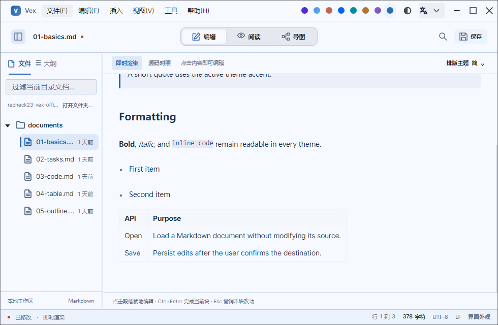

# 原型与 NativeAOT 复核

2026-10-16，版本 1.5.6 补充：修复全局语言切换与第三方主题接线。验证器直接修改唯一 I18nManager，在同一个已打开的 Semi TextBox 上反复展开实际菜单，检查简体、英文、繁体和日文复制、粘贴文案及 Ursa 对话框资源；宿主设置同键文案后继续回切，覆盖保持生效。主题字典保存在主题自身资源中，事件切换在 UI 线程执行。

本轮使用官方 NuGet 源和独立包缓存，重新通过正式 Windows NativeAOT、正式 EXE 隔离自检、原生 UI 全套回归及 EXE 安装器生成，PE 的 CLR 目录为空。另以同一产品源码追加托管最小窗口检查：980×640 下四语工具栏所有按钮、关于内容视口、顶部更新按钮及滚动到底部后的关闭按钮均在可用区域内；编辑偏好的长文档滚动、Markdown 自然表格列宽和五步引导继续通过。新增最小窗口断言属于托管验证，原生结果来自此前已完成的完整验证器，不将二者混称。

2026-10-15，版本 1.5.5。使用 CodeWF.Avalonia 12.1.4.22 和 Toolkit 1.0.0.19；库与应用共用 Toolkit 全局语言单例，宿主输出 JSON，库资源内嵌，强类型键由 T4 生成。

- 标题栏右侧仅保留单排八色点、Ursa 三态模式按钮和完整语言下拉；主题、配色和语言复用既有保存逻辑。验证真实按钮点击、内部提示动态切语、四语语言列表，以及 980/1280 宽度下与窗口按钮无重叠。关于等模态显示期间禁用外观入口。
- 执行仓库 `scripts/publish.ps1 -RuntimeIdentifier win-x64` 发布正式 Windows NativeAOT，再将 `scripts/ui-verification` 另行发布为 NativeAOT 并运行。原生验证覆盖五份 Markdown 文件切换与保存、编辑/阅读/导图、八色浅深模式、文件树、表格自然列宽、标题栏与内容分隔、完整引导及偏好恢复。
- 同一个关于浮层打开期间切换简体、繁体、英文、日文，校验实际版本、编译时间及平台。更新状态机覆盖检查、下载校验、失败、取消及安装分支，受控测试不执行真实安装器。
- 单文件离线原型与标题栏交互同步，具备桌面窗框；浏览器审计实际点击语言菜单、八色点与三态模式，固定关于样例时间不覆盖正式程序编译时间。
- 本机生成 Windows EXE 安装器及 SHA256；安装结构回归覆盖标准 macOS Resources、语言和帮助文档、Linux 桌面入口、图标、调试符号剔除及失败传播。五平台资产门禁拒绝缺少校验文件和便携压缩包。
- 文件关联脚本覆盖 `.md`、`.markdown`、`.mdown` 图标、候选程序和右键入口，复核期间不修改用户默认程序。

正式 EXE 另提供 `--verify-runtime <独立目录>` 自检：逐一检查发布的语言 JSON、全局动态切语与独立偏好持久化，不创建窗口，不读取用户账号或仓库。该自检验证实际发布的可执行文件，UI 验证器负责真实控件与布局；两者都不替代人工桌面验收。

锁屏期间采用无头浏览器和真实应用离屏渲染，没有新增桌面键鼠验收。输入法、多 DPI、跨屏、系统文件关联实际注册及其他操作系统运行仍需专项验证。NativeAOT 保留第三方裁剪与 AOT 警告，通过的路径不能代表全部反射分支；交互覆盖和局部几何测量也不等于全页 95% 还原。
