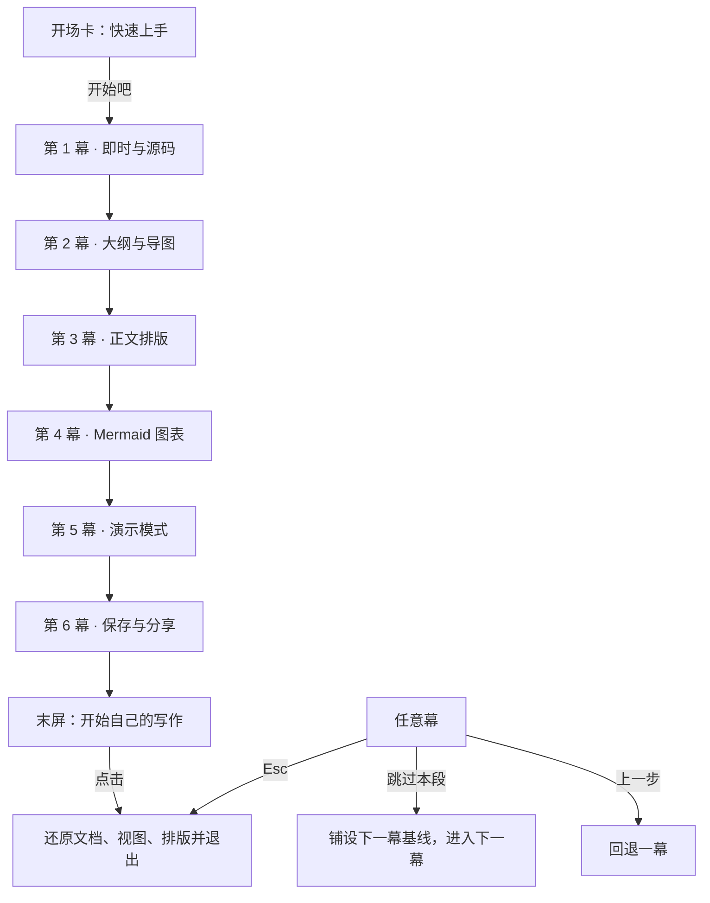
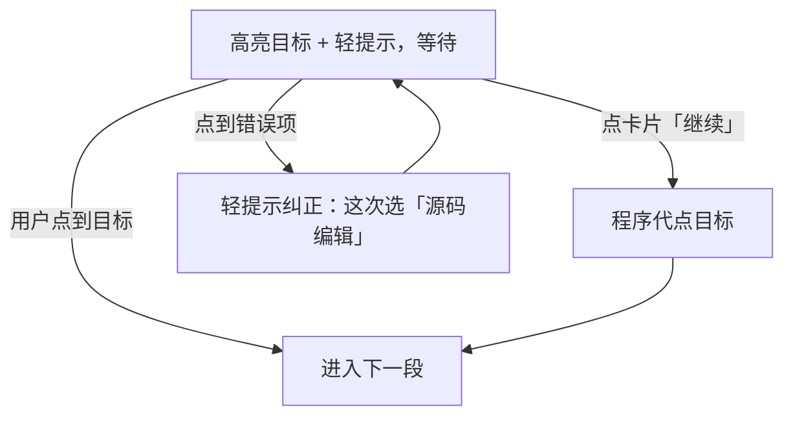

# 引导设计（六幕快速上手）

实施顺序：先原型（`design/`），验收后桌面端（`src/`）。

## 1. 交互模型

| 原语 | 含义 | 卡片行为 |
|---|---|---|
| 【演】 | 程序自动执行：打字机输入、切换视图、点击菜单、定时停顿 | 段末出【继续】；段中用轻提示（气泡）不打断 |
| 【门】 | 等待用户亲手点击指定入口：高亮目标 + 轻提示，不设超时、不判失败 | "继续"永远可点，含义是**程序代点**；用户点到目标即自动进入下一段 |
| 两级门 | 换视图 = "入口按钮 → 二级选项"：先亮入口，弹出后再亮具体项 | 点错项轻提示纠正"这次选「源码编辑」"，继续等待 |
| 收幕 | 一幕结束的小结卡 | 幕名 + 一句话 +【继续】进入下一幕 |

统一规则：

1. 完成判据走真实状态（布局类名、面板展开、排版键值）；门的"继续"可代点，任何一步都不会卡死。
2. Esc 随时整体退出；"跳过本段"跳到下一幕并铺设该幕基线文档；"上一步"回退一幕。
3. 演示期间屏蔽卡片以外的所有输入（原型与桌面端一致）；退出引导时完整还原文档、视图、排版与滚动位置。
4. 轻提示不可少：每个【演】动作都要有对应的气泡或卡片文案，不允许无说明的自动操作。

## 2. 流程图

引导会话总体流程：



门控（【门】）内部逻辑：



## 3. 示例文档与打字内容

叙事线为"成都游记"，内容固定，打字机按幕递进写入。

`stage0`（第 1 幕第 1～2 段打入）：

```markdown
# 成都，慢慢走

这个周末，去成都。把脚步放慢一点，给茶香和街巷多留些时间。
```

第 1 幕第 3 段在源码中把首句改为"先喝一碗盖碗茶"，并续写至 `stage1`：

```markdown
# 成都，慢慢走

这个周末，去成都。先喝一碗盖碗茶，给茶香和街巷多留些时间。

## 出发清单

- [ ] 带上相机
- [ ] 预订车票

## 第一天行程

### 人民公园

坐在茶社里，喝一碗盖碗茶。

### 宽窄巷子

沿着青砖小巷，看看老院子。

## 第二天行程

### 熊猫基地

早一点出发，去看大熊猫。

## 锦里夜游

等灯笼亮起来，再去锦里走走。

### 旅途随手记

记下今天最喜欢的一碗茶和一条巷子。
```

第 1 幕第 4 段切回即时后补写结尾句，得到 `stage1WithEnding`：

```markdown
沿着这条路线，慢慢走。
```

第 4 幕在 `stage1WithEnding` 末尾写入路线章节，得到 `stage2`：

````markdown
## 成都慢游路线


````

第 4 幕收段把「宽窄巷子」站更名为「宽窄巷子 · 喝茶漫步」，得到 `routeEdited`。

## 4. 六幕分镜

### 第 1 幕 · 即时与源码（约 35 秒）

1. 【演】清空文档 → 打字机打出 stage0 的标题行「# 成都，慢慢走」→ 轻提示：*写下这趟旅行的标题，内容会即时呈现。* →【继续】
2. 【演】续打至 stage0 → 卡片：*内容已经写下，先读一遍刚才的结果。* →【继续】
3. 【门·两级】亮工作台布局按钮：*点这里更换视图* → 画廊弹出后亮「源码编辑」：*选择「源码编辑」* →【演】源码中改写首句并续写至 stage1 → 轻提示：*刚才的文字都在这里——源码里也能继续修改。* →【继续】
4. 【门·两级】再亮布局按钮：*再切换回「即时编辑」* →【演】补写结尾句至 stage1WithEnding → 收幕卡：*同一篇游记，两种方式都能继续写。*

### 第 2 幕 · 大纲与导图（约 25 秒）

1. 【门】亮底栏「大纲」开关：*点底栏「大纲」，查看文档大纲* → 展开 → 轻提示：*大纲会列出所有标题。* →【继续】
2. 【演】自动点击大纲项「第一天行程」→ 正文精确定位滚动 → 卡片：*大纲点一下，正文就到位。* →【继续】
3. 【门·两级】亮布局按钮 → 亮「思维导图」→ 切换 → 轻提示：*导图把标题关系画在这里。* → 尾部轻提示：*点击节点可看全文，摘要入口在「工具」菜单。* →【继续】收幕

### 第 3 幕 · 正文排版（约 20 秒）

1. 【门】亮排版按钮：*点「排版」，给文字选一套样式* → 面板弹出
2. 【演】依次应用 简约 → 书卷 → 专栏 → 刊物，每套停 1.2 秒，轻提示同步显示：*排版：书卷*
3. 卡片：*排版会同步应用到阅读和导出。* →【演】自动收面板，收幕

### 第 4 幕 · Mermaid 图表（约 25 秒）

1. 【演】切到源码视图 → 轻提示：*接下来的图表，完全用文字写成。* →【继续】
2. 【演】打字机打出章节标题「## 成都慢游路线」
3. 【演】写入 route 代码块 → 自动切换「源码 + 预览」→ 下方渲染出路线图 → 卡片：*一段文字，变成了清楚的路线。* →【继续】
4. 【演】自动把「宽窄巷子」改为「宽窄巷子 · 喝茶漫步」→ 路线图同步更新 → 轻提示：*图里的这一站，也跟着更新了。* →【继续】收幕

### 第 5 幕 · 演示模式（约 20 秒）

1. 【演】切到阅读视图并回到顶部 → 卡片：*这篇游记，也可以直接拿来讲。* →【继续】
2. 【演】进入演示模式 → 轻提示：*沿着章节，一段一段展开。* →【继续】
3. 【演】翻到下一页 → 切换导图讲述 → 轻提示：*想先讲全局，也可以从导图开始。* →【继续】
4. 【演】退出演示，回到阅读视图 → 收幕卡：*讲完以后，回到游记继续完善。*

### 第 6 幕 · 保存与分享（约 25 秒）

1. 【演】展开文件菜单，高亮「保存」→ 轻提示：*想继续写，可以保存这份 Markdown。* →【继续】
2. 【演】展开「导出」子菜单，依次亮 HTML / PDF / PNG 长图 / Word → 轻提示：*想交给别人阅读，有现成的格式。* →【继续】
3. 【演】收起文件菜单，展开工具菜单，亮「复制到微信公众号 / 知乎 / 稀土掘金」→ 轻提示：*准备发布时，从这里选择对应的平台。* →【继续】
4. 【演】收起菜单 → 收尾卡：*一篇游记已经成形。* → 末屏「开始自己的写作」按钮，点击退出引导并还原文档。

开场卡：标题「快速上手」，正文 *运行软件即可立即创作哟，跟着演示看一遍核心功能。*，按钮「先不看」「开始吧」。

## 5. 文案键（VEX_DATA，四语言）

| 键（前缀 `Guide`） | 内容 | 数量 |
|---|---|---|
| `IntroTitle` / `IntroText` / `IntroStart` / `IntroSkip` | 开场卡 | 4 |
| `Title1..6` | 幕名：即时与源码 / 大纲与导图 / 正文排版 / Mermaid 图表 / 演示模式 / 保存与分享 | 6 |
| `Act{n}Summary`（n=1..6） | 各幕收幕卡一句话 | 6 |
| `Act{n}Step{m}` | 各幕分段提示（按第 4 节分镜逐条） | 约 20 |
| `GateLayout` / `GateLayoutSource` / `GateLayoutInstant` / `GateLayoutMap` / `GateOutline` / `GateTypography` | 门引导语 | 6 |
| `GateWrongFormat` | 纠正语：*这次选「{0}」* | 1 |
| `Skip` / `Previous` / `Next` / `Start` / `StepFormat`（`{0} / 6`） | 公共控件 | 5 |

## 6. 原型改造清单（`design/`）

- `assets/desktop/guide.js`：
  - `acts[]` 8 幕改 6 幕，段结构统一为 `{ kind: 'auto' | 'gate', tip, targets, action }`；新增门控原语 `waitForClick`：高亮目标、放行目标点击（绕过现有全局输入屏蔽）、点中或"继续"代点后继续脚本；两级门支持点错纠正。
  - 打字机（`typeText`/`transitionText`）、暂停继续（`pauseForContinue`）、聚光灯与卡片布局、会话快照（`beginGuideSession`/`endGuideSession`）机制保留。
  - 第二幕并入摘要轻提示；文案改读 `VEX_DATA.Guide*`，zh 兜底。
- `assets/desktop/localization.js`：按第 5 节写入四语言键。
- `scripts/verify.cjs`：引导断言同步（六幕、门控、退出还原）。

## 7. 桌面端改造清单（`src/`）

- `WorkbenchGuideView`：改为演示驱动——
  - 打字机：`DispatcherTimer` 逐字应用 `vm.Markdown`（沿用 `BeginGuideDocument`/`EndGuideDocument` 临时文档与历史隔离）。
  - 门控：每幕门描述为"目标控件 + 期望状态谓词 + 代点动作"；`AllowsPointer` 白名单仅放行门目标与卡片。
  - 布局切换、菜单演示、演示模式进出均程序驱动；退出还原（文档/视图/排版/滚动/选区）机制不变。
  - `GuideStepFormat` 改 `{0} / 6`；步骤圆点 6 个。
- `I18n/*.json`：四语言同步第 5 节键。

## 8. 验收标准

1. 原型：六幕按分镜完整走通；每个门亲手点、点错纠正、代点、跳过、Esc 退出、文档还原均正常；四语言切换无缺键；`verify.cjs` 通过。
2. 桌面端：同上；NativeAOT 产物 `--verify-runtime` 通过；首启自动弹出（`HasSeenOnboardingGuide`）与"快速上手/新手引导"重看入口不变。
3. 两边幕数、幕名、文案逐字一致（以 VEX_DATA 为准）。
