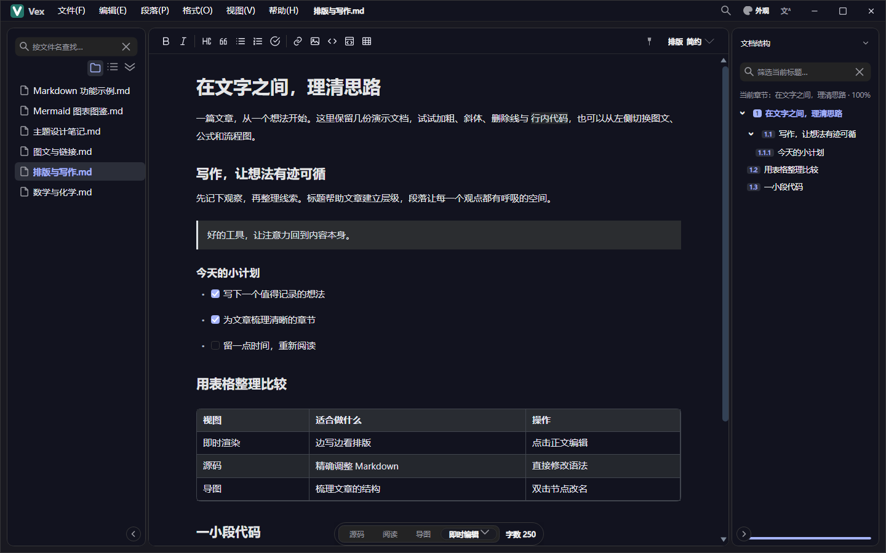
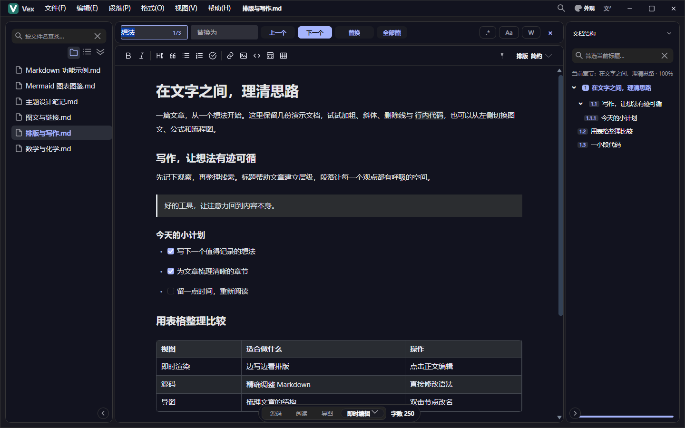
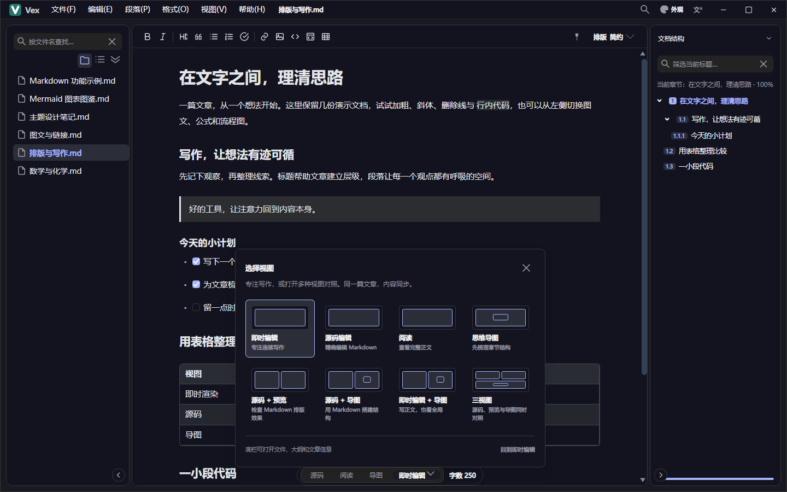
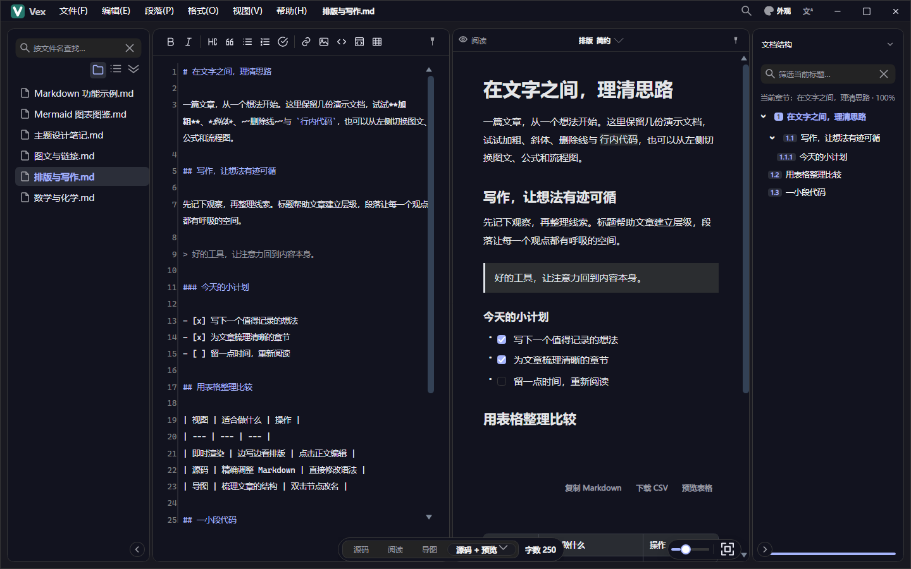
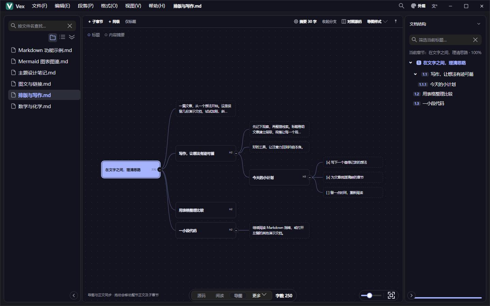
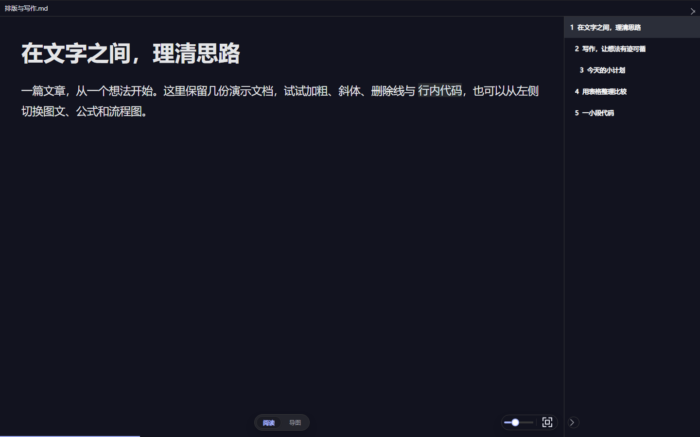
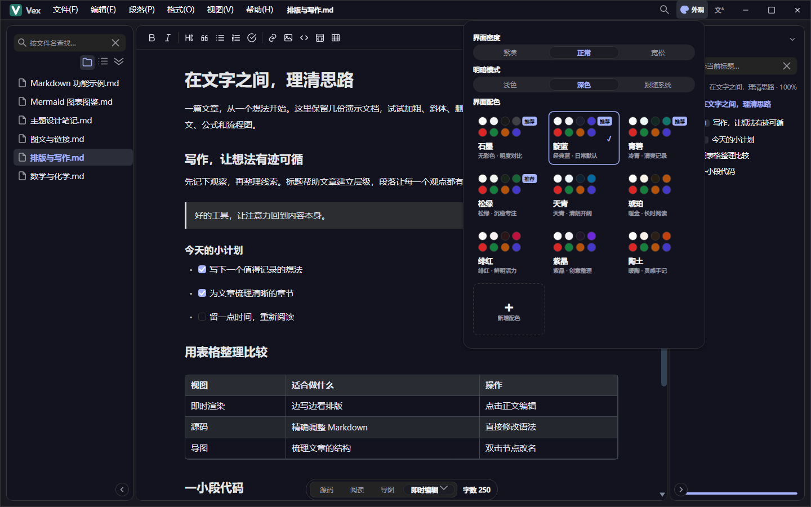
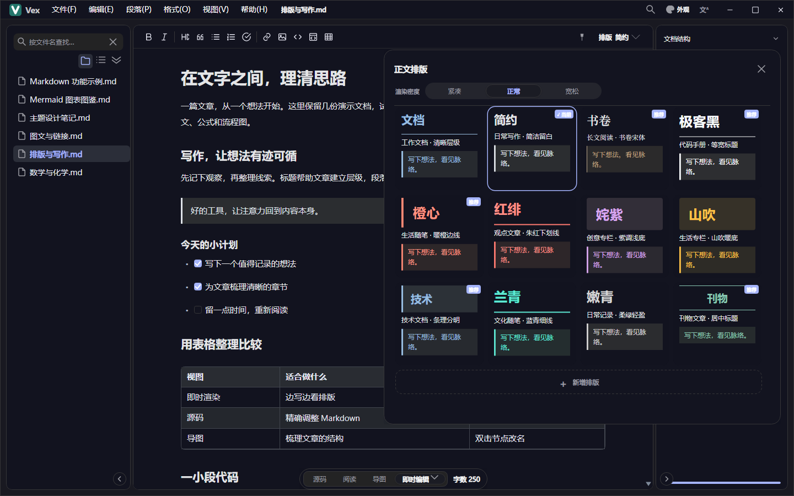
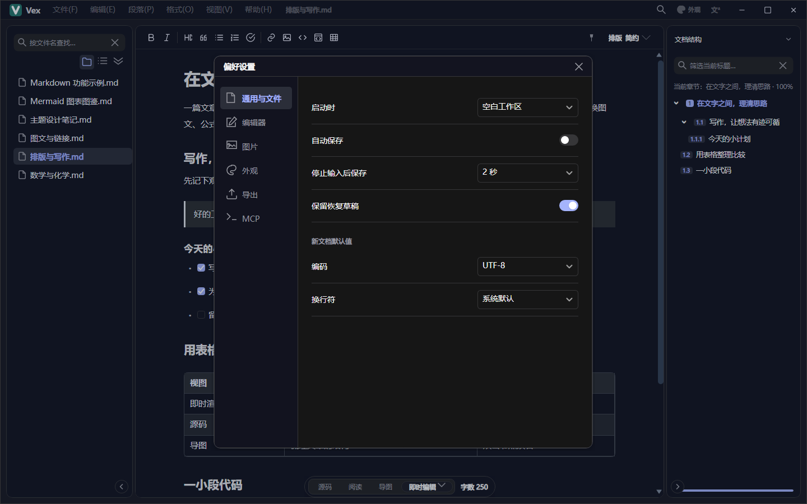
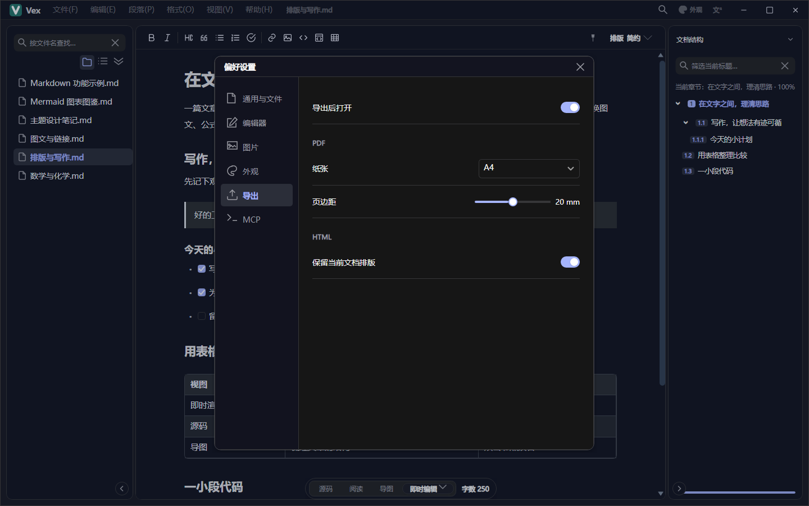

# Vex 快速开始

维刻 Vex · 写下想法，看见脉络。本文覆盖 1.7.2 的安装、写作、偏好和备份；学习源码从 [文档入口](https://github.com/dotnet9/Vex/blob/main/docs/仓库学习文档.md) 开始。

## 1. 安装与升级

从 [GitHub Releases](https://github.com/dotnet9/Vex/releases/latest) 下载系统和架构对应的安装包与 `.sha256`，核对后安装。

| 平台 | 正式文件名 | 安装方式 |
| --- | --- | --- |
| Windows x64 | `Vex-v<版本>-win-x64-setup.exe` | 当前用户安装，可选桌面快捷方式及 Markdown 打开候选 |
| Linux x64 / arm64 | `Vex-v<版本>-linux-x64.deb` / `Vex-v<版本>-linux-arm64.deb` | Debian 包管理器，架构分别为 amd64 / arm64 |
| macOS Intel / Apple Silicon | `Vex-<版本>-osx-x64.dmg` / `Vex-<版本>-osx-arm64.dmg` | 挂载，将 Vex.app 拖到 Applications，复制结束后推出镜像 |

正式交付为上述五个 RID 的 NativeAOT 安装包。签名、Gatekeeper 及系统兼容性以对应版本说明和实机结果为准。浏览器安装原型仅用于演示。

Windows 关联选项注册 `.md`、`.markdown`、`.mdown` 的打开候选与右键入口，尊重系统默认应用选择；可在系统设置中选择默认程序。取消该选项后，应用启动不会自行重新注册。旧全用户安装的迁移和异常处理见 [安装与发布](https://github.com/dotnet9/Vex/blob/main/docs/安装与发布.md)。

从帮助菜单或关于界面检查更新。应用匹配安装包并验证 SHA256；Windows 等待安装器窗口就绪后才请求退出，安装前处理未保存内容。Linux、macOS 的复制、授权与替换由系统完成。

## 2. 开始写作

1. 从“文件 / 新建”开始，或打开已有文件。支持 `.md`、`.markdown`、`.mdown`、`.txt`。
2. 打开文件夹可浏览和筛选目录；直接打开单个文件时也会加载同目录文档。每个进程始终只有一份当前文档，切换文件会同步所有视图和独立窗口。
3. 默认即时编辑，点击正文直接输入；`Ctrl+Enter` 完成本块，`Esc` 取消本块修改。代码块编辑时可在下方修改语言。需要完整 Markdown 时切换“源码”。
4. 网页内容粘贴优先将剪贴板 HTML 转为 Markdown，无 HTML 时回落普通文本。格式工具可插入标题、列表、链接、图片、代码和表格。
5. `Ctrl+F` 查找，`Ctrl+H` 替换，支持大小写、整词、正则、计数与循环提示；`Enter` 或 `F3` 下一个，`Shift+Enter` 或 `Shift+F3` 上一个。
6. 保存或另存为；取消目的地不会视为保存成功。新文档使用默认编码和换行，已有文档保留其实际编码与原文换行。

首次练习可另存 [Markdown 功能示例](https://github.com/dotnet9/Vex/blob/main/docs/Markdown功能示例.md)。源码和即时编辑共用正文撤销历史，筛选、查找、章节表单等输入框有自己的文本撤销。

“文件 / 演示文档”会在新的 Vex 进程中打开随程序发布的 `docs/演示文档` 目录，包含排版、图文、公式、Markdown、图表和主题笔记六份文档。本地插图无需联网；文件列表、目录折叠、编辑和另存为都使用普通文档流程。

“帮助 / 更新日志”和“帮助 / 鸣谢”会启动新的 Vex 进程，打开随应用发布的文档。“关于”里的更新日志使用同一入口。新窗口沿用普通文档的编辑、保存、另存为和关闭流程；当前窗口的内容保持原状。

## 3. 结构、布局与演示

顶部中央布局入口提供即时、源码、阅读、导图、源码＋阅读、源码＋导图、即时＋导图、三视图八种组合。布局和排版面板选择后保持展开，按 Esc 或点击外部关闭。视图可分离到独立窗口，仍共享当前文档；源码和即时输入全局互斥。阅读与导图视图的右下角有悬浮缩放坞：拖动条调整正文缩放或导图倍率，百分比只在拖动时以气泡浮出，滚轮与平移同样回写拖动条。

右侧辅助栏共用大纲、文章信息、章节详情。点击大纲定位，导图节点支持重命名和章节操作：双击 / F2 改标题，Enter 新建同级，Tab 新建子章；工具栏、详情和拖动调整层级与顺序。移动携带子章，删除需要确认，正文修改可撤销。

文件夹和大纲折叠、树 / 列表、排序、宽度、辅助页签和布局会记入配置。搜索临时显示折叠项，清除搜索后恢复主动折叠状态。

点击“演示”或 `F6` 进入正文 / 文档大纲 / 导图；`D / O / M` 切换模式，左右键或 PageUp / PageDown 翻节，`+ / -` 或右下角缩放坞拖动条调整倍率（10% 一档，旁边按钮还原进入时的大小），阅读 / 导图切换胶囊与缩放坞悬浮在底部同一根轴线上。导图可平移、缩放、折叠，双击或 Enter 进入章节。`Esc` 或 `F6` 退出，恢复原布局与全文位置。

“帮助 / 新手引导”提供六步临时演练，完成或跳过后恢复原文、历史、布局和原独立窗口。演练中的副本与正式文章分开保存。

## 4. 外观与偏好

标题栏外观入口选择浅色、深色、跟随系统及 **9 套配色**；正文排版面板提供 **13 套独立效果卡片**。推荐与全部方案都可达，方向键只浏览，确认或点击才应用。界面语言为简体中文、繁体中文、英文、日文。

从“工具 / 偏好设置”或 `Ctrl+,`（macOS `⌘+,`）进入通用与文件、编辑器、图片、外观、导出、MCP 六类设置。常规偏好自动保存，MCP 设置需点击保存后生效。

- 正文和代码字号、缩进、换行、语法、内容缩放和字数独立设置，不重写正文。正文按规则 §11 的 13 / 15 / 17 档渲染，默认 15px。
- 内容缩放（50–200%）、导图倍率（1–200%）与演示倍率（100–250%）各记各的，跨会话保留；改一处不动其它。
- 图片可复制到文档资源目录并使用相对路径，同名不同内容生成新文件。移动文章时同时移动附件。
- 动效可关闭；预览水印与导出水印独立。MCP 默认关闭，连接和权限见 [MCP 接口](https://github.com/dotnet9/Vex/blob/main/docs/MCP接口.md)。

## 5. 保存、草稿与外部变更

自动保存默认关闭。开启后只写已有路径、且磁盘内容仍等于上次保存基线的文档；未命名文档仍需手动保存。恢复草稿默认启用，用于异常中断恢复，不能取代正式保存和备份。

保存、导出或草稿失败会保留正文并持续提示，可分别重试；取消不显示成功。发现外部变化时先比较，再选择保留当前、另存副本或载入外部版本，载入可以撤销。恢复草稿先预览全文，再创建独立未保存文档，不直接覆盖来源文件。

关闭和切换遇到未保存内容时按提示保存、放弃或取消；选择保留草稿退出时若草稿写入失败，窗口继续保留。当前手动保存不是完整事务备份，重要资料应另行备份。

## 6. 导出与分享

“文件 / 导出”支持 Markdown、HTML、PDF、PNG、Word（.docx）；可设置默认格式、目录、HTML 样式、PDF 纸张和边距、水印。导出生成副本，不改变原文未保存状态。PDF 正文选择、附件嵌入、离线查看及复杂图表应实际打开目标文件检查。

“工具 / 复制到公众号、知乎、稀土掘金”写入富 HTML 剪贴板，再手动粘贴到网页编辑器。网站可能过滤样式，检查目标呈现后再发布；复制操作不会自动对外发布文章。

## 7. 数据位置与备份

| 数据 | 当前位置 / 解析规则 | 备份建议 |
| --- | --- | --- |
| Markdown 与附件 | 用户选择的目录 | 复制整个目录，保留相对路径 |
| 偏好与折叠状态 | `AppConfigHelper.GetDefaultConfigPath()` 解析的 XML，可为程序旁 `.config` / `.dll.config` | 关闭应用后确认实际位置再复制，不假定统一在用户目录 |
| 最近文件 | `LocalApplicationData/CodeWF/Vex/recent-files.txt` | 按需备份，仅含导航记录 |
| 恢复草稿 | `LocalApplicationData/Vex/Drafts`，Windows 通常 `%LOCALAPPDATA%\Vex\Drafts` | 关闭应用后复制，恢复后及时另存 Markdown |
| MCP 审计 | `LocalApplicationData/Vex/mcp-audit.jsonl` 及轮转文件 | 按需保存并脱敏 |

各系统特殊目录由运行时解析。MCP Token 当前保存在普通配置字段中，分享配置、日志、环境变量和备份前先脱敏。随包快速开始、更新日志和鸣谢属于程序资源，不是个人文档。

问题报告见 [贡献与安全](https://github.com/dotnet9/Vex/blob/main/docs/贡献与安全.md)，当前验证覆盖和限制见 [验收与已知限制](https://github.com/dotnet9/Vex/blob/main/docs/验收与已知限制.md)。
