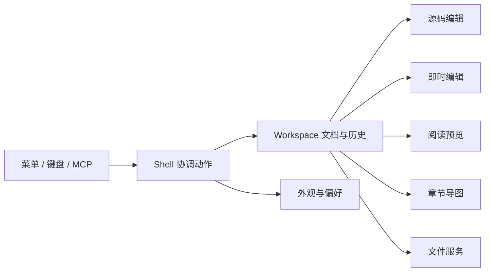

# 架构与源码导读

本文对照当前 .NET 10 / Avalonia 12 源码，解释模块职责和关键工作流。产品目标见 [需求说明](Vex需求文档.md)，操作方式见 [快速开始](快速开始.md)。

## 仓库地图

| 位置 | 职责 |
| --- | --- |
| `src/Vex` | 桌面应用、MVVM、文件与 MCP 服务、国际化 |
| `src/Vex.Controls` | 可复用的应用控件 |
| `src/Vex.Controls.Themes` | 控件主题资源 |
| `src/Vex/Core` | 模型、服务接口、消息和共享偏好 |
| `src/Vex/Modules/Shell` | 主窗口、菜单、文件导航、设置、更新和浮层 |
| `src/Vex/Modules/Workspace` | 文档编辑、预览、导图、历史、统计与导出 |
| `src/Vex/Modules/Appearance` | 主题、配色、正文排版状态 |
| `src/Vex/Modules/Help` | 帮助文档、关于与外部入口 |
| `src/Vex/Modules/Mcp` | HTTP 服务、工具分发、确认、审计和序列化 |
| `src/Vex/I18n` | 四种界面语言及强类型生成模板 |
| `scripts` | 本地联调、验证、原生发布与安装器源码 |
| `.github/workflows` | 回归、NuGet 和五 RID 安装包发布 |
| `design` / `docs` | 浏览器原型 / 说明与验收记录 |

`Vex.slnx` 是解决方案入口，`global.json` 选择稳定版 .NET 10 SDK。`Directory.Build.props` 管理版本和构建元数据，`Directory.Packages.props` 管理 NuGet 版本。`artifacts/` 为忽略的构建输出，不能当作用户笔记备份。

## 启动与模块组合

从 [Program.cs](../src/Vex/Program.cs) 到 [App.axaml.cs](../src/Vex/App.axaml.cs)，由 Prism / DryIoc 注册服务和模块，组合主窗口及各区域。ViewModel 通过 ReactiveUI 暴露状态；跨模块动作使用 `CodeWF.Toolkit.EventBus` 的类型化消息。View 负责显示、焦点与窗口交互，文件、持久化和 MCP 业务由服务协调。

## 一份原文，多种视图

每个进程维护一份当前 Markdown 文档；文件列表负责切换当前文档。八种布局与独立视图窗口共享当前内容，切换文件会同步替换所有视图。源码和即时编辑在各窗口中互斥，避免两个输入器同时提交不同内容。

`WorkspaceDocumentState` 维护 Markdown 与路径，通过 `MarkdownDocumentChangedCommand` 同步视图；路径变化即使正文相同，也应触发更新。`WorkspaceEditHistory` 负责工作区编辑历史，导图章节调整最终仍修改 Markdown。布局、缩放、主题切换不能产生正文修改或撤销记录。

可从以下文件追踪一次动作：

1. [MainWindowViewModel.cs](../src/Vex/Modules/Shell/ViewModels/MainWindowViewModel.cs)：工作区组合与用户动作。
2. [WorkspaceDocumentState.cs](../src/Vex/Modules/Workspace/Services/WorkspaceDocumentState.cs)：正文与路径同步。
3. [MarkdownInstantView.cs](../src/Vex/Modules/Workspace/Views/MarkdownInstantView.cs)：原位块编辑。
4. [WorkspaceEditHistory.cs](../src/Vex/Modules/Workspace/Services/WorkspaceEditHistory.cs)：撤销与重做。
5. [DocumentService.cs](../src/Vex/Modules/Workspace/Services/DocumentService.cs)：打开、目录枚举、保存与自动保存。

## 文件、保存与恢复

文件服务识别 `.md`、`.markdown`、`.mdown`、`.txt`，打开真实文件时保留其路径、编码和换行信息。打开文件夹会在后台递归枚举文档；不能把原型里的固定示例列表当作真实目录排序规则。

手动保存与自动保存有不同实现：当前手动保存使用 `File.WriteAllTextAsync`，不能据此宣称已经具有原子替换事务。自动保存只处理已有文件，持有排他文件句柄，先核对上次保存内容，再按原编码和 BOM 写入；外部修改或文件锁会阻止覆盖。保存成功必须对应实际写入的内容，失败或取消仍保留未保存状态。

`AutoSaveDraftService` 在系统本地应用数据目录下的 `Vex/drafts` 写入恢复草稿；草稿用于恢复异常中断内容，不是历史版本库。正式 Markdown、附件、最近路径、配置和草稿有各自生命周期，卸载与升级不应主动删除用户文档。

## 偏好与外观

`AppSettings` 是类型化设置模型，`AppSettingsStore` 通过 `AppConfigHelper` 读取并按键合并写入配置。常规偏好即时保存；MCP 服务设置需保存后生效。默认值和用户主动清空的文本需要区分，不能因增加设置项覆盖其他模块配置。

主题分成明暗模式、界面配色、正文排版三层。当前应用为 8 套配色和 18 套排版；浏览器原型使用合并目录，见 [外观资源](resources/外观资源.md)。合并原型不会自动扩大应用中的选项。

## 渲染、导出与 MCP

源码编辑使用 AvaloniaEdit，Markdown 和导图使用 `CodeWF.Avalonia.Markdown`、`CodeWF.Avalonia.MindView`。导出由 `MarkdownExportService` 连接共享库的导出能力，图片按本地、数据 URI、远程资源等来源处理。HTML、PDF、PNG、Word 的引擎和分页能力不同，须分别检查实际文件。

MCP 使用 `HttpListener`、JSON-RPC、静态 schema 与 `System.Text.Json` 源生成，保持 NativeAOT 兼容。网络请求经鉴权、路径范围及必要确认后，通过 UI 线程调用工作区；不能用请求线程直接改 Avalonia 控件。当前有 29 个工具，详见 [接口说明](MCP功能实现方案.md)。

## 构建与分发

应用使用 `net10.0` / `net10.0-windows`，可打包控件项目支持 `net8.0;net10.0`。开发先通过 NuGet 消费共享库；本地联调用临时包源，不新增跨仓项目引用。Windows x64、Linux x64/arm64、macOS x64/arm64 在对应系统和架构上 NativeAOT 发布，再制作 EXE / DEB / DMG 及 SHA256。详细步骤见 [开发与验证](development/开发与验证.md) 和 [发布流程](RELEASE.md)。
