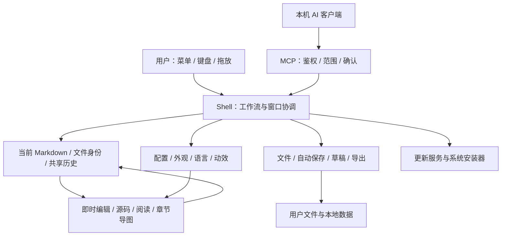

# Vex 概要设计

## 1. 设计基线

Vex 1.7.3 是 .NET 10 / Avalonia 12.1.4 桌面应用，采用 MVVM、Prism / DryIoc 容器、ReactiveUI 和类型化事件消息。Markdown 原文是正文的唯一来源；界面、导图和导出从它派生。产品范围见 [需求文档](需求文档.md)，方法、模型和调用链见 [详细设计](详细设计.md)。

系统边界包括本地文档、系统剪贴板与文件选择、应用配置、恢复草稿、GitHub 更新资产和可选本机 MCP。浏览器原型用于设计和比较，不是桌面运行时；NuGet 共享库也不是本仓项目引用。

## 2. 分层与模块职责

| 层 / 目录 | 主要职责 | 依赖约束 |
| --- | --- | --- |
| `Core/Models`、`Core/Services`、`Core/Messaging` | 类型化模型、服务契约、偏好约束、消息 | 避免把视图行为和文件副作用混入数据模型 |
| `Modules/Shell` | 主窗口、导航、菜单、设置、保护、演示和各工作流协调 | 通过服务处理文件 / 导出；通过 VM 和消息驱动视图 |
| `Modules/Workspace` | 文档 I/O、共享原文、历史、章节解析、编辑渲染与导出 | 章节和视图修改最终回写同一 Markdown |
| `Modules/Appearance` | 明暗、配色和正文排版状态 | UI 配色与正文纸面独立 |
| `Modules/Help` | 随包帮助、关于、更新检查和安装交接 | 对应平台资产与 SHA256 校验 |
| `Modules/Mcp` | HTTP / JSON-RPC、schema、工具、权限、确认和审计 | 工作区动作转 UI 线程；不能任意执行系统命令 |
| `I18n`、`Styles`、`Core/Motion` | 四语、语义资源、动效令牌和生命周期 | 资源切换不创建正文历史 |
| `Vex.Controls` | 本仓控件、`Themes` 资源与 `VexControlsTheme` 加载入口 | 与主应用组成两个生产项目，统一发布一个控件包 |

Prism 模块目录与注册位置不是一一对应。当前 ModuleCatalog 注册 Shell、Workspace、Appearance、Help 四个模块；MCP 及大部分服务和 VM 在 [App.RegisterTypes](../src/Vex/App.axaml.cs) 注册，WorkspaceModule 尚不承担独立服务注册。学习时应先看实际容器组合，不能根据目录推断存在 `McpModule`。

## 3. 运行和文档模型

[Program.cs](../src/Vex/Program.cs) 注册编码并选择正常桌面入口或 `--verify-runtime` 验证入口。[App.axaml.cs](../src/Vex/App.axaml.cs) 注册高亮、数学、Mermaid、HTML 表格、语言插件和容器，应用已保存主题后创建主窗口。macOS 帮助和语言资源同时考虑 `.app/Contents/Resources` 布局。

一份当前文档由三种互补状态表达：

- `DocumentSnapshot` 表达文件身份、编码和原文，供打开、保存及重载使用。
- `WorkspaceDocumentState` 广播当前 Markdown 与路径，供视图同步；相同正文但路径不同也要更新。
- `WorkspaceEditHistory` 保存跨源码、即时编辑、章节与 MCP 操作的统一撤销 / 重做历史。

`MainWindowViewModel` 协调当前快照、磁盘基线、工作区和未保存状态；`ShellWorkbenchViewModel` 协调编辑历史、布局、章节和演示。文件列表不是多个独立会话，切换文件后各窗口一同更新。源码与即时编辑共用编辑器席位，避免同时输入。

八种布局为 `instant`、`source`、`read`、`map`、`source-render`、`source-map`、`instant-map`、`three`，定义见 [WorkbenchLayoutOption.cs](../src/Vex/Core/Models/WorkbenchLayoutOption.cs)。独立窗口由 [WorkspaceViewController.cs](../src/Vex/Modules/Shell/Views/WorkspaceViewController.cs) 管理视图和返回位置，仍使用同一状态与历史。

## 4. 关键数据流

### 编辑和派生视图

用户编辑 → 视图提交 Markdown → 工作台历史记录 → 共享状态广播 → 其他视图同步 → 大纲 / 统计延迟派生。格式与章节动作显式分组，导航、主题、布局不进入正文历史。大纲和统计采用 220ms 防抖，隐藏视图避免不必要的渲染工作。

### 打开、保存和异常恢复

打开 / 切换请求 → 未保存保护 → 文件服务读取快照 → 更新路径、基线与共享原文 → 刷新文件导航和派生视图。

手动保存使用异步文件写入，成功后才更新磁盘基线；当前不是完整原子替换事务。自动保存只处理已有文件，持有排他句柄，先比较上次保存内容，再按原编码写入；外部变更会阻止覆盖。草稿独立延迟保存，恢复先预览，再创建没有原路径的未保存文档。详见详细设计的数据保护章节。

### 配置与导航记忆

用户主动折叠 / 调整 → VM 部分更新 `AppSettings` → `AppSettingsStore` 重新读取磁盘并合并指定项 → `AppConfigHelper` 写 XML。重建树或切换文档时按稳定身份恢复。搜索临时展开和窄窗临时隐藏不覆盖主动偏好。进程内锁不等同跨进程事务锁。

## 5. 数据存储边界

| 数据 | 当前来源或位置 | 生命周期 |
| --- | --- | --- |
| Markdown 与附件 | 用户指定目录 | 用户自行管理、备份；不归构建输出或草稿服务所有 |
| 配置 | `AppConfigHelper.GetDefaultConfigPath()` 解析的 XML 配置 | 常规偏好即时保存，MCP 设置需保存生效；不能假定全部位于用户目录 |
| 最近文件 | `LocalApplicationData/CodeWF/Vex/recent-files.txt` | 导航辅助，不是文档副本 |
| 恢复草稿 | `LocalApplicationData/Vex/Drafts` | 每进程会话隔离；恢复和清理显式协调 |
| MCP 审计 | `LocalApplicationData/Vex/mcp-audit.jsonl` 及轮转文件 | 约 1MiB 轮转，可能包含敏感路径和内容摘要 |
| 随包文档 | `docs/快速开始.md`、`docs/鸣谢.md`、`docs/更新日志.md`、`docs/演示文档`、`docs/图片` | 构建时复制；日志、鸣谢和演示目录在独立进程中按普通文档打开，快速开始引用的截图随包供应用内离线查看 |
| 开发与验证输出 | 工作流指定仓外临时目录 | 可重新生成；不能当用户备份 |

Linux / macOS 的特殊目录由 .NET 解析，不套用 Windows 路径。Token 属于普通配置字段，当前没有系统凭据库保证。配置路径解析、默认值与折叠键格式见详细设计。

## 6. 技术选型与外部依赖

| 能力 | 当前实现 | 设计含义 |
| --- | --- | --- |
| 桌面 UI | Avalonia 12.1.4、ReactiveUI、Prism / DryIoc | 共享 UI，平台安装行为仍需分别验证 |
| 源码编辑 | AvaloniaEdit | 完整 Markdown、选区和输入动作 |
| Markdown / 导图 / 主题 / 语言 | CodeWF.Avalonia 四个直接包 12.1.4.35 | 从 NuGet 消费，本地改库也先打临时包 |
| 工具基础设施 | CodeWF.Toolkit Core / Files / EventBus 1.0.0.27 | 配置、事件及更新基础能力 |
| 控件主题 | Semi、Ursa 及本仓语义资源 | 宿主按语言和外观覆盖，不把库默认文本等同完整四语 |
| MCP 序列化 | System.Text.Json 源生成、静态 schema | 保持 NativeAOT，不反射扫描工具方法 |
| 原型 | HTML / CSS / JS 与本地 vendor 资源 | Node 仅预览和验证需要，桌面运行不依赖它 |

实际版本以 [中央包文件](../Directory.Packages.props) 为准，来源与许可见 [鸣谢](鸣谢.md)。库源码在独立 `E:/github/Libs`，本地包放 `E:/github/temp_nugets`，构建中间结果放 `E:/github/temp_files`。

## 7. 部署与质量策略

两个生产项目由 [Vex.slnx](../Vex.slnx) 组合。应用目标为 `net10.0;net10.0-windows`，可打包控件目标为 `net8.0;net10.0`。控件模板和主题资源在同一包中，应用只加载一个 `VexControlsTheme` 入口，按控件划分的资源仍放在 `Vex.Controls/Themes` 下。五个正式 RID 在各自原生 runner NativeAOT 编译，分别生成 EXE、DEB、DMG 和校验文件；不以项目声明的全部 RID 作为交付承诺。

验证分为服务 / 配置验证、Avalonia 离屏真实控件、性能计时、浏览器原型、安装器契约与隔离夹具、原生运行时、公开资产校验及真实系统验收。各层证据解决的问题不同，不能用离屏测试或测试项数量推出整应用 98% 视觉一致或跨平台实机无缺陷。

扩展代码时优先维持三个不变量：所有正文修改汇入共享历史；用户操作状态经类型化配置持久化；失败、取消和内容身份变化不冒充成功。实现入口见详细设计，命令见 [开发与验证](开发与验证.md)。
