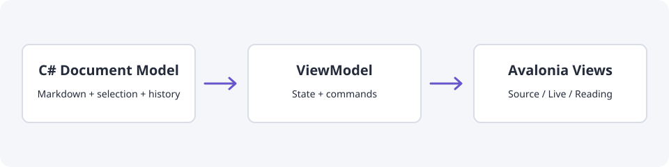

# Avalonia 跨平台之道：从 AXAML 到原生发布

Avalonia 为 .NET 桌面应用提供声明式布局、属性绑定、模板与跨平台渲染。本文以文档工作区为例说明职责划分；目标是 Windows、macOS 和 Linux 桌面，不涉及移动端布局。



## 把窗口拆成可以理解的视图

| 组件 | 负责什么 | 不应夹带的状态 |
| --- | --- | --- |
| 窗口外壳 | 标题栏、工作区与弹层组合 | Markdown 解析状态 |
| 文件面板 | 文件列表、搜索与关闭入口 | 编辑器撤销历史 |
| 文档工作区 | 视图切换与布局 | 原生控件的通用渲染算法 |
| Markdown 控件库 | 源码、即时、阅读与选择交互 | 产品菜单与文件策略 |

## 声明式布局与编译绑定

```xml
<UserControl xmlns="https://github.com/avaloniaui"
             xmlns:x="http://schemas.microsoft.com/winfx/2006/xaml"
             xmlns:vm="using:Demo.ViewModels"
             x:DataType="vm:DocumentViewModel">
  <Grid RowDefinitions="Auto,*" RowSpacing="8">
    <TextBlock Text="{Binding Title}" FontSize="18" />
    <TextBox Grid.Row="1" Text="{Binding Markdown, Mode=TwoWay}"
             AcceptsReturn="True" TextWrapping="Wrap" />
  </Grid>
</UserControl>
```

示例需要对应的 `DocumentViewModel`，并由宿主设置 `DataContext`。布局、模板和普通命令绑定优先放在 AXAML；业务状态留在 ViewModel。

## 一个菜单使用标准控件即可

```xml
<TextBox.ContextMenu>
  <ContextMenu>
    <MenuItem Header="复制" Command="{Binding CopyCommand}" />
    <MenuItem Header="选择全部" Command="{Binding SelectAllCommand}" />
  </ContextMenu>
</TextBox.ContextMenu>
```

菜单要检查中文和英文的行盒、图标槽、子菜单定位、键盘导航与窗口边缘约束。不要只看菜单能否打开，还要检查每一项是否完整可读。

## UI 线程与异步服务

`await` 完成后，更新绑定属性的代码需要遵循应用的 UI 调度约定。文件 IO、解析与布局各有边界；不要在每一帧 `LayoutUpdated` 中遍历整棵可视树来修补数据。

## Native AOT 不是最后一个复选框

```bash
dotnet publish Demo.csproj -c Release -r win-x64 -p:PublishAot=true
```

这条命令只是发布示例。完整验收还包括实际发布目录中的原生程序、四种语言资源、相对图片路径、图表渲染、设置持久化，以及源码与即时编辑中的选择、撤销和输入法。

- [ ] 窗口在不同桌面宽度下可用
- [ ] ContextMenu 和 Flyout 不越界、不截字
- [ ] 拆分窗格后所有格式命令仍可达
- [ ] win-x64 AOT 产物完成实际运行验收

官方参考：[Avalonia 文档](https://docs.avaloniaui.net/)、[Native AOT](https://learn.microsoft.com/dotnet/core/deploying/native-aot/)。
