# Mermaid 图表图鉴

## 流程图

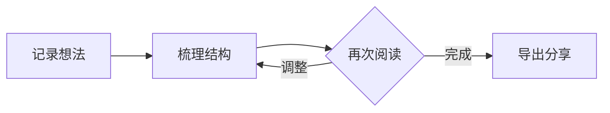


## 时序图

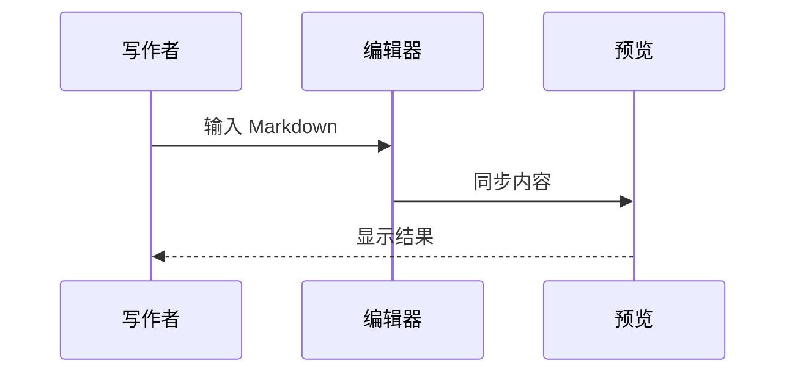


## 状态图

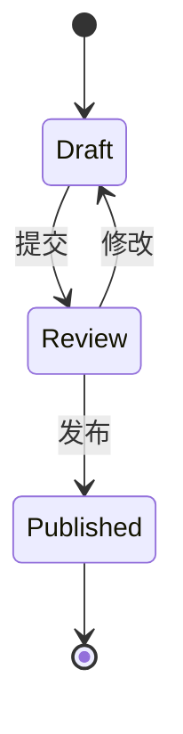


## 用户旅程图

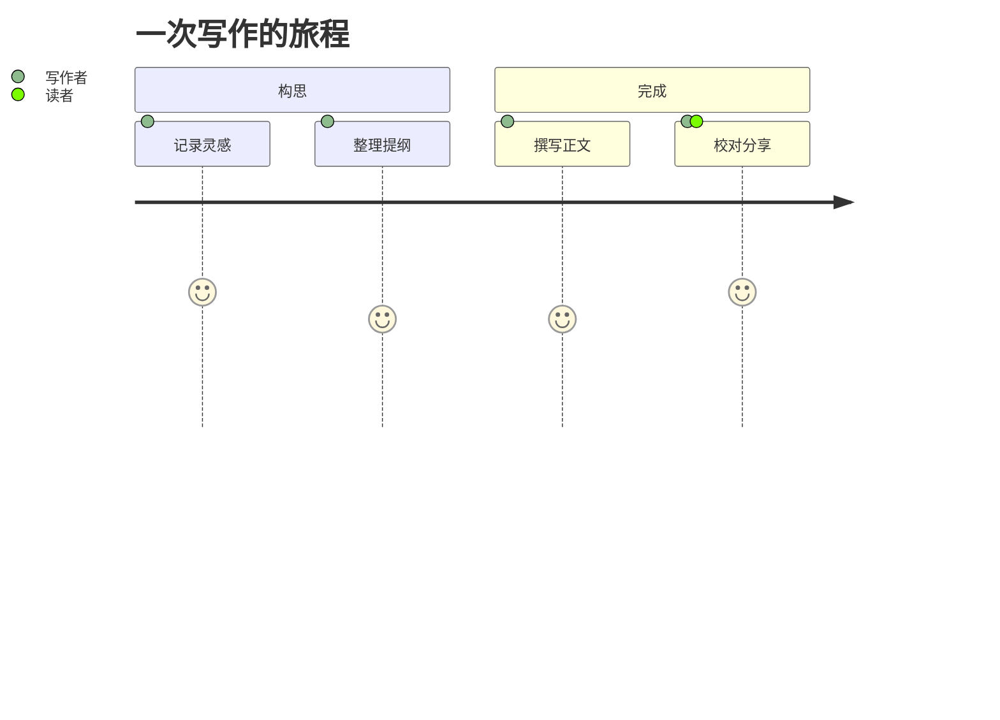


## 甘特图

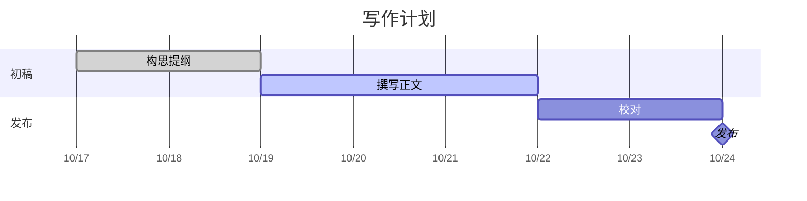


## 时间线

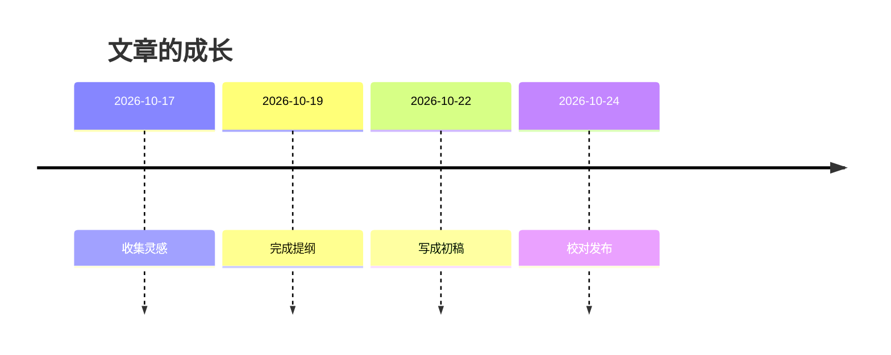


## Git 分支图

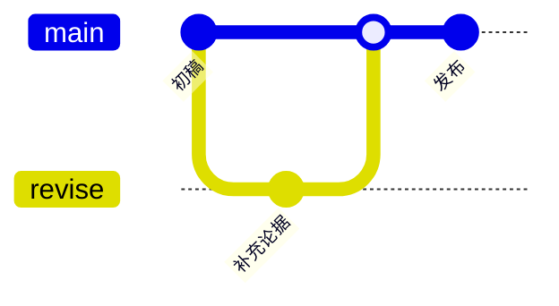


## 看板


## 类图

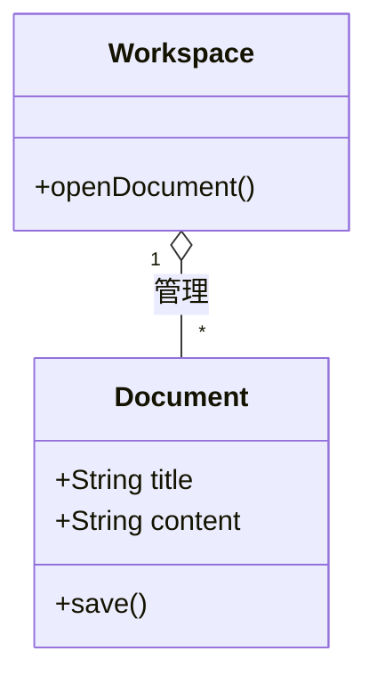


## 实体关系图

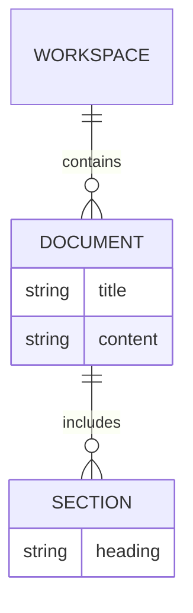


## 需求图

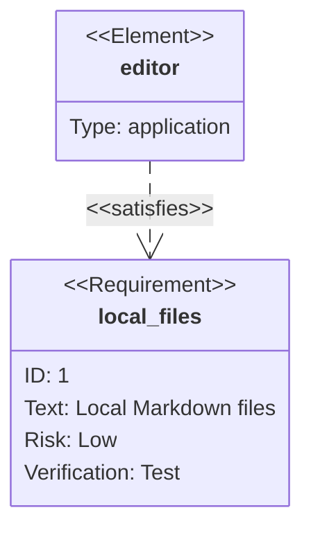


## 思维导图

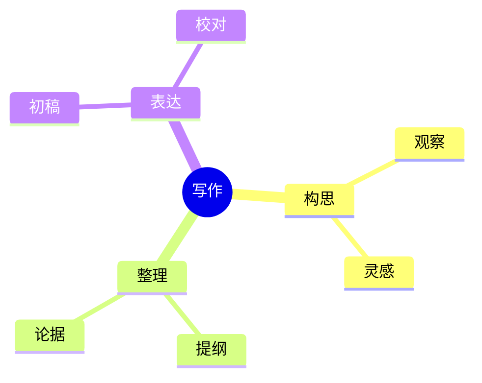


## 块图

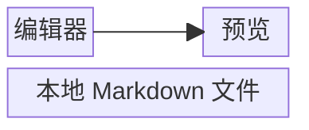


## C4 架构图

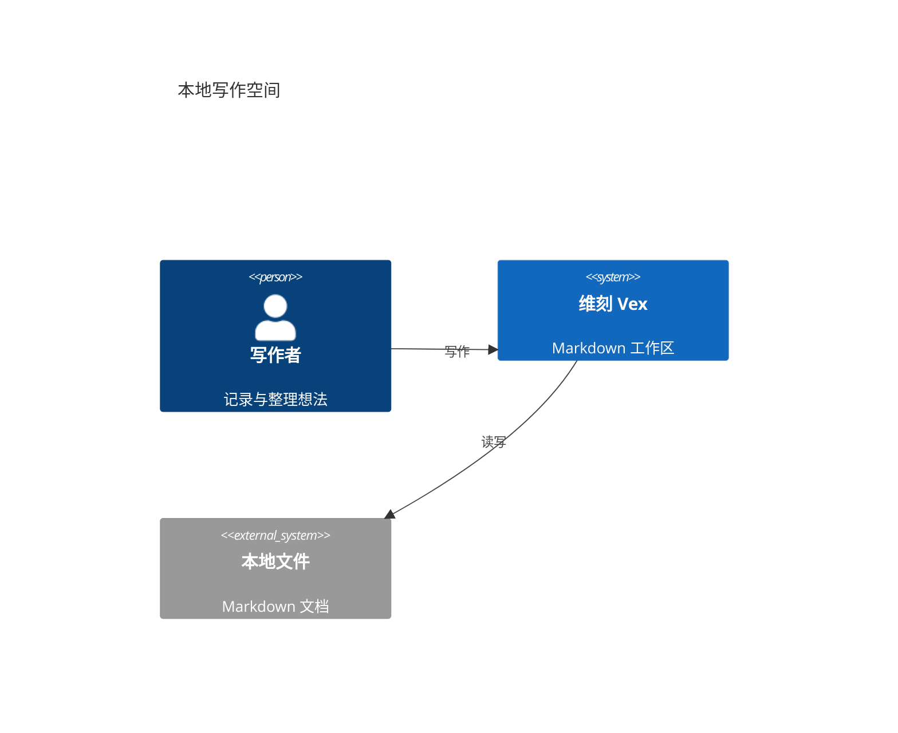


## 架构图

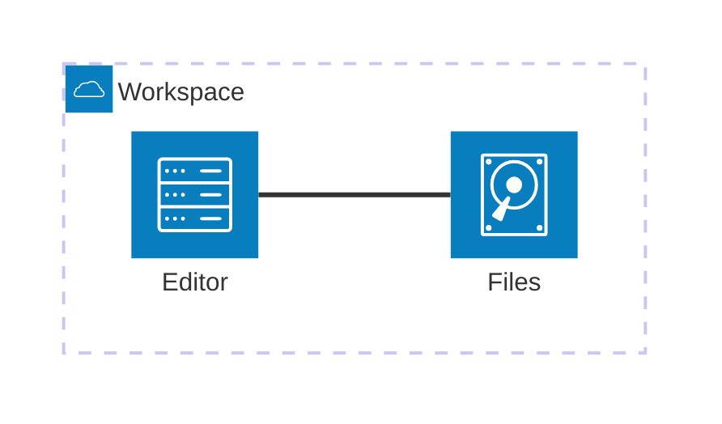


## 数据包图

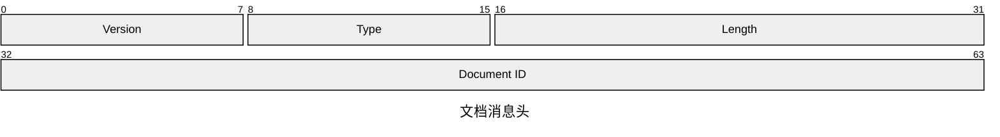


## 饼图

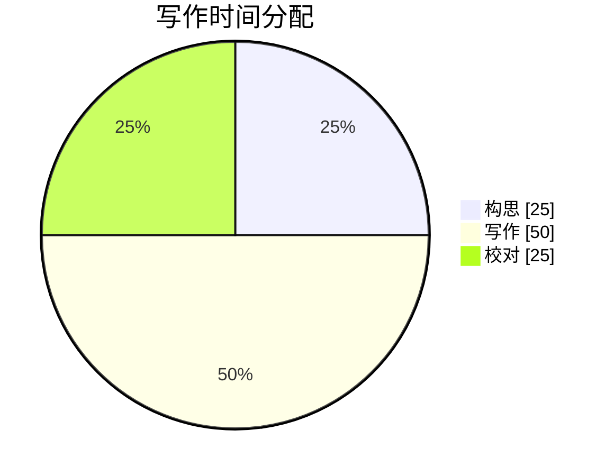


## 象限图

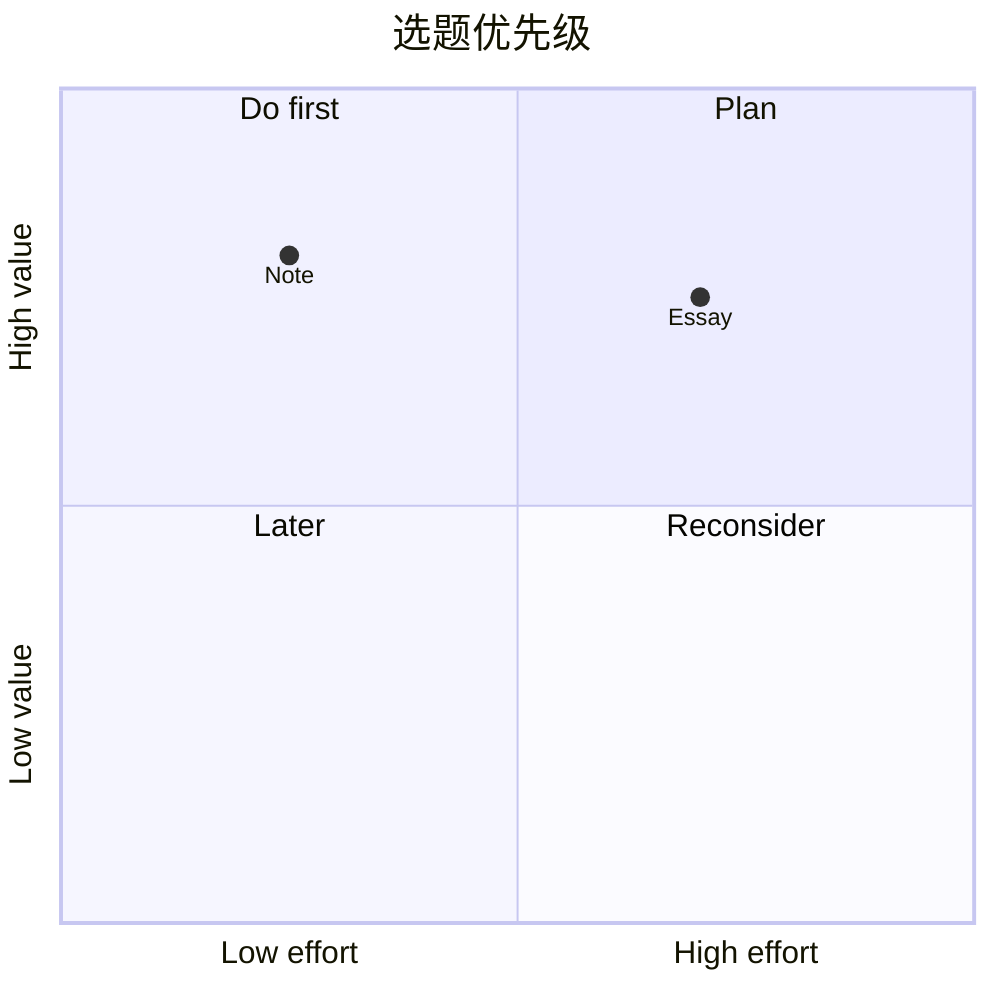


## XY 坐标图

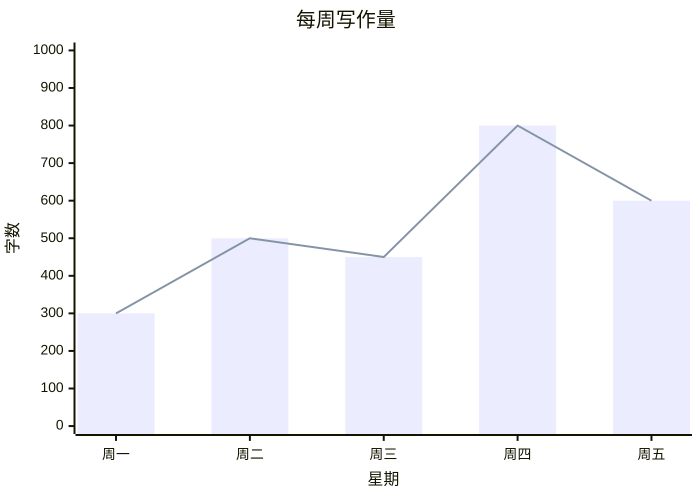


## 桑基图

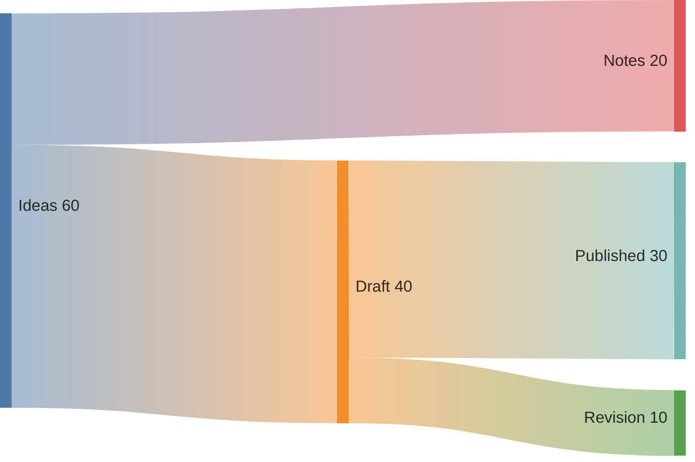


## 雷达图

```mermaid
radar-beta
  title "写作自评"
  axis clarity["清晰"], structure["结构"], detail["细节"], rhythm["节奏"]
  curve draft["初稿"]{3, 4, 3, 2}
  curve revised["修订"]{5, 4, 4, 4}
  max 5
```


## 矩形树图

```mermaid
treemap-beta
  "文章"
    "构思"
      "灵感": 20
      "提纲": 15
    "正文"
      "论述": 45
      "案例": 20
```


