# Mermaid 图表图鉴

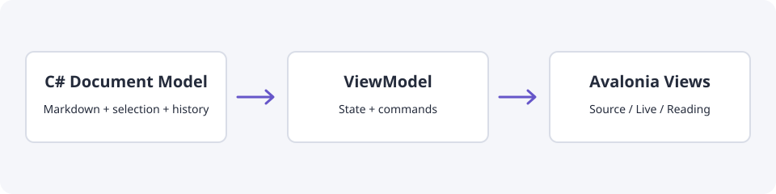

用图表说明 C# 对象、.NET 服务与 Avalonia 桌面交互，比把每个细节塞进一段话更容易阅读。本页收录当前渲染器支持的 24 类图表，每种保留一个可直接编辑的短示例。

源码与文档：<https://mermaid.js.org>

在源码视图查看原始 Mermaid，在即时编辑中修改代码，再切换阅读检查结果。示例中的日期、时间与数值都是教学数据，不代表产品性能。

## 流程图

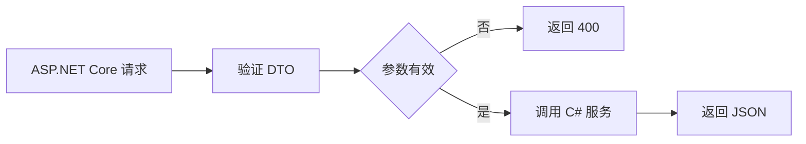


## 时序图

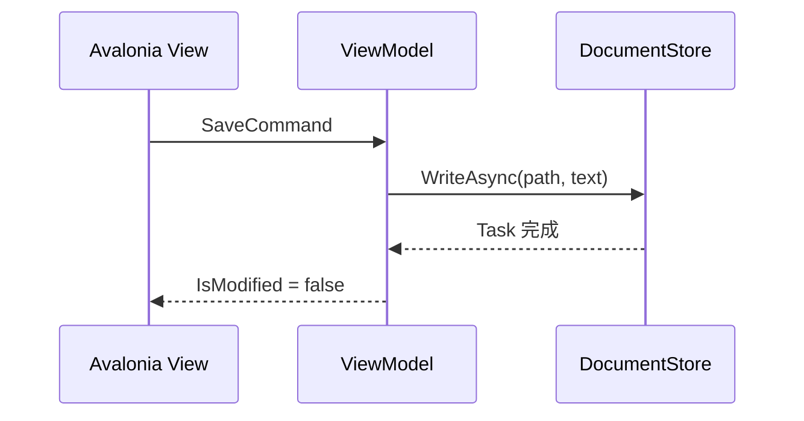


## 状态图

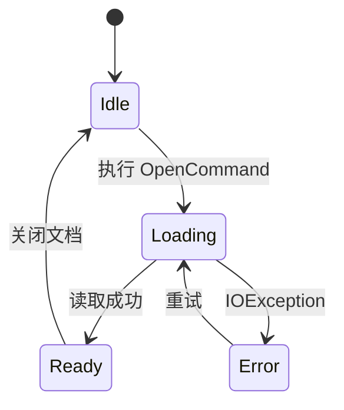


## 用户旅程图

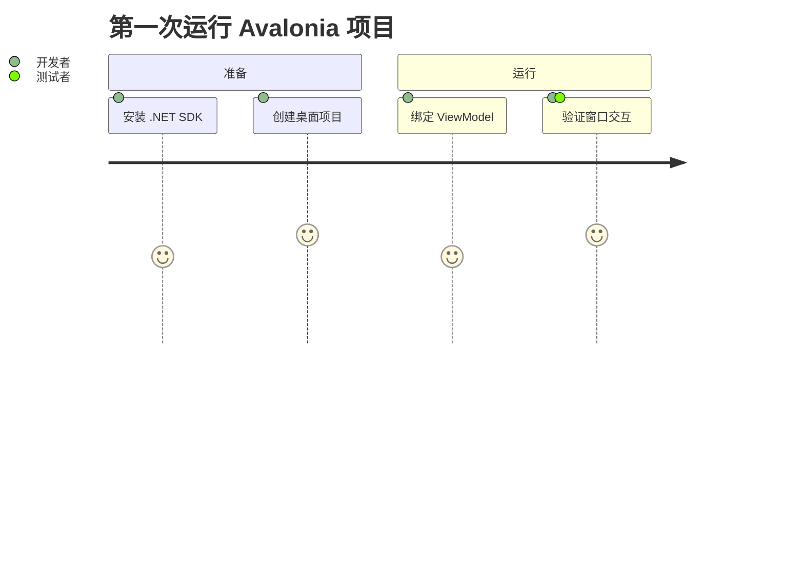


## 甘特图

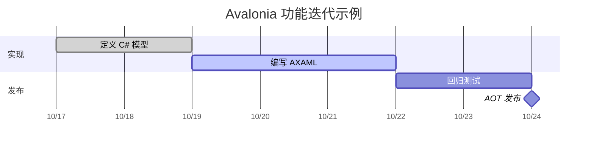


## 时间线

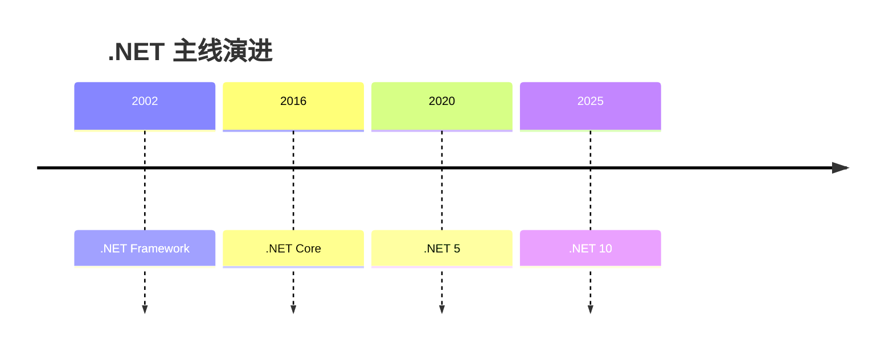


## Git 分支图

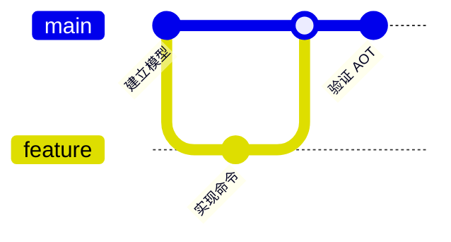


## 看板

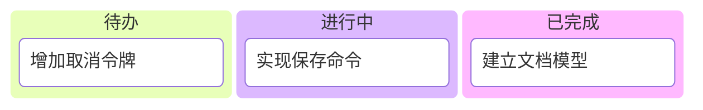


## 类图

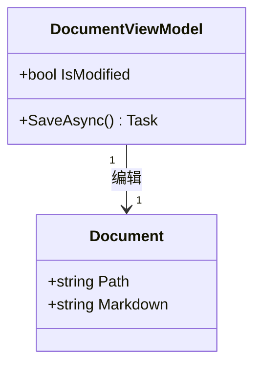


## 实体关系图

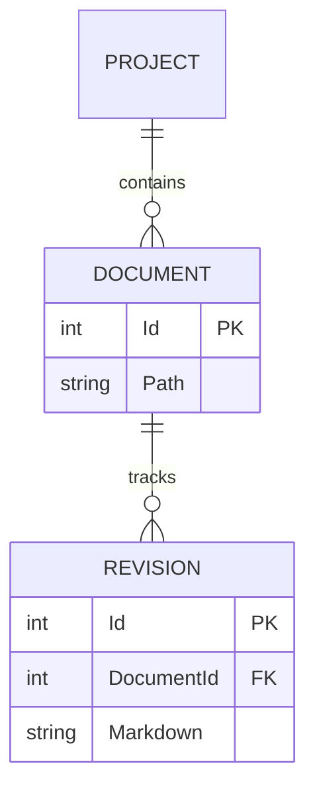


## 需求图

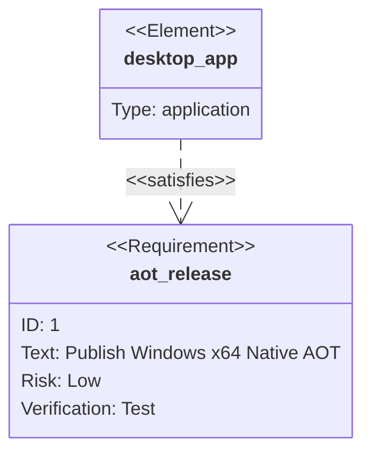


## 思维导图

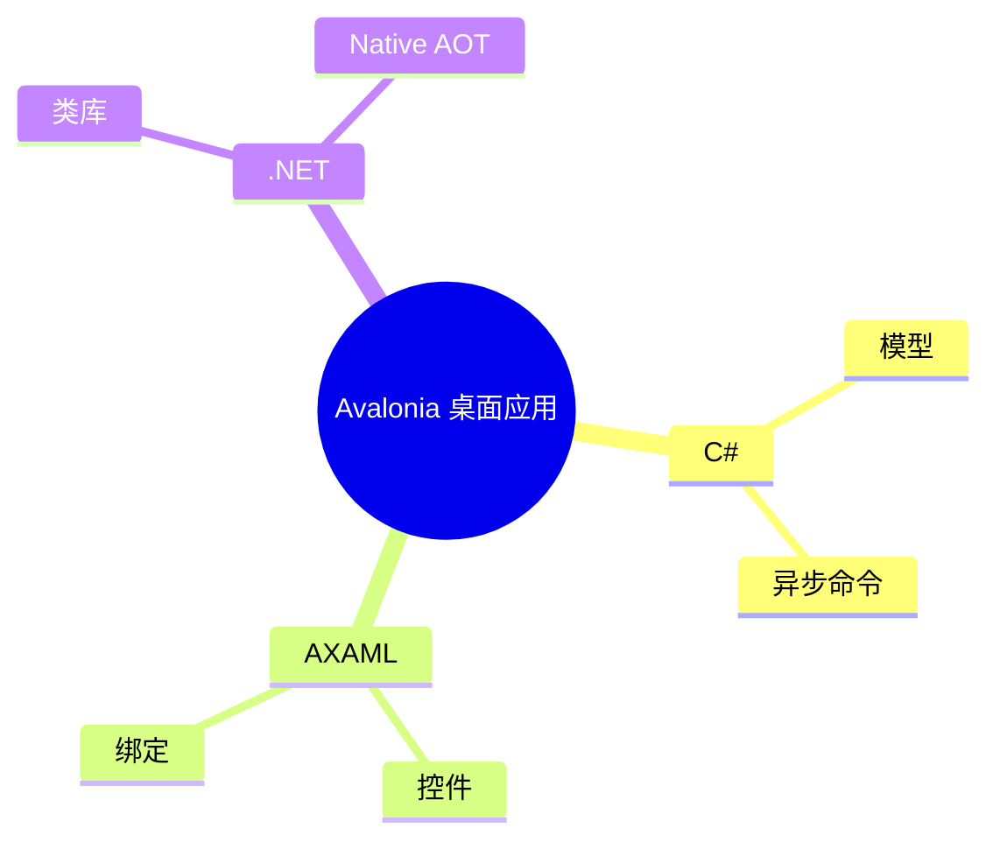


## 块图

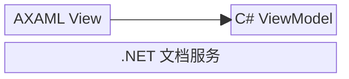


## C4 架构图

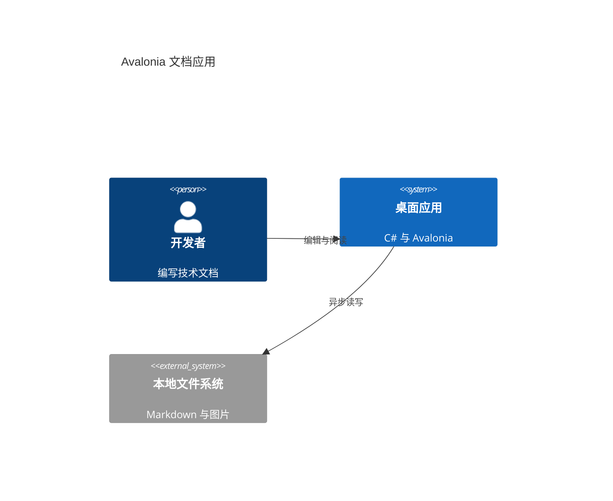


## 架构图

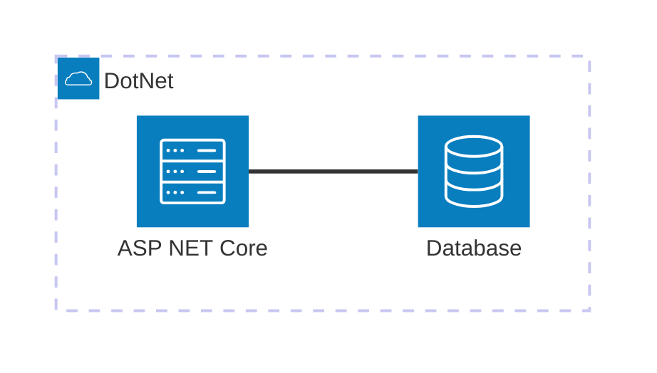


## 数据包图

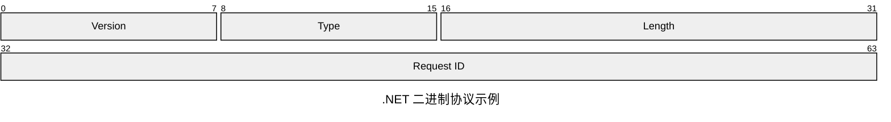


## 饼图

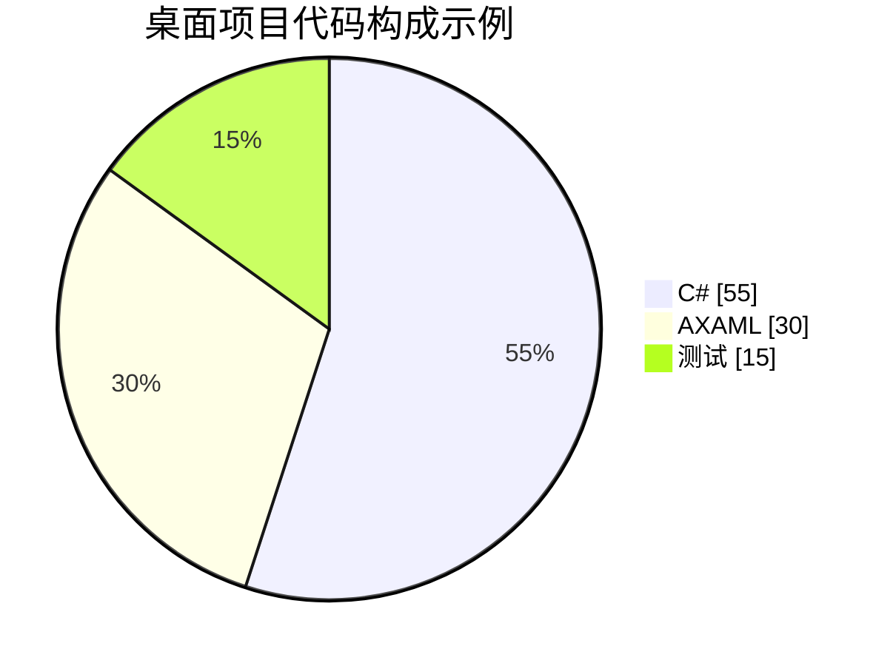


## 象限图

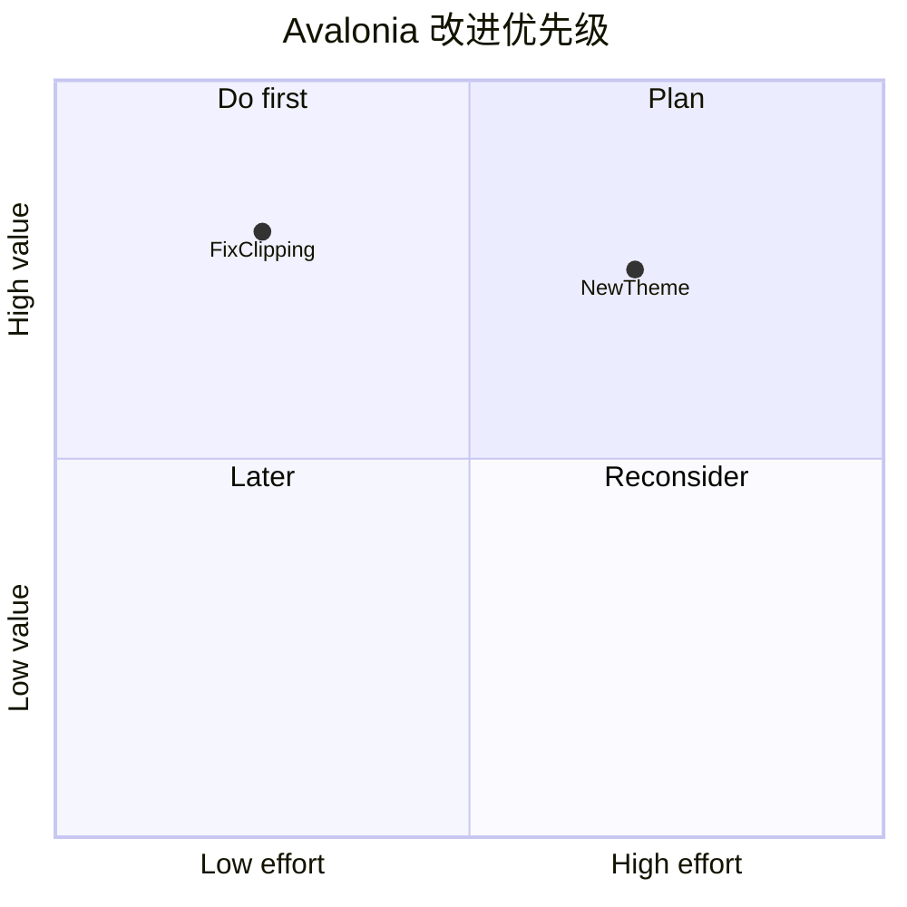


## XY 坐标图

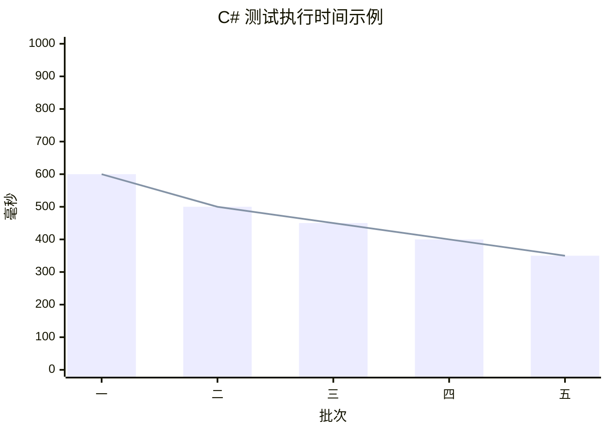


## 桑基图

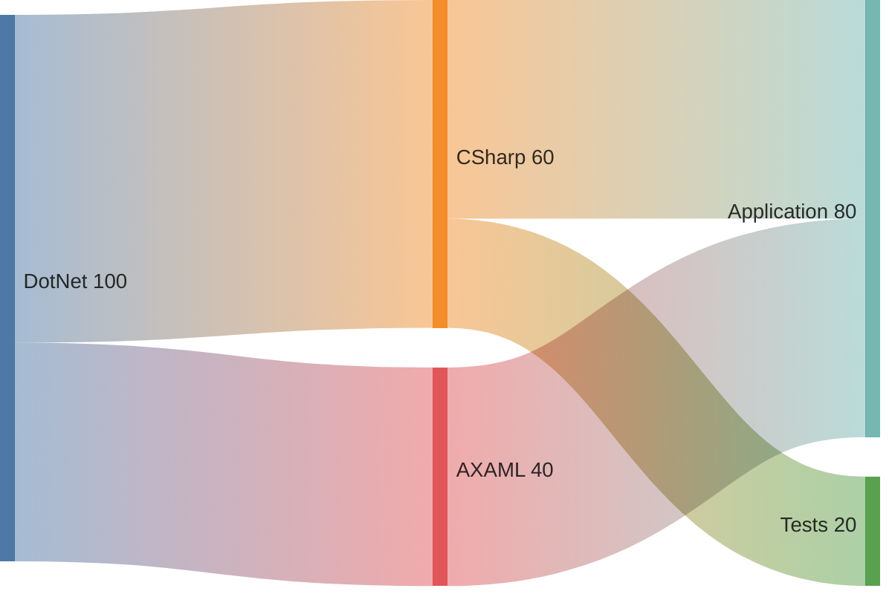


## 雷达图

```mermaid
radar-beta
  title "桌面交互评审示例"
  axis keyboard["键盘"], clarity["清晰"], layout["布局"], feedback["反馈"]
  curve before["修改前"]{3, 4, 3, 2}
  curve after["修改后"]{5, 4, 4, 4}
  max 5
```


## 矩形树图

```mermaid
treemap-beta
  "Avalonia 项目"
    "应用"
      "ViewModels": 25
      "Views": 20
    "基础设施"
      "Services": 30
      "Tests": 25
```

## 韦恩图

用交集说明技术职责：C# 承载逻辑，AXAML 描述视图，.NET 提供运行与类库能力。

```mermaid
venn-beta
  set A["C#"]
  set B["AXAML"]
  set C[".NET"]
  union A, B["Avalonia 应用"]
  union A, C["服务与模型"]
```

## 目录树

用一个最小桌面项目检查文件层级、文件名、注释与高亮。

```mermaid
treeView-beta
    AvaloniaNotes/
        Models/
            Document.cs
        ViewModels/
            MainWindowViewModel.cs :::highlight ## 状态与命令
        Views/
            MainWindow.axaml
        App.axaml
        Program.cs
        AvaloniaNotes.csproj
```

---

继续阅读 [.NET 历史与版本关系](.NET%20历史与版本关系.md)，或回到 [技术文档导航](主题设计笔记.md)。


