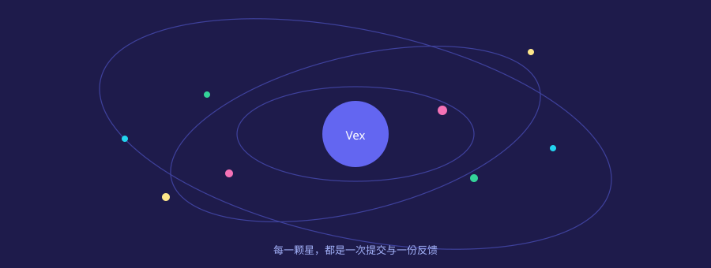

# 图文与链接

把想法写下来只是第一步；为它配上插图、注明出处、连向更远的地方，文章才算完整。本页集中演示图片与链接的各种形态。

## 一张图片的两种来历

矢量插图与位图照片各有分工：前者随缩放保持锐利，后者记录真实的光影。

## 链接的三种写法

行内链接最直接：[Avalonia 官网](https://avaloniaui.net) 一跳即达。

引用式链接让正文保持干净——多个位置引用同一出处时尤其好用，比如 [Vex 仓库][vex-repo] 与 [Avalonia 仓库][ava-repo]。

裸地址也会被自动识别：https://avaloniaui.net

  [vex-repo]: https://github.com/dotnet9/Vex "Vex 源码仓库"
  [ava-repo]: https://github.com/AvaloniaUI/Avalonia "Avalonia 源码仓库"

## 引用里也能再嵌套

> 图文并茂是好文章的表，
>> 而逻辑清晰是它的里。
> > 表里如一，读者自然愿意停留。

---

脚注用来安放那些「想说但会打断正文」的内容[^note]。多个脚注按出现顺序编号，点击编号可来回跳转。

[^note]: 这是脚注的正文。它通常用于补充说明、出处或题外话。
