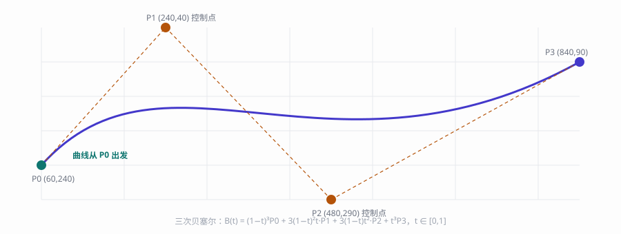

# 数学与化学

## 图形学的第一课：贝塞尔曲线

Vex 里圆角矩形、平滑笔迹、缓动动画，背后都是同一族多项式。三次贝塞尔曲线由四个控制点定义：

$$B(t) = (1-t)^3 P_0 + 3(1-t)^2 t P_1 + 3(1-t) t^2 P_2 + t^3 P_3, \quad t \in [0,1]$$

两个端点 $P_0$、$P_3$ 决定曲线的起止，两个控制点 $P_1$、$P_2$ 决定它「被拉向哪里」。上面的插图就是这个公式：蓝色曲线是结果，橙色虚线是控制多边形。

## 二维变换：一个矩阵搞定平移与旋转

把点绕原点旋转 $\theta$ 角，用的是同一个 $2\times2$ 矩阵：

$$R(\theta) = \begin{pmatrix} \cos\theta & -\sin\theta \ \sin\theta & \cos\theta \end{pmatrix}$$

界面上「先缩放、再旋转、后平移」的复合变换，在图形学里习惯扩成 $3\times3$ 齐次矩阵连乘——一次乘法即可表达整条变换链。

## 颜色空间的伽马校正

人眼对暗部更敏感，所以显示器存储颜色时做了一次幂运算（sRGB 标准约为 2.2）。线性空间与 sRGB 之间来回转换的公式：

$$L_{\text{srgb}} = L_{\text{linear}}^{1/2.2}$$

混色与光照计算必须在线性空间进行，否则高光会发灰——这正是「颜色插值」功能在内部多做一次转换的原因。

## 化学式也不缺席

Markdown 的 mhchem 扩展可以排版化学方程式。铁生锈：

$$4Fe + 3O_2 \rightarrow 2Fe_2O_3$$

咖啡因的分子式是 $\ce{C8H10N4O2}$， 写作时来一杯，思路会清晰一些——咖啡因通过拮抗腺苷受体延缓困意，这一机制由 Emil Fischer 在十九世纪末发现。

---

> 公式不是装饰：每一条都对应着界面上看得见的行为——圆角的曲率、水印的透明度、颜色插值的平滑过渡。
