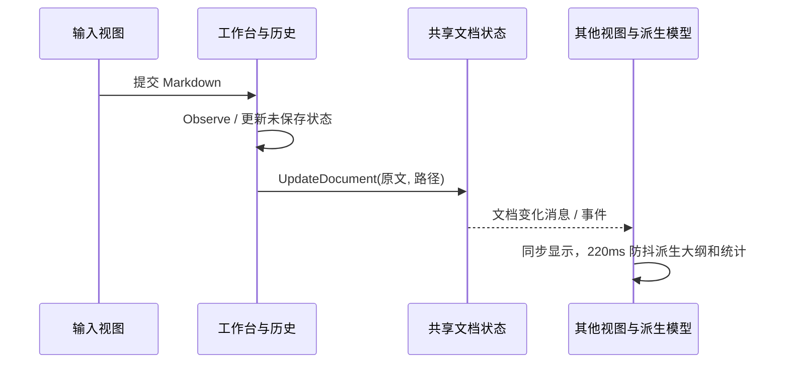

# Vex 详细设计

本文解释 1.7.2 当前代码的模型、调用链、状态规则和扩展位置。先读 [概要设计](概要设计.md) 理解边界；需求编号见 [需求文档](需求文档.md)。这里描述实现事实，未来改进和未经实机验证的能力不能直接写成保证。

## 1. 启动与依赖装配

1. [Program.cs](../src/Vex/Program.cs) 注册代码页编码提供器。带 `--verify-runtime <独立目录>` 时走隔离运行时验证，否则创建经典桌面应用。Skia 的 512MB GPU 缓存上限只是缓存配置，不是应用内存上限。
2. [App.Initialize](../src/Vex/App.axaml.cs) 初始化文件打开集成、高亮、自定义 Markdown 渲染、数学、Mermaid、HTML 表格和 JSON 语言插件，再载入应用资源。
3. `ConfigureModuleCatalog` 加入 Shell、Workspace、Appearance、Help；`RegisterTypes` 绑定接口、服务与 VM。主要文档和外观状态使用单例，让主窗口及分离窗口共享。
4. `CreateShell` 先应用保存的主题再解析 MainWindow，避免初始帧错误明暗。语言切换同步 Semi / Ursa 内置文案；库缺少的字典使用代码中的回退，不能据此宣称第三方所有文案均已翻译。

新增服务应同时检查接口、容器注册和调用方，不应仅在模块目录放入一个类。UI 更新使用 Dispatcher；不在后台事件中直接创建或修改 Avalonia 控件。

## 2. 核心模型与契约

| 类型 / 契约 | 数据或方法 | 约束 |
| --- | --- | --- |
| [DocumentSnapshot](../src/Vex/Core/Models/DocumentSnapshot.cs) | FilePath、FileName、Markdown、Encoding、IsNew | 一次文件读取 / 保存的文档快照；不是持久化历史数据库 |
| [IWorkspaceDocumentState](../src/Vex/Core/Services/IWorkspaceDocumentState.cs) | Markdown、FilePath、DocumentChanged、UpdateDocument | 当前原文和文件身份的共同来源 |
| [IDocumentService](../src/Vex/Core/Services/IDocumentService.cs) | CreateNew、OpenPathAsync、ReloadAsync、OpenFolderPathAsync、SaveAsync、TryAutoSaveAsync、SaveAsAsync、RenameAsync、DeleteAsync | 文件选择取消用空结果表达；异常交给工作流展示和保护 |
| [AppSettings](../src/Vex/Core/Models/AppSettings.cs) | 可空的类型化偏好字段 | 缺失值交默认策略处理；主动清空的文本与缺省区分 |
| [WorkspaceEditHistory](../src/Vex/Modules/Workspace/Services/WorkspaceEditHistory.cs) | Observe、BreakGroup、Undo / Redo、Capture / Restore | 多输入方式共用正文快照历史 |
| [OutlineItem](../src/Vex/Core/Models/OutlineItem.cs) / DocumentFileNode | 标题结构 / 文件树 | UI 派生模型，不反向成为正文存储 |

消息契约集中在 [Core/Messaging](../src/Vex/Core/Messaging)：`MarkdownTextChangedCommand` 表达编辑内容，`MarkdownDocumentChangedCommand` 同步文档，导航、选区查询和 Shell 动作使用各自类型。新增动作先区分查询、纯导航和正文修改，避免产生重复写入与历史记录。

## 3. 原文同步与撤销历史

[WorkspaceDocumentState.UpdateDocument](../src/Vex/Modules/Workspace/Services/WorkspaceDocumentState.cs) 仅在正文与路径都相等时跳过；路径按 `StringComparison.Ordinal` 比较，因此同内容的不同文件或大小写敏感路径仍会通知。更新后发布类型化消息和 `DocumentChanged` 事件，订阅者按自身职责选择，避免同一动作重复处理。

[MainWindowViewModel](../src/Vex/Modules/Shell/ViewModels/MainWindowViewModel.cs) 管理当前快照、磁盘保存基线和未保存保护；[ShellWorkbenchViewModel](../src/Vex/Modules/Shell/ViewModels/ShellWorkbenchViewModel.cs) 管理统一编辑历史及工作台状态。视图自己的选区、焦点与临时块编辑状态不替代共享原文。

历史采用全文快照：连续输入间隔超过 650ms、文本长度变化超过 32 字符或显式 `BreakGroup` 时增加撤销项；新编辑清除重做栈。撤销栈限制 200 项，按 UTF-16 文本估算约 16MB 并保留必要项，不等于总进程内存承诺。`Capture/Restore` 用于新手引导暂存，视图重建不能重置用户历史。

## 4. 编辑器、渲染与章节

### 4.1 源码和即时编辑

[MarkdownEditorView](../src/Vex/Modules/Workspace/Views/MarkdownEditorView.axaml.cs) 使用 AvaloniaEdit，处理选区、快捷动作、搜索和源文定位。[MarkdownInstantView](../src/Vex/Modules/Workspace/Views/MarkdownInstantView.cs) 将渲染块转为原位输入，`Ctrl+Enter` 提交本块，`Esc` 恢复本块进入前内容。视图切换必须提交或取消正在编辑的块，再切换输入器。

格式动作由 [EditorActionMapper](../src/Vex/Modules/Workspace/Services/EditorActionMapper.cs) 等服务转换，表格插入、模板和 HTML 粘贴转换分别有专用实现。异步剪贴板返回后要核验当前目标，不能把等待期间切换前的选区写进新文档。正文更新使用统一动作链，不能绕过历史直接改渲染控件。

[VexMarkdownRendering](../src/Vex/Modules/Workspace/Views/VexMarkdownRendering.cs) 对接共享 Markdown 引擎；数学、化学、图表、高亮、上下标、自动链接和软换行开关从偏好作用于渲染，不改原文。表格依据内容测量列宽，宽表局部滚动。水印由独立覆盖视图绘制，预览和导出开关分开。

### 4.2 章节与大纲

[MarkdownHeadingScanner](../src/Vex/Modules/Workspace/Services/MarkdownHeadingScanner.cs) 识别标题，处理代码围栏、YAML、Setext 等边界；[MarkdownChapterDocument](../src/Vex/Modules/Workspace/Services/MarkdownChapterDocument.cs) 按源码区间处理章节与子章。改名、正文、顺序、层级、拖动和删除最终生成新的 Markdown，并写入共享历史。不要按渲染节点顺序直接拼接文本，否则容易丢失换行、章节前言和围栏内容。

[ShellWorkbenchViewModel.Chapters](../src/Vex/Modules/Shell/ViewModels/ShellWorkbenchViewModel.Chapters.cs) 协调选章与章节表单；保存和关闭前处理尚未提交的表单。大纲、文章信息、章节详情共用右辅助栏，辅助页签也写入配置。文件和大纲搜索临时展示匹配项时不改用户折叠记录。

### 4.3 布局、分离窗口与演示

[WorkbenchLayoutOption](../src/Vex/Core/Models/WorkbenchLayoutOption.cs) 用 Editor / Render / Map 组合八种布局；[WorkspaceViewController](../src/Vex/Modules/Shell/Views/WorkspaceViewController.cs) 负责视图停靠和独立窗口。全局源码 / 即时编辑互斥，阅读与导图从同一原文派生；分离窗口不是新文档会话。

[Presentation 分部](../src/Vex/Modules/Shell/ViewModels/ShellWorkbenchViewModel.Presentation.cs) 和 [MarkdownPresentationDocument](../src/Vex/Modules/Workspace/Services/MarkdownPresentationDocument.cs) 负责章节演示。进入先捕获全文滚动锚点，再替换章节显示；退出先恢复全文，再恢复锚点，并取消过期的章节归零和光标定位任务。演示导航不修改正文。引导使用临时文档，结束后恢复原文、历史、布局、偏好和原有独立窗口。

## 5. 文件工作流与内容保护

### 5.1 打开与保存

[DocumentService](../src/Vex/Modules/Workspace/Services/DocumentService.cs) 识别四种文档扩展名。`OpenPathAsync` 用 StreamReader 检测 BOM 并保留编码；目录递归枚举在后台任务执行。打开、改名、删除、重载等动作由 Shell 协调，避免绕开未保存确认。

手动 `SaveAsync/SaveAsAsync` 使用 `File.WriteAllTextAsync`。写成功后才更新保存快照、文件身份和未保存标记；取消返回空结果，失败继续保留当前内容。当前不具备临时文件替换式事务，不能承诺系统断电下绝不损坏正式文件。

`TryAutoSaveAsync(document, lastSavedMarkdown)` 仅处理已有路径：排他打开磁盘文件 → 读取并比较上次保存基线 → 按原编码及 preamble 写入。文件锁或外部修改阻止覆盖。手动保存和自动保存并非相同的并发保护模型。

### 5.2 保护状态与外部变更

[ShellDocumentProtection](../src/Vex/Modules/Shell/ViewModels/ShellDocumentProtection.cs) 分开保存 SaveError、ExportError、DraftError、Recovery 与 External 状态。[MainWindowViewModel.Protection](../src/Vex/Modules/Shell/ViewModels/MainWindowViewModel.Protection.cs) 实现预览、确认、重试和清理：

| 事件 | 行为 | 不变量 |
| --- | --- | --- |
| 保存 / 导出失败 | 持续提示，提供独立重试 | 继续编辑不清错误，取消重试不显示成功；导出成功不标记原文已保存 |
| 发现外部文件变化 | 提示并提供双版本比较 | 用户选择保留、另存副本或载入；载入后可以撤销 |
| 恢复旧草稿 | 显示来源与全文，处理当前未保存内容 | 创建独立无原路径的未保存文档，不直接覆盖原文件 |
| 退出保留草稿 | 确认草稿实际落盘 | 写入失败继续保持窗口与正文 |

### 5.3 草稿存储

[AutoSaveDraftService](../src/Vex/Modules/Shell/Services/AutoSaveDraftService.cs) 默认启用，内容变化后约 1.5s 延迟写入 `LocalApplicationData/Vex/Drafts`。文件键由路径 SHA256（未命名使用固定身份）和当前进程 session GUID 组成，多个实例不会共用同一个草稿文件。

序列化使用源生成；先写 `.tmp`，再 `File.Move(..., overwrite:true)`。失败保留 pending 快照和 LastError，便于重试。列举其他会话恢复项时损坏数据不直接删除；清当前会话和清已恢复来源分别处理。它是故障恢复机制，不是正式文档备份或完整版本历史。

## 6. 配置与用户操作记忆

### 6.1 配置读写

[AppSettingsStore](../src/Vex/Core/Services/AppSettingsStore.cs) 通过 CodeWF.Toolkit.Files 的 `AppConfigHelper` 读写 XML，`Current` 使用进程内缓存。`Update(settings => settings with { 指定项 = 值 })` 在进程内锁中重新读取磁盘，再合并指定字段，减少旧实例退出时覆盖其他字段。此锁不跨进程，仍不保证两个进程同时写入的事务隔离。

共享 helper 按以下顺序解析实际配置文件：显式 `AppContext` 的 `APP_CONFIG_FILE` → 已存在的进程路径 `.config` → 已存在的同名 `.dll.config` → 默认进程路径 `.config`。应用未统一重定向到用户配置目录，测试宿主会显式设置独立路径。备份和排障应先确认实际文件及写权限，不应笼统断言配置总在 `%LOCALAPPDATA%`。

新增设置需同时补齐：`AppSettings` 字段、Store 读取与写入、默认值 / 范围、消费状态、UI 绑定和往返验证。`null`、空字符串和用户主动关闭要分清，不能用默认值覆盖有效选择。

### 6.2 文件和大纲折叠

[NavigationExpansionState](../src/Vex/Core/Services/NavigationExpansionState.cs) 使用完整路径归一化：Windows 转大写，其他系统保留大小写；键经过 `Uri.EscapeDataString` 转义，配置值由排序的独立行组成，集合按 Ordinal 比较，并非 JSON。

| 设置 | 身份 | 何时更新 |
| --- | --- | --- |
| CollapsedFolders | 规范化文件夹完整路径 | 用户主动折叠 / 展开目录 |
| CollapsedOutlineSections | 文档身份 + 标题祖先链、层级、标题及同名出现序号 | 用户主动折叠 / 展开文档结构 |
| FileListView / FileSortDescending | 全局导航偏好 | 切换树 / 列表或排序 |
| IsOutlineVisible / OutlineWidth / AuxiliaryTab | 辅助栏状态 | 用户显式调整显示、宽度和页签 |

大纲不用行号作为身份，所以在标题前新增正文不会直接丢失折叠选择；标题改名或结构变化可能形成新身份。搜索临时展开、重建模型、窗口变窄的临时隐藏均不得当成用户操作写回。

### 6.3 主要默认值

默认和约束集中在 [EditorPreferences](../src/Vex/Core/Services/EditorPreferences.cs) 及 Store。下表用于理解，不替代源码常量：

| 类别 | 默认与范围 |
| --- | --- |
| 文件 | 恢复工作区开；自动保存关，延迟 2s（2～60s）；恢复草稿开；新文件 UTF-8、系统换行 |
| 编辑 | 正文 16px（16～24），代码 12.5px（11～20），缩进 2（2～8），代码换行关，系统正文字体 |
| 渲染 / 图片 | 七项语法开关均开；复制图片和相对路径开；资源目录 `assets` |
| 显示 | 字数开；内容缩放 100%（50～200）；明暗、配色、正文排版各自持久化 |
| 导出 | 默认 HTML，导出后打开、HTML 样式开；预览 / 导出水印关，文字“维刻 Vex”，透明度 12（0～50）；PDF A4，边距 20（10～30） |
| MCP | 默认关闭，回环 127.0.0.1:17891，必须配置 Token |

## 7. 外观、语言与动效

[ThemeService](../src/Vex/Modules/Appearance/Services/ThemeService.cs) 从共享 `StudioPaletteCatalog` 选择 16 配色，经 `StudioThemeController` 应用；明暗模式为 system / light / dark。[EditorAppearanceState](../src/Vex/Modules/Appearance/Services/EditorAppearanceState.cs) 管理独立的 27 套正文排版及尺寸，通过 Changed 通知视图。UI 背景和正文白纸 / 暗纸使用不同语义资源，应用资源见 [StudioPalette.axaml](../src/Vex/Styles/StudioPalette.axaml)。

原型关键几何已进入实现：标题栏 32px、工作栏 58px、菜单 248px；即时正文最大 1280px，横留白按 6% 限制到 28～88px，多栏 36px；阅读区含留白最大 820px，横留白 48px、窄布局 36px。测量需明确 DPI 和截图尺寸，不能把逻辑像素直接当所有屏幕物理像素。

四语 JSON 和 [Language.tt](../src/Vex/I18n/Language.tt) 位于 `I18n`，生成 `Language.cs` 强类型映射。全局语言通知可能来自后台，外观菜单与排版面板转 UI 线程重建，脱离视图后跳过排队任务。不要手工维护生成映射造成两份真值。

[MotionResources](../src/Vex/Core/Motion/MotionResources.cs) 定义 140 / 220 / 260ms，关闭动效后归零。自研控件包的 `EntranceMotion` 为标题菜单提供纯淡入，为选择面板提供 -4px 位移和 .985 缩放，为对话框提供 9px 位移和 .99 缩放，曲线为 cubic(.2,.8,.2,1)；不逐帧改变布局属性。同一调度周期的可见性通知合并处理；隐藏、离树、关闭开关时取消任务并恢复基础值，解除全局订阅。增加浮层时需同时处理正常关闭、快速重开和窗口销毁。

## 8. 导出与更新

[MarkdownExportService](../src/Vex/Modules/Workspace/Services/MarkdownExportService.cs) 经共享库导出 Markdown / HTML / PDF / PNG / Word，文件选择取消返回空结果。导出使用当前正文和排版，图片按来源处理，但各格式分页、字体和复杂图表仍需实物复核。导出仅生成副本，不改变正式 Markdown 的保存基线。

[VexUpdateService](../src/Vex/Modules/Help/Services/VexUpdateService.cs) 与 [ShellUpdateViewModel](../src/Vex/Modules/Shell/ViewModels/ShellUpdateViewModel.cs) 负责查询、资产匹配、下载和 SHA256。浮层关闭可保留下载会话，重开复用状态。[WindowsUpdateInstaller](../src/Vex/Modules/Help/Services/WindowsUpdateInstaller.cs) 用具名事件等待安装窗口实际显示，成功后再请求应用退出；下载完成不代表已经安装。Linux / macOS 安装交互由系统处理。

## 9. MCP 请求执行链

[McpServerHost](../src/Vex/Modules/Mcp/Services/McpServerHost.cs) 使用 HttpListener，限制 127.0.0.1 / localhost / ::1；默认关闭，无 Token 不启动。端点 `/mcp/`，JSON-RPC 协议版本 2025-06-18。

请求经过 Bearer 鉴权 → 协议分发 → 静态工具 schema 和参数检查 → 文档 / 路径范围检查 → 必要确认 → 再核验当前文档和路径 → UI 线程执行 → 记录审计 → 返回结果。确认期间目标可能改变，不能只在弹窗前检查一次。偏移按 .NET UTF-16 字符串单元计算。

[McpToolDispatcher](../src/Vex/Modules/Mcp/Services/McpToolDispatcher.cs) 提供 29 个工具；[McpJsonContext](../src/Vex/Modules/Mcp/Serialization/McpJsonContext.cs) 为 AOT 提供序列化元数据。当前 UI 主题工具的枚举仍只覆盖 system / light / dark / aquatic / desert / dusk / night-sky，布局工具仍是布尔参数接口，不能推导已覆盖全部 16 配色和八布局 Key。

[McpOperationAuditService](../src/Vex/Modules/Mcp/Services/McpOperationAuditService.cs) 内存保留 100 条，磁盘 JSONL 超过 1MiB 轮转至 `.1.jsonl`。Token 存普通配置，审计、环境变量和备份都需脱敏。stdio 客户端经桥接脚本转换为 HTTP，完整参数、资源和连接示例统一维护在 [MCP 接口](MCP接口.md)，不在本设计中重复 schema。

## 10. 构建、安装与扩展检查表

[publish.ps1](../scripts/publish.ps1) 负责 NativeAOT 载荷，[package_linux_deb.ps1](../scripts/package_linux_deb.ps1)、[Vex.iss](../scripts/Vex.iss) 和 macOS 打包脚本负责系统格式。`PublishAot/PublishTrimmed` 开启，非单文件模式；编译器的单线程和 GC 选项不能当作应用运行时性能结论。

| 要修改的逻辑 | 推荐入口 | 必须复核 |
| --- | --- | --- |
| 增加编辑动作 | 消息 / EditorActionMapper / 编辑视图 | 选区、撤销、两个输入器、分离窗口 |
| 增加偏好 | AppSettings / Store / EditorPreferences / 设置 VM 和绑定 | 默认值、磁盘往返、部分更新、不改其他用户状态 |
| 增加配色或排版 | 共享库目录与 NuGet、本仓资源、原型资源目录 | Key 和数量、深浅对比度、纸面、HTML 样式及许可 |
| 增加文件动作 | IDocumentService / Shell 工作流 | 未保存保护、取消、锁定、外部修改、实际成功后才更新身份 |
| 增加 MCP 工具 | Dispatcher 静态 schema / Context / 确认与审计 | 鉴权、范围、确认后目标复核、UI 线程、错误结果 |
| 修改安装器 | 生产入口 / 资源 / 来源清单 | 来源哈希、契约、隔离夹具、对应系统原生验收 |

具体命令、故障定位和输出目录见 [开发与验证](开发与验证.md)。验证层次、性能数字和真实系统缺口只维护在 [验收与已知限制](验收与已知限制.md)，避免设计文档中的历史结论持续失真。

通用入场动画、水印绘制和同行等高面板由 `CodeWF.Avalonia.Controls` 提供。Vex 通过 NuGet 引用，原型动效参数在 `WorkbenchStyles.axaml` 配置，水印主题绑定和排版选择业务留在应用内。
